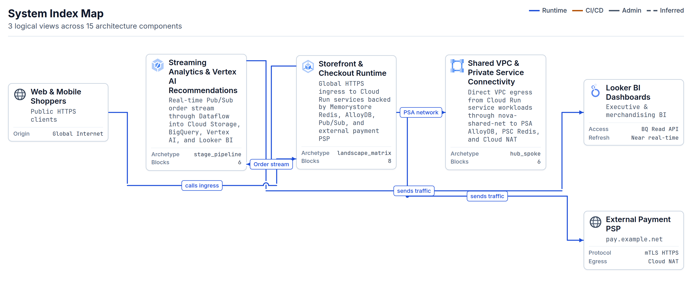
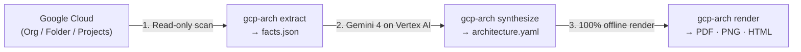
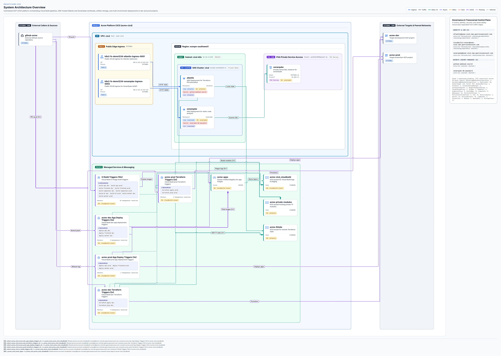
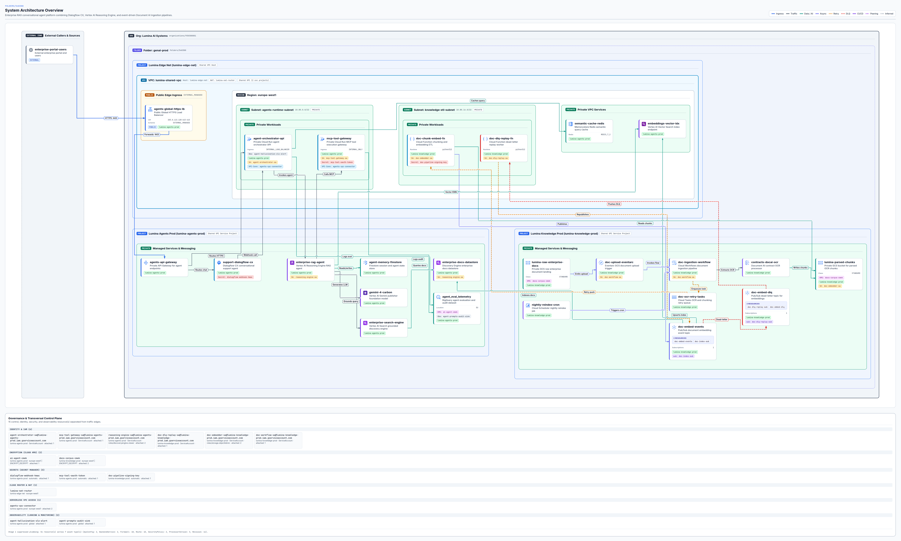
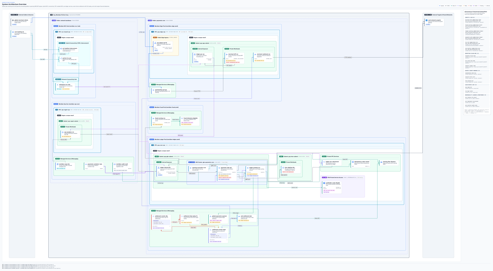
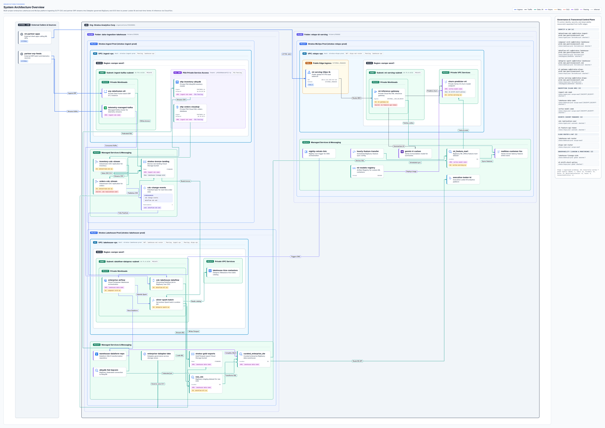

<div align="center">

# gcp-arch

**Turn live Google Cloud environments into clean, presentation-ready architecture diagrams — automatically, safely, and tracked in Git.**

[](https://arrase.github.io/gcp-arch/)
[](https://github.com/arrase/gcp-arch/releases)
[](https://go.dev/)

[](https://sonarcloud.io/summary/overall?id=arrase_gcp-arch)
[](https://sonarcloud.io/summary/overall?id=arrase_gcp-arch)
[](https://sonarcloud.io/summary/overall?id=arrase_gcp-arch)
[](https://sonarcloud.io/summary/overall?id=arrase_gcp-arch)
[](https://sonarcloud.io/summary/overall?id=arrase_gcp-arch)
[](https://sonarcloud.io/summary/overall?id=arrase_gcp-arch)
[](https://sonarcloud.io/summary/overall?id=arrase_gcp-arch)
[](https://sonarcloud.io/summary/overall?id=arrase_gcp-arch)
[](https://sonarcloud.io/summary/overall?id=arrase_gcp-arch)
[](https://sonarcloud.io/summary/overall?id=arrase_gcp-arch)
[](https://sonarcloud.io/summary/overall?id=arrase_gcp-arch)

[Documentation](https://arrase.github.io/gcp-arch/) · [Quick Start](#quick-start) · [Example Gallery](#example-gallery) · [Releases](https://github.com/arrase/gcp-arch/releases)

<br>

<a href="https://arrase.github.io/gcp-arch/examples/">
  
</a>

*Generated automatically from GCP metadata — multi-project Shared VPC, Cloud Run, AlloyDB, Pub/Sub, Dataflow, BigQuery & Vertex AI.*

</div>

---

## Why `gcp-arch`?

Cloud architecture diagrams go stale the day they are drawn, while raw infrastructure exports dump hundreds of low-level routes and rules onto an unreadable canvas.

`gcp-arch` bridges the gap with a single static CLI binary:

| | |
| :--- | :--- |
| **Real infrastructure, zero guesswork** | Scans live projects, folders, and organizations in read-only mode — capturing real topology, IAM, GKE, CI/CD, and runtime traffic. |
| **Multi-view clarity** | Produces an executive **System Overview** plus focused detail views, collapsing noisy plumbing and separating IAM, KMS, and Secrets into a governance sidebar. |
| **Git-tracked source of truth** | Compiles your cloud into a clean, readable `architecture.yaml` you can review in Pull Requests and enrich with your own titles and notes. |
| **Effortless Day-2 updates** | Re-run with `--reconcile` as your environment evolves — human edits are preserved, and unchanged topologies complete locally with zero AI calls. |
| **Export anywhere, 100% offline** | Renders vector **PDF** reports (one page per view), crisp **Retina PNGs** ready for Google Docs/Slides, and self-contained **HTML** dossiers. |
| **Safe by design** | Strictly read-only target scanning, zero secret values collected, and Vertex AI synthesis billed separately to your own project. |

---

## How It Works



1. **[Extract](https://arrase.github.io/gcp-arch/extraction/)** — Collects sanitized, read-only metadata and runtime signals from your GCP scopes into a local `facts.json` file.
2. **[Synthesize](https://arrase.github.io/gcp-arch/synthesis/)** — Builds a structured containment skeleton and annotates it with Gemini 4 on Vertex AI to produce a Git-tracked `architecture.yaml` with full resource conservation.
3. **[Render](https://arrase.github.io/gcp-arch/rendering/)** — Turns `architecture.yaml` into print-ready **PDF**, **Retina PNG**, and standalone **HTML** deliverables completely offline — no cloud credentials or `facts.json` needed.

---

## Quick Start

### 1. Install

Download a pre-built binary for Linux, macOS, or Windows from [GitHub Releases](https://github.com/arrase/gcp-arch/releases):

```bash
# Example: Linux amd64
curl -fL "https://github.com/arrase/gcp-arch/releases/latest/download/gcp-arch-linux-amd64" -o gcp-arch
chmod +x gcp-arch
```

Or build from source (requires **Go 1.26+**):

```bash
git clone https://github.com/arrase/gcp-arch.git
cd gcp-arch
CGO_ENABLED=0 go build -o ./bin/gcp-arch ./cmd/gcp-arch
```

### 2. Authenticate

Sign in with Google Cloud Application Default Credentials:

```bash
gcloud auth application-default login
```

> **Prerequisites:** Read-only access (`roles/cloudasset.viewer`) on your target GCP scope, `roles/aiplatform.user` on a Vertex AI project for synthesis, and local Chrome/Chromium for PDF/PNG export (HTML works standalone). See [Security & IAM](https://arrase.github.io/gcp-arch/security_iam/) and [CLI & Configuration](https://arrase.github.io/gcp-arch/cli_configuration/) for details.

### 3. Generate Your First Architecture

```bash
# Check permissions and Vertex AI readiness
gcp-arch preflight --projects my-gcp-project --vertex-project my-vertex-project

# 1. Extract read-only cloud metadata
gcp-arch extract --projects my-gcp-project -o facts.json

# 2. Synthesize a multi-view architecture manifest
gcp-arch synthesize facts.json --vertex-project my-vertex-project -o architecture.yaml

# 3. Render PDF, Retina PNGs, and standalone HTML offline
gcp-arch render architecture.yaml -o out/
```

### 4. Keep Diagrams Updated (Day 2)

After your team edits titles, subtitles, or notes in `architecture.yaml`, sync infrastructure changes without losing manual curation:

```bash
gcp-arch extract --projects my-gcp-project -o facts.json
gcp-arch synthesize facts.json --reconcile architecture.yaml --vertex-project my-vertex-project
gcp-arch render architecture.yaml -o out/
```

---

## Example Gallery

Explore **6 complete multi-view reference architectures** (20 rendered views spanning 49 Google Cloud APIs) in [`examples/`](examples/README.md) or browse the full [Examples & Visual Gallery](https://arrase.github.io/gcp-arch/examples/).

| Platform CI/CD & GKE DevOps | Agentic AI & Document RAG |
| :---: | :---: |
| [](examples/platform-cicd/) | [](examples/agentic-ai-document-platform/) |
| Cloud Build cohorts, GKE workloads, PSA Cloud SQL & multi-env deploys | Vertex AI Agent Engine, Vector Search, Dialogflow CX, Document AI & Eventarc |

| Global FinTech Payments | Enterprise Lakehouse & MLOps |
| :---: | :---: |
| [](examples/fintech-global-payments/) | [](examples/enterprise-lakehouse-mlops/) |
| Hybrid NCC transit, PSC fabrics, Private GKE, Spanner, AlloyDB & Bigtable | Managed Kafka, Datastream CDC, Composer, Dataflow, Dataproc, BigQuery & Vertex AI |

Plus **[Retail Cloud-Native](examples/retail-cloud-native/)** *(shown above)* and **[Multi-Region Zero-Trust Mesh](examples/enterprise-zero-trust-mesh/)**.

---

## Documentation

Full technical guides, flag references, IAM matrices, schema specifications, and internals live in the **[GCP Arch Documentation](https://arrase.github.io/gcp-arch/)** (source in [`gh-pages/`](gh-pages/)).

| Guide | What You'll Find |
| :--- | :--- |
| **[CLI & Configuration](https://arrase.github.io/gcp-arch/cli_configuration/)** | All five subcommands, flags, `~/.config/gcp-arch/config.yaml`, Chrome auto-discovery, and exit codes |
| **[Security, IAM & Preflight](https://arrase.github.io/gcp-arch/security_iam/)** | Minimum read-only IAM roles, credential isolation, secret scrubbing, and preflight checks |
| **[Stage 1 — Read-Only Extraction](https://arrase.github.io/gcp-arch/extraction/)** | Cloud Asset Inventory, IAM, GKE, Cloud Build, Cloud Monitoring, BigQuery & Dataflow discovery |
| **[Stage 2 — Synthesis & Day-2](https://arrase.github.io/gcp-arch/synthesis/)** | Containment skeleton, Vertex AI Gemini 4 annotation, conservation guarantees, and `--reconcile` |
| **[Stage 3 — Offline Rendering](https://arrase.github.io/gcp-arch/rendering/)** | Nested layouts, orthogonal routing, embedded fonts & 85 icons, PDF/PNG exports, and geometry verification |
| **[Manifest Schema & Validation](https://arrase.github.io/gcp-arch/manifest_schema/)** | `architecture.yaml` (`v1`) schema, offline PR CI checks, and Day-2 curation guide |
| **[Examples & Visual Gallery](https://arrase.github.io/gcp-arch/examples/)** | Walkthrough of all 6 reference bundles and 20 high-DPI diagrams |
| **[System Architecture](https://arrase.github.io/gcp-arch/architecture/)** & **[Developer Guide](https://arrase.github.io/gcp-arch/developer_guide/)** | Package map, design specification, local testing, linting, and release workflow |

