# Semantic Multi-View GCP Architecture Pipeline (`gcp-arch`)

*   **Author:** Juan Ezquerro LLanes
*   **Status:** Implemented
*   **Date:** 2026-11-27

--------------------------------------------------------------------------------

## Overview

`gcp-arch` is a standalone static Go (`go 1.26.11` in [go.mod](../../go.mod), `CGO_ENABLED=0`) CLI tool for cloud engineers and consultants who generate Google Cloud Platform (GCP) architecture deliverables — vector `.pdf` reports (1:1 per-view pagination), adaptive up to `2.0x` Retina `.png` images for Google Docs, and self-contained offline `.html` dossiers — from a Git-tracked `architecture.yaml` manifest.

The codebase is organized into six focused internal packages ([internal/atomicfile](../../internal/atomicfile), [internal/extract](../../internal/extract), [internal/icons](../../internal/icons), [internal/manifest](../../internal/manifest), [internal/synth](../../internal/synth), and [internal/render](../../internal/render)) orchestrated by five CLI subcommands (`preflight`, `extract`, `synthesize`, `validate`, `render`) in [cmd/gcp-arch](../../cmd/gcp-arch), plus an end-to-end verification suite in [e2e](../../e2e):

1.  **Stage 1 (`extract` -> `facts.json`, [internal/extract](../../internal/extract)):** Streams read-only Cloud Asset Inventory (CAI) resources and IAM policies (`<= 80` RPM), GKE `Ingress`/`Service`/workload/Workload-Identity chains, in-stream CAI Cloud Build triggers and top-`N` succeeded build step refs, 7-day Cloud Monitoring runtime traffic (preserving 22 data-plane reads while filtering control-plane discovery and synthesizing Vertex AI `PublisherModel` metrics), 7-day BigQuery SQL job lineage, active Dataflow job lineage, and structural/private-IP references into a closed, allowlist-scrubbed `v3` `facts.json` (`0600`, gitignored).
2.  **Stage 2 (`synthesize` -> `architecture.yaml`, [internal/synth](../../internal/synth), [internal/manifest](../../internal/manifest)):** Runs a unified three-part pipeline over `<= 500` active resources:
    *   **Stage 2A (Deterministic Go Containment Skeleton):** Applies 5 deterministic 1:1 plumbing folds, groups homogeneous workload/trigger cohorts with 100% member retention, builds an unlimited-depth containment hierarchy (`Org > Folder > Project > VPC > Region > Subnet > ExposureZone / GKE / PSA / Hybrid / SharedHub / External`), separates 12 transversal asset types across 7 governance categories into card chips and governance items, bridges orphan nodes via `INFERRED` edges, breaks cycles via Tarjan SCC, and computes longest-path `TopoRank` + 3-pass barycenter `SubRank`.
    *   **Stage 2B (Single Bounded Vertex AI Gemini 4 Annotator):** Uses the official Google GenAI Go SDK (`google.golang.org/genai`, `BackendVertexAI`, `gemini-4-carbon`, `location=global`, `Temperature=0.1`, structured `*genai.Schema`, billed to `--vertex-project`) to emit **only** `focus_summary`, stage-partitioned detail views (`view_1..view_3`), node subtitles, and edge `verb`/`flow_kind`/`semantic_tag`. Go locks all node IDs, canonical titles, containment hierarchy, ranks, view IDs, and symmetric cross-view `off_page_refs`.
    *   **Stage 2C (Deterministic Conservation & Validation Gate):** Enforces `ValidateWithFactsAndConservation` (`VerifyConservation` + `ValidateWithFacts`), verifying 0 missing/hallucinated primary URIs, 0 missing functional/transversal edges, 100% `View 0` component coverage (`view0=1.00`), and non-heuristic directed-walk `VERIFIED` edge provenance.
3.  **Stage 3 (`render` -> `.pdf`, Retina `.png`, `.html`, [internal/render](../../internal/render), [internal/icons](../../internal/icons)):** Renders `architecture.yaml` completely offline (zero network calls, zero `facts.json` dependency) using 6 embedded `.woff2` fonts (`Inter`, `JetBrains Mono`) and 85 inline SVG `<symbol>` service icons. Renders unlimited-depth nested Flexbox containers (`layered_flow` and legacy archetypes) with a responsive transversal governance panel (`.dock-bottom` / `.wide-gov`), routes edges via an in-page DOM-measured Hanan-grid A* orthogonal router ([internal/render/assets/router.js](../../internal/render/assets/router.js)) with eager bus trunk bundling, horizontal jumper bridges, fan-in/fan-out pill bundling, and zero-collision checks, then exports 1:1 per-view vector `.pdf`, adaptive up to `2.0x` Retina `.png` (`8,192px` max dim / `28M` px cap), and standalone `.html` via a single isolated headless Chrome/Chromium session (`chromedp`), with automatic `< 1 MB` RAM streaming scanline PNG pixel and geometry verification on every PNG render.

---

## Goals & Non-Goals

### Goals

*   **Collector Isolation:** Stage 1 (`internal/extract/`, `cmd/gcp-arch/extract.go`, `cmd/gcp-arch/preflight.go`) stays decoupled; synthesis consumes `extract.FactsFile` (`v3`) cleanly at the `LoadFacts` boundary.
*   **Closed, Allowlist-Scrubbed Multi-Project `v3` Fact Extraction:** Produce a deterministic `0600` `facts.json` within `<= 80` CAI RPM using official Google Go SDKs (`cloud.google.com/go/asset`, `cloud.google.com/go/monitoring`, `cloud.google.com/go/auth`, `cloud.google.com/go/iam`, `google.golang.org/api`, `google.golang.org/genai`), strict 75-type attribute allowlisting, canonical AIP-122 URIs, authoritative PSA tenant detection, and strict edge endpoint closure (`resources[]`).
*   **Full-Depth Hierarchy, Transversal Separation & Deterministic Conservation:** Support unlimited containment depth, consistent left-to-right traffic/data flow, semantic separation of IAM, Service Accounts, KMS, Secrets, Observability, Cloud NAT/Routers, VPC Access Connectors, and Firewall/Cloud Armor into card badges and dedicated governance panels, `<= 500` active resources, 100% resource/edge conservation (`VerifyConservation`), non-heuristic non-shortcutting `VERIFIED` walks, and `< 5 ms` `0`-LLM Day-2 `--reconcile` idempotence.
*   **High-Resolution Offline Rendering & Automated Pixel/Geometry Verification:** Render `architecture.yaml` offline with zero `text-overflow: ellipsis`, zero card/header/wire/pill/text collisions (`*render.LayoutCollisionError`), adaptive up to `2.0x` Retina PNGs bounded under Chrome Skia bitmap limits, and automatic streaming scanline PNG verification (`*render.GeometryReportError`).
*   **Live & Regression Verification:** Verify end-to-end against live Vertex AI and headless Chrome across the 10-fixture complexity catalog (`testdata/catalog/`) and offline streaming PNG checks across all 6 reference bundles (`examples/`).

### Non-Goals

*   **Local IaC Parsing:** Parsing local `.tf` HCL files, remote Terraform modules, or `*.tfstate` files.
*   **Secret or Data Payload Inspection:** Reading Secret Manager payloads, Kubernetes `Secret`/`ConfigMap` data values into output artifacts, Cloud Storage object bytes, or BigQuery table rows.
*   **Legacy Formats or Interactive Editors:** Generating `.drawio`, Excalidraw, standalone `.svg`, or an interactive browser canvas editor.

---

## Architecture & Pipeline Topology

```mermaid
flowchart LR
    GCP["Live GCP Scopes (CAI, IAM, Monitoring, BigQuery, Dataflow)"] --> Extract["Stage 1: internal/extract (gcp-arch extract)"]
    Extract --> Facts["facts.json (v3, 0600, gitignored)"]
    Facts --> Skeleton["Stage 2A: Go Containment Skeleton (internal/synth)"]
    Skeleton --> Annotate["Stage 2B: Bounded Gemini 4 Annotator (google.golang.org/genai)"]
    Vertex["Vertex AI (--vertex-project)"] <--> Annotate
    Annotate --> Gate["Stage 2C: ValidateWithFactsAndConservation (internal/manifest)"]
    Gate --> Manifest["architecture.yaml (v1, Git-tracked)"]
    Facts -. "--facts (provenance + conservation)" .-> Validate["internal/manifest (gcp-arch validate)"]
    Manifest --> Validate
    Validate --> Render["Stage 3: Nested Flexbox + Hanan A* Router (internal/render + 6 .woff2 Fonts)"]
    Icons["internal/icons (85 Embedded SVGs)"] --> Render
    Render --> HTML["architecture.html (Standalone Offline Dossier)"]
    Render <--> CDP["Headless Chrome / Chromium (chromedp)"]
    CDP --> PDF["architecture.pdf (1:1 Vector A4 Landscape Pages)"]
    CDP --> PNG["views/*.png (Adaptive <= 2.0x Retina + Streaming PNG Check)"]
```



### CLI Surface, Configuration Precedence, and Exit Codes

*   **Subcommands ([cmd/gcp-arch](../../cmd/gcp-arch)):** `preflight`, `extract`, `synthesize`, `validate`, `render`, plus root `--version` (`-v`, injected via `-ldflags "-X main.version=..."` in [.github/workflows/release.yml](../../.github/workflows/release.yml)).
*   **Configuration Precedence ([cmd/gcp-arch/config.go](../../cmd/gcp-arch/config.go)):** `CLI flags > environment variables (CHROME_PATH, XDG_CONFIG_HOME) > ~/.config/gcp-arch/config.yaml > built-in defaults`. When `config.yaml` exists, `PersistentPreRunE` decodes it strictly (`KnownFields(true)`, no trailing documents, scalar-or-list coercion on `org`, `folder`, `projects`, `format`) across **all** subcommands (12 keys: `org`, `folder`, `projects`, `project_aliases`, `quota_project`, `vertex_project`, `vertex_location`, `model`, `thinking_level`, `cloudbuild_runs`, `chrome_path`, `format`). Passing any CLI scope flag (`--org`, `--folder`, `--projects`/`--project`) replaces all config scopes; `--project-alias` overlays per project number.
*   **Chrome Binary Discovery ([internal/render/chrome.go](../../internal/render/chrome.go)):**
    1. Explicit `--chrome-path <bin>` (fails fast with exit code `1` for **all** formats—including `--format html` alone—if missing).
    2. `CHROME_PATH` environment variable (falls through if unset or non-existent).
    3. `chrome_path` in `config.yaml` (falls through if unset or non-existent).
    4. `PATH` (`google-chrome`, `google-chrome-stable`, `chromium`, `chromium-browser`).
    5. Standard macOS/Linux OS install paths.
    Only when `--format html` is requested alone without `--chrome-path` and steps 2–5 find no binary does `render` emit unrouted standalone `architecture.html` with a `stderr` notice that CLI collision verification was skipped.
*   **Exit Codes ([cmd/gcp-arch/main.go](../../cmd/gcp-arch/main.go)):**
    *   `0`: Success (including `preflight` reporting degraded/denied optional probes, `extract` with degraded coverage, and Chrome-free `--format html` fallback).
    *   `1`: Runtime or external I/O failure (`QuotaProjectError`, GCP auth/quota/transport error, Vertex RPC error, missing input file, write failure, or missing Chrome binary for `pdf`/`png` or explicit `--chrome-path`).
    *   `2`: Usage, schema, scale, validation, collision, or geometry/pixel failure (invalid CLI flags/config, `> 500` active resources `*synth.ScaleLimitError`, invalid YAML or unknown fields, `*manifest.ValidationError` including `CONSERVATION_*`, `*render.LayoutCollisionError`, or `*render.GeometryReportError`).

---

## Stage 1 Design: Closed Multi-Project Fact Extraction ([internal/extract](../../internal/extract))

### Canonical `v3` `facts.json` Contract & Invariants

`facts.json` ([internal/extract/schema.go](../../internal/extract/schema.go)) stores deterministic sorted slices (`schema_version: "v3"`, `read_time`, `scopes`, `hierarchy`, `resources`, `edges`, `suppressed_plumbing_counts`, `out_of_scope_targets`, `coverage_ledger`), written atomically via [internal/atomicfile](../../internal/atomicfile) (`0600` file, `0700` dir) subject to four data-model invariants:

1.  **Compute-Scoped AIP-122 Canonicalization ([internal/extract/canonical.go](../../internal/extract/canonical.go)):** Strips query/fragment suffixes and regional API host prefixes, normalizes `gs://` and `www.googleapis.com/sql/...`, maps project numbers to `project_id`s (from CAI `Project` assets + `--project-alias`), normalizes `container.googleapis.com` `/zones/<z>/clusters/<c>` -> `/locations/<z>/clusters/<c>`, and rewrites `/locations/{global,<region>,<zone>}/<collection>/` -> `/{global,regions/<region>,zones/<zone>}/<collection>/` **exclusively when the service host is `compute.googleapis.com`**. Relative `projects/<p>/locations/<loc>/instances/<name>` paths without a service host exclude `"instances"` from Compute inference so they never collide with Redis, Memcache, or Filestore URIs (`CanonicalizeAIP122WithService` supplies the explicit service host where known).
2.  **Default-Deny Allowlist Attributes & Sanitized Ref Scanning ([internal/extract/sanitize.go](../../internal/extract/sanitize.go)):** `FactResource.Attributes` is constructed strictly via `ProjectAttributes` using **75** per-`asset_type` allowlist projectors (`assetAttrProjectors`; unknown asset types return `nil`). Before projection, `ConfigMap` `data`, workload `containers`/`initContainers`, and Cloud Build `steps[]` are scanned for sanitized structural references (`ExtractSanitizedRefs`, with 23 `excludedDatasetSuffixes` and `SanitizeURL` stripping query/fragment/userinfo). Because projection is strictly allowlist-only, raw payloads and all 22 sensitive payload keys (regression-tested via `poisonPayload`/`forbiddenAttrKeys` in [internal/extract/extract_test.go](../../internal/extract/extract_test.go)) are never retained.
3.  **Post-Enrichment Default Pruning & Edge Endpoint Closure ([internal/extract/cai.go](../../internal/extract/cai.go)):** Unused default sandbox assets (`default` VPCs/subnets, unreferenced default Service Accounts) and `_Default`/`_Required` `LogBucket`s are suppressed **after** all structural resolvers and runtime enrichers run, retaining any default Service Account referenced by Monitoring, BigQuery, or IAM edges. Finally, `filterFactEdges` enforces **strict endpoint closure**: every `FactEdge.FromURI` and `FactEdge.ToURI` must exist in `resources[]` (materializing in-scope `cloudresourcemanager.googleapis.com/Project` resources on demand when referenced, and dropping any residual dangling edge while recording `DANGLING_EDGES_DROPPED` under `scope: "facts"`, `source: "edge_closure"` in `coverage_ledger`, surfaced on `stderr`).
4.  **Scoped Reference Disambiguation:**
    *   *Kubernetes `ConfigMap` refs ([internal/extract/gke.go](../../internal/extract/gke.go)):* Sanitized refs inside a `ConfigMap` are attributed exclusively to workloads in the same `(cluster, namespace)` that mount or reference that `ConfigMap` via `envFrom[].configMapRef`, `env[].valueFrom.configMapKeyRef`, or `volumes[].configMap` (across `containers`, `initContainers`, and `CronJob` `jobTemplate`).
    *   *Cloud Build `--cluster=<name>` refs ([internal/extract/sanitize.go](../../internal/extract/sanitize.go), [internal/extract/edges.go](../../internal/extract/edges.go)):* `buildAllowedProjects` scopes cluster/Cloud Run deploy target resolution to explicit `--project` flags in the build step if present, else the trigger/build's own `srcProj` (never widening to other scanned projects when `srcProj` is known; only unrestricted if both are empty); emits an edge only when a **single** cluster matches.
    *   *PSA Tenant Detection:* `IsPSATenantProject` matches Google's hex convention `^p[0-9a-f]{10,}-tp$`, while a dedicated first pass over active `servicenetworking` VPC peerings (`indexVPCPeerings`) serves as the authoritative signal across all peer/stub checks (`isPSATenant`).
    *   *Shared Service Account Attribution (`resolvePrincipalSource` in [internal/extract/enrichers.go](../../internal/extract/enrichers.go)):* Unified across Cloud Monitoring and BigQuery job lineage: attributes activity to the dedicated workload when `1` workload uses the Service Account, and falls back to the unsuppressed `iam.googleapis.com/ServiceAccount` URI when `0` or `> 1` workloads use it (marking `heuristic: true` when `> 1` workloads share the SA).

### Observation Windows, Preflight & Rate Limits ([internal/extract/client.go](../../internal/extract/client.go), [internal/extract/enrichers.go](../../internal/extract/enrichers.go))

| Source | Window / Filter | Rate & Cap | Noise / Stability Handling |
| :--- | :--- | :--- | :--- |
| Cloud Asset Inventory (`RESOURCE`, `IAM_POLICY`, 20 IAM asset types) | Pinned to single `read_time` from page 1; includes `Organization` & `Folder` IAM | `<= 80` RPM (burst `1`) | Deterministic snapshot; folds top `--cloudbuild-runs` (default `3`) `SUCCESS` `Build` records per trigger (plus `<= 5` triggerless per project) via bounded min-heap with `0` `cloudbuild/v1` RPCs. Suppresses 92 plumbing asset types, 5 prefixes, and 16 services into `suppressed_plumbing_counts`. |
| Cloud Monitoring (`consumed_api` + Vertex `PublisherModel`) | `7 days` ending at CAI `read_time` (`86400s` alignment) | `<= 10` QPS (burst `1`, `8` workers) | `IsReadOnlyDiscoveryMethod` drops control-plane `get*`/`list*`/`aggregatedlist*`/`batchget*`/`testiampermissions`/`watch*`/`poll*` noise while retaining **22 data-plane reads** (GCS, Firestore, Datastore, Bigtable/BQ Storage, Spanner, BigQuery, Pub/Sub). Queries Vertex `model_invocation_count` & `consumed_token_throughput` when `aiplatform.googleapis.com` is enabled. All `MONITORING_TRAFFIC` edges carry `heuristic: true`. |
| BigQuery `jobs.list` | `7 days` (`minCreationTime = read_time - 7d`), metadata projection only (`$0` slot cost) | `<= 10` QPS (burst `10`), `20` pages × `1,000` jobs (`TRUNCATING_CAP` if hit) | `sql_elt` lineage is structural (`heuristic: false`); principal `bq_job` edges are structural for `0`/`1` workloads on SA and `heuristic: true` when `> 1` workloads share an SA. |
| Dataflow `jobs.list` | `Filter("ACTIVE")` (`JOB_VIEW_DESCRIPTION`, empty location defaults to `us-central1`) when `dataflow.googleapis.com` enabled | `<= 10` QPS (burst `10`) | Structural `CONFIG_REF` edges; vanished transient batch jobs downgrade `VERIFIED -> INFERRED` on Day 2 instead of deleting curated edges. |

*   **Preflight Probes (`RunPreflight`):** Probes `cloudasset.googleapis.com` (on Org/Folder scopes, queries `AssetTypes: ["cloudresourcemanager.googleapis.com/Project"]` `PageSize: 1` first, falling back to unfiltered `sampleProjectFromScope` via `Ancestors` only if empty), `cai.folders` (Org/Folder scopes), `monitoring.googleapis.com`, `bigquery.googleapis.com`, `dataflow.googleapis.com`, and—when `--vertex-project` is set—`vertex.iam` (`cloudresourcemanager/v1` `TestIamPermissions(["aiplatform.endpoints.predict"])`) and `vertex.model` (`synth.ProbeVertexModel` via `google.golang.org/genai` `Models.Get`, 30s timeout).
*   **Degraded Single-Project Enrichers:** On single-project scans where `callerQuotaProject == targetProject`, `SERVICE_DISABLED` for `optionalEnricherServices` (`bigquery.googleapis.com`, `dataflow.googleapis.com`, `monitoring.googleapis.com`) degrades cleanly to `CoverageState` `SERVICE_DISABLED` rather than failing as `ErrorKindQuotaFatal`.

### `FactEdge` Direction & Provenance Semantics (`12` Kinds)

`FactEdge.ID` is `hex(sha256(kind + ":" + from_uri + ":" + to_uri + ":" + detail))[:16]`. When the same edge ID is emitted both structurally and heuristically, the structural (`heuristic: false`) version wins (`putEdge` in [internal/extract/cai.go](../../internal/extract/cai.go)).

| `FactEdgeKind` | Direction (`from_uri -> to_uri`) | Emitters | `heuristic`? | `VERIFIED` Flow Rule |
| :--- | :--- | :--- | :--- | :--- |
| `CONFIG_REF` | Referencing resource -> referenced target (or upstream source -> sink on push/CDC/BigLake bridges) | CAI metadata (38 retained extractors), absorbed bridges, private-IP/Cloud SQL joins, env/ConfigMap refs, active Dataflow jobs | Always `false` | `RUNTIME`, `CICD`, or `ADMIN` |
| `K8S_INGRESS_BACKEND` | `networking.k8s.io/Ingress` or L4 `ForwardingRule` -> `k8s.io/Service` | GKE resolver ([gke.go](../../internal/extract/gke.go)) | Always `false` | `RUNTIME`, `CICD`, or `ADMIN` |
| `K8S_NEG_BACKEND` | L7 `ForwardingRule` -> `k8s.io/Service` (`cloud.google.com/neg-status`) | GKE resolver ([gke.go](../../internal/extract/gke.go)) | Always `false` | `RUNTIME`, `CICD`, or `ADMIN` |
| `K8S_SERVICE_SELECTOR` | `k8s.io/Service` (`len(selector) > 0`) -> matching GKE workload | GKE resolver ([gke.go](../../internal/extract/gke.go)) | Always `false` | `RUNTIME`, `CICD`, or `ADMIN` |
| `WORKLOAD_IDENTITY` | GKE workload -> `iam.googleapis.com/ServiceAccount` | GKE `iam.gke.io/gcp-service-account` join | Always `false` | Permission/identity only (`ADMIN` if sole evidence) |
| `CLOUDBUILD_TRIGGER_REPO` | Synthetic external repo (`github.com` / `gitlab.com`, plus `repositoryEventConfig` fallback) -> `BuildTrigger` | CAI `BuildTrigger` ([cai.go](../../internal/extract/cai.go)) | Always `false` | `CICD`, `RUNTIME`, or `ADMIN` |
| `CLOUDBUILD_STEP_REF` | `BuildTrigger` (or in-scope `Project` for triggerless builds) -> referenced registry, bucket, secret, service, cluster, or out-of-scope stub | In-stream succeeded `Build` min-heap & inline trigger steps | Always `false` | `CICD`, `RUNTIME`, or `ADMIN` |
| `IAM_RESOURCE_BINDING` | `ServiceAccount` -> bound target resource | Resource-scoped IAM or CEL-condition-pinned project binding (`false`); single-instance 22-service project role inference (`true`) | `false` (resource/condition) / `true` (project role) | Non-heuristic bindings prove access only (`ADMIN` required if all walk edges are IAM/WI) |
| `PSA_PEERING` | Consumer `compute.googleapis.com/Network` -> PSA-managed instance (`Cloud SQL`, `AlloyDB`, `Redis`, `Memcache`, `Filestore`) | VPC/PSA resolver ([edges.go](../../internal/extract/edges.go)) | Always `false` | `RUNTIME` or `ADMIN` (cannot route through container-backed VPC for unrelated workloads) |
| `VPC_PEERING` | Deterministically ordered `VPC -> peer VPC` (or `VPC -> external project stub`) | Non-PSA active VPC peerings | Always `false` | `RUNTIME` or `ADMIN` |
| `BQ_LINEAGE` | Source `Dataset -> dest Dataset` (`sql_elt`), or caller workload/`ServiceAccount -> Dataset` (`bq_job`) | BigQuery `jobs.list` enricher | `false` (`sql_elt` & `0`/`1`-workload SA) / `true` (`> 1` workloads sharing SA) | Non-heuristic edges back `RUNTIME`, `CICD`, or `ADMIN` |
| `MONITORING_TRAFFIC` | Caller workload/`ServiceAccount` -> single-instance project target (17 types) or active Vertex AI `PublisherModel` | 7-day `consumed_api` & `PublisherModel` enrichers | Always `true` | Correlation-only: may inform `INFERRED` edges, **never** `VERIFIED` |

---

## Stage 2 Design: Deterministic Skeleton, Bounded Vertex AI Synthesis & Conservation ([internal/synth](../../internal/synth), [internal/manifest](../../internal/manifest))

### Stage 2A: Go Deterministic Containment Skeleton

Implemented in [synth.go](../../internal/synth/synth.go), [assets.go](../../internal/synth/assets.go), [skeleton.go](../../internal/synth/skeleton.go), [containers.go](../../internal/synth/containers.go), [edges.go](../../internal/synth/edges.go), and [ranking.go](../../internal/synth/ranking.go):

1.  **Scale Ceiling (`MaxActiveResources = 500`):** Enforced up front in both `Synthesize` and `Reconcile` (`*synth.ScaleLimitError`, exit code `2`) before any Vertex AI call.
2.  **Asset Classification ([assets.go](../../internal/synth/assets.go)):** Classifies 3 structural container asset types (`Network`, `Subnetwork`, `Cluster`), 12 transversal asset types across 7 categories (`IAM_SA`, `KMS`, `SECRET`, `OBSERVABILITY`, `NAT_ROUTER`, `FIREWALL_ARMOR`, `VPC_ACCESS`), 5 external specs (`baseLayer` `0` for callers/repos/on-prem, `6` for targets), and 65 internal asset specs with `applyRetryDLQRoleOverride` assigning `retry` (`baseLayer: 3`) and `dlq` (`baseLayer: 4`).
3.  **5 Deterministic 1:1 Plumbing Folds ([skeleton.go](../../internal/synth/skeleton.go)):**
    *   `k8s.io/Service` -> `apps.k8s.io/Deployment` (single `K8S_SERVICE_SELECTOR`)
    *   `networking.k8s.io/Ingress` -> `apps.k8s.io/Deployment` (single `K8S_INGRESS_BACKEND`, directly or through a folded `k8s.io/Service`)
    *   `compute.googleapis.com/BackendService` -> `GlobalForwardingRule` or `ForwardingRule` (strict 1:1 `CONFIG_REF`)
    *   `compute.googleapis.com/VpnGateway` -> `compute.googleapis.com/VpnTunnel` (single child tunnel)
    *   `pubsub.googleapis.com/Subscription` -> `pubsub.googleapis.com/Topic` (strict 1:1 `CONFIG_REF` `subscription`)
4.  **Homogeneous Cohorts ([skeleton.go](../../internal/synth/skeleton.go)):** Groups non-external `BuildTrigger`, `apps.k8s.io/Deployment`, `run.googleapis.com/Service`, `run.googleapis.com/Job`, `CloudFunction`, and `batch.k8s.io/CronJob` siblings sharing exact `(ProjectID, AssetType, containerID, non-transversal non-heuristic in/out wiring)` into a `COHORT` component (`minSize = 3`, or `2` for `BuildTrigger` when `>= 3` triggers exist in the project) with 100% `backed_by` and `members` retention.
5.  **Unlimited Containment Tree ([containers.go](../../internal/synth/containers.go)):** Builds arbitrary-depth hierarchies across all 12 `ContainerKind` values (`ORG > FOLDER > PROJECT > VPC > REGION > SUBNET > GKE_CLUSTER / EXPOSURE_ZONE / PSA_ZONE / HYBRID_ZONE / SHARED_HUB / EXTERNAL_ZONE`), pruning empty unbacked zones while preserving all resource-backed or edge-bearing containers.
6.  **Transversal Separation, Structural Edges & Orphan Bridging ([edges.go](../../internal/synth/edges.go)):** Attaches transversal edges to `transversal_items` (`backed_edge_ids`, `roles`, `attached_node_ids`), card `badges` (`sa`, `kms`, `secret`, `armor`, `vpc_conn`, `nat`, `log`), and container `folded_edge_ids`; records `structural_edges` for folds, PSA/VPC boundaries, container attachments, and heuristic correlations; adds `INFERRED` edges for NCC spokes, hybrid VPN/Interconnect gateways, private DNS zones, and isolated nodes sharing a transversal control.
7.  **Ranking ([ranking.go](../../internal/synth/ranking.go)):** Promotes Eventarc-triggering GCS buckets to `TopoRank = 1`, breaks cycles (excluding `is_retry_or_dlq` back-edges and self-loops) via Tarjan SCC with deterministic feedback-edge selection, computes longest-path `TopoRank` via Kahn topological sort, and refines `SubRank` via 3-pass neighbor-average barycenter sweeps within `(TopoRank, ContainerID)`.

### Stage 2B: Single Bounded Vertex AI Gemini 4 Annotator ([internal/synth/client.go](../../internal/synth/client.go), [internal/synth/annotate.go](../../internal/synth/annotate.go))

*   **SDK & Defaults:** Uses `google.golang.org/genai` (`BackendVertexAI`) authenticated with `cloud.google.com/go/auth/credentials` (`https://www.googleapis.com/auth/cloud-platform`), defaulting to `model = "gemini-4-carbon"`, `location = "global"`, `Temperature = 0.1`, structured JSON output (`*genai.Schema`), optional `--thinking-level` (`minimal`, `low`, `medium`, `high`, `xhigh`), `240s` per-attempt timeout, and up to `2` retries (`maxVertexAttempts = 3`, `2s`/`4s` exponential backoff) on transient `genai.APIError` (`429`/`503`/`504`), timeouts, and unexpected EOFs.
*   **Strict Separation of Responsibility:** The LLM emits **only** `focus_summary`, stage-partitioned `detail_views` (`view_1..view_3` — `0` detail views when `<= 14` nodes, `2` when `15..28`, `3` when `> 28`), `node_enrichments` (`subtitle`), and `edge_enrichments` (`verb`, `flow_kind`, `semantic_tag` from 9 values: `ingress`, `traffic`, `data`, `async`, `retry`, `dlq`, `cicd`, `peering`, `hybrid`). Go deterministically locks node IDs, canonical titles, `backed_by`, `members`, `badges`, `inline_meta`, ranks, containment hierarchy, view IDs (`view_0_system_index`, `view_1..view_3`), `archetype: layered_flow`, `include_transversal_panel: true`, `accent_mode`, and symmetric `OUT`/`IN` `off_page_refs` (`populateOffPageRefs`).
*   **Sanitization:** `cleanAnnotation` rejects/strips `"..."`, `U+2026` (`…`), duplicate adjacent parenthetical counts, and stray trailing punctuation/quotes; `clampVerb` clamps synthesized verbs to `14` runes (within `maxEdgeVerbRunes = 16`), defaulting empty to `"Calls"`, and enforces `ADMIN` on permission-only `VERIFIED` edges.

### Stage 2C: `architecture.yaml` Contract (`v1`), Validation & Conservation ([internal/manifest](../../internal/manifest))

Every `backed_by` and `excluded_resources` entry stores `{uri, asset_type, project_id}` so `validate` and `render` work standalone without `facts.json`. Top-level `Manifest` fields (`schema_version: v1`): `metadata`, `components`, `containers`, `transversal_items`, `structural_edges`, `suppressed_plumbing_counts`, `excluded_resources`, `rejected_edges`, `acknowledged_edges`, and `views` (`layered_flow` primary archetype; legacy `landscape_matrix`, `stage_pipeline`, and `hub_spoke` remain supported).

*   **`ValidateStructure` (Offline, 53 error codes in [validate.go](../../internal/manifest/validate.go)):** Strict `yaml.v3` `KnownFields(true)` decoding; `schema_version: v1`; valid `icon_key` (85 icons); 1:1 unique URI accounting across all 4 buckets (`components[].backed_by`, `containers[].backed_by`, `transversal_items[].backed_by`, `excluded_resources`); 15 stateful datastore types cannot be mixed in one component or placed in `excluded_resources`; hard limits `maxInlineMetaRows = 4`, `maxDetailViews = 16`, `maxEdgeVerbRunes = 16` (unlimited container nesting depth with cycle checks; `>= 1` placements per view with no upper cap); `view_0_system_index` required when `detailCount >= 2`, forbidden only when `detailCount == 1`, valid as standalone overview when `detailCount == 0`; `column >= 0` (`0..4` for `landscape_matrix`/`stage_pipeline`, `0..2` for `hub_spoke`, unbounded `>= 0` for `layered_flow`); cross-view `(from, to, flow_kind)` verb/provenance consistency; single-source/single-target `via_bus_id`; and `rejected_edges`/`acknowledged_edges` referential integrity.
*   **`ValidateWithFacts` (+5 `--facts` codes in [validate.go](../../internal/manifest/validate.go), [evidence.go](../../internal/manifest/evidence.go)):** Enforces 100% `FactsFile` resource accounting across the 4 buckets; container `parent_uri` membership across all views; and directed-walk `VERIFIED` edge provenance (`EvidenceIndex.WalkIssue`: non-heuristic, no container or 3rd-component URI shortcuts, connected directed walk where every cited edge lies on a walk from `from.backed_by` to `to.backed_by`, `ADMIN` required for permission-only IAM/WI walks; strictly enforced on `layered_flow` `view_0_system_index` as well as detail views).
*   **`ValidateWithFactsAndConservation` / `VerifyConservation` (+7 `CONSERVATION_*` codes in [conservation.go](../../internal/manifest/conservation.go)):** Verifies zero missing/hallucinated primary URIs (allowing structural container assets in `containers[].backed_by` and 7 transversal-eligible primary types in `transversal_items[].backed_by`), all 5 core transversal types represented in `transversal_items[].backed_by`, zero missing non-heuristic functional edges and non-monitoring transversal edges, strict `StructuralEdge.Reason` validation (8 valid reasons, rejecting bogus `structural_link` targets or transversal bypasses), and `View0Coverage == 1.0`.

### Day-2 Reconciliation ([internal/synth/reconcile.go](../../internal/synth/reconcile.go))

1.  **Zero-Delta Fast Path (`< 5 ms`, `0` LLM calls, `--vertex-project` optional):** When the active URI set matches across `components`, `containers`, `transversal_items`, and `excluded_resources`, refreshes `VERIFIED` edge provenance in place (`refreshEdgeProvenance`: repairs changed edge hashes via `ShortestWalk`, downgrades vanished transient walks to `INFERRED` with `"Not verifiable from facts.json: ..."` without deleting curated edges, and re-upgrades previously auto-downgraded edges when walks return), validates with `ValidateWithFactsAndConservation` (or `ValidateWithFacts` + unsettled-pair check for legacy manifests), and leaves `architecture.yaml` untouched on disk when canonical YAML bytes are unchanged.
2.  **Delta Re-Synthesis Path:** Runs unified `Synthesize` over the updated `facts.json`, invokes `preserveCuratedEdits` to carry over curated human edits (`title`, `subtitle`, `notes` on matching components and `title`, non-auto `subtitle`, `notes` on matching views), re-validates via `ValidateWithFactsAndConservation`, and writes `architecture.yaml` atomically (`0644`).

---

## Stage 3 Design: Nested Flexbox Layout, Hanan-Grid A* Router & Chrome CDP Export ([internal/render](../../internal/render))

### Offline HTML/CSS & Nested Flexbox Preparation ([prepare.go](../../internal/render/prepare.go), [html.go](../../internal/render/html.go), [diagram.css](../../internal/render/assets/diagram.css))

*   **Unified Nested Flexbox Containers:** All archetypes render through `PrepareDocument` into arbitrary-depth nested Flexbox `.arch-box` containers (`data-depth="1..N"`, zero negative margins, `SplitTwoColumn`, `SplitTopBottom`, `SplitSideStack`, `StackVertical`) and vertical `.node-lane` columns (max `4` cards/lane, or `6` when `> 28` placements). Zero `text-overflow: ellipsis`; long identifiers wrap cleanly at `_`/`-` via `<wbr>`. Card widths scale across `244px`, `320px` (`data-wide="1"`), and `372px` (`data-wide="2"`).
*   **Responsive Transversal Governance Panel:** Renders 7 ordered transversal categories (`IAM_SA`, `KMS`, `SECRET`, `FIREWALL_ARMOR`, `NAT_ROUTER`, `VPC_ACCESS`, `OBSERVABILITY`) plus suppressed plumbing counts in a right sidebar (`340px`), dynamically switching to `.dock-bottom` (multi-column horizontal bottom grid) or `.wide-gov` (`620px` 2-column grid) to balance aspect ratios on tall IAM meshes. `views[0]` footer attaches URI-sorted `Excluded (N)` entries and numbered `[N]` `INFERRED` edge footnotes.
*   **Offline Security & Assets:** Embeds 6 `.woff2` fonts (`Inter` 400/500/600/700, `JetBrains Mono` 400/500) as base64 data URIs and only the referenced subset of 85 XSS-validated inline SVG `<symbol>` icons ([internal/icons/validate.go](../../internal/icons/validate.go), [registry.go](../../internal/icons/registry.go)) under `Content-Security-Policy: default-src 'none'; style-src 'unsafe-inline'; font-src data:; img-src data:; script-src 'unsafe-inline'`.

### In-Page Hanan-Grid A* Orthogonal Router ([internal/render/assets/router.js](../../internal/render/assets/router.js))

*   **Layout & Routing:** Awaits `document.fonts.ready` + 2 `requestAnimationFrame` ticks, runs aspect-ratio governance docking (`balanceViewAspectRatio`), then executes up to `MAX_REFLOW_PASSES = 3` corridor spacing/expansion passes. `buildChannelCoords` and `buildStaticGridMasks` run an A* orthogonal router over a DOM-measured Hanan grid avoiding cards (`4px` pad), headers (`3px` pad), non-ancestor boxes, and box top bands, with staggered port allocation (`0.14..0.86`), parallel segment lane separation (`LANE_STEP = 7.5`), eager bus trunk bundling when `activeEdges.length >= 20`, and SVG `A 4.5 4.5` white-halo horizontal jump bridges (`BRIDGE_RADIUS = 4.5`).
*   **Verb Pills & Collision Gate:** Places canvas-measured `Inter 600` (`9px` standard, `10.5px` on dense overview `data-dense="1"`) verb pills across 4 relaxation passes with fan-in/fan-out pill bundling (`<verb> (<N>×)`) and sibling reclamation so zero pills are silently dropped. Audits 11 collision kinds (`card_collision`, `header_card_collision`, `container_overlap`, `wire_card_collision`, `wire_header_collision`, `pill_wire_collision`, `pill_border_collision`, `unplaced_label`, `text_ellipsis`, `text_overflow`, `text_orphan_wrap` across 24 `TEXT_AUDIT_SELECTOR` selectors). Always paints `<svg class="connector-layer">` and applies `--print-scale = Math.min(1, 685 / h, 1024 / w)` (`@page { size: A4 landscape; margin: 10mm; }`), while returning `{ok: false, collisions}` so CLI `render` aborts with `*render.LayoutCollisionError` (exit code `2`, 0 files written).

### Headless Chrome Export & Streaming PNG Verification ([chrome.go](../../internal/render/chrome.go), [render.go](../../internal/render/render.go), [geometry.go](../../internal/render/geometry.go), [pngcheck.go](../../internal/render/pngcheck.go))

*   **Isolated Single Session:** Launches local Chrome/Chromium (`--headless=new`, `--disable-gpu`, `--disable-background-networking`, `--renderer-process-limit=1`, ephemeral `0700` `--user-data-dir`, `2m` default timeout, automatic Linux container `--no-sandbox` detection).
*   **Exports:**
    *   **Vector PDF (`architecture.pdf`):** 1:1 per-view A4 landscape pages (`PrintToPDF` with `PrintBackground: true`, `PreferCSSPageSize: true`).
    *   **Adaptive Retina PNGs (`views/<00..NN>-<view_id>.png`):** Per-view DOM isolation (`__GCP_ARCH_ISOLATE_VIEW__`), `CaptureScreenshot` at adaptive scale up to `2.0x` clamped to `<= 8,192px` max dimension and `<= 28M` total pixels (floored at `1.0x`) to prevent Chrome Skia bitmap whiteout.
    *   **Standalone HTML (`architecture.html`):** Pre-routed offline dossier with embedded router fallback.
*   **Automatic Streaming PNG & Geometry Verification (`< 1 MB` Go RAM):** Runs on every PNG render via a streaming zlib/IDAT scanline decoder (`pngcheck.go`), checking `PNGMinWidth = 600`, `PNGMinHeight = 400`, aspect ratio in `[0.35, 2.60]`, non-background ratio `[0.005, 0.90]`, high-contrast ratio `>= 0.002`, distinct 4-bit colors `>= 8`, chromatic ratio `>= 0.001`, border clipping (`png_clipped_edges`), and per-box non-blankness (`png_box_blank` on `NodeBoxes` & `BadgeBoxes`). Requested artifacts (and opt-in `geometry_report.json` when `--geometry-report` is set) are written first for inspection, then any failure (including `--facts` conservation failure) returns `*render.GeometryReportError` (exit code `2`). Additional structural geometry invariants (coincident container overlap and node-container boundary straddling) are enforced in [e2e/geometry_test.go](../../e2e/geometry_test.go).

---

## Layout Strategy Evaluation & Alternatives Considered

Three representation, layout, and rendering architectures were benchmarked on [testdata/acme_cicd_v3.facts.json](../../testdata/acme_cicd_v3.facts.json) (44 resources, 93 edges) and an adversarial 91-resource, 231-edge, 7-level-hierarchy fixture using live Vertex AI (`gemini-4-carbon`) and real rasterizers (Chrome/Chromium, `elkjs`, and Graphviz `dot`):

| Dimension | Nested Flexbox + A* Router (Selected) | `elkjs` Layered Layout (Discarded) | Graphviz `dot` (Discarded) |
| :--- | :--- | :--- | :--- |
| **Visual Review Score (/50)** | **44.0 / 50** | 34.5 / 50 | 15.5 / 50 |
| **Pipeline** | Go Skeleton + `gemini-4-carbon` + Nested Flexbox + DOM Hanan-Grid A* Router + Chrome PNG/PDF | Go + Node `elkjs` + SVG/HTML + Chrome PNG | Go + Graphviz `dot` + SVG/HTML + Chrome PNG |
| **Adversarial View 0 Canvas** | **Compact `4513×2659` DIP (AR `1.76`, `15.43%` card fill, `0%` whiteout)** | `11030×3731` DIP (`3.43x` area, AR `2.61`, `4.44%` card fill, `~25%` top void) | `4808×8375` DIP (AR `0.57`, **`61.4%–70.8%` Chrome Skia bottom whiteout**) |
| **Geometry & Collision Audit** | `0` card overlaps, `0` ellipsis/clipping, `0` non-endpoint pierces | `0` overlaps; severe DPI clamping & wide whitespace | **14/14 views `FAIL`**: `ortho` `8` pill-card + `93` pill-wire hits; `polyline` `25` card pierces |
| **Conservation & Hierarchy** | `PASS` (91/91 URIs, 105/105 functional edges; single Shared VPC Host + chips) | Dropped `4` `PSA_PEERING` edges; duplicated Shared VPC `3x` & flipped columns | Dropped `10` `CONFIG_REF (vpc_connector)` edges; omitted `19/91` names |
| **Runtime Dependencies** | **Pure Go + local Chrome (`chromedp`)** | Go + Node + `npm elkjs` + Chrome | Go + Graphviz `dot` + Chrome |

Other rejected alternatives:
*   **Two-Pass Freeform LLM Placement & Fixed Depth-2 CSS Grid:** Replaced by the deterministic Go containment skeleton + single bounded annotator + unlimited-depth nested Flexbox, eliminating run-to-run layout drift, dropped edges, and depth-2 hierarchy loss.
*   **Parse Local Terraform (`.tf`) Files:** Requires HCL evaluation, private module credentials, and live drift correlation already solved directly from read-only CAI/GKE/Cloud Build/runtime facts.
*   **Draw.io (`.drawio`) Tracked Artifact:** Causes noisy XML coordinate merge conflicts across Day-2 updates and lacks editorial vector PDF/Retina PNG output.

---

## Risks, Security & Mitigations

*   **Credential Separation:** Target inspection (`preflight`, `extract`) uses `cloud-platform.read-only`; Vertex AI (`synthesize`, Vertex preflight) uses isolated `cloud-platform` credentials on `--vertex-project`.
*   **Zero Secret/Data Exfiltration:** Stage 1 enforces a 75-type attribute allowlist (`ProjectAttributes`) and `SanitizeURL`; `architecture.yaml` (`0644`, Git-tracked) stores opaque 16-hex `evidence_edge_ids` rather than raw `0600` `FactEdge.Detail` strings.
*   **LLM Hallucination & Scale Guards:** Hard `<= 500` active resource ceiling (`ScaleLimitError`), deterministic Go title/hierarchy/rank locking, `VerifyConservation`, and non-heuristic directed-walk `ValidateWithFacts`.
*   **Offline Browser & SVG Hardening:** Strict CSP (`default-src 'none'`), `ValidateSVG` blocking `<script>`/`<foreignObject>`/`on*`/external URLs/CSS escapes, and isolated ephemeral `--user-data-dir` Chrome sessions.

---

## Package & File Reference

| Package / Path | Key Files & Responsibilities |
| :--- | :--- |
| [cmd/gcp-arch](../../cmd/gcp-arch) | [main.go](../../cmd/gcp-arch/main.go), [config.go](../../cmd/gcp-arch/config.go), [preflight.go](../../cmd/gcp-arch/preflight.go), [extract.go](../../cmd/gcp-arch/extract.go), [synthesize.go](../../cmd/gcp-arch/synthesize.go), [validate.go](../../cmd/gcp-arch/validate.go), [render.go](../../cmd/gcp-arch/render.go), [main_test.go](../../cmd/gcp-arch/main_test.go), [e2e_test.go](../../cmd/gcp-arch/e2e_test.go). |
| [internal/atomicfile](../../internal/atomicfile) | [atomicfile.go](../../internal/atomicfile/atomicfile.go), [atomicfile_test.go](../../internal/atomicfile/atomicfile_test.go): Zero-dependency crash-safe `Write` and buffered `WriteFunc`. |
| [internal/icons](../../internal/icons) | [assets/icons.yaml](../../internal/icons/assets/icons.yaml) (`85` inline SVGs), [validate.go](../../internal/icons/validate.go) (`ValidateSVG`), [registry.go](../../internal/icons/registry.go) (`validateAndCompileSVG`, `<defs>`-hoisting `<symbol>` sprite compiler), [icons_test.go](../../internal/icons/icons_test.go). |
| [internal/extract](../../internal/extract) | [schema.go](../../internal/extract/schema.go), [constants.go](../../internal/extract/constants.go), [canonical.go](../../internal/extract/canonical.go), [client.go](../../internal/extract/client.go), [sanitize.go](../../internal/extract/sanitize.go), [cai.go](../../internal/extract/cai.go), [gke.go](../../internal/extract/gke.go), [edges.go](../../internal/extract/edges.go), [enrichers.go](../../internal/extract/enrichers.go), plus unit/audit tests. |
| [internal/manifest](../../internal/manifest) | [types.go](../../internal/manifest/types.go), [validate.go](../../internal/manifest/validate.go), [evidence.go](../../internal/manifest/evidence.go), [conservation.go](../../internal/manifest/conservation.go), plus [manifest_test.go](../../internal/manifest/manifest_test.go), [rules_test.go](../../internal/manifest/rules_test.go), [conservation_test.go](../../internal/manifest/conservation_test.go). |
| [internal/synth](../../internal/synth) | [synth.go](../../internal/synth/synth.go), [assets.go](../../internal/synth/assets.go), [skeleton.go](../../internal/synth/skeleton.go), [containers.go](../../internal/synth/containers.go), [edges.go](../../internal/synth/edges.go), [ranking.go](../../internal/synth/ranking.go), [annotate.go](../../internal/synth/annotate.go), [client.go](../../internal/synth/client.go), [reconcile.go](../../internal/synth/reconcile.go), plus [synth_test.go](../../internal/synth/synth_test.go), [client_test.go](../../internal/synth/client_test.go), [reconcile_test.go](../../internal/synth/reconcile_test.go). |
| [internal/render](../../internal/render) | [render.go](../../internal/render/render.go), [prepare.go](../../internal/render/prepare.go), [html.go](../../internal/render/html.go), [chrome.go](../../internal/render/chrome.go), [geometry.go](../../internal/render/geometry.go), [pngcheck.go](../../internal/render/pngcheck.go), [assets/diagram.css](../../internal/render/assets/diagram.css), [assets/router.js](../../internal/render/assets/router.js), [assets/fonts/](../../internal/render/assets/fonts), plus [render_test.go](../../internal/render/render_test.go), [layout_test.go](../../internal/render/layout_test.go), [pngcheck_test.go](../../internal/render/pngcheck_test.go). |
| [e2e](../../e2e) | [catalog_e2e_test.go](../../e2e/catalog_e2e_test.go) (`TestCatalogLiveE2E`, `TestCatalogStabilityLiveE2E`), [catalog_fixtures_test.go](../../e2e/catalog_fixtures_test.go) (`TestCatalogFixturesStage1FidelityAndManifest`), [geometry_test.go](../../e2e/geometry_test.go) (`TestExamplesPNGStreamingRegression`, `TestGeometryVerificationMatrix`, `TestCheckStability`). |
| Fixtures & Examples | [testdata/acme_cicd_v3.facts.json](../../testdata/acme_cicd_v3.facts.json), [testdata/acme_cicd_expected.architecture.yaml](../../testdata/acme_cicd_expected.architecture.yaml), [testdata/examples/](../../testdata/examples), [testdata/catalog/](../../testdata/catalog/README.md) (`10` complexity fixtures + `manifest.json`), and `6` rendered bundles in [examples/](../../examples/README.md). |

---

## Verification Plan & E2E Commands

*   **Static Build & Hygiene:** `gofmt -l .`, `go vet ./...`, `CGO_ENABLED=0 go build -o ./bin/gcp-arch ./cmd/gcp-arch` (release builds add `-trimpath -ldflags="-s -w -X main.version=..."` across 5 OS/arch targets).
*   **Race-Enabled Unit, Integration & Offline E2E Suite:** `go test -race -count=1 ./...` (includes headless Chrome rendering tests when Chrome/Chromium is present, streaming PNG verification tests, catalog fixture fidelity checks, and `TestExamplesPNGStreamingRegression` across all 6 committed examples).
*   **Live Vertex AI + Chrome Catalog & Multi-Run Stability Suite:**
    ```bash
    GCP_ARCH_E2E=1 GCP_ARCH_VERTEX_PROJECT=<project> go test -v -count=1 -timeout 20m ./e2e
    # Optional overrides: GCP_ARCH_VERTEX_LOCATION=global GCP_ARCH_VERTEX_MODEL=gemini-4-carbon
    ```
*   **Docs Site Build:** `mkdocs build --strict`
