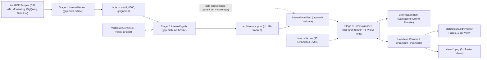

> **Historical Note:** This document describes the legacy v2 semantic multi-view pipeline.
> Stage 2 synthesis and Stage 3 rendering were superseded by [diagram-redesign-architecture.md](diagram-redesign-architecture.md).

# Semantic Multi-View GCP Architecture Pipeline (`gcp-arch`)

*   **Author:** Juan Ezquerro LLanes
*   **Status:** Implemented
*   **Date:** 2026-11-26

--------------------------------------------------------------------------------

## Overview

`gcp-arch` is a Go (`go 1.26.11` in [go.mod](../../go.mod)) command-line tool (`CGO_ENABLED=0`) for cloud engineers and consultants who generate Google Cloud Platform (GCP) architecture diagrams for client handoff documents (PDF reports and Google Docs) and engineer onboarding. Previously, the retired v2 `gcp-arch` relied on 15 static Go graph-compaction passes, static `Tier 1–3` edge rules, and an `elk-go` layout engine whose CLI exporter (`gcp-arch export`) emitted only `.svg` and `.drawio` files (offering no vector `.pdf` output and requiring interactive browser clicks for `.png`). Evaluated against a reference CI/CD platform (`acme-cicd`), that static pipeline collapsed active delivery pipelines into footer counters, hid Kubernetes applications inside workload totals, left backing databases disconnected, exposed raw forwarding-rule hashes, and flooded diagrams with unclassified Kubernetes, backup, and discovery-API entries.

Because `gcp-arch` had zero external production users requiring backward compatibility, ~80% of the legacy v2 codebase was retired (`internal/compiler`, `internal/layout`, `internal/drawio`, `internal/svg`, `internal/explore`, `internal/theme`, `internal/ir`, `internal/catalog`, and `internal/ingest`), retaining [internal/atomicfile](../../internal/atomicfile) (`Write` / `WriteFunc`) alongside five focused packages ([internal/extract](../../internal/extract), [internal/icons](../../internal/icons), [internal/manifest](../../internal/manifest), [internal/synth](../../internal/synth), and [internal/render](../../internal/render)) orchestrated by [cmd/gcp-arch](../../cmd/gcp-arch):

1.  **Stage 1 (`extract` -> `facts.json`):** Implemented in [internal/extract](../../internal/extract). Streams read-only Cloud Asset Inventory (CAI) resources and IAM policies (`<= 80` RPM), GKE `Ingress`/`Service`/workload/Workload-Identity chains, Cloud Build triggers with in-stream top-`N` succeeded build step folding, 7-day Cloud Monitoring runtime traffic (preserving data-plane reads while filtering control-plane discovery and synthesizing Vertex AI `PublisherModel` metrics), 7-day BigQuery SQL job lineage, active Dataflow job lineage, and structural/private-IP references into a closed, credential-scrubbed `v3` `facts.json` (`0600`).
2.  **Stage 2 (`synthesize` -> `architecture.yaml`):** Implemented in [internal/synth](../../internal/synth) and validated by [internal/manifest](../../internal/manifest). Runs two-pass closed-world Gemini 4 synthesis on Vertex AI (billed to `--vertex-project`, with optional `--thinking-level`) over short-ID-interned facts (`r_0001`, `e_0001`, `<= 500` active resources). Pass 1 partitions resources into `1..16` cohesive detail views (`landscape_matrix`, `stage_pipeline`, `hub_spoke`) with strict `1:1` resource accounting; Pass 2 places components and emits edges; Go then deterministically derives symmetric `off_page_refs`, harmonizes cross-view edges, records `acknowledged_edges` for Day-2 idempotence, projects `View 0` ([internal/synth/view0.go](../../internal/synth/view0.go)) when `>= 2` detail views exist, and validates the resulting Git-tracked `architecture.yaml`.
3.  **Stage 3 (`render` -> `.pdf`, `3x .png`, `.html`):** Implemented in [internal/render](../../internal/render) using [internal/icons](../../internal/icons). Renders `architecture.yaml` offline (zero network calls, zero `facts.json` dependency) with bundled `.woff2` fonts (`Inter`, `JetBrains Mono`) and inline SVG `<symbol>` icons. Go packs contiguous multi-column container row bands, runs deterministic Sugiyama barycenter sweeps, verifies container frame geometry, and assigns Sugiyama multi-column waypoints and prioritized bus spines; headless Chrome/Chromium (`chromedp`) then runs the in-page orthogonal corridor router ([internal/render/assets/router.js](../../internal/render/assets/router.js)) to verify zero card/badge/pill/collinear overlaps and export vector `.pdf` pages, `3x .png` images, and a standalone `.html` dossier in `< 1 s` on reference suites (`<= 2 s` budget).

## The Problem

### User Need and Business Context

Engineers and consultants auditing or handing over a live GCP environment need page-fitted diagrams that explain within seconds what applications run in the environment and how traffic, data, and deployment pipelines flow between them. Those diagrams are delivered inside written PDF reports and pasted into Google Docs specifications, while the underlying source definition stays in Git so teams can review and maintain architecture changes over time without losing curated titles or notes.

### Why the Retired Static Pipeline Failed

Auditing the retired `v2` static compiler and `elk-go` renderer against `acme-cicd` exposed four systemic failures:

1.  **Primary workflows buried in static counters:** Rigid service-type buckets (`TRANSVERSAL_COUNTER`, `TRANSVERSAL_CONTROL_API`) collapsed 20 Cloud Build triggers, GitHub (`github-acme`), and 643 Artifact Registry images (`acme-apps`) into a disconnected footer counter (`Cloud Build: Count 852`), leaving `acme-tfstate` and `acme-private-modules` unlinked.
2.  **Destructive GKE and Cloud Build ingestion:** Folding Kubernetes workloads into integer counts (`Workloads: 45`) and dropping `Service`/`Ingress` objects hid `Atlantis` and `SonarQube`, exposed raw forwarding-rule hashes (`k8s2-fs-...`), left the `sonarqube` Cloud SQL instance disconnected, and ignored Cloud Build `BuildTrigger` and succeeded `Build` `steps[]`.
3.  **Plumbing leaks, URI drift, tenant project confusion, and discovery noise:** Uncataloged Kubernetes/backup objects and read-only `terraform plan` state refreshes surfaced as `Standalone Unclassified Service ×27`; inconsistent Compute URI paths (`/locations/global/networks/cicd` vs. `/global/networks/cicd`) duplicated `VPC: cicd`; and Google-managed Private Services Access (PSA) tenant projects rendered as external customer projects.
4.  **Mechanical graph layout and CLI output gaps:** `elk-go` produced uneven compound container whitespace, lacked CSS Grid alignment and inline metadata tables, relied on approximate character-width tables, and could not export Google-Docs-ready `.png` or paginated vector `.pdf` deliverables from the CLI.

## Goals & Non-Goals

### Goals

*   **Clean Go Codebase:** Maintain five domain packages (`extract`, `icons`, `manifest`, `synth`, `render`) plus zero-dependency `ioutil` behind five CLI subcommands (`preflight`, `extract`, `synthesize`, `validate`, `render`), `--version`, and strict `~/.config/gcp-arch/config.yaml` defaults.
*   **Closed, Credential-Scrubbed Multi-Project `v3` Fact Extraction (`extract`):** Produce a deterministic `0600` `facts.json` within `<= 80` CAI RPM that captures GKE ingress-to-workload and Workload Identity chains, in-stream CAI Cloud Build triggers and succeeded step refs, IAM policies, data-plane-preserving 7-day Cloud Monitoring traffic (including Vertex AI `PublisherModel` synthesis), 7-day BigQuery SQL lineage, active Dataflow jobs, canonical AIP-122 URIs, PSA tenant detection, per-`asset_type` attribute allowlists, and strict edge endpoint closure (`resources[]`).
*   **Sound Two-Pass Synthesis, Provenance & Day-2 Idempotence (`synthesize`, `validate`):** Enforce `<= 500` active resources (scoping `--projects`/`--folder` per domain; `--org` is supported only for small organizations within that ceiling), `1:1` unique resource accounting, non-excludable stateful datastores, non-heuristic non-shortcutting `VERIFIED` walks (`ADMIN` flow kind required for permission-only evidence), deterministic Go `off_page_refs` and `View 0` (`<= 16` detail views), and `0`-LLM Day-2 `--reconcile` idempotence via `acknowledged_edges` and non-destructive provenance refresh.
*   **Deterministic CSS Grid Layout & Zero-Collision Rendering (`render`):** Render `architecture.yaml` standalone and offline with structural container nesting depth (`1..2`), contiguous container row bands that cannot enclose foreign cards, deterministic Sugiyama sweeps and bus priorities, horizontal + vertical print scaling, visible `Excluded (N)` footnotes, and headless Chrome verification exporting `.pdf`, `3x .png`, and `.html` in `<= 2 s`.
*   **`acme-cicd` Acceptance Benchmark:** Render both the CI/CD delivery pipeline and GKE ingress/application/Cloud SQL flows on [testdata/acme_cicd_v3.facts.json](../../testdata/acme_cicd_v3.facts.json) and [testdata/acme_cicd_expected.architecture.yaml](../../testdata/acme_cicd_expected.architecture.yaml) with 100% audited resource accounting and zero layout collisions.

### Non-Goals

*   **Local IaC Parsing:** Parsing local `.tf` HCL files, remote Terraform modules, or `*.tfstate` files.
*   **Secret or Data Payload Inspection:** Reading Secret Manager versions, Kubernetes `Secret`/`ConfigMap` payload values in output artifacts, Cloud Storage objects, or BigQuery table rows.
*   **Legacy Formats or Interactive Editors:** Generating `.drawio`, Excalidraw, standalone `.svg`, or an interactive browser canvas editor, or maintaining backward compatibility with retired `v2` `.snap` files and subcommands.

## Critical User Journeys (CUJs)

### CUJ 1: Day-1 Multi-View Handoff Generation (`acme-cicd`)

*   **Given:** Read-only target credentials (`cloud-platform.read-only`) on `acme-cicd`, Vertex AI user access (`roles/aiplatform.user`) on `my-vertex-project`, and local Chrome/Chromium.
*   **When:** Running `preflight` -> `extract` -> `synthesize` -> `render`.
*   **Then:**
    *   `extract` writes `0600` `facts.json` with GKE `atlantis`/`sonarqube` ingress-to-workload chains, 20 `BuildTrigger` assets with folded succeeded step refs, private-IP `SonarQube -> Cloud SQL` linkage, PSA `p1234567890abcdef-tp` peering, external stubs (`github-acme`, `acme-dev`, `acme-prod`), closed edge endpoints, and `stderr` out-of-scope hints.
    *   `synthesize` runs Pass 1 and concurrent Pass 2 on Vertex AI (`gemini-4-carbon`), derives symmetric `off_page_refs`, `acknowledged_edges`, and `View 0` in Go, validates 100% `1:1` resource accounting and non-heuristic directed-walk provenance via `manifest.ValidateWithFacts`, and writes `architecture.yaml`.
    *   `render` verifies container frame geometry in Go and zero connector/card/badge/pill/collinear overlaps in isolated headless Chrome, writing vector `out/architecture.pdf` (`len(views)` pages), `3x` `out/views/00..03-*.png`, and `out/architecture.html`.

### CUJ 2: Day-2 Curation Preservation, Transient Lineage Stability, and Incremental Drift

*   **Given:** A Git-tracked `architecture.yaml` with curated titles, `notes`, and `rejected_edges`. Later, either (a) nothing structural changed (even if 7-day `MONITORING_TRAFFIC` correlations fluctuate or a transient batch job aged out), (b) resources were deleted, or (c) new services (`release-webhook`, `build-events`) or new structural edges were added.
*   **When:** Running `extract` followed by `synthesize facts.json --reconcile architecture.yaml`.
*   **Then:**
    *   **Unchanged or heuristic-only fluctuation:** Completes in `< 100 ms` with `0` Vertex AI calls (no `--vertex-project` required) and zero YAML diff; `acknowledged_edges` prevents undrawn cross-view edges from re-triggering the LLM on subsequent runs. If a `VERIFIED` edge's transient lineage vanished while both endpoints still exist, it is downgraded in `0` LLM calls to `INFERRED` (dashed + rationale footnote) rather than deleted, and automatically restored to `VERIFIED` if the lineage reappears.
    *   **Deletion-only drift:** Prunes vanished URIs, drops deleted resource-backed containers (re-parenting surviving children/placements) and emptied detail views, cleans dangling `rejected_edges`/`acknowledged_edges`, recomputes `off_page_refs` and `View 0`, and validates in `0` Vertex AI calls.
    *   **Additive resource or structural edge drift:** Freezes curated titles, archetypes, `notes`, and `rejected_edges`, calls Gemini 4 with `ReconcilePatchSchema` (up to `2` validation retries) only for unclaimed resources and newly wired non-heuristic edges, finalizes `off_page_refs`, `acknowledged_edges`, and `View 0`, validates, and atomically writes `architecture.yaml`.

### CUJ 3: Deterministic Offline PR CI and Provenance Artifact CI (`validate`)

*   **When:** Clean-checkout Git PR CI runs `gcp-arch validate architecture.yaml` (offline, without gitignored `facts.json`), or extraction CI runs `gcp-arch validate architecture.yaml --facts facts.json`.
*   **Then:**
    *   Without `--facts`, `ValidateStructure` exits `2` on any schema, unknown-field, `1:1` duplicate-URI, excluded-datastore, unplaced-component, `View 0` (`> 16` views or ID collision), column/depth/verb/bus, cross-view edge inconsistency, or dangling pair violation.
    *   With `--facts`, `ValidateWithFacts` additionally exits `2` on any unaccounted `FactResource`, container `parent_uri` mismatch, heuristic-backed `VERIFIED` edge, component/container walk shortcut, non-`ADMIN` permission-only `VERIFIED` edge, or broken directed walk.

---

## Architecture & Core Invariants

### Pipeline Topology



### CLI Surface, Configuration Precedence, and Exit Codes

*   **Configuration Precedence ([cmd/gcp-arch/config.go](../../cmd/gcp-arch/config.go)):** `CLI flags > environment variables (CHROME_PATH, XDG_CONFIG_HOME) > ~/.config/gcp-arch/config.yaml > built-in defaults`. When `config.yaml` exists, `PersistentPreRunE` decodes it strictly (`KnownFields(true)`, no trailing documents, scalar-or-list coercion on `org`, `folder`, `projects`, `format`) across **all** subcommands. Passing any CLI scope flag (`--org`, `--folder`, `--projects`/`--project`) replaces `config.yaml` scopes; `--project-alias` overlays per project number.
*   **Chrome Binary Discovery ([internal/render/cdp.go](../../internal/render/cdp.go)):** Resolved in a single canonical order:
    1. Explicit `--chrome-path <bin>` (fails fast with exit code `1` for **all** formats—including `--format html` alone—if missing).
    2. `CHROME_PATH` environment variable (falls through if unset or non-existent).
    3. `chrome_path` in `config.yaml` (falls through if unset or non-existent).
    4. `PATH` (`google-chrome`, `google-chrome-stable`, `chromium`, `chromium-browser`).
    5. Standard macOS/Linux OS install paths.
    Only when `--format html` is requested alone without `--chrome-path` and steps 2–5 find no binary does `render` emit the unrouted standalone HTML with a `stderr` notice that CLI collision verification was skipped.
*   **Exit Codes:** `0` success; `1` runtime/external I/O error (GCP auth/quota, Vertex RPC error, missing input file, missing Chrome binary); `2` usage/config error, `> 500` active-resource ceiling (`ScaleLimitError`), manifest validation failure (`ValidationError`), or frame/card/badge/pill/collinear collision (`LayoutCollisionError`).

---

## Stage 1 Design: Closed Multi-Project Fact Extraction ([internal/extract](../../internal/extract))

### Canonical `v3` `facts.json` Contract & Invariants

`facts.json` ([internal/extract/schema.go](../../internal/extract/schema.go)) stores deterministic sorted slices (`schema_version: "v3"`, `read_time`, `scopes`, `hierarchy`, `resources`, `edges`, `suppressed_plumbing_counts`, `out_of_scope_targets`, `coverage_ledger`) subject to four data-model invariants:

1.  **Compute-Scoped AIP-122 Canonicalization ([internal/extract/canonical.go](../../internal/extract/canonical.go)):** Strips regional API host prefixes, maps project numbers to `project_id`s (from CAI `Project` assets + `--project-alias`), normalizes `container.googleapis.com` `/zones/<z>/clusters/<c>` -> `/locations/<z>/clusters/<c>`, and rewrites `/locations/{global,<region>,<zone>}/<collection>/` -> `/{global,regions/<region>,zones/<zone>}/<collection>/` **exclusively when the service host is `compute.googleapis.com`**. Relative `projects/<p>/locations/<loc>/instances/<name>` paths without a service host exclude `"instances"` from Compute inference so they never collide with Redis, Memcache, or Filestore URIs (`CanonicalizeAIP122WithService` supplies the explicit service host where known).
2.  **Allowlist-Only Attributes & Unconditional Secret Scrubbing ([internal/extract/sanitize.go](../../internal/extract/sanitize.go)):** `FactResource.Attributes` is built strictly from per-`asset_type` field allowlists after scanning `ConfigMap` `data`, workload `containers`/`initContainers`, and Cloud Build `steps[]` for sanitized structural targets (`ExtractSanitizedRefs`). Raw payloads and all `22` `sensitiveDroppedKeys` (`startup-script`, `startup-script-url`, `shutdown-script`, `user-data`, `env`, `envvariables`, `secretenv`, `environmentvariables`, `buildenvironmentvariables`, `args`, `command`, `script`, `data`, `binarydata`, `stringdata`, `substitutions`, `query`, `rawquery`, `schema`, `webhookconfig`, `kubectl.kubernetes.io/last-applied-configuration`, `last-applied-configuration`) are unconditionally dropped.
3.  **Post-Enrichment Default Pruning & Edge Endpoint Closure ([internal/extract/cai.go](../../internal/extract/cai.go)):** Unused default sandbox assets (`default` VPCs/subnets, `_Default`/`_Required` `LogBucket`s, unreferenced default Service Accounts) are pruned **after** all structural resolvers and runtime enrichers run, retaining any default Service Account referenced by Monitoring, BigQuery, or IAM edges. Finally, `filterFactEdges` enforces **strict endpoint closure**: every `FactEdge.FromURI` and `FactEdge.ToURI` must exist in `resources[]` (materializing in-scope `cloudresourcemanager.googleapis.com/Project` resources on demand when referenced, and dropping any residual dangling edge while recording `DANGLING_EDGES_DROPPED` (`CoverageDanglingEdges`) under `source: "edge_closure"` in `coverage_ledger`, surfaced on `stderr`).
4.  **Scoped Reference Disambiguation:**
    *   *Kubernetes `ConfigMap` refs ([internal/extract/gke.go](../../internal/extract/gke.go)):* Sanitized refs inside a `ConfigMap` are attributed exclusively to workloads in the same `(cluster, namespace)` that mount or reference that `ConfigMap` via `envFrom[].configMapRef`, `env[].valueFrom.configMapKeyRef`, or `volumes[].configMap` (across `containers`, `initContainers`, and `CronJob` `jobTemplate`).
    *   *Cloud Build `--cluster=<name>` refs ([internal/extract/sanitize.go](../../internal/extract/sanitize.go), [internal/extract/edges.go](../../internal/extract/edges.go)):* Scoped first to `--project` flags in the same build step, else the trigger/build's own project, else all scanned projects; emits an edge only when a **single** cluster matches, dropping ambiguous names.
    *   *PSA Tenant Detection:* `IsPSATenantProject` matches Google's hex convention `^p[0-9a-f]{10,}-tp$` (avoiding false positives on customer projects like `prod-tp` or `partner-tp`), while a dedicated first pass over active `servicenetworking` VPC peerings (`indexVPCPeerings`) serves as the authoritative signal across all peer/stub checks (`isPSATenant`).
    *   *Shared Service Account Attribution (`resolvePrincipalSource` in [internal/extract/enrichers.go](../../internal/extract/enrichers.go)):* Unified across Cloud Monitoring and BigQuery job lineage: attributes activity to the dedicated workload when `1` workload uses the Service Account, and falls back to the unsuppressed `iam.googleapis.com/ServiceAccount` URI when `0` or `> 1` workloads use it (marking `heuristic: true` when `> 1` workloads share the SA).

### Observation Windows & Runtime Filtering

| Source | Window / Filter | Rate & Cap | Noise / Stability Handling |
| :--- | :--- | :--- | :--- |
| Cloud Asset Inventory (`RESOURCE`, `IAM_POLICY`) | Pinned to single `read_time` from page 1; includes `Organization` & `Folder` IAM | `<= 80` RPM | Deterministic point-in-time snapshot; folds top `--cloudbuild-runs` (default `3`) `SUCCESS` `Build` records per trigger (plus `<= 5` triggerless per project) via bounded min-heap with `0` `cloudbuild/v1` RPCs. |
| Cloud Monitoring (`consumed_api` + Vertex `PublisherModel`) | `7 days` ending at CAI `read_time` (`enrichmentLookback = 7 * 24h`, `86400s` alignment) | `<= 10` QPS | `IsReadOnlyDiscoveryMethod` drops control-plane `get*`/`list*`/`aggregatedlist*`/`batchget*`/`testiampermissions`/`watch*`/`poll*` noise (e.g. `terraform plan`) while explicitly **retaining 22 data-plane reads** (`objects.get`, `objects.list`, `GetObject`, `ReadObject`, `ListObjects`, Firestore `Listen`/`BatchGetDocuments`/`GetDocument`/`ListDocuments`/`RunQuery`/`RunAggregationQuery`, Datastore `Lookup`, Bigtable/BQ Storage `ReadRows`, Spanner `Read`/`StreamingRead`/`ExecuteSql`/`ExecuteStreamingSql`, BigQuery `GetQueryResults`/`tabledata.list`/`tabledataService.list`, Pub/Sub `Pull`/`StreamingPull`). All `MONITORING_TRAFFIC` edges carry `heuristic: true`. |
| BigQuery `jobs.list` | `7 days` (`minCreationTime = read_time - 7d`), metadata projection only (`$0` slot cost) | `<= 10` QPS, `20` pages × `1,000` jobs (`TRUNCATING_CAP` logged if hit) | Dataset-to-dataset `sql_elt` lineage is structural (`heuristic: false`); principal `bq_job` edges are structural for dedicated `1:1` SAs and `heuristic: true` when `> 1` workloads share an SA. |
| Dataflow `jobs.list` | `Filter("ACTIVE")` (streaming and currently running batch jobs) when `dataflow.googleapis.com` enabled | `<= 10` QPS | Structural `CONFIG_REF` edges; finished batch jobs that disappear between runs downgrade `VERIFIED -> INFERRED` on Day 2 instead of deleting curated edges. |

### `FactEdge` Direction & Provenance Semantics

`FactEdge.ID` is `sha256(kind + ":" + from_uri + ":" + to_uri + ":" + detail)[:16]`. When the same edge ID is emitted both structurally and heuristically, the structural (`heuristic: false`) version wins (`putEdge` in [internal/extract/cai.go](../../internal/extract/cai.go)).

| `FactEdgeKind` | Direction (`from_uri -> to_uri`) | Emitters | `heuristic`? | `VERIFIED` Flow Rule |
| :--- | :--- | :--- | :--- | :--- |
| `CONFIG_REF` | Referencing resource -> referenced target (or upstream source -> sink on push/CDC/BigLake bridges: LB -> backend, Router -> VPN Gateway, NCC Hub -> Spoke target, DB -> Datastream CDC, GCS -> BigLake dataset) | CAI metadata, absorbed bridges, private-IP/Cloud SQL joins, env/ConfigMap refs, active Dataflow jobs | Always `false` | Can back `RUNTIME`, `CICD`, or `ADMIN` |
| `K8S_INGRESS_BACKEND` | `networking.k8s.io/Ingress` or L4 `ForwardingRule` -> `k8s.io/Service` | GKE resolver ([gke.go](../../internal/extract/gke.go)) | Always `false` | Can back `RUNTIME`, `CICD`, or `ADMIN` |
| `K8S_NEG_BACKEND` | L7 `ForwardingRule` -> `k8s.io/Service` (via `cloud.google.com/neg-status`) | GKE resolver ([gke.go](../../internal/extract/gke.go)) | Always `false` | Can back `RUNTIME`, `CICD`, or `ADMIN` |
| `K8S_SERVICE_SELECTOR` | `k8s.io/Service` (`len(selector) > 0`) -> matching GKE workload | GKE resolver ([gke.go](../../internal/extract/gke.go)) | Always `false` | Can back `RUNTIME`, `CICD`, or `ADMIN` |
| `WORKLOAD_IDENTITY` | GKE workload -> `iam.googleapis.com/ServiceAccount` (or cross-project stub) | GKE `iam.gke.io/gcp-service-account` join | Always `false` | Permission/identity only (`ADMIN` if sole evidence) |
| `CLOUDBUILD_TRIGGER_REPO` | Synthetic external repo (`//<host>/<owner>/<repo>` for any parsed Git host, e.g., `github.com` -> `external.github.com/Repository`, `gitlab.com` -> `external.gitlab.com/Repository`) -> `BuildTrigger` (flow direction) | CAI `BuildTrigger` ([cai.go](../../internal/extract/cai.go)) | Always `false` | Can back `CICD` / `RUNTIME` / `ADMIN` |
| `CLOUDBUILD_STEP_REF` | `BuildTrigger` (or in-scope `Project` for triggerless builds) -> referenced registry, bucket, secret, service, cluster, or out-of-scope project stub | In-stream succeeded `Build` min-heap & inline trigger steps | Always `false` | Can back `CICD` / `RUNTIME` / `ADMIN` |
| `IAM_RESOURCE_BINDING` | `ServiceAccount` (or cross-project stub) -> bound target resource | Resource-scoped IAM or IAM-Condition-pinned project binding (`false`); single-instance project role inference (`true`) | `false` (resource/condition) / `true` (single-instance project role) | Non-heuristic bindings prove access only: if all walk edges are `IAM_RESOURCE_BINDING` / `WORKLOAD_IDENTITY`, `flow_kind` **must** be `ADMIN` |
| `PSA_PEERING` | Consumer `compute.googleapis.com/Network` -> PSA-managed instance (`Cloud SQL`, `AlloyDB`, `Redis`, `Memcache`, `Filestore`) | VPC/PSA resolver ([edges.go](../../internal/extract/edges.go)) | Always `false` | Can back `RUNTIME` / `ADMIN` (note: walks cannot route *through* a container-backed VPC to connect unrelated workloads) |
| `VPC_PEERING` | Deterministically ordered `VPC -> peer VPC` (or in-scope `VPC -> external project stub`) | Non-PSA active VPC peerings | Always `false` | Can back `RUNTIME` / `ADMIN` |
| `BQ_LINEAGE` | Source `Dataset -> dest Dataset` (`sql_elt`), or caller workload/`ServiceAccount -> Dataset` (`bq_job`) | BigQuery `jobs.list` enricher | `false` (`sql_elt` & dedicated `1:1` SA) / `true` (`> 1` workloads sharing SA) | Non-heuristic edges can back `RUNTIME` / `CICD` / `ADMIN` |
| `MONITORING_TRAFFIC` | Caller workload/`ServiceAccount` -> single-instance project target or active Vertex AI `PublisherModel` | 7-day `consumed_api` & `PublisherModel` enrichers | Always `true` | Correlation-only: may inform `INFERRED` edges (dashed + footnote), **never** `VERIFIED` |

---

## Stage 2 Design: Closed-World Synthesis, Provenance & Day-2 Reconciliation ([internal/manifest](../../internal/manifest), [internal/synth](../../internal/synth))

### `architecture.yaml` Contract (`schema_version: v1`)

Every `backed_by` and `excluded_resources` entry stores `{uri, asset_type, project_id}` so `gcp-arch validate` and `gcp-arch render` operate standalone without `facts.json`:

```yaml
schema_version: v1
metadata:
  generated_at: "2026-11-23T02:00:00Z"
  scopes: ["projects/acme-cicd"]
components:
  - id: atlantis
    title: Atlantis PR Automation
    subtitle: gke:cicd / ns:atlantis
    icon_key: k8s_workload
    component_kind: WORKLOAD
    project_id: acme-cicd
    notes: Curated title for client handoff
    backed_by:
      - uri: //container.googleapis.com/projects/acme-cicd/locations/europe-southwest1-b/clusters/cicd/k8s/namespaces/atlantis/apps/deployments/atlantis
        asset_type: apps.k8s.io/Deployment
        project_id: acme-cicd
      - uri: //iam.googleapis.com/projects/acme-cicd/serviceAccounts/atlantis@acme-cicd.iam.gserviceaccount.com
        asset_type: iam.googleapis.com/ServiceAccount
        project_id: acme-cicd
    inline_meta:
      - label: Service Account
        value: atlantis@acme-cicd.iam
containers:
  - id: proj_acme_cicd
    title: "Project: acme-cicd"
    kind: PROJECT
  - id: gke_cicd
    title: "GKE Cluster: cicd"
    subtitle: europe-southwest1-b
    kind: GKE_CLUSTER
    parent_container_id: proj_acme_cicd
    backed_by:
      - uri: //container.googleapis.com/projects/acme-cicd/locations/europe-southwest1-b/clusters/cicd
        asset_type: container.googleapis.com/Cluster
        project_id: acme-cicd
excluded_resources: []
rejected_edges:
  - from: atlantis
    to: sonarqube_db
    reason: Unrelated monitoring correlation suppressed across all flow kinds
acknowledged_edges:
  - from: cloudbuild_triggers
    to: atlantis
views:
  - id: gke_developer_platform
    title: GKE Developer Platform & Ingress
    archetype: landscape_matrix
    accent_mode: RUNTIME
    container_ids: [proj_acme_cicd, gke_cicd]
    placements:
      - component_id: atlantis
        container_id: gke_cicd
        column: 1
    edges:
      - from: atlantis
        to: acme_tfstate
        verb: locks tfstate
        flow_kind: CICD
        provenance: VERIFIED
        evidence_edge_ids: ["c21876e6fb659711"]
```

### Closed-World Validation Invariants ([internal/manifest/validate.go](../../internal/manifest/validate.go), [internal/manifest/evidence.go](../../internal/manifest/evidence.go))

`ValidateStructure` (offline) and `ValidateWithFacts` (`--facts`) enforce seven deterministic gates:

1.  **100% `1:1` Unique Resource Accounting & Non-Hidden Visibility:**
    *   Every URI in `facts.Resources` must appear (`ErrUnaccountedFactResource`, `--facts`), and every URI in the manifest must appear **at most once** across `components[].backed_by`, `containers[].backed_by`, and `excluded_resources` (`ErrDuplicateAccountedURI`, structural)—preventing duplicate `ServiceAccount` folding or component/container double-counting.
    *   Every defined `Component` must be placed in `>= 1` detail view (`ErrUnplacedComponent`, structural).
    *   Stateful datastores (`Cloud SQL`, `AlloyDB`, `Spanner`, `Bigtable`, `Firestore`, `Memorystore`, `Cloud Storage`, `BigQuery Dataset`, `Artifact Registry`, `Filestore`, `Pub/Sub Topic`) **cannot** be placed in `excluded_resources` (`ErrExcludedDatastore`, structural; multiple instances of one type fold into a `COHORT` instead), and within any component's `backed_by` all stateful datastore URIs must share one `asset_type` (`ErrHeterogeneousDatastore`). Any allowed `excluded_resources` entries are rendered visibly in `views[0]`'s footer (`Excluded (N)`) and reported by `gcp-arch validate`.
2.  **Non-Shortcutting, Non-Heuristic Directed-Walk Provenance (`--facts`):** A detail-view edge with `provenance: VERIFIED` is valid iff its `evidence_edge_ids`:
    *   exist in `facts.Edges` (`ErrUnknownEvidenceEdge`) with `heuristic == false`;
    *   touch **only** URIs owned by `from.backed_by`, `to.backed_by`, or unowned intermediate bridges (`excluded_resources`)—never shortcutting through a third `Component` or routing through a `Container`'s `backed_by` URI (so `workload -> VPC -> Cloud SQL` cannot falsely verify `workload -> Cloud SQL`);
    *   form a connected directed walk from `from.backed_by` to `to.backed_by`; and
    *   carry `flow_kind: ADMIN` whenever every cited edge is `IAM_RESOURCE_BINDING` or `WORKLOAD_IDENTITY` (permissions prove access, not runtime/CI/CD data flow).
    Edges without such a walk must use `provenance: INFERRED` with a non-empty `inference_rationale`.
3.  **Container `parent_uri` Membership (`--facts`):** When a placement specifies a resource-backed `container_id` (`VPC`, `GKE_CLUSTER`) and the component's resources carry `parent_uri` chains in `facts.json`, at least one backing resource must reach that container's backing URI (`ErrPlacementContainerMismatch`).
4.  **View Index & Namespace Disjointness (Structural):** Detail views are capped at `1..16` (`ErrTooManyDetailViews`) so `View 0` never silently truncates views; `views[0].id == "view_0_system_index"` iff `>= 2` detail views exist; and view IDs must be disjoint from component IDs (`ErrViewComponentIDCollision`) because `View 0` placements address both namespaces.
5.  **Archetype, Density & Bus Bounds (Structural):** Detail views allow `1..12` placements (`1..16` on `View 0`), structural container nesting depth `<= 2` within `view.container_ids`, column bounds `0..4` (`landscape_matrix`/`stage_pipeline`) or `0..2` (`hub_spoke`), `1..16`-rune `verb`, and single-source or single-target `via_bus_id` groups.
6.  **Cross-View Edge Consistency (Structural):** When the same `(from, to, flow_kind)` edge is drawn in multiple detail views, its `verb` and `provenance` must match across views (`ErrInconsistentCrossViewEdge`).
7.  **Tombstone & Pair Referential Integrity (Structural):** Every `(from, to)` entry in `rejected_edges` and `acknowledged_edges` must reference existing component IDs (`ErrUnknownPairComponent`), and `rejected_edges` forbids drawing `(from, to)` across **all** `flow_kind`s (`ErrRejectedEdgePresent`).

### Two-Pass Synthesis, Deterministic Finalization & Day-2 Reconciliation ([internal/synth](../../internal/synth))

*   **Pass 1 (`runPass1`):** Sends `hierarchy`, interned `r_XXXX` descriptors, valid `icon_key` slugs, and deduplicated `r_XXXX -> [{to, kind}]` adjacency. Retries up to `2` times include the prior `previous_plan` JSON plus exact offending IDs so the model patches defects rather than regenerating the plan from scratch.
*   **Pass 2 (`populateViews`):** Runs concurrently (`errgroup.SetLimit(concurrency)`) per detail view over incident `r_XXXX` and `e_XXXX` handles (including `heuristic` flags), validating container `parent_uri` chains and `EvidenceIndex.WalkIssue` per view. `Pass2Placement` omits `off_page_refs` from the LLM schema altogether.
*   **Deterministic Go Finalization (`finalizeManifest` in [internal/synth/finalize.go](../../internal/synth/finalize.go)):** Shared by both `Synthesize` and `Reconcile`:
    1.  `refreshEdgeProvenance`: Re-validates `VERIFIED` walks, re-pointing refreshed edge hashes via `ShortestWalk`, downgrading vanished transient walks to `INFERRED` (`"Not verifiable from facts.json: ..."`), and re-upgrading previously auto-downgraded edges when their walk returns—while leaving human-authored `INFERRED` edges untouched.
    2.  `harmonizeCrossViewEdges`: Aligns `verb`, `provenance`, `evidence_edge_ids`, and `inference_rationale` across detail views sharing `(from, to, flow_kind)`.
    3.  `deriveOffPageRefs`: Computes symmetric `OUT`/`IN` `off_page_refs` across views from drawn edges and non-heuristic projected `FactEdge` pairs, preserving human-curated badge labels where `(target_view_id, direction)` already exists.
    4.  `undrawnProjectedPairs` -> `acknowledged_edges`: Records every non-heuristic inter-component pair that was left undrawn and unrejected so subsequent Day-2 runs recognize it as already settled.
    5.  `BuildSystemIndexView` ([internal/synth/view0.go](../../internal/synth/view0.go)): Projects `view_0_system_index` when `2..16` detail views exist, splitting remaining placement slots (`16 - len(detailViews)`) fairly between external callers and external targets, and linking detail views via `OUT` refs, shared-sink `IN` refs (oriented left-to-right first), and shared non-external components.
*   **Day-2 Reconciliation (`Reconcile` in [internal/synth/pipeline.go](../../internal/synth/pipeline.go)):**
    *   *Zero-LLM Unchanged / Provenance-Refresh Fast Path:* When zero URIs were added/vanished and zero unsettled **non-heuristic** inter-component `FactEdge`s appeared (ignoring `heuristic: true` monitoring churn), `Reconcile` refreshes provenance and `acknowledged_edges`, validates, and returns in `< 100 ms` with `0` LLM calls (`cmd/gcp-arch/synthesize.go` skips writing when canonical YAML bytes are unchanged).
    *   *Deterministic Pruning (`pruneManifest`):* Removes vanished URIs from components, containers, and `excluded_resources`; drops components whose `backed_by` emptied and cleans referencing `rejected_edges`/`acknowledged_edges`; drops **resource-backed** containers whose `backed_by` emptied while re-parenting child containers and placements to the surviving ancestor container; drops emptied detail views; and keeps surviving `INFERRED` and `VERIFIED` edges (downgrading lost walks via `finalizeManifest`). If zero unclaimed URIs and zero new structural edges remain, finishes in `0` LLM calls.
    *   *Delta Patching:* Calls Gemini 4 with `ReconcilePatchSchema` (up to `2` retries) over frozen headers, remaining view capacities, and unclaimed/newly wired handles, then runs `finalizeManifest` and `ValidateWithFacts`.

---

## Stage 3 Design: Deterministic CSS Grid Layout & Chrome CDP Export ([internal/render](../../internal/render))

### Deterministic Grid Preparation ([internal/render/prepare.go](../../internal/render/prepare.go))

1.  **Structural Container Depth (`structuralDepth`):** A container's visual depth inside a view is strictly `1 + count(ancestors in view.container_ids)` (`1` or `2`), independent of `ContainerKind`. Depth `1` frames use `#F8FAFC` fill, `1px solid #94A3B8`, and outward margin `-26px -9px -8px -9px` (`-46px` top when hosting a depth-2 inner frame on its top row); depth `2` frames use `#F1F5F9` fill, `1px solid #CBD5E1`, and `-22px -4px -4px -4px`. `ContainerKind` only toggles `border-style: dashed` on `PSA_ZONE` and `EXTERNAL_ZONE`.
2.  **Contiguous Multi-Column Container Band Allocation (`allocateContainerBands`) & Frame Verification (`checkContainerFrames`):** Cards and view containers form a hierarchy of rectangular `(minCol..maxCol, height)` blocks packed top-to-bottom in first-appearance `placements[]` order so every container owns a contiguous row band across all columns it spans, guaranteeing foreign cards cannot land inside its bounding rectangle. `checkContainerFrames` then deterministically verifies that zero non-member cards fall inside any frame rectangle and zero non-nested frames intersect, returning `*LayoutCollisionError` (exit code `2`) if violated.
3.  **Sugiyama Alternating Barycenter Sweeps (`runBarycenterSweeps`):** Starting from the initial `placements[]` YAML order within each container band, multi-column views run `2` iterations of a left-to-right sweep (`col = 1..n-1`, anchoring `col 0`) followed by a right-to-left sweep (`col = n-2..0`, anchoring `col n-1`). Each visit permutes cards within the rows already owned by `(column, container_id)` by the median current row of cross-column neighbors (unconnected cards last, ties broken by `placements[]` YAML order).
4.  **Bus Spine Priority (`assignBusGroups`) & Waypoints (`buildRoutingEdges`):** Each cross-column edge joins **at most one** directionally partitioned (`cmp.Compare(to.col, from.col)`) bus spine in strict priority order: (1) explicit `via_bus_id`, (2) auto fan-out `(from, flow_kind, dir)`, (3) auto fan-in `(to, flow_kind, dir)`; any candidate group left with `< 2` edges dissolves so later tiers can claim its edges. Edges spanning `|col(to) - col(from)| > 1` receive a clear `.corridor-row` `WaypointRow` avoiding intermediate container badges; same-column edges detour laterally into an adjacent `.corridor-col`.

### In-Page Orthogonal Router, Scaling & Export ([internal/render/assets/router.js](../../internal/render/assets/router.js), [internal/render/cdp.go](../../internal/render/cdp.go))

*   **Measurement, Widening & Collision Gate:** After `document.fonts.ready` and two `requestAnimationFrame` ticks on the `1040px` `.view-sheet`, `router.js` deconflicts ports (`8px` min spacing), routes `8px`-spaced orthogonal lanes with `4px` halo bridges on irreducible perpendicular crossings (such as $K_{2,2}$ / $K_{3,3}$ bipartite links), widens congested `.corridor-col`/`.corridor-row` tracks up to `160px` across at most `2` synchronous reflow passes, and checks zero overlaps against non-incident `.arch-card`s (`4px`), `.arch-container-badge`s (`4px`), verb pills (`4px`), and parallel collinear segments (`>= 6px`).
*   **Always-Injected Connectors & Print-Scale Fit:** `router.js` always injects `<svg class="connector-layer">` before evaluating `allCollisions` so a standalone browser-opened HTML file retains visible edges even if a layout collision occurred, while still returning `{ok: false, collisions}` so CLI `gcp-arch render` aborts with exit code `2` and an actionable remediation message (`move one of the listed components to another column or container, or split the view`). `applyPrintScale` sets `--print-scale = min(1, 708 / height, 1040 / sheet.scrollWidth)` so both tall sheets and corridor-widened wide sheets fit cleanly onto one `A4 landscape` PDF page (`len(views)` total pages), while `viewRects` captures `max(rect.width, sheet.scrollWidth)` at `deviceScaleFactor: 3.0` so `3x .png` exports never clip.

---

## Risks, Limits & Mitigations

*   **LLM Hallucination or Silent Resource Dropping:** Mitigated by short-ID interning, `1:1` unique resource accounting, banning `excluded_resources` on stateful datastores, rendering allowed exclusions visibly on `views[0]`, requiring every component to be placed, deriving `off_page_refs` in Go, and enforcing non-heuristic non-shortcutting `VERIFIED` walks (`ADMIN` for permission-only evidence).
*   **Scale & `--org` Scope Ceiling:** Enforced via deterministic Stage-1 plumbing/default suppression plus a hard `<= 500` active `FactResource` guard (`exit 2`). `--org` is intended only for small organizations within that ceiling; larger organizations must scope `--folder` or `--projects` per application domain.
*   **Observation Window Drift vs. Git Curation:** Mitigated by `acknowledged_edges` (settling undrawn cross-view pairs), ignoring `heuristic: true` runtime fluctuations in Day-2 edge diffing, downgrading vanished `VERIFIED` walks to `INFERRED` rather than deleting curated edges, and freezing curated titles, archetypes, `notes`, and `rejected_edges`.
*   **Credential & Browser Isolation:** Target scopes use `cloud-platform.read-only` while `--vertex-project` uses isolated `cloud-platform` credentials; Stage 1 enforces allowlisted attributes and drops all `22` sensitive keys; `architecture.yaml` (`0644`, Git-tracked) stores opaque 16-hex `evidence_edge_ids` rather than raw `0600` `FactEdge.Detail` strings; and Stage 3 escapes all HTML/JSON templates under `Content-Security-Policy: default-src 'none'; style-src 'unsafe-inline'; font-src data:; img-src data:; script-src 'unsafe-inline'` in an ephemeral `--user-data-dir` Chrome session.

## Alternatives Considered

*   **Retain Retired Static `internal/compiler` + `elk-go`:** Rejected—failed semantically on `acme-cicd` (burying Cloud Build and GKE workloads in counters) and lacked `3x .png` and vector `.pdf` CLI export.
*   **Parse Local Terraform (`.tf`) Files:** Rejected—requires HCL evaluation, private module credentials, and Git-vs-live drift correlation already solved directly from live CAI/GKE/Cloud Build/private-IP facts.
*   **Use Draw.io (`.drawio`) as the Tracked Artifact:** Rejected—causes noisy XML coordinate merge conflicts across Day-2 updates and lacks editorial CSS Grid typography.
*   **Render One Monolithic Global Diagram:** Rejected—shrinks text below readable point sizes on A4 PDF and Google Docs pages past ~12 blocks.
*   **Single-Pass LLM Raw HTML/SVG or Raw YAML Generation:** Rejected—unmeasured LLM `<svg>` coordinates slice through cards, raw YAML text wastes retries on syntax errors, and full regenerations overwrite Day-2 human edits.
*   **Hard Zero-Crossing Aborts on Perpendicular Segments:** Rejected—valid $K_{2,2}$ and $K_{3,3}$ bipartite flows are non-planar inside one corridor; `4px` halo bridges handle perpendicular crossings cleanly while `exit 2` strictly blocks card, badge, pill, frame, and collinear overlaps.

---

## Package & File Reference

| Package / Path | Key Files & Responsibilities |
| :--- | :--- |
| [internal/atomicfile](../../internal/atomicfile) | [atomicfile.go](../../internal/atomicfile/atomicfile.go), [atomicfile_test.go](../../internal/atomicfile/atomicfile_test.go): Zero-dependency crash-safe `Write` and streaming `WriteFunc`. |
| [internal/icons](../../internal/icons) | [assets/icons.yaml](../../internal/icons/assets/icons.yaml) (`85` inline SVGs), [validate.go](../../internal/icons/validate.go) (`ValidateSVG` XSS/URL hardening), [registry.go](../../internal/icons/registry.go) (`<defs>`-hoisting `<symbol>` sprite compiler), [icons_test.go](../../internal/icons/icons_test.go). |
| [internal/extract](../../internal/extract) | [schema.go](../../internal/extract/schema.go) (`FactsFile` `v3`, `FactEdge.Heuristic`, `DANGLING_EDGES_DROPPED`), [canonical.go](../../internal/extract/canonical.go) (Compute-scoped AIP-122 canonicalizer), [constants.go](../../internal/extract/constants.go), [client.go](../../internal/extract/client.go) (`80` RPM CAI / `10` QPS enrichers, `ClassifyGCPError`, `RunPreflight`), [sanitize.go](../../internal/extract/sanitize.go) (allowlists, secret scrubbing, `^p[0-9a-f]{10,}-tp$`, step-scoped `--cluster`), [cai.go](../../internal/extract/cai.go) (CAI streaming, Cloud Build min-heap, post-enricher default pruning, `filterFactEdges` closure), [gke.go](../../internal/extract/gke.go) (Ingress/NEG/Service/Workload/ConfigMap/Workload-Identity joins), [edges.go](../../internal/extract/edges.go) (structural/absorbed/PSA/private-IP/IAM resolvers), [enrichers.go](../../internal/extract/enrichers.go) (data-plane-aware Monitoring, `PublisherModel`, BigQuery, Dataflow, `resolvePrincipalSource`), [schema_canonical_test.go](../../internal/extract/schema_canonical_test.go), [extract_test.go](../../internal/extract/extract_test.go), [audit_test.go](../../internal/extract/audit_test.go). |
| [internal/manifest](../../internal/manifest) | [types.go](../../internal/manifest/types.go) (`Manifest` `v1`, `ComponentPair` `acknowledged_edges`, strict `KnownFields` codec, deterministic `Marshal`), [evidence.go](../../internal/manifest/evidence.go) (`EvidenceIndex`: non-heuristic, non-shortcutting, `ADMIN`-permission walk verifier & `ShortestWalk`), [validate.go](../../internal/manifest/validate.go) (`ValidateStructure`, `ValidateWithFacts`, `ComponentInsideContainer`), [manifest_test.go](../../internal/manifest/manifest_test.go), [rules_test.go](../../internal/manifest/rules_test.go). |
| [internal/synth](../../internal/synth) | [intern.go](../../internal/synth/intern.go) (`InternTable`, `BuildAdjacency`), [schemas.go](../../internal/synth/schemas.go) (`Pass1PlanSchema`, `Pass2ViewSchema` without LLM `off_page_refs`, `ReconcilePatchSchema`), [prompts.go](../../internal/synth/prompts.go) (Pass-1 `previous_plan` retry prompts, Pass-2 & Reconcile prompts), [client.go](../../internal/synth/client.go) (`VertexClient`, `ParseThinkingLevel`, `ProbeVertexModel`), [finalize.go](../../internal/synth/finalize.go) (`refreshEdgeProvenance`, `harmonizeCrossViewEdges`, `deriveOffPageRefs`, `undrawnProjectedPairs`), [view0.go](../../internal/synth/view0.go) (`BuildSystemIndexView`), [pipeline.go](../../internal/synth/pipeline.go) (`Synthesize`, `Reconcile`, container/pair-aware `pruneManifest`), [synth_test.go](../../internal/synth/synth_test.go), [reconcile_audit_test.go](../../internal/synth/reconcile_audit_test.go). |
| [internal/render](../../internal/render) | [prepare.go](../../internal/render/prepare.go) (structural container depth, `allocateContainerBands`, `checkContainerFrames`, 2-pass Sugiyama `runBarycenterSweeps`, prioritized `assignBusGroups`, `Excluded` footer attachment), [html.go](../../internal/render/html.go) (embeds 6 `.woff2` fonts as base64 + `<symbol>` sprite + CSP offline HTML builder), [assets/fonts/*.woff2](../../internal/render/assets/fonts), [assets/diagram.css](../../internal/render/assets/diagram.css), [assets/router.js](../../internal/render/assets/router.js) (orthogonal lane router, 2-pass corridor widening, always-injected SVG, width+height `--print-scale`), [cdp.go](../../internal/render/cdp.go) (`FindChrome`, single-session `ChromeDPRunner`, actionable `LayoutCollisionError`), [render_test.go](../../internal/render/render_test.go), [layout_test.go](../../internal/render/layout_test.go). |
| [cmd/gcp-arch](../../cmd/gcp-arch) | [main.go](../../cmd/gcp-arch/main.go), [config.go](../../cmd/gcp-arch/config.go), [preflight.go](../../cmd/gcp-arch/preflight.go), [extract.go](../../cmd/gcp-arch/extract.go), [synthesize.go](../../cmd/gcp-arch/synthesize.go), [validate.go](../../cmd/gcp-arch/validate.go), [render.go](../../cmd/gcp-arch/render.go), [main_test.go](../../cmd/gcp-arch/main_test.go), [e2e_test.go](../../cmd/gcp-arch/e2e_test.go). |
| Fixtures & Examples | [testdata/acme_cicd_v3.facts.json](../../testdata/acme_cicd_v3.facts.json), [testdata/acme_cicd_expected.architecture.yaml](../../testdata/acme_cicd_expected.architecture.yaml), [examples/platform-cicd/](../../examples/platform-cicd/architecture.yaml), [examples/retail-cloud-native/](../../examples/retail-cloud-native/architecture.yaml) ([examples/README.md](../../examples/README.md)). |

## Verification Plan

*   **Build & Module Hygiene:** `go mod tidy && git diff --exit-code go.mod go.sum && CGO_ENABLED=0 go build -o ./bin/gcp-arch ./cmd/gcp-arch`
*   **Static Analysis & Formatting:** `gofmt -l .` (empty) and `go vet ./...` (plus `golangci-lint` in [.github/workflows/ci.yml](../../.github/workflows/ci.yml))
*   **Race-Enabled Unit, Integration & Headless Chrome Suite (`>= 85%` coverage per `./internal/...` package):** `CI=true go test -race -count=1 -cover ./...`
    *   Verifies `1:1` resource accounting, excluded-datastore rejection, non-heuristic/non-shortcutting/`ADMIN`-permission `VERIFIED` walks, container `parent_uri` checks, edge endpoint closure, data-plane read preservation, PSA regex + `servicenetworking` fallback, scoped `--cluster` resolution, `Synthesize -> Reconcile` `0`-LLM idempotence with `acknowledged_edges`, transient lineage `VERIFIED <-> INFERRED` downgrade/recovery, structural container depth, container band non-enclosure, Sugiyama sweep determinism, bus priority, width+height `--print-scale`, standalone HTML connector retention on collision, vector `.pdf` page count (`len(views)`), and `3x` `.png` dimensions (`< 1 s` measured Chrome render latency on 4-view reference bundles).
