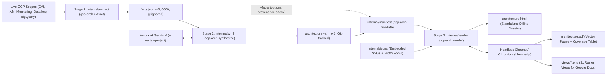

# Semantic Multi-View GCP Architecture Pipeline (`gcp-arch`)

*   **Author:** Juan Ezquerro LLanes
*   **Status:** Proposed
*   **Date:** 2026-11-23

--------------------------------------------------------------------------------

## Overview

`gcp-arch` is a Go (`go 1.26`) command-line tool for cloud engineers and consultants who generate Google Cloud Platform (GCP) architecture diagrams for client handoff documents (PDF reports and Google Docs) and engineer onboarding. Today, `gcp-arch` relies on 15 static Go graph-compaction passes, static `Tier 1–3` edge rules, and a coordinate layout built on `elk-go` (an Eclipse Layout Kernel port for Go) whose headless CLI exporter (`gcp-arch export`) emits only Scalable Vector Graphics (`.svg`) and Draw.io (`.drawio`) files (requiring interactive browser clicks in `gcp-arch explore` for `.png` and offering no vector `.pdf` output). When tested against a reference CI/CD platform (`acme-cicd`, evaluated against its `v2` baseline), that static pipeline fails to communicate how the system works: it collapses active delivery pipelines into footer counters, hides Kubernetes applications inside opaque workload totals, leaves backing databases disconnected, exposes raw load-balancer hashes, and floods diagrams with unclassified Kubernetes, backup, and discovery-API entries.

Because `gcp-arch` has zero external production users requiring backward compatibility, this design deletes ~80% of the existing codebase (`internal/compiler`, `internal/layout`, `internal/drawio`, `internal/svg`, `internal/explore`, `internal/theme`, `internal/ir`, `internal/catalog`, and `internal/ingest`), retains the zero-dependency `internal/ioutil` atomic-write leaf package, and builds a three-stage pipeline across five domain packages (`internal/extract`, `internal/icons`, `internal/manifest`, `internal/synth`, and `internal/render`):

1.  **Stage 1 (`extract` -> `facts.json`):** Salvage the existing low-level GCP API transport, rate limiters, error classification, credential scrubbing, structural reference paths (`base_catalog.yaml`), and private-IP joiners (`internal/compiler`), while expanding read-only extraction across Cloud Asset Inventory (CAI, GCP's resource metadata inventory), Identity and Access Management (IAM) policies, Google Kubernetes Engine (GKE) Ingress/Service/Workload chains, Cloud Build triggers and recent succeeded build step references folded directly from the CAI stream, Cloud Monitoring runtime traffic, active Dataflow job lineage, and BigQuery SQL lineage into a canonical `v3` `facts.json` file.
2.  **Stage 2 (`synthesize` -> `architecture.yaml`):** Run a two-pass Gemini 4 synthesis on Vertex AI (billed to a dedicated `--vertex-project`) over short-ID-interned facts (`r_0001`, `e_0001`). Pass 1 partitions the system over deduplicated short-ID adjacency into focused `6–12` block logical views and assigns each view one of three layout archetypes (`landscape_matrix`, `stage_pipeline`, or `hub_spoke`). Pass 2 populates human-readable component titles, technical sublabels, inline card metadata rows, and provenance-checked edges (`VERIFIED` vs. `INFERRED`), while Go deterministically projects `View 0` (System Index Map) whenever `>= 2` detail views exist and validates the resulting Git-tracked `architecture.yaml` manifest.
3.  **Stage 3 (`render` -> `.pdf`, `3x .png`, `.html`):** Render `architecture.yaml` offline (with zero dependency on `facts.json`) using a fixed-width HTML and CSS Grid template system with bundled `.woff2` fonts (`Inter` and `JetBrains Mono`) and embedded inline SVG `<symbol>` service icons. A local headless Chrome or Chromium process driven via `chromedp` lays out each archetype grid with flat background container frames, reserved CSS routing corridors, and intermediate waypoint cells, runs an in-page script over measured `getBoundingClientRect()` coordinates to route orthogonal SVG connectors with zero card, badge, label, or collinear overlaps, and exports vector `.pdf` pages, high-resolution `3x .png` images for Google Docs, and a self-contained `.html` architecture dossier.

## The Problem

### User Need and Business Context

Engineers and consultants auditing or handing over a live GCP environment need page-fitted diagrams that explain two things within seconds to another engineer: what applications run in the environment, and how traffic, data, and deployment pipelines flow between them. Those diagrams are delivered inside written PDF handoff packages and pasted into collaborative Google Docs specifications, while the underlying source definition stays in Git alongside infrastructure repositories so teams can review and maintain architecture changes over time.

### Why the Current Static Pipeline Fails

Auditing the current `v2` static compiler and `elk-go` renderer against the `acme-cicd` `v2` baseline exposed four systemic failures:

1.  **Primary workflows buried in static counters:** Static compaction rules classify resources by rigid service-type buckets (`ZoneKind` and `LayerRole` in `internal/ir`) without understanding workload roles. In `acme-cicd`, the project's central purpose—building container images from GitHub (`github-acme`) across 20 Cloud Build triggers into 643 Artifact Registry images (`acme-apps`) and running Terraform pull-request automation—is routed by `TRANSVERSAL_COUNTER` and `TRANSVERSAL_CONTROL_API` rules (`internal/catalog/assets/base_catalog.yaml` and `internal/compiler/compact_finalize.go`) into a disconnected gray footer badge (`Cloud Build: Count 852`), while `acme-tfstate` and `acme-private-modules` sit in an unlinked Cloud Storage stack.
2.  **Destructive GKE and Cloud Build ingestion:** Current sanitization (`internal/ingest/sanitize.go`) folds `k8s.io/Namespace` and `apps.k8s.io/{Deployment,StatefulSet,DaemonSet}` objects into integer counts and discards `k8s.io/Service` and `networking.k8s.io/Ingress` objects outright. As a result, the `cicd` GKE cluster renders as a single opaque box (`Workloads: 45`) hiding `Atlantis` and `SonarQube`; external HTTPS load balancers display raw generated forwarding-rule hashes (`k8s2-fs-demo1234-...`) instead of linking through Network Endpoint Groups (NEGs, GCP load-balancer backends mapping Kubernetes pods) to their services; and the `sonarqube` Cloud SQL database floats with zero edges. Similarly, `sanitizeResourceData` scans `containers[].args` and `containers[].env` but never traverses Cloud Build `steps[]` / `build.steps[]` (nor matches `*.pkg.dev`, `--project`, `--cluster`, or `gcloud run deploy`), `base_catalog.yaml` lists `cloudbuild.googleapis.com/Trigger` instead of CAI's actual `cloudbuild.googleapis.com/BuildTrigger` type, and all 819 historical `Build` runs remain unfolded.
3.  **Plumbing leaks, URI drift, tenant project confusion, and read-call noise:** Unhandled Kubernetes, backup, and zero-instance API entries surface as `Standalone Unclassified Service ×27` in the `acme-cicd` `v2` baseline (`l2-acme-cicd.svg`, expanding under `--expand-standalone` in `l2-acme-cicd-expanded.svg` into `17` uncataloged CAI resource-type cards such as `k8s.io/ServiceAccount`, `k8s.io/Secret`, `k8s.io/Endpoints`, and `sqladmin.googleapis.com/BackupRun` plus `10` zero-asset `consumed_api` cards, `4` of which—`firestore`, `redis`, `memcache`, and `osconfig`—stem from `~22` read-only `terraform plan` state refreshes), while `"data"` and `"stringdata"` keys are not stripped from `ConfigMap` payloads. Inconsistent network URI formats (`/locations/global/networks/cicd` vs. `/global/networks/cicd`) create duplicate `VPC: cicd` containers under `--expand-standalone`. Google-managed Private Services Access (PSA) tenant projects (`p1234567890abcdef-tp`, internal projects created by Google to host managed Cloud SQL instances) render as external customer peer projects.
4.  **Mechanical graph layout and CLI output gaps:** Even when restricted to 6–12 nodes, `elk-go` computes mechanical compound container boxes with uneven internal whitespace, cannot align multi-column editorial grids or inline metadata tables, and relies on approximate character-width tables (`internal/layout/textwrap.go`) that clip or drift when PDF viewers substitute system fonts. Furthermore, headless CLI `gcp-arch export` emits only `.svg` and `.drawio` files—neither of which can be inserted directly into Google Docs (which requires raster `.png`) or delivered as paginated vector `.pdf` reports.

## Goals

*   **Clean Go Codebase Reset:** Delete legacy `internal/compiler`, `internal/layout`, `internal/drawio`, `internal/svg`, `internal/explore`, `internal/theme`, `internal/ir`, `internal/catalog`, `internal/ingest`, `elk-go`, `etree`, and `accesscontextmanager`, retaining zero-dependency `internal/ioutil` alongside five pipeline packages (`internal/extract`, `internal/icons`, `internal/manifest`, `internal/synth`, `internal/render`) behind five CLI commands (`preflight`, `extract`, `synthesize`, `validate`, `render`).
*   **Structural Multi-Project `v3` Fact Extraction (`extract`):** Produce a credential-scrubbed `facts.json` (`0600`) within `<= 80` CAI requests per minute that retains GKE workloads (`Deployment`, `StatefulSet`, `DaemonSet`, `CronJob`, `Job` with namespace metadata), `Service` (`cloud.google.com/neg-status` and L4 LoadBalancer IPs), `Ingress`, and Workload Identity links; retains `BuildTrigger` plus sanitized step references folded in-stream from the latest 1–3 succeeded CAI `Build` records per trigger; captures `Organization`/`Folder`/`Project`/resource IAM policies, runtime Cloud Monitoring edges (filtering read-only `resource.labels.method` calls), active Dataflow job lineage, BigQuery SQL lineage, and salvaged structural/private-IP `CONFIG_REF` links; canonicalizes [AIP-122](https://google.aip.dev/122) (Google API Improvement Proposal 122: Resource Names) URIs; classifies `*-tp` Google tenant projects as PSA backing zones; enforces per-asset-type attribute allowlists; and emits synthetic external/cross-project `FactResource` stubs plus `stderr` scope hints.
*   **Closed-World Two-Pass Vertex AI Synthesis & Day-2 Reconciliation (`synthesize`, `validate`):** Decompose `facts.json` (`<= 500` active resources) via Vertex AI Gemini 4 (`google.golang.org/genai`, decoupled `--vertex-project`, `--vertex-location`, and `--model`) using short-ID interning (`r_XXXX`, `e_XXXX`) into a Git-tracked `architecture.yaml` containing focused logical views (plus a Go-projected `View 0` system index when `>= 2` detail views exist), enforcing 100% non-plumbing resource accounting across components, containers, and exclusions, directed-walk `FactEdge` provenance (`VERIFIED` vs. footnoted `INFERRED`), stateful datastore homogeneity, zero-LLM fast paths when URIs and projected edges are unchanged, and delta `--reconcile` updates on Day 2.
*   **Editorial HTML/CSS Grid & Chrome CDP Rendering (`render`):** Render `architecture.yaml` standalone and offline (zero network calls, zero `facts.json` dependency, bundled `Inter` and `JetBrains Mono` `.woff2` fonts, embedded inline `<symbol>` service icons) across three fixed-width layout archetypes (`landscape_matrix`, `stage_pipeline`, `hub_spoke`, flat background container frames up to depth `2`, inline card metadata rows, CSS corridor tracks, `.edge-waypoint` cells, shared bus spines, and `4px` corridor bridges) with automated zero-collision verification, exporting vector `.pdf`, `3x .png`, and standalone `.html` in `<= 2 s` via `chromedp`.
*   **`acme-cicd` Acceptance Benchmark:** On `acme-cicd`, automatically unpack and render both the CI/CD delivery pipeline (`GitHub github-acme -> 20 Cloud Build triggers -> Artifact Registry acme-apps` plus cross-project deployment target stubs) and the GKE application ingress flows (`HTTPS Load Balancers -> GKE cicd Ingress/NEG -> Atlantis -> gs://acme-tfstate & gs://acme-private-modules`, and `SonarQube -> Cloud SQL sonarqube`) with human-readable titles, zero unclassified K8s/backup warning cards, zero card/header/label/collinear collisions, and 100% audited resource coverage.

## Non-Goals

*   **Local IaC Parsing:** Parsing local Terraform (`.tf`) HCL files, remote Terraform module sources, or `*.tfstate` state files.
*   **Data or Secret Payload Inspection:** Reading Secret Manager secret versions, Kubernetes `Secret` payload values, Cloud Storage object contents, or BigQuery table rows.
*   **Legacy Diagram Editors and Formats:** Generating `.drawio`, Excalidraw, or standalone `.svg` files, or shipping an interactive web explorer (`gcp-arch explore`) or mouse-dragging canvas editor.
*   **Backward Compatibility with `v2` Artifacts:** Supporting legacy `.snap` files, `.gcp-arch/decisions.yaml`, `L0`/`L1`/`L2` `elk-go` views, or deprecated `snapshot`/`views`/`explore`/`export`/`inspect` CLI subcommands.

## Open Questions

*   None.

## Critical User Journeys (CUJs)

### CUJ 1: Day-1 Multi-View Handoff Generation on a GKE + CI/CD Project (`acme-cicd`)

*   **Given:** A consultant holds read-only GCP credentials (`cloud-platform.read-only`) on target project `acme-cicd`, Vertex AI user access (`roles/aiplatform.user` with `cloud-platform` scope) on billing project `consultant-ai-sandbox`, and Google Chrome installed locally (even if a desktop Chrome session is already open).
*   **When:** The consultant runs:
    1.  `gcp-arch preflight --projects acme-cicd --vertex-project consultant-ai-sandbox`
    2.  `gcp-arch extract --projects acme-cicd -o facts.json`
    3.  `gcp-arch synthesize facts.json --vertex-project consultant-ai-sandbox -o architecture.yaml`
    4.  `gcp-arch render architecture.yaml --format pdf,png,html -o out/`
*   **Then:**
    *   `extract` writes sanitized `facts.json` (`0600`), retaining the `cicd` GKE cluster's `atlantis` and `sonarqube` workloads, `Service` NEG annotations, `Ingress` host/path rules, 20 `BuildTrigger` definitions with step references folded in-stream from their latest succeeded CAI `Build` records (`gs://acme-tfstate`, `gs://acme-private-modules`, Artifact Registry `acme-apps`), private-IP `SonarQube -> Cloud SQL sonarqube` linkage, PSA `*-tp` peering, synthetic external `FactResource` stubs for `github-acme` and external deploy projects, and an explicit `stderr` scope hint listing those external target projects.
    *   `synthesize` interns resource URIs and `FactEdge` records to short IDs, runs Pass 1 (with deduplicated short-ID adjacency) and Pass 2 against Gemini 4 (`gemini-4-carbon`) in `consultant-ai-sandbox`, deterministically projects `View 0` (System Index) in Go across the resulting detail views (`CI/CD Delivery Pipeline`, `GKE Developer Platform & Ingress`, `Shared Network & PSA Topology`), validates 100% resource coverage and directed-walk `FactEdge` provenance, and writes `architecture.yaml`.
    *   `render` launches one isolated headless Chrome session (`--user-data-dir=<tempdir>`) offline, verifies zero card, badge, verb-pill, and collinear overlaps across all views, and writes `out/architecture.pdf` (vector multi-page PDF plus Inventory Coverage Table computed directly from `architecture.yaml`), `out/views/00-view_0_system_index.png` .. `0N-<view_id>.png` (`3x` raster views ready for Google Docs), and `out/architecture.html`.

### CUJ 2: Day-2 Git Curation Preservation and Incremental Drift Reconciliation

*   **Given:** An engineer previously committed `architecture.yaml` to Git after renaming a block title to `"Atlantis PR Automation"`, adding a `notes` annotation, adding a `rejected_edges` tombstone for a noisy monitoring correlation, and adjusting a view subtitle. Two weeks later, the team deploys a new Cloud Run service (`release-webhook`), adds a Pub/Sub topic (`build-events`), and wires an existing Cloud Build trigger to a new bucket in `acme-cicd`.
*   **When:** The engineer runs `gcp-arch extract --projects acme-cicd -o facts.json`, followed by `gcp-arch synthesize facts.json --reconcile architecture.yaml --vertex-project consultant-ai-sandbox`, `gcp-arch validate architecture.yaml --facts facts.json`, and `gcp-arch render architecture.yaml -o out/`.
*   **Then:**
    *   Whenever `facts.json` has zero added/vanished resource URIs and zero added/vanished inter-component `FactEdge` projections relative to `architecture.yaml`, `synthesize --reconcile architecture.yaml` exits in `< 100 ms` with `0` Vertex AI calls (requiring no `--vertex-project`) and zero diff to `architecture.yaml`.
    *   When `release-webhook`, `build-events`, or new inter-component `FactEdge`s appear, `synthesize --reconcile` freezes all existing view IDs, archetypes, human-edited block titles (`"Atlantis PR Automation"`), `notes`, and `rejected_edges` tombstones, requests a placement/edge patch only for the unclaimed resources and newly wired edges, validates the merged manifest (`1..12` blocks per detail view), and atomically writes canonical `architecture.yaml` in place.

### CUJ 3: Deterministic Validation Failure in Local/Artifact Provenance CI and Clean-Checkout Git PR CI

*   **Given:** During manual editing of `architecture.yaml` in a pull request, an author (a) introduces an invalid icon key or breaks single-source `via_bus_id` rules, or (b) in a pipeline with extracted `facts.json`, marks an unbacked cross-service edge as `provenance: VERIFIED` and deletes a Cloud SQL instance from its view without adding it to `excluded_resources`.
*   **When:** Clean-checkout Git PR CI runs `gcp-arch validate architecture.yaml` (requiring no gitignored `facts.json` and zero network calls), or an extraction/artifact CI job runs `gcp-arch validate architecture.yaml --facts facts.json` (zero network calls).
*   **Then:**
    *   Without `--facts`, `validate` checks schema integrity, `KnownFields(true)`, archetype column bounds, container depth `<= 2`, valid icon keys, single-source `via_bus_id`, and `rejected_edges` compliance, exiting `2` on any structural violation.
    *   With `--facts facts.json`, `validate` additionally enforces directed-walk `FactEdge` provenance and 100% `FactsFile` resource accounting, exiting `2` with actionable errors identifying (a) the exact view and edge whose `evidence_edge_ids` fail to form a directed walk from `from.backed_by` to `to.backed_by`, and (b) the orphaned Cloud SQL AIP-122 URI missing from `components[].backed_by`, `containers[].backed_by`, and `excluded_resources`.

## Technical Plan (Architecture)

### System Architecture and Package Topology

`gcp-arch` is structured as a strictly linear three-stage pipeline over two persistent on-disk contracts: `facts.json` (`schema_version: "v3"`, machine-generated plain UTF-8 JSON, `0600` permissioned and gitignored) and `architecture.yaml` (`schema_version: "v1"`, self-contained for rendering/coverage, human-editable, and tracked in Git).



#### Package Disposition and Dependency Changes

| Path / Module | Action | Role in New Architecture |
| --- | --- | --- |
| `internal/compiler`, `internal/layout`, `internal/drawio`, `internal/svg`, `internal/explore`, `internal/theme`, `internal/ir`, `internal/catalog`, `internal/ingest` | **Delete (Phase 4)** | Retires the 15 static compaction passes, `ZoneKind`/`LayerRole` IR types, `elk-go` coordinate slicers, Draw.io/SVG emitters, and loopback web explorer after salvaging reusable ingestion, `outbound_ref_paths`, plumbing rules, private-IP matching, and `<symbol>` def-hoisting in Phases 1–2. |
| `internal/ioutil` | **Retain** | Zero-dependency crash-safe sibling-temp-file writer (`WriteFileAtomic(path, data, filePerm, dirPerm)`) shared across `extract`, `synth`, and `render` without coupling `synth` or `render` to GCP SDK imports. |
| `github.com/d2lang/elk-go`, `github.com/beevik/etree`, `cloud.google.com/go/accesscontextmanager` | **Remove from `go.mod`** | No longer used once `elk-go`, Draw.io XML generation, and legacy VPC-SC `ACCESS_POLICY` perimeter borders are retired. |
| `google.golang.org/genai`, `github.com/chromedp/chromedp` | **Add to `go.mod`** | Official Google Gen AI Go SDK (`v1.79+`, `BackendVertexAI`) for Pass 1, Pass 2, and `--reconcile` `ResponseSchema` calls, and pure-Go `chromedp` (`v0.20+`, `CGO_ENABLED=0`) for isolated headless Chrome target/session management, `3x` screenshots, and `printToPDF`. |
| `internal/icons` | **Create** | Embeds SVG icons salvaged from `internal/catalog/assets/icons.yaml` (extended with `github`, `external_client`, `private_services_access`, `k8s_workload`, and `k8s_ingress`), `ValidateSVG`, and `<defs>`-hoisting `compileIconSymbol` salvaged from `internal/svg/render.go`. |
| `internal/extract` | **Create** | Multi-project read-only GCP collector, Compute-aware AIP-122 URI canonicalizer, salvaged `base_catalog` plumbing/default suppression & `outbound_ref_paths`/`matchPrivateIP` resolvers, GKE/CAI-Cloud-Build/PSA/Monitoring/Dataflow/BigQuery enrichers, allowlisted attribute projector, and synthetic external stub emitter. |
| `internal/manifest` | **Create** | Canonical `architecture.yaml` Go structs and enums, strict `gopkg.in/yaml.v3` (`KnownFields(true)`) parser/serializer, structural & `--facts` provenance validator (`ValidateStructure`, `ValidateWithFacts`), and manifest-driven `ComputeCoverage(manifest)` builder. |
| `internal/synth` | **Create** | Short-ID (`r_XXXX`, `e_XXXX`) bidirectional interning table, deduplicated Pass-1 adjacency projector, `<= 500` active-resource guard, Vertex AI Gemini 4 client, Pass-1 planner, Pass-2 concurrent populator, deterministic Go `View 0` builder, and Day-2 `--reconcile` resource+edge delta engine. |
| `internal/render` | **Create** | Fixed-width offline HTML/CSS Grid archetype generator (`landscape_matrix`, `stage_pipeline`, `hub_spoke`), bundled `.woff2` font & `<symbol>` sprite injector, HTML/JSON-safe serializer, flat background `.arch-container` framer, Sugiyama `.edge-waypoint` & bus-spine pre-processor, embedded JS corridor router, and single-session `chromedp` exporter. |

#### CLI Command Surface and Exit Codes (`cmd/gcp-arch`)

All commands return exit code `0` on success, `1` on runtime or external I/O failure (GCP auth/quota failure, Vertex AI RPC error, missing Chrome binary when `pdf`/`png` is requested), and `2` on CLI flag error, active-resource cap overflow (`> 500`), `validate` rule violation, or `render` card/badge/pill/collinear collision failure:

1.  `gcp-arch preflight (--org <id> | --folder <id> | --projects <p1,p2>) [--project-alias <NUM=ID>] [--quota-project <id>] [--vertex-project <id>] [--vertex-location global] [--model gemini-4-carbon] [-q|--quiet] [--json]`: Probes target read-only permissions (`cloudasset.assets.listResource`, `monitoring.timeSeries.list`, `bigquery.jobs.list`, `dataflow.jobs.list`) using `cloud-platform.read-only` credentials, and when `--vertex-project` is supplied, runs a zero-token Vertex AI readiness check (`projects.testIamPermissions` for `aiplatform.endpoints.predict` plus `Models.Get` in `--vertex-location` using `cloud-platform` OAuth scope). (`--project` is accepted as an alias for `--projects` on `preflight` and `extract`.)
2.  `gcp-arch extract (--org <id> | --folder <id> | --projects <p1,p2>) [--project-alias <NUM=ID>] [--quota-project <id>] [--cloudbuild-runs 3] [-q|--quiet] [-o facts.json]`: Streams rate-limited multi-project facts into `facts.json` (`0600`, `0700` parent dir) and prints discovered out-of-scope deployment target projects to `stderr`.
3.  `gcp-arch synthesize <facts.json> [--vertex-project <id>] [--vertex-location global] [--model gemini-4-carbon] [--reconcile <architecture.yaml>] [-o architecture.yaml] [--concurrency 4] [-q|--quiet]`: Generates a new `architecture.yaml` (Day 1, requiring `--vertex-project`) or reconciles resource/edge deltas into `<architecture.yaml>` (Day 2; writes atomically to `<architecture.yaml>` when `-o` is omitted, and skips `--vertex-project` validation when hitting the `0`-LLM fast path). Fails with exit code `2` if `len(activeResources) > 500` or post-synthesis validation fails.
4.  `gcp-arch validate <architecture.yaml> [--facts <facts.json>] [--json]`: Runs offline structural validation (`ValidateStructure`) when `--facts` is omitted, and full directed-walk `FactEdge` provenance + 100% `FactsFile` coverage validation (`ValidateWithFacts`) when `--facts` is supplied, with zero network calls.
5.  `gcp-arch render <architecture.yaml> [--format pdf,png,html] [-o out/] [--chrome-path <bin>] [-q|--quiet]`: Runs `manifest.ValidateStructure`, renders `out/architecture.pdf`, `out/views/<00..NN>-<view_id>.png` (`3x` device scale), and `out/architecture.html` (including the Inventory Coverage Table computed directly from `architecture.yaml` with zero `--facts` flag). When `--format html` is requested alone and Chrome is absent, writes self-contained `out/architecture.html` with the embedded JS router and prints a `stderr` notice that CLI collision verification was skipped.

### Stage 1: Structural Multi-Project Fact Extraction (`internal/extract`)

#### Canonical `v3` `facts.json` Data Model

`facts.json` is plain indented UTF-8 JSON storing deterministic sorted slices with zero secret, script, or `ConfigMap` data payloads:

*   `schema_version`: `"v3"`
*   `read_time`: RFC 3339 UTC timestamp pinned from CAI page 1.
*   `scopes`: Canonical sorted scope strings (`organizations/...`, `folders/...`, `projects/...`).
*   `hierarchy`: `organizations[]`, `folders[]`, and `projects[]` (`project_id`, `project_number`, `display_name`, `parent`, `is_psa_tenant`, `shared_vpc_host_project`).
*   `resources[]` (`FactResource`): `uri` (canonical AIP-122 URI, or synthetic external URI such as `//github.com/<owner>/<repo>`), `asset_type`, `project_id`, `location`, `display_name`, `parent_uri` (owning VPC, subnet, or GKE cluster), `is_external` (`true` for external GitHub/GitLab repos and out-of-scope target project stubs), `attributes` (constructed exclusively from a strict per-`asset_type` field allowlist: CIDR, machine tier, database engine, GKE `namespace`, `replicas`, `ingress_hosts`, `repo_url`, `trigger_filter`, `kms_key_uri`, `service_account`, and folded child counts such as `image_count: 643`, `table_count: 42`, or `node_pool_count: 2`), and `project_capabilities[]` (sorted role strings for broad ancestor IAM roles `roles/{owner,editor,viewer,browser}` held by a Service Account).
*   `edges[]` (`FactEdge`): Deterministic ID (`sha256(kind + ":" + from_uri + ":" + to_uri + ":" + detail)[:16]`), `from_uri`, `to_uri`, `kind` (`CONFIG_REF`, `K8S_INGRESS_BACKEND`, `K8S_NEG_BACKEND`, `K8S_SERVICE_SELECTOR`, `WORKLOAD_IDENTITY`, `CLOUDBUILD_TRIGGER_REPO`, `CLOUDBUILD_STEP_REF`, `IAM_RESOURCE_BINDING`, `PSA_PEERING`, `VPC_PEERING`, `BQ_LINEAGE`, `MONITORING_TRAFFIC`), and `detail` (port/protocol, IAM role, or sanitized command target).
*   `suppressed_plumbing_counts`: Sorted map of dropped plumbing/default `asset_type -> count` for audit transparency.
*   `out_of_scope_targets[]` (`OutOfScopeHint`): `target_project_id`, `synthetic_uri` (`//cloudresourcemanager.googleapis.com/projects/<target_project_id>`), `referenced_by_uris[]`, `source_kind` (`"cloudbuild_deploy_flag"`, `"config_ref_cross_project"`, or `"iam_cross_project"`).
*   `coverage_ledger[]` (`CoverageEntry`): Per-scope collection state (`OK`, `IAM_DENIED`, `VPC_SC_BLOCKED`, `SERVICE_DISABLED`, `UNKNOWN_ORG_REQUIRED`, `TRUNCATING_CAP`) produced via salvaged `ClassifyGCPError`.

#### Targeted Extraction Rules and Salvaged Resolvers

1.  **Compute-Scoped AIP-122 & GKE Cluster URI Canonicalization:** `CanonicalizeAIP122` normalizes regional API prefixes, maps project numbers to canonical `project_id`s (using discovered `Project` assets plus `--project-alias <NUM=ID>`), normalizes `container.googleapis.com` `/zones/<z>/clusters/<c>` to `/locations/<z>/clusters/<c>`, and rewrites `/locations/global/<collection>/` -> `/global/<collection>/`, `/locations/<region>/<collection>/` -> `/regions/<region>/<collection>/`, and `/locations/<zone>/<collection>/` -> `/zones/<zone>/<collection>/` **strictly when the service is `compute.googleapis.com` or `isComputeScopeCollection` matches** (including relative `projects/<p>/locations/...` paths inside `inferServiceFromRelative`), preserving `/locations/` on Cloud Build, Cloud Run, and Artifact Registry URIs while guaranteeing `VPC: cicd` resolves to one canonical URI.
2.  **Salvaged Plumbing/Default Suppression, Sub-Resource Folding & Allowlisted Scrubbing:**
    *   *Plumbing & Default Suppression:* Salvage `IGNORED_PLUMBING` and `ABSORBED_CHILD` classifications from `internal/catalog/assets/base_catalog.yaml` plus `isDefaultSandboxAsset` and `isDefaultServiceAccount` from `internal/ingest/enrichers.go` (suppressing unused `default` VPCs, auto-mode regional `default` subnets, `_Default`/`_Required` `LogBucket`s, and unreferenced default Service Accounts). Add Kubernetes, backup, GKE-node, and Gateway plumbing (`cloudbuild.googleapis.com/Build`, `k8s.io/Namespace`, `k8s.io/ServiceAccount`, `k8s.io/Secret`, `k8s.io/ConfigMap`, `k8s.io/Endpoints`, `discovery.k8s.io/EndpointSlice`, `k8s.io/Pod`, `apps.k8s.io/ReplicaSet`, `k8s.io/Event`, `k8s.io/Node`, `k8s.io/ResourceQuota`, `k8s.io/PersistentVolume`, `k8s.io/PersistentVolumeClaim`, `storage.k8s.io/StorageClass`, `admissionregistration.k8s.io/*`, `rbac.authorization.k8s.io/*`, `gateway.networking.k8s.io/*`, `sqladmin.googleapis.com/BackupRun`, `sqladmin.googleapis.com/Backup`, `container.googleapis.com/NodePool`, `gkehub.googleapis.com/Membership`, `gke-<cluster>-*` `InstanceGroupManager`s/`InstanceTemplate`s/worker `Instance` VMs, and Load Balancer intermediate `GlobalAddress`/`Address`/`TargetHttpProxy`/`TargetHttpsProxy`/`UrlMap`/`BackendService`/`SecurityPolicy`/`NetworkEndpointGroup` records) into `suppressed_plumbing_counts` after extracting structural/GKE edges onto `ForwardingRule`/`GlobalForwardingRule` and folding child counts onto parent repositories/datasets/clusters.
    *   *Allowlisted Attributes & Secret Scrubbing:* `FactResource.Attributes` is populated strictly from an explicit per-`asset_type` field allowlist—never by forwarding denylist-filtered maps. Before discarding raw payloads, `ExtractSanitizedRefs` scans `k8s.io/ConfigMap` `data`, workload `containers[]` and `initContainers[]` (`command`, `args`, `env`), and Cloud Build `steps[]` (`name`, `entrypoint`, `args`, `script`), while `kubectl.kubernetes.io/last-applied-configuration`, `webhookConfig`, and all `sensitiveDroppedKeys` (`startup-script`, `startup-script-url`, `shutdown-script`, `user-data`, `env`, `envvariables`, `secretenv`, `environmentvariables`, `buildenvironmentvariables`, `args`, `command`, `script`, `data`, `binarydata`, `stringdata`, `substitutions`, `query`, `rawquery`, `schema`) are unconditionally discarded.
3.  **Salvaged Structural `CONFIG_REF`, Private-IP (`SonarQube -> Cloud SQL`), BigQuery, and Dataflow Joins:**
    *   Salvage `outbound_ref_paths` structural pointer extraction from `base_catalog.yaml` and `edges_tier1.go` (covering Serverless NEGs, BackendBuckets, Pub/Sub push & BQ/GCS sinks, Eventarc, Cloud Scheduler, Cloud Tasks, VPN/Router, VPC peering `VPC_PEERING`, and Cloud Run `reconcileCloudRunTraffic` / `*.run.app` host matching).
    *   Salvage VPC/PSA-scoped private-IPv4 indexing (`indexVPCAndPrivateIPs` and `matchPrivateIP` from `internal/compiler/edges_index.go` and `edges_tier1.go`) plus bare `<proj>:<region>:<instance>` Cloud SQL connection-name matching in `ExtractSanitizedRefs`, deterministically joining `SonarQube`'s JDBC/ConfigMap/env references to `sqladmin.googleapis.com/Instance` (`CONFIG_REF`).
    *   Salvage `EnrichBigQueryJobs` (`BQ_LINEAGE`) and `EnrichDataflowJobs` (`CONFIG_REF` edges for active streaming jobs, gated on `dataflow.googleapis.com` enabled, `<= 10 QPS`), while retiring `EnrichRagCorpora` and `accesscontextmanager`.
4.  **GKE Ingress / L4 LB -> NEG -> Service -> Workload -> Workload Identity Join:**
    *   Retain `container.googleapis.com/Cluster`, `apps.k8s.io/{Deployment,StatefulSet,DaemonSet}`, `batch.k8s.io/{CronJob,Job}`, `k8s.io/Service`, and `networking.k8s.io/Ingress` outside `kube-system`, `gke-managed-*`, and `gmp-system` namespaces (copying `metadata.namespace` onto `attributes["namespace"]`).
    *   Resolve `ForwardingRule -> TargetHttp(s)Proxy -> UrlMap -> BackendService -> NetworkEndpointGroup -> k8s.io/Service` via `Service` annotation `cloud.google.com/neg-status` (`K8S_NEG_BACKEND`), join L4 `Service.status.loadBalancer.ingress[].ip` to `ForwardingRule.IPAddress` (`K8S_INGRESS_BACKEND`), and attach `Ingress` host/path rules to the entry `ForwardingRule` so synthesis sees human hostnames (`atlantis.*`, `sonarqube.*`) instead of `k8s2-fs-...` hashes.
    *   Require `len(Service.spec.selector) > 0` before matching `Service.spec.selector` against workload pod-template labels (`spec.template.metadata.labels`, or `spec.jobTemplate.spec.template.metadata.labels` for `CronJob`) within `(cluster_uri, namespace)` to emit `K8S_SERVICE_SELECTOR` edges.
    *   Index `k8s.io/ServiceAccount` annotation `iam.gke.io/gcp-service-account` in memory before suppressing `k8s.io/ServiceAccount`, joining workload `serviceAccountName` (including `CronJob` `spec.jobTemplate.spec.template.spec.serviceAccountName`) to `//iam.googleapis.com/projects/<proj>/serviceAccounts/<email>` (`WORKLOAD_IDENTITY`).
5.  **In-Stream CAI Cloud Build Trigger & Top-`N` Succeeded Build Folding:**
    *   Ingest `cloudbuild.googleapis.com/BuildTrigger` (emitting a synthetic external `FactResource` `//github.com/<owner>/<repo>` with `is_external: true` and a `CLOUDBUILD_TRIGGER_REPO` `FactEdge`, plus inline `build.steps[]`, `build.images[]`, and `serviceAccount`).
    *   During CAI `RESOURCE` streaming, maintain an in-memory bounded min-heap by `createTime` retaining at most `--cloudbuild-runs` (default `3`) `cloudbuild.googleapis.com/Build` assets with `status == "SUCCESS"` per `buildTriggerId` (plus up to `5` triggerless succeeded builds), passing their `steps[]` (`name`, `entrypoint`, `args`, `script`), `images[]`, and `artifacts.objects.location` through `ExtractSanitizedRefs` (`<region>-docker.pkg.dev/<proj>/<repo>`, `gcr.io/<proj>/...`, `gs://<bucket>`, `--project=<id>` / `--project <id>`, `--cluster=<name>`, `gcloud run deploy <svc>`) to emit `CLOUDBUILD_STEP_REF` edges on the parent `BuildTrigger` before counting all `Build` assets in `suppressed_plumbing_counts`—requiring zero `cloudbuild/v1` RPCs or extra IAM roles.
6.  **PSA Tenant Classification, `resource.labels.method` Metric Filtering, IAM Edges & External Stubs:**
    *   Mark peer projects matching `^p[a-z0-9]+-tp$` or VPC peering `servicenetworking-googleapis-com` as `is_psa_tenant: true` and emit `PSA_PEERING` edges linking private-IP Cloud SQL, Memorystore, AlloyDB, and Filestore instances to their consumer VPC.
    *   In `EnrichMonitoring`, group `serviceruntime.googleapis.com/api/request_count` (`resource.type = "consumed_api"`) by **`resource.labels.method`**, filter out case-insensitive discovery/read-only methods (`get*`, `list*`, `aggregatedlist*`, `batchget*`, `testiampermissions`, and watch/poll calls on zero-instance services), and join `ServiceAccount.uniqueId` + salvaged companion API host mappings (`bigquerystorage -> bigquery`, `storage-api -> storage`) to unambiguous single-instance project targets (`MONITORING_TRAFFIC`).
    *   Add `Organization` and `Folder` to `iamPolicyAssetTypes`. Emit `IAM_RESOURCE_BINDING` `FactEdge`s for resource-scoped IAM bindings and for project-level service-specific roles (such as `roles/cloudsql.client`, `roles/cloudsql.instanceUser`, `roles/redis.editor`) bound to a dedicated Service Account when either an IAM Condition pins the target URI or the project contains a single instance of that target service; store broad ancestor roles (`roles/{owner,editor,viewer,browser}`) on `FactResource.ProjectCapabilities`.
    *   Any referenced `project_id` outside `scopes` (excluding `*-tp` PSA tenants and public builder mirrors such as `cloud-builders`) emits both an `out_of_scope_targets[]` hint (`stderr`) and a synthetic external `FactResource` (`is_external: true`, `//cloudresourcemanager.googleapis.com/projects/<id>`) so cross-project deployment edges validate cleanly.

### Stage 2: Closed-World Vertex AI Synthesis and Validation (`internal/manifest`, `internal/synth`)

#### Short-ID Interning, Active-Resource Cap, and Two-Pass Gemini 4 Execution

Before calling Vertex AI, `internal/synth` verifies `len(facts.Resources) <= 500` (failing fast with exit code `2` and instructing the caller to narrow `--projects`/`--folder` if exceeded after plumbing/default suppression) and builds an in-memory deterministic `InternTable`:

*   Sorted `facts.Resources[i]` <-> `r_0001 .. r_NNNN`
*   Sorted `facts.Edges[j]` <-> `e_0001 .. e_MMMM`

All calls use `google.golang.org/genai` configured with `BackendVertexAI`, `Project: --vertex-project`, `Location: --vertex-location` (default `"global"`), `Model: --model` (default `"gemini-4-carbon"`), `Temperature: 0.1`, `ResponseMIMEType: "application/json"`, and non-recursive `genai.Schema` definitions:

1.  **Pass 1 (`PlanSuite`):** Input contains `hierarchy`, interned `r_XXXX` resource descriptors, valid `icon_key` slugs in the system prompt, and a **deduplicated short-ID adjacency list** (`r_XXXX -> [{to: r_YYYY, kind}]`) so Pass 1 sees exact topological connectivity before locking components and views. Output conforms to `Pass1PlanSchema`:
    *   `components[]`: Canonical `id` slug (`atlantis`, `sonarqube_db`, `cicd_triggers`), `title`, `subtitle`, `icon_key` (`genai.TypeString`, validated in Go via `icons.Has`), `component_kind` (`EXTERNAL_CALLER | INGRESS | WORKLOAD | PIPELINE | MESSAGING | DATASTORE | COHORT | EXTERNAL_TARGET`), `project_id`, `backed_by_ids` (`["r_0012", ...]` holding primary URIs plus folded 1:1 `ServiceAccount`, `Secret`, `CryptoKey`, `Ingress`, `Service`, and `ForwardingRule` URIs), and `inline_meta` (`[{label, value}]`, up to 4 rows).
    *   `container_defs[]`: Global container definitions (`id`, `title`, `subtitle`, `kind`: `PROJECT | VPC | GKE_CLUSTER | PSA_ZONE | EXTERNAL_ZONE | SHARED_HUB`, `parent_container_id`, `backed_by_ids`: `["r_0003"]` accounting for `VPC` and `GKE_CLUSTER` `FactResource`s).
    *   `excluded_resources[]`: `[{resource_id: "r_XXXX", reason: "..."}]` for intentional non-diagrammed active inventory.
    *   `detail_views[]`: `1..M` focused logical views (`6–12` target candidate component IDs per view), each assigned `id`, `title`, `subtitle`, `archetype` (`landscape_matrix | stage_pipeline | hub_spoke`), and `accent_mode` (`RUNTIME | CICD | MIXED`).
    *   *Pre-Pass-2 Gate:* Go verifies that `components[].backed_by_ids ∪ container_defs[].backed_by_ids ∪ excluded_resources` covers 100% of `r_0001..r_NNNN`, that stateful datastore URIs inside each `Component` share one `asset_type`, that `icons.Has(icon_key)` holds, and that every component belongs to `>= 1` detail view (retrying Pass 1 up to `2` times with exact offending IDs on failure).
2.  **Pass 2 (`PopulateViews`) & Deterministic `View 0` Projection:** Runs concurrently (`errgroup.SetLimit(concurrency)`) across `detail_views[]` with component IDs/titles locked. Each call receives only the `r_XXXX` details and `e_XXXX` `FactEdge` records incident to that view's candidate components (plus 1-hop cross-view neighbors for `off_page_refs`). Output conforms to `Pass2ViewSchema`:
    *   `container_ids[]`: Referenced `container_defs` active in this view (nesting depth `<= 2`).
    *   `placements[]`: Ordered slice of `{component_id, container_id, column, off_page_refs[]}` (`column` in `0..4` for `landscape_matrix`/`stage_pipeline` or `0..2` for `hub_spoke`; YAML slice order serves as the deterministic tie-breaker for Stage-3 barycenter row sorting).
    *   `edges[]`: `{from, to, verb (<= 16 chars), flow_kind (RUNTIME | CICD | ADMIN), provenance (VERIFIED | INFERRED), evidence_edge_ids (["e_0041", ...]), inference_rationale, via_bus_id}`.
    *   **Deterministic `View 0` (`view_0_system_index`):** If `len(detail_views) == 1`, `View 0` is omitted so single-view scopes avoid a duplicate summary page. Whenever `len(detail_views) >= 2`, Go constructs `views[0]` (`id: "view_0_system_index"`, `archetype: "landscape_matrix"`, `<= 16` view/external summary blocks) deterministically from the populated detail views and cross-view edges with zero extra LLM calls.

#### Canonical `architecture.yaml` Contract Example

Every resource reference in `architecture.yaml` stores `{uri, asset_type, project_id}` (`BackedResource`) so `gcp-arch render` and `gcp-arch validate` operate standalone without `facts.json`:

```yaml
schema_version: v1
metadata:
  generated_at: "2026-11-23T02:00:00Z"
  scopes: ["projects/acme-cicd"]
components:
  - id: github_acme
    title: GitHub (github-acme)
    subtitle: Source Repositories
    icon_key: github
    component_kind: EXTERNAL_CALLER
    project_id: external
    backed_by:
      - uri: //github.com/acme-corp/platform-services
        asset_type: external.github.com/Repository
        project_id: external
  - id: atlantis
    title: Atlantis PR Automation
    subtitle: gke:cicd / ns:atlantis
    icon_key: k8s_workload
    component_kind: WORKLOAD
    project_id: acme-cicd
    notes: Curated title for client handoff
    backed_by:
      - uri: //container.googleapis.com/projects/acme-cicd/locations/europe-west1/clusters/cicd/k8s/namespaces/atlantis/apps/deployments/atlantis
        asset_type: apps.k8s.io/Deployment
        project_id: acme-cicd
      - uri: //iam.googleapis.com/projects/acme-cicd/serviceAccounts/atlantis@acme-cicd.iam.gserviceaccount.com
        asset_type: iam.googleapis.com/ServiceAccount
        project_id: acme-cicd
    inline_meta:
      - label: Service Account
        value: atlantis@acme-cicd.iam
containers:
  - id: gke_cicd
    title: "GKE Cluster: cicd"
    subtitle: europe-west1
    kind: GKE_CLUSTER
    parent_container_id: vpc_cicd
    backed_by:
      - uri: //container.googleapis.com/projects/acme-cicd/locations/europe-west1/clusters/cicd
        asset_type: container.googleapis.com/Cluster
        project_id: acme-cicd
excluded_resources: []
rejected_edges:
  - from: atlantis
    to: sonarqube_db
    reason: Unrelated monitoring correlation suppressed by reviewer
views:
  - id: gke_platform
    title: GKE Developer Platform & Ingress
    subtitle: HTTPS Ingress to Atlantis and SonarQube
    archetype: landscape_matrix
    accent_mode: RUNTIME
    container_ids: [proj_acme_cicd, vpc_cicd, gke_cicd]
    placements:
      - component_id: atlantis
        container_id: gke_cicd
        column: 2
    edges:
      - from: atlantis
        to: tfstate_bucket
        verb: terraform state
        flow_kind: CICD
        provenance: VERIFIED
        evidence_edge_ids: ["a1b2c3d4e5f60718"]
```

#### Deterministic Validation Gates (`internal/manifest/validate.go`)

`ValidateStructure(m)` (always run by `validate` and `render`) and `ValidateWithFacts(m, facts)` (run when `--facts` is supplied and inside `synthesize`) enforce four invariants:

1.  **Directed-Walk `FactEdge` Provenance Gate (`--facts`):** On detail views, an edge with `provenance: VERIFIED` is valid if and only if its non-empty `evidence_edge_ids` resolve in `facts.Edges` to a **connected directed walk** starting at a URI in `from.backed_by` and ending at a URI in `to.backed_by` (allowing intermediate hops across folded or `excluded_resources` URIs). Broad ancestor IAM roles are absent from `facts.Edges` by construction. Edges without a directed walk must set `provenance: INFERRED` with a non-empty `inference_rationale` (rendered dashed with a `[n]` footnote).
2.  **100% Resource Accounting & Manifest-Driven Coverage Table:** With `--facts`, every `FactResource.URI` in `facts.json` must appear in `components[].backed_by`, `containers[].backed_by`, or `excluded_resources[]` (with non-empty `reason`). `ComputeCoverage(manifest)` builds the sorted Inventory Coverage Table (`URI | Type | Project | Disposition`) directly from `architecture.yaml` for inclusion in `architecture.html` and `architecture.pdf`.
3.  **Stateful-Only Homogeneous Datastore & Cohort Gate (Structural):** Within any `Component.backed_by` slice, all URIs belonging to stateful datastore asset types (Cloud SQL, AlloyDB, Spanner, Bigtable, Firestore, Memorystore, Cloud Storage, BigQuery Dataset, Artifact Registry, Filestore, Pub/Sub Topic) must share a single uniform `asset_type`—preventing heterogeneous datastore catch-alls while allowing folded 1:1 `ServiceAccount`, `Secret`, `CryptoKey`, `Ingress`, `Service`, and `ForwardingRule` URIs on the same component.
4.  **Archetype, Density, Single-Source Bus & Tombstone Gate (Structural):** When `>= 2` detail views exist, `views[0].id` must be `view_0_system_index` (`1..16` `Placements`); every detail view must contain `1..12` `Placements` (counting `len(view.Placements)`, excluding `container_ids`), enforce container nesting depth `<= 2`, obey column bounds (`0..4` for `landscape_matrix`/`stage_pipeline`, `0..2` for `hub_spoke`) and `len(verb) <= 16`, require all edges sharing a `via_bus_id` within a view to share the same `from` (or same `to`) component, validate `icons.Has(icon_key)`, and forbid any global `(from, to)` component-ID pair listed in `rejected_edges`.

#### Day-2 Delta Reconciliation (`synthesize --reconcile`)

When `--reconcile <architecture.yaml>` is passed:

1.  Go decodes `<architecture.yaml>` via strict `yaml.v3` (`KnownFields(true)`), diffs `facts.Resources` against `components[].backed_by ∪ containers[].backed_by ∪ excluded_resources`, and projects `facts.Edges` onto existing `(from, to)` component pairs (ignoring pairs in `rejected_edges`).
2.  **Zero-LLM Fast Path:** If zero URIs were added/removed and zero inter-component `FactEdge` projections were added/invalidated (updating only refreshed deterministic `FactEdge` IDs if an attribute detail changed on the same edge), Go runs `ValidateWithFacts` and exits `0` in `< 100 ms` with `0` Vertex AI calls (requiring no `--vertex-project`) and zero diff when unchanged.
3.  **Resource & Edge Delta Patch:** Vanished URIs are pruned from `backed_by` slices (removing a component and its placements/edges if its `backed_by` becomes empty), and `VERIFIED` edges whose underlying `FactEdge` walk vanished are pruned. If unclaimed URIs or newly wired inter-component `FactEdge`s exist, Gemini 4 is called once (`ReconcilePatchSchema`) with frozen component/container headers, remaining view capacities (`12 - len(placements)`), `rejected_edges`, and the delta `r_XXXX` / `e_XXXX` items, merging returned `append_backed_by`, `new_components`, `new_containers`, `new_placements`, `new_edges`, and overflow `new_views` (`1..12` blocks), recomputing `View 0` in Go if `>= 2` detail views exist, validating via `ValidateWithFacts`, and writing canonical `yaml.v3` output (`notes` preserved) via `ioutil.WriteFileAtomic`.

### Stage 3: Editorial CSS Grid Archetypes, Corridor Router, and Chrome CDP Export (`internal/icons`, `internal/render`)

#### Offline Typography, `<symbol>` Icons, Escaping, and Visual Hierarchy

*   **Zero-Network Asset Bundle (`embed.FS`):** `internal/render` embeds `Inter` (`400`, `500`, `600`, `700`) and `JetBrains Mono` (`400`, `500`) `.woff2` files as base64 `@font-face` rules alongside deduplicated `<svg style="display:none"><defs>...</defs><symbol id="gcp-icon-...">...</symbol></svg>` sprites compiled via salvaged `compileIconSymbol`. All manifest strings are escaped via `html/template` and HTML-safe `encoding/json` serialization (`<`, `>`, `&` escaped), and `Content-Security-Policy` (`default-src 'none'; style-src 'unsafe-inline'; font-src data:; img-src data:; script-src 'unsafe-inline'`) blocks any external network fetch.
*   **Card & Edge Visual Encoding:**
    *   *Cards (`.arch-card`):* White `#FFFFFF` background, `1px solid #CBD5E1` border (`border-radius: 6px`), `24x24` inline `<use href="#gcp-icon-...">` SVG icon, `13px/600` `Inter` title (`#0F172A`), `10.5px` `JetBrains Mono` technical sublabel (`#475569`), optional compact inline metadata rows (`border-top: 1px solid #F1F5F9`, up to 4 `key: value` rows), and optional cross-view pill badges (`-> View 2: CI/CD`).
    *   *Flat Background Container Frames (`.arch-container`, max depth `2`):* Placed directly on the flat `.view-sheet` CSS Grid spanning `(minCol..maxCol, minRow..maxRow)` behind member `.arch-card` items (`pointer-events: none`) with a compact top-left corner badge (`.arch-container-badge`) anchored strictly inside `minCol` so interleaved vertical `.corridor-col` tracks remain unobstructed. Depth-1 frames (`PROJECT`, `EXTERNAL_ZONE`, `PSA_ZONE`, `SHARED_HUB`) use `#F8FAFC` fill and `1px solid #94A3B8` (`dashed` for `PSA_ZONE` and `EXTERNAL_ZONE`); depth-2 frames (`VPC`, `GKE_CLUSTER`) use `#F1F5F9` fill and `1px solid #CBD5E1` with `10px` inset padding.
    *   *Connectors:* `RUNTIME` flows render in `#1D4ED8` (slate blue), `CICD` flows in `#B45309` (amber ochre), and `ADMIN`/IAM flows in `#475569` (neutral slate). `VERIFIED` edges use solid `1.5px` strokes; `INFERRED` edges use `5 3` dashed strokes with an inline `[n]` tag matching a numbered rationale footer printed beneath that view's canvas.

#### Fixed-Width Flat CSS Grid Archetypes, Waypoints, and Bus Spines

Every `.view-sheet` is locked to a fixed CSS width of `1040px` (matching the printable `A4 landscape` width inside `10mm` page margins, with card sizing constrained so each view fits `<= 190mm` height on a single PDF page) so `.html`, `3x .png`, and `.pdf` share identical pixel coordinates. Content columns interleave with dedicated vertical routing corridor tracks (`var(--corridor-col-i, 56px)`) and content rows interleave with horizontal corridor tracks (`var(--corridor-row-j, 48px)`):

```text
   Col 0 (Callers)   Corridor 0    Col 1 (Ingress)   Corridor 1    Col 2 (Compute/GKE)   Corridor 2   Col 3 (Datastores)
 +-----------------+            +-----------------+            +-----------------------+            +-------------------+
 | [GitHub Repos]  |            | [HTTPS LB]      |            | [GKE: cicd badge]     |            | [Artifact Reg]    |
 +-----------------+   56px..   +-----------------+   56px..   |  [Atlantis]           |   56px..   | [GCS: tfstate]    |
                       160px                          160px    |  [SonarQube]          |   160px    | [SQL: sonarqube]  |
   (48px..160px horizontal corridor gutter: .edge-waypoint)    +-----------------------+            +-------------------+
```

1.  `landscape_matrix`: Up to 5 semantic columns (`Col 0..4`: `External Callers -> Ingress/Edge -> Compute/Orchestration -> Messaging/Cache -> Backing Datastores`), used for application/ingress architectures and `View 0`.
2.  `stage_pipeline`: `3–5` sequential stage columns (`Col 0..4`) with top stage banners and `64px` initial inter-stage corridors, used for CI/CD build/deploy pipelines.
3.  `hub_spoke`: A 3-column symmetric grid (`Col 0..2`: `Left Spokes | Corridor 0 | Central Hub | Corridor 1 | Right Spokes / PSA Zones`), used for Shared VPC and PSA peering topologies.

Before emitting HTML, Go performs three deterministic preparation steps in `internal/render/prepare.go`:

*   **Barycenter Row Ordering:** Within each `(column, container_id)`, cards are sorted by the median row index of connected neighbors, breaking ties deterministically using the `placements[]` YAML slice order.
*   **Lateral Same-Column & Sugiyama Multi-Column Waypoints:** Any edge with `|col(to) - col(from)| > 1` receives `.edge-waypoint` anchor elements in the horizontal corridor gutters of intermediate columns, while any edge with `col(from) == col(to)` routes laterally into the adjacent `.corridor-col` track to bypass intermediate cards in the same column.
*   **Shared Fan-Out / Fan-In Bus Spines:** Whenever `>= 2` edges in a view share `(from, flow_kind)` or `(to, flow_kind)` (or share an explicit `via_bus_id`), Go groups them onto a shared corridor trunk spine with perpendicular taps and per-branch `<= 16`-char verb labels.

#### In-Page Orthogonal Router and Zero-Collision Verifier (`internal/render/assets/router.js`)

The deterministic router script runs identically in headless Chrome and (unless `data-gcp-arch-routed="1"` is already set) in standalone browser-opened `--format html` files:

1.  Await `document.fonts.ready` and one animation frame on the fixed `1040px` `.view-sheet` canvas.
2.  Measure `getBoundingClientRect()` relative to each `.view-sheet` for all `.arch-card`, `.arch-container-badge`, `.corridor-col`, `.corridor-row`, and `.edge-waypoint` elements.
3.  Distribute source/target ports along card borders (`>= 10px` from corners, sorted by target coordinate) and assign each orthogonal corridor segment to a discrete `8px`-spaced lane inside its `.corridor-col` or `.corridor-row` track (`12px` outer padding from card walls), placing `<= 16`-char verb pills in clear spans.
4.  **Collision & Crossing Check:** Verify zero overlaps between every routed segment/verb-pill and (a) non-incident `.arch-card` rects (`4px` clearance), (b) `.arch-container-badge` rects (`4px` clearance), (c) other verb-pill rects (`4px` clearance), and (d) parallel collinear segments (`>= 6px` separation). Junctions between segments belonging to the *same* bus spine are joined with a `2.5px` dot, while irreducible perpendicular crossings between unrelated corridor segments (such as non-planar $K_{2,2}$ or $K_{3,3}$ bipartite links) render a `4px` background halo bridge on the horizontal segment without aborting export.
5.  **Bounded Corridor Widening (Max 2 Reflow Passes):** If any corridor's lane count or verb-pill width exceeds its current CSS track width, update `--corridor-col-i` / `--corridor-row-j` on `.view-sheet` (`min(160px, 24px + 8 * laneCount + pillReserve)`), read `viewSheet.offsetHeight` to force synchronous CSS Grid reflow, and re-run steps 2–4 (at most 2 passes).
6.  **Strict Zero-Collision Gate:** If any card collision, container-badge collision, verb-pill overlap, or parallel collinear overlap remains after pass 2, set `window.__GCP_ARCH_RENDER_RESULT__ = {ok: false, collisions: [...]}` (causing CLI `gcp-arch render` to print colliding IDs to `stderr` and exit `2`). When `ok == true`, inject `<svg class="connector-layer">`, mark `document.documentElement.dataset.gcpArchRouted = "1"`, and expose `{ok: true, collisions: [], viewRects: [...], html: document.documentElement.outerHTML}`.

#### Single-Session `chromedp` Exporter (`internal/render/cdp.go`)

When `pdf` or `png` output is requested (or when `html` is rendered on a machine with Chrome/Chromium available):

1.  Go locates Chrome/Chromium (`--chrome-path`, `CHROME_PATH`, or standard OS paths), creates an isolated ephemeral `--user-data-dir` temp directory (cleaned up via `defer os.RemoveAll`, so an existing desktop Chrome session never hijacks invocation), and starts a single `chromedp.NewExecAllocator` + `chromedp.NewContext` session (`--headless=new`, `--disable-gpu`, `--no-first-run`, `--no-default-browser-check`, `--disable-background-networking`, adding `--no-sandbox` only when running inside a Linux container without user namespaces).
2.  Go sets fixed viewport metrics (`emulation.SetDeviceMetricsOverride(1200, 900, 3.0, false)`) **before** navigating to a `0600` temp `.html` file, then evaluates `window.__GCP_ARCH_RENDER_PROMISE__` (`AwaitPromise`). If `ok == false`, Chrome is closed and `render` exits `2`.
3.  **HTML Export (`out/architecture.html`):** Writes the serialized post-routed `result.HTML` (`data-gcp-arch-routed="1"`) via `ioutil.WriteFileAtomic` (`0644`).
4.  **PNG Export (`out/views/<00..NN>-<view_id>.png`):** Loops over `result.ViewRects` calling `page.CaptureScreenshot` with `Format: page.CaptureScreenshotFormatPng`, `CaptureBeyondViewport: true`, and `Clip: &page.Viewport{X, Y, Width, Height, Scale: 1}` (capturing crisp `3x` PNGs via the active `deviceScaleFactor: 3.0` even for views below the fold).
5.  **PDF Export (`out/architecture.pdf`):** Calls `page.PrintToPDF` (`PrintBackground: true`, `PreferCSSPageSize: true`), honoring `@page { size: A4 landscape; margin: 10mm; }` and `.view-sheet { break-after: page; }` over the fixed `1040px` layout followed by the paginated Inventory Coverage Table.

## Risks, Limits & Mitigations

*   **LLM Hallucination or Resource Omission in Stage 2:** An unconstrained language model can invent unconfigured arrows or drop unconnected datastores. *Mitigation:* Intern all resources and edges to short handles (`r_XXXX`, `e_XXXX`) and enforce `ValidateWithFacts`: an edge renders as `VERIFIED` (solid) only if `evidence_edge_ids` form a connected directed walk in `facts.Edges` from `from.backed_by` to `to.backed_by`, while unbacked links must be `INFERRED` (dashed + rationale footnote). Stateful datastore catch-alls are rejected, and 100% of active `FactResource`s must appear in `components[].backed_by`, `containers[].backed_by`, or `excluded_resources` audited in the Inventory Coverage Table.
*   **Multi-Hundred-Project `--org` / `--folder` Token Overflow:** Emitting thousands of excluded boilerplate resources in one Pass-1 JSON response would exceed Vertex AI's `65,536` output token limit, and large `ResponseSchema` enums can hit constrained-decoding state limits. *Mitigation:* Deterministically fold unused `default` VPCs/subnets, `_Default`/`_Required` log buckets, and unreferenced default Service Accounts into `suppressed_plumbing_counts` in Go during Stage 1, type `icon_key` as plain `STRING` validated via `icons.Has`, and enforce a hard `<= 500` active `FactResource` ceiling on `gcp-arch synthesize` (exiting `2` with guidance to scope `--projects`/`--folder` to an application domain).
*   **Day-2 Drift vs. Human Curation in Git:** Regenerating `architecture.yaml` from scratch clobbers curated titles, `notes`, and archetypes, while ignoring edge-only changes leaves diagrams stale. *Mitigation:* `synthesize --reconcile` diffs both resource URIs and projected inter-component `FactEdge` pairs in Go first (`0` Vertex AI calls when unchanged) and applies delta-only patches onto canonical `yaml.v3` structs while freezing existing titles, `notes`, archetypes, and `rejected_edges`.
*   **Corridor Congestion & Non-Planar Bipartite Crossings in Stage 3:** Fixed corridors can overflow on parallel fan-out, and $K_{2,2}$/$K_{3,3}$ bipartite links cannot be routed planarly inside a single corridor. *Mitigation:* Render `.arch-container` boxes as flat background frames with corner badges outside `.corridor-col` tracks, merge `>= 2` shared flows onto bus spines, widen congested corridors across up to 2 synchronous reflow passes (`56px..160px`), render irreducible perpendicular corridor crossings with `4px` halo bridges, and abort (`exit 2`) strictly on card, badge, verb-pill, or collinear overlaps.
*   **Credential Exposure & Local Browser Boundary:** Kubernetes annotations/scripts can hold raw credentials, and Vertex AI rejects `cloud-platform.read-only` tokens. *Mitigation:* Construct `FactResource.Attributes` solely from per-`asset_type` field allowlists (dropping `last-applied-configuration`, `command`, `script`, `ConfigMap` `data`, and `sensitiveDroppedKeys`), isolate `cloud-platform.read-only` credentials on target GCP scopes from `cloud-platform` Vertex AI credentials on `--vertex-project`, escape all HTML/JSON payloads in `render`, and drive Chrome offline (`Content-Security-Policy: default-src 'none'`).

## Alternatives Considered

### Alternative A: Retain Static Go Rule Compiler (`internal/compiler`) and `elk-go` 40-Box Band Layout

*   **Pros:** Zero LLM API calls, zero local Chrome dependency for vector output, and reuses existing compaction passes and `elk-go` layout code.
*   **Cons:** Cannot infer workload roles or application boundaries from service types alone; collapses `acme-cicd` Cloud Build pipelines into footer counters, folds GKE clusters into opaque counts, and produces uneven container whitespace.
*   **Reason for Rejection:** Fails semantically and visually on `acme-cicd` and cannot produce Google-Docs-compatible `3x .png` or paginated vector `.pdf` handoff bundles from the CLI.

### Alternative B: Parse Local Terraform (`.tf`) Files Alongside Live GCP APIs

*   **Pros:** Surfaces infrastructure-as-code module groupings and resource references authored directly in HCL files.
*   **Cons:** Requires HCL expression evaluation, authenticated fetching of private remote Terraform modules (`gs://acme-private-modules`), multi-repo workspace correlation, and drift reconciliation between Git branches and live deployed resources.
*   **Reason for Rejection:** Fixing CAI GKE (`Ingress`/`Service`/`neg-status`), private-IP Cloud SQL matching, and in-stream CAI Cloud Build step extraction recovers live topology without coupling `gcp-arch` to local repository checkouts or HCL evaluation.

### Alternative C: Use Draw.io (`.drawio` / `.drawio.svg`) as the Editable Repository Artifact

*   **Pros:** Lets users drag boxes manually in a desktop or web GUI after generation.
*   **Cons:** Lacks multi-column CSS Grid typography and inline card metadata tables, and introduces XML coordinate-merge conflicts across Day-2 updates.
*   **Reason for Rejection:** Target users prioritize clean page-fitted output and code-reviewable Git YAML diffs over manual GUI box-dragging.

### Alternative D: Render One Monolithic Global Diagram per Multi-Project System

*   **Pros:** Places every resource across all scanned projects on a single canvas with zero `off_page_refs` badges.
*   **Cons:** Shrinks typography below readable point sizes on A4 PDF pages and Google Docs widths once a system exceeds ~12–15 blocks.
*   **Reason for Rejection:** Unreadable in written PDF and Google Docs deliverables beyond a single small project; decomposing into `1..12` block logical views (plus `View 0` when multi-view) preserves legibility.

### Alternative E: Direct Single-Pass LLM Raw HTML + Inline `<svg>` Coordinate Generation

*   **Pros:** Requires zero deterministic layout preparation or in-page JavaScript routing; a single prompt asks the LLM to emit raw HTML and `<svg>` paths directly from inventory.
*   **Cons:** Raw CAI dumps overflow model context, unconstrained prompts omit low-degree datastores or invent unconfigured edges, Day-2 reruns overwrite human edits, and unmeasured LLM `<svg><path>` pixel coordinates slice through card text past ~8–9 blocks.
*   **Reason for Rejection:** Violates 100% resource accounting, deterministic `FactEdge` provenance, Day-2 curation stability, and zero-card-collision layout guarantees.

### Alternative F: Pure-Go `elk-go` SVG Renderer Over Synthesized `architecture.yaml`

*   **Pros:** Keeps CLI export free of any local Chrome/Chromium binary while still using Stage-2 Gemini 4 view decomposition.
*   **Cons:** `elk-go` (`INCLUDE_CHILDREN`) produces uneven compound-container whitespace, lacks CSS Grid alignment and inline flexbox metadata rows, relies on approximate character-width tables, and emits `.svg` files rejected by Google Docs.
*   **Reason for Rejection:** Sacrifices exact `.woff2` font measurement, native vector `.pdf` pagination, and headless `3x .png` export for Google Docs.

### Alternative G: Full Clean-Slate Rewrite in Python (`google-genai` + `Playwright`)

*   **Pros:** Concise scripting syntax for JSON/YAML transformation and Vertex AI SDK calls.
*   **Cons:** Calls the exact same Vertex AI Gemini 4 model and renders the exact same HTML/CSS/JS templates while discarding verified Go CAI `ReadTime` pagination, `<= 80` RPM rate limiting, `ClassifyGCPError` handling, zero-slot BigQuery job lineage, private-IP indexing, and credential scrubbing, and requires distributing a Python runtime and `.venv` instead of a single `CGO_ENABLED=0` binary.
*   **Reason for Rejection:** Delivers zero semantic or visual gain while discarding race-tested Go ingestion code and single-binary distribution.

### Alternative H: Direct LLM YAML Text Generation or Raw `yaml.Node` AST Surgery

*   **Pros:** Direct LLM YAML output avoids `genai.Schema` definitions; `*yaml.Node` AST splicing preserves `#` YAML comments across `--reconcile`.
*   **Cons:** Unquoted colons and indentation errors in LLM YAML waste retries, while custom `*yaml.Node` sequence splicing adds brittle AST mutation code for a codebase with zero legacy users.
*   **Reason for Rejection:** Vertex AI `ResponseSchema` JSON decoding paired with canonical `yaml.v3` struct serialization (and explicit `notes` fields on manifest structs) eliminates parse failures and AST surgery simultaneously.

### Alternative I: Fixed-Width `56px` Corridors or Hard Zero-Crossing Aborts on Perpendicular Segments

*   **Pros:** Fixed `56px` corridors avoid synchronous reflow passes; aborting on every perpendicular crossing guarantees strictly planar drawings.
*   **Cons:** Fixed `56px` corridors fail when `>= 6` parallel lanes share a track, while hard zero-crossing aborts deterministically fail (`exit 2`) on valid minimal $K_{2,2}$ and $K_{3,3}$ bipartite flows (`2–3` workloads sharing `2–3` datastores).
*   **Reason for Rejection:** Combining 2-pass corridor widening (`56px..160px`), `>= 2`-edge bus spines, and `4px` halo bridges on irreducible perpendicular crossings (while enforcing `exit 2` on card, badge, verb-pill, and collinear overlaps) guarantees clean pages without rejecting valid architectures.

## Non-Functional Requirements

*   **Security & Privacy:**
    *   *Separated OAuth Scopes:* Target-scope `preflight` and `extract` clients authenticate exclusively with `https://www.googleapis.com/auth/cloud-platform.read-only` and never mutate GCP resources; `--vertex-project` clients authenticate separately with `https://www.googleapis.com/auth/cloud-platform` (`roles/aiplatform.user`).
    *   *Allowlisted Metadata & Zero Payload Retention:* `extract` never calls Secret Manager payload APIs, Cloud Storage object APIs, or BigQuery table-read APIs, populates `FactResource.Attributes` strictly from per-`asset_type` allowlists, and drops `kubectl.kubernetes.io/last-applied-configuration`, `webhookConfig`, `startup-script`, `startup-script-url`, `shutdown-script`, `user-data`, `env`, `envvariables`, `secretenv`, `environmentvariables`, `buildenvironmentvariables`, `args`, `command`, `script`, `data`, `binarydata`, `stringdata`, `substitutions`, `query`, `rawquery`, and `schema` before writing `facts.json` (`0600`).
    *   *Customer-Controlled Vertex AI Boundary & Escaped Offline Rendering:* Stage 2 sends only sanitized structural metadata to Vertex AI inside `--vertex-project`. Stage 3 escapes all strings via `html/template` and HTML-safe `encoding/json` and executes offline (`--disable-background-networking` and `Content-Security-Policy: default-src 'none'`).
    *   *SVG Injection Hardening:* All embedded icons in `internal/icons` pass `ValidateSVG` (rejecting `<script>`, `<foreignObject>`, `<iframe>`, `on*` handlers, `@import`, and external URLs).
*   **Performance, Quotas & Scale:**
    *   *Stage 1 (`extract`):* Enforces `<= 80` CAI `ListAssets` requests per minute, `<= 10 QPS` Cloud Monitoring, `<= 10 QPS` BigQuery `jobs.list` (metadata projection only, USD 0 SQL slot cost), and `<= 10 QPS` Dataflow `jobs.list` (active jobs only when enabled), folding Cloud Build runs in-stream from CAI with `0` extra RPCs and keeping post-GC Go heap below `512 MB`.
    *   *Stage 2 (`synthesize`):* Supports up to `500` active `FactResource`s per run after plumbing/default suppression; short-ID interning cuts URI token volume by ~80%; Pass 2 executes concurrently (`--concurrency 4` default); Day-2 `--reconcile` executes `0` Vertex AI calls in `< 100 ms` when no resource or edge deltas exist.
    *   *Stage 3 (`render`):* Reuses one isolated headless Chrome process (`chromedp`) across all views, completing layout, corridor reflow, `3x .png` screenshots, vector `.pdf` printing, and `.html` export in `<= 2 s` for a 4–8 view suite.
*   **Rollout & Compatibility:**
    *   Legacy `v2` packages, `.drawio`/`.svg` exporters, `explore`, and `.snap` files are removed in Phase 4 without dual-pipeline flags. The `acme-cicd` `v2` baseline archive is left unmodified during implementation for post-implementation acceptance review.

--------------------------------------------------------------------------------

## Detailed Implementation Plan

Work is partitioned into **four incremental phases**. Every phase preserves a green `go build ./... && go test -race ./...` state; existing `internal/*` packages remain intact during Phases 1–3 so code and assets are salvaged directly before atomic CLI cutover and legacy deletion in Phase 4. The `acme-cicd` `v2` baseline archive is left unmodified throughout all four phases.

### Phase 1: Core Contracts, Embedded Icons, Canonicalizer, and Manifest Validator

#### 1.1 `internal/icons/assets/icons.yaml`, `internal/icons/validate.go`, `internal/icons/registry.go`, and `internal/icons/icons_test.go` (Create)

*   **Action:** Create package `internal/icons`
*   **Implementation Steps:**
    *   Copy the 66 inline SVG definitions (`map[string]struct{ SVG string }`) from `internal/catalog/assets/icons.yaml` into `internal/icons/assets/icons.yaml` and append 5 deterministic inline `24x24` SVG definitions for `github`, `external_client`, `private_services_access`, `k8s_workload`, and `k8s_ingress` (`71` total keys).
    *   In `validate.go`, migrate `ValidateSVG(svg string) error` from `internal/catalog/svg.go`, replacing `*catalog.SchemaError` with standard `fmt.Errorf` errors rejecting `<script>`, `<foreignObject>`, `<iframe>`, `on*` attributes, `@import`, and external URLs.
    *   In `registry.go`, salvage the XML token rewriter and `<defs>`-hoisting logic from `compileIconSymbol` in `internal/svg/render.go` (`lines 298–442`), exposing `Load() (*Registry, error)`, `Has(key string) bool`, `ValidKeys() []string` (sorted), and `SymbolSprite(keys []string) string` emitting `<svg style="display:none"><defs>...</defs><symbol id="gcp-icon-<key>" viewBox="...">...</symbol></svg>` with internal `id`/`href`/`url(#...)` tokens prefixed by `icon-<key>-`.
    *   In `icons_test.go`, test `ValidateSVG` rejection cases, `ValidKeys()` count/sorting (`71` keys), and `<filter>`/`<mask>` `<defs>` hoisting across all 71 icons.

#### 1.2 `internal/extract/schema.go` and `internal/extract/canonical.go` (Create)

*   **Action:** Create base schema and canonicalizer in `internal/extract` (reusing `internal/ioutil.WriteFileAtomic`)
*   **Implementation Steps:**
    *   In `schema.go`, implement `LoadFacts(path string) (*FactsFile, error)` and `WriteFacts(path string, f *FactsFile) error` (plain indented UTF-8 JSON written via `ioutil.WriteFileAtomic(path, data, 0o600, 0o700)` after deterministic slice sorting) over exact Go types:

        ```go
        package extract

        const FactsSchemaVersion = "v3"

        type FactEdgeKind string
        const (
            EdgeConfigRef          FactEdgeKind = "CONFIG_REF"
            EdgeK8sIngressBackend  FactEdgeKind = "K8S_INGRESS_BACKEND"
            EdgeK8sNEGBackend      FactEdgeKind = "K8S_NEG_BACKEND"
            EdgeK8sServiceSelector FactEdgeKind = "K8S_SERVICE_SELECTOR"
            EdgeWorkloadIdentity   FactEdgeKind = "WORKLOAD_IDENTITY"
            EdgeCloudBuildRepo     FactEdgeKind = "CLOUDBUILD_TRIGGER_REPO"
            EdgeCloudBuildStepRef  FactEdgeKind = "CLOUDBUILD_STEP_REF"
            EdgeIAMResourceBinding FactEdgeKind = "IAM_RESOURCE_BINDING"
            EdgePSAPeering         FactEdgeKind = "PSA_PEERING"
            EdgeVPCPeering         FactEdgeKind = "VPC_PEERING"
            EdgeBQLineage          FactEdgeKind = "BQ_LINEAGE"
            EdgeMonitoringTraffic  FactEdgeKind = "MONITORING_TRAFFIC"
        )

        type CoverageState string
        const (
            CoverageOK                 CoverageState = "OK"
            CoverageIAMDenied          CoverageState = "IAM_DENIED"
            CoverageVPCSCBlocked       CoverageState = "VPC_SC_BLOCKED"
            CoverageServiceDisabled    CoverageState = "SERVICE_DISABLED"
            CoverageUnknownOrgRequired CoverageState = "UNKNOWN_ORG_REQUIRED"
            CoverageTruncatingCap      CoverageState = "TRUNCATING_CAP"
        )

        type FactsFile struct {
            SchemaVersion            string           `json:"schema_version"`
            ReadTime                 string           `json:"read_time"`
            Scopes                   []string         `json:"scopes"`
            Hierarchy                Hierarchy        `json:"hierarchy"`
            Resources                []FactResource   `json:"resources"`
            Edges                    []FactEdge       `json:"edges"`
            SuppressedPlumbingCounts map[string]int   `json:"suppressed_plumbing_counts"`
            OutOfScopeTargets        []OutOfScopeHint `json:"out_of_scope_targets,omitempty"`
            CoverageLedger           []CoverageEntry  `json:"coverage_ledger"`
        }

        type Hierarchy struct {
            Organizations []OrgNode     `json:"organizations,omitempty"`
            Folders       []FolderNode  `json:"folders,omitempty"`
            Projects      []ProjectNode `json:"projects"`
        }

        type OrgNode struct {
            OrgID       string `json:"org_id"`
            DisplayName string `json:"display_name,omitempty"`
        }

        type FolderNode struct {
            FolderID    string `json:"folder_id"`
            DisplayName string `json:"display_name,omitempty"`
            Parent      string `json:"parent,omitempty"`
        }

        type ProjectNode struct {
            ProjectID            string `json:"project_id"`
            ProjectNumber        string `json:"project_number,omitempty"`
            DisplayName          string `json:"display_name,omitempty"`
            Parent               string `json:"parent,omitempty"`
            IsPSATenant          bool   `json:"is_psa_tenant,omitempty"`
            SharedVPCHostProject string `json:"shared_vpc_host_project,omitempty"`
        }

        type FactResource struct {
            URI                 string         `json:"uri"`
            AssetType           string         `json:"asset_type"`
            ProjectID           string         `json:"project_id"`
            Location            string         `json:"location,omitempty"`
            DisplayName         string         `json:"display_name"`
            ParentURI           string         `json:"parent_uri,omitempty"`
            IsExternal          bool           `json:"is_external,omitempty"`
            Attributes          map[string]any `json:"attributes,omitempty"`
            ProjectCapabilities []string       `json:"project_capabilities,omitempty"`
        }

        type FactEdge struct {
            ID      string       `json:"id"`
            FromURI string       `json:"from_uri"`
            ToURI   string       `json:"to_uri"`
            Kind    FactEdgeKind `json:"kind"`
            Detail  string       `json:"detail,omitempty"`
        }

        type OutOfScopeHint struct {
            TargetProjectID  string   `json:"target_project_id"`
            SyntheticURI     string   `json:"synthetic_uri"`
            ReferencedByURIs []string `json:"referenced_by_uris"`
            SourceKind       string   `json:"source_kind"`
        }

        type CoverageEntry struct {
            Scope  string        `json:"scope"`
            Source string        `json:"source"`
            State  CoverageState `json:"state"`
            Detail string        `json:"detail,omitempty"`
        }
        ```

    *   In `canonical.go`, migrate `CanonicalizeAIP122` and `CanonicalizeAIP122WithService` from `internal/ir/canonical.go`, updating `inferServiceFromRelative` and post-prefix path normalization so: (a) `/locations/{global,<region>,<zone>}/<collection>/` rewrites to `/{global,regions/<region>,zones/<zone>}/<collection>/` **only** when service is `compute.googleapis.com` or `isComputeScopeCollection(collection)` is true (covering both `//compute.googleapis.com/...` and relative `projects/<p>/locations/...` strings without altering Cloud Build, Cloud Run, or Artifact Registry `/locations/` paths), and (b) `container.googleapis.com` `/zones/<z>/clusters/<c>` normalizes to `/locations/<z>/clusters/<c>`.

#### 1.3 `internal/manifest/types.go`, `internal/manifest/validate.go`, and `internal/manifest/manifest_test.go` (Create)

*   **Action:** Create `architecture.yaml` contract, YAML codec, validator, and coverage builder in `internal/manifest`
*   **Implementation Steps:**
    *   In `types.go`, implement `Load(path string) (*Manifest, error)` (`yaml.NewDecoder` with `KnownFields(true)`), `Marshal(m *Manifest) ([]byte, error)` (deterministic sorting), `Write(path string, m *Manifest) error` (`ioutil.WriteFileAtomic(path, data, 0o644, 0o755)`), and exact Go structs/enums:

        ```go
        package manifest

        const SchemaVersion = "v1"

        type ComponentKind string
        const (
            KindExternalCaller ComponentKind = "EXTERNAL_CALLER"
            KindIngress        ComponentKind = "INGRESS"
            KindWorkload       ComponentKind = "WORKLOAD"
            KindPipeline       ComponentKind = "PIPELINE"
            KindMessaging      ComponentKind = "MESSAGING"
            KindDatastore      ComponentKind = "DATASTORE"
            KindCohort         ComponentKind = "COHORT"
            KindExternalTarget ComponentKind = "EXTERNAL_TARGET"
        )

        type ContainerKind string
        const (
            ContainerProject      ContainerKind = "PROJECT"
            ContainerVPC          ContainerKind = "VPC"
            ContainerGKECluster   ContainerKind = "GKE_CLUSTER"
            ContainerPSAZone      ContainerKind = "PSA_ZONE"
            ContainerExternalZone ContainerKind = "EXTERNAL_ZONE"
            ContainerSharedHub    ContainerKind = "SHARED_HUB"
        )

        type Archetype string
        const (
            ArchetypeLandscapeMatrix Archetype = "landscape_matrix"
            ArchetypeStagePipeline   Archetype = "stage_pipeline"
            ArchetypeHubSpoke        Archetype = "hub_spoke"
        )

        type AccentMode string
        const (
            AccentRuntime AccentMode = "RUNTIME"
            AccentCICD    AccentMode = "CICD"
            AccentMixed   AccentMode = "MIXED"
        )

        type FlowKind string
        const (
            FlowRuntime FlowKind = "RUNTIME"
            FlowCICD    FlowKind = "CICD"
            FlowAdmin   FlowKind = "ADMIN"
        )

        type Provenance string
        const (
            ProvenanceVerified Provenance = "VERIFIED"
            ProvenanceInferred Provenance = "INFERRED"
        )

        type Manifest struct {
            SchemaVersion     string             `yaml:"schema_version"`
            Metadata          Metadata           `yaml:"metadata"`
            Components        []Component        `yaml:"components"`
            Containers        []Container        `yaml:"containers,omitempty"`
            ExcludedResources []ExcludedResource `yaml:"excluded_resources,omitempty"`
            RejectedEdges     []RejectedEdge     `yaml:"rejected_edges,omitempty"`
            Views             []View             `yaml:"views"`
        }

        type Metadata struct {
            GeneratedAt string   `yaml:"generated_at"`
            Scopes      []string `yaml:"scopes"`
        }

        type BackedResource struct {
            URI       string `yaml:"uri"`
            AssetType string `yaml:"asset_type"`
            ProjectID string `yaml:"project_id"`
        }

        type InlineMeta struct {
            Label string `yaml:"label"`
            Value string `yaml:"value"`
        }

        type Component struct {
            ID            string           `yaml:"id"`
            Title         string           `yaml:"title"`
            Subtitle      string           `yaml:"subtitle,omitempty"`
            IconKey       string           `yaml:"icon_key"`
            ComponentKind ComponentKind    `yaml:"component_kind"`
            ProjectID     string           `yaml:"project_id"`
            Notes         string           `yaml:"notes,omitempty"`
            BackedBy      []BackedResource `yaml:"backed_by"`
            InlineMeta    []InlineMeta     `yaml:"inline_meta,omitempty"`
        }

        type Container struct {
            ID                string           `yaml:"id"`
            Title             string           `yaml:"title"`
            Subtitle          string           `yaml:"subtitle,omitempty"`
            Kind              ContainerKind    `yaml:"kind"`
            ParentContainerID string           `yaml:"parent_container_id,omitempty"`
            BackedBy          []BackedResource `yaml:"backed_by,omitempty"`
        }

        type ExcludedResource struct {
            URI       string `yaml:"uri"`
            AssetType string `yaml:"asset_type"`
            ProjectID string `yaml:"project_id"`
            Reason    string `yaml:"reason"`
        }

        type RejectedEdge struct {
            From   string `yaml:"from"`
            To     string `yaml:"to"`
            Reason string `yaml:"reason"`
        }

        type View struct {
            ID           string      `yaml:"id"`
            Title        string      `yaml:"title"`
            Subtitle     string      `yaml:"subtitle,omitempty"`
            Archetype    Archetype   `yaml:"archetype"`
            AccentMode   AccentMode  `yaml:"accent_mode"`
            Notes        string      `yaml:"notes,omitempty"`
            ContainerIDs []string    `yaml:"container_ids,omitempty"`
            Placements   []Placement `yaml:"placements"`
            Edges        []Edge      `yaml:"edges,omitempty"`
        }

        type Placement struct {
            ComponentID string       `yaml:"component_id"`
            ContainerID string       `yaml:"container_id,omitempty"`
            Column      int          `yaml:"column"`
            OffPageRefs []OffPageRef `yaml:"off_page_refs,omitempty"`
        }

        type OffPageRef struct {
            TargetViewID string `yaml:"target_view_id"`
            Label        string `yaml:"label"`
            Direction    string `yaml:"direction"` // "IN" | "OUT"
        }

        type Edge struct {
            From               string     `yaml:"from"`
            To                 string     `yaml:"to"`
            Verb               string     `yaml:"verb"`
            FlowKind           FlowKind   `yaml:"flow_kind"`
            Provenance         Provenance `yaml:"provenance"`
            EvidenceEdgeIDs    []string   `yaml:"evidence_edge_ids,omitempty"`
            InferenceRationale string     `yaml:"inference_rationale,omitempty"`
            ViaBusID           string     `yaml:"via_bus_id,omitempty"`
        }

        type ValidationReport struct {
            Valid  bool              `json:"valid"`
            Errors []ValidationIssue `json:"errors,omitempty"`
        }

        type ValidationIssue struct {
            Code    string `json:"code"`
            ViewID  string `json:"view_id,omitempty"`
            Subject string `json:"subject,omitempty"`
            Message string `json:"message"`
        }
        ```

    *   In `validate.go`, implement `ValidateStructure(m *Manifest, icons *icons.Registry) error`, `ValidateWithFacts(m *Manifest, facts *extract.FactsFile, icons *icons.Registry) error` (returning `*ValidationError` wrapping `[]ValidationIssue`, mapped to exit code `2`), and `ComputeCoverage(m *Manifest) []CoverageRow` enforcing directed-walk `FactEdge` provenance, 100% `FactsFile` coverage, stateful-datastore `asset_type` homogeneity, `View 0` rules (`views[0].id == "view_0_system_index"` iff `len(detailViews) >= 2`, `1..16` placements), `1..12` `Placements` per detail view, column bounds (`0..4` / `0..4` / `0..2`), `len(verb) <= 16`, single-source/single-target `via_bus_id`, container depth `<= 2`, and `rejected_edges`.
    *   In `manifest_test.go`, test every validation error code, multi-hop directed-walk provenance, folded 1:1 `ServiceAccount`/`CryptoKey` on `DATASTORE` components, `KnownFields(true)` rejection, and `ComputeCoverage(m)` determinism.
*   **Phase 1 Checkpoint:** `go build ./... && go test -race -count=1 ./internal/icons ./internal/manifest ./internal/extract`

---

### Phase 2: Complete Multi-Project Fact Extractor and `acme-cicd` `v3` Fixture

#### 2.1 `internal/extract/client.go`, `internal/extract/sanitize.go`, `internal/extract/cai.go`, `internal/extract/gke.go`, `internal/extract/edges.go`, `internal/extract/enrichers.go`, and `internal/extract/extract_test.go` (Create)

*   **Action:** Complete `internal/extract` by salvaging from `internal/ingest`, `internal/catalog`, and `internal/compiler`
*   **Implementation Steps:**
    *   `client.go`: Migrate rate-limited clients (`80 RPM` CAI, `10 QPS` Monitoring/BigQuery/Dataflow, scoped strictly to `https://www.googleapis.com/auth/cloud-platform.read-only`, omitting `ACM`/`RAGLimiter`), `--project-alias` map support, `ClassifyGCPError` (`CoverageServiceDisabled`, `CoverageIAMDenied`, `CoverageVPCSCBlocked`), and `RunPreflight(ctx, clients, scopes, vertexOpts)` (probing target `cloudasset.assets.listResource`, `monitoring.timeSeries.list`, `bigquery.jobs.list`, and `dataflow.jobs.list`, plus optional zero-token `--vertex-project` `projects.testIamPermissions` for `aiplatform.endpoints.predict` and `genai.Client.Models.Get` using `cloud-platform` scope).
    *   `sanitize.go`: Migrate `SanitizeURL` and `ExtractSanitizedRefs` (adding `<region>-docker.pkg.dev/<proj>/<repo>`, `gcr.io/<proj>/...`, bare `<proj>:<region>:<instance>` Cloud SQL refs, `--project=<id>` / `--project <id>`, `--cluster=<name>`, and `gcloud run deploy <svc>`); implement per-`asset_type` attribute allowlists; scan `ConfigMap.data`, workload `containers` + `initContainers` (`command`, `args`, `env`), and Cloud Build `steps[]` (`name`, `entrypoint`, `args`, `script`) before dropping payloads and `last-applied-configuration` / `webhookConfig`; salvage plumbing/absorption tables from `base_catalog.yaml`, `isDefaultSandboxAsset`/`isDefaultServiceAccount` from `ingest/enrichers.go`, GKE node-pool/VM suppression from `compiler/passes_compute.go` (`apps.k8s.io/ReplicaSet`, `discovery.k8s.io/EndpointSlice`, `k8s.io/Namespace`, `gateway.networking.k8s.io/*`), and LB sub-resource folding onto `ForwardingRule`/`GlobalForwardingRule`; and classify `^p[a-z0-9]+-tp$` / `servicenetworking-googleapis-com` peers as `IsPSATenant = true` (`PSA_PEERING`).
    *   `cai.go`: Migrate `ReadTime`-pinned CAI `RESOURCE` and `IAM_POLICY` pagination (adding `cloudresourcemanager.googleapis.com/Organization` and `Folder` to `iamPolicyAssetTypes` and dropping `ACCESS_POLICY`), fold top-`N` (`--cloudbuild-runs 3`) `SUCCESS` `cloudbuild.googleapis.com/Build` assets per `buildTriggerId` (plus `<= 5` triggerless builds) in-stream via min-heap to emit `CLOUDBUILD_STEP_REF` and `CLOUDBUILD_TRIGGER_REPO` (with synthetic `//github.com/<owner>/<repo>` `FactResource`), and emit `IAM_RESOURCE_BINDING` vs `ProjectCapabilities` (including unambiguous single-instance/conditioned project-level `roles/cloudsql.client` bindings).
    *   `gke.go`: Join `ForwardingRule -> ... -> NetworkEndpointGroup -> k8s.io/Service` via `cloud.google.com/neg-status` (`K8S_NEG_BACKEND`), L4 `Service.status.loadBalancer.ingress[].ip -> ForwardingRule` (`K8S_INGRESS_BACKEND`), `Ingress` host/path attributes, guarded `len(Service.spec.selector) > 0` workload matching (`spec.template` and `CronJob` `spec.jobTemplate.spec.template`, `K8S_SERVICE_SELECTOR`), and `k8s.io/ServiceAccount` `iam.gke.io/gcp-service-account` (`WORKLOAD_IDENTITY`).
    *   `edges.go`: Salvage `outbound_ref_paths` (`base_catalog.yaml`), `reconcileCloudRunTraffic` / `indexCloudRunHosts`, `VPC_PEERING`, and `indexVPCAndPrivateIPs` + `matchPrivateIP` (`compiler/edges_index.go` and `edges_tier1.go`), plus synthetic external `FactResource` (`IsExternal: true`) and `OutOfScopeHint` generation for out-of-scope target projects.
    *   `enrichers.go`: Migrate `EnrichBigQueryJobs` (`BQ_LINEAGE`), `EnrichDataflowJobs` (`CONFIG_REF`), and `EnrichMonitoring` (grouping `consumed_api` by **`resource.labels.method`**, case-insensitive read-only filtering `get*`/`list*`/`aggregatedlist*`/`batchget*`/`testiampermissions`, and joining `ServiceAccount.uniqueId` + companion API hosts to unambiguous single-instance project targets as `MONITORING_TRAFFIC`).
    *   `extract_test.go`: Race-enabled tests covering Compute vs non-Compute URI canonicalization, relative Compute paths, GKE `CronJob`/empty-selector/NEG/Workload-Identity joins, in-stream CAI `Build` top-3 min-heap folding, allowlist secret scrubbing (`last-applied-configuration`, `ConfigMap.data`, `script`), `SonarQube -> Cloud SQL` private-IP matching, `resource.labels.method` lowercase/PascalCase filtering, `0600` `WriteFacts` mode, and external stub emission.

#### 2.2 `testdata/acme_cicd_v3.facts.json` (Create)

*   **Action:** Create deterministic `v3` `facts.json` fixture in `testdata/`
*   **Implementation Steps:** Model `acme-cicd` end-to-end: synthetic external `//github.com/acme-corp/platform-services`, 20 `BuildTrigger` assets with folded succeeded build `CLOUDBUILD_STEP_REF` edges (`acme-apps` Artifact Registry with `image_count: 643`, `gs://acme-tfstate`, `gs://acme-private-modules`, and out-of-scope deploy project stub), `VPC: cicd`, GKE cluster `cicd` with `Ingress`/`ForwardingRule`/`Service` chains for `atlantis` and `sonarqube`, private-IP `PSA_PEERING` + `CONFIG_REF` to `sonarqube` Cloud SQL in `p1234567890abcdef-tp`, and suppressed plumbing counts.
*   **Phase 2 Checkpoint:** `go build ./... && go test -race -count=1 ./internal/extract ./internal/icons ./internal/manifest`

---

### Phase 3: Two-Pass Vertex AI Synthesizer and Offline CSS Grid / `chromedp` Renderer

#### 3.1 `go.mod` and `go.sum` (Modify — Add New Dependencies)

*   **Action:** Add `google.golang.org/genai` (`v1.79+`) and `github.com/chromedp/chromedp` (`v0.20+`) via `go get` (keeping `elk-go`/`etree`/`accesscontextmanager` until Phase 4 legacy removal so existing packages keep compiling).

#### 3.2 `internal/synth/intern.go`, `internal/synth/schemas.go`, `internal/synth/prompts.go`, `internal/synth/client.go`, `internal/synth/view0.go`, `internal/synth/pipeline.go`, and `internal/synth/synth_test.go` (Create)

*   **Action:** Create `internal/synth`
*   **Implementation Steps:**
    *   `intern.go`: Bidirectional `InternTable` (`r_0001..r_NNNN` <-> `FactResource`, `e_0001..e_MMMM` <-> `FactEdge`) plus `BuildAdjacency(facts, table)` emitting deduplicated `r_XXXX -> [{to: r_YYYY, kind}]` pairs for Pass 1.
    *   `schemas.go`: Define JSON Go structs and non-recursive `*genai.Schema` definitions (`Pass1PlanSchema`, `Pass2ViewSchema`, `ReconcilePatchSchema`) with `icon_key` typed as `genai.TypeString` and enum constraints on `archetype`, `component_kind`, `container_kind`, `flow_kind`, and `provenance`.
    *   `prompts.go`: Author closed-world system instructions and JSON prompt builders for Pass 1 (adjacency-informed view decomposition, 1:1 folding into `backed_by_ids` + `inline_meta`), Pass 2 (per-view placements, `<= 16`-char `verb`, directed-walk `e_XXXX` citation, `via_bus_id`), and `--reconcile` (resource + inter-component edge delta patching).
    *   `client.go`: Define `type ModelClient interface { GenerateJSON(ctx context.Context, systemPrompt, userPrompt string, schema *genai.Schema) ([]byte, error) }` and `VertexClient` over `google.golang.org/genai` (`BackendVertexAI`, `cloud-platform` OAuth scope, default model `"gemini-4-carbon"`).
    *   `view0.go`: Implement `BuildSystemIndexView(m *manifest.Manifest) *manifest.View` producing `view_0_system_index` deterministically when `len(detailViews) >= 2` (and returning `nil` when `len(detailViews) == 1`).
    *   `pipeline.go`: Enforce `len(facts.Resources) <= 500`; implement `Synthesize` (Pass 1 + pre-Pass-2 gate + concurrent `errgroup` Pass 2 + `<= 2` validation-feedback retries + `BuildSystemIndexView` + `ValidateWithFacts`) and `Reconcile` (`0`-LLM fast path on zero resource/edge deltas, vanished URI/edge pruning, single-call `ReconcilePatch` merge, and `manifest.Write`).
    *   `synth_test.go`: Deterministic mock-`ModelClient` tests covering short-ID interning, Pass-1 adjacency projection, `> 500` active-resource exit-code-`2` guard, retry-feedback recovery, `2`-retry exhaustion failure, single-view `View 0` omission vs multi-view `View 0` projection, `0`-LLM fast path, and Day-2 edge-only + resource delta reconciliation.

#### 3.3 `internal/render/` Static Font Assets, Stylesheet, Router, HTML Builder & `chromedp` Exporter (Create)

*   **Action:** Create exact repository files in `internal/render`:
    *   `internal/render/assets/fonts/Inter-Regular.woff2` (Create — extracted from official `https://github.com/rsms/inter/releases/download/v4.1/Inter-4.1.zip` `extras/woff2/Inter-Regular.woff2`)
    *   `internal/render/assets/fonts/Inter-Medium.woff2` (Create — `Inter-4.1.zip` `extras/woff2/Inter-Medium.woff2`)
    *   `internal/render/assets/fonts/Inter-SemiBold.woff2` (Create — `Inter-4.1.zip` `extras/woff2/Inter-SemiBold.woff2`)
    *   `internal/render/assets/fonts/Inter-Bold.woff2` (Create — `Inter-4.1.zip` `extras/woff2/Inter-Bold.woff2`)
    *   `internal/render/assets/fonts/Inter-OFL.txt` (Create — `Inter-4.1.zip` `LICENSE.txt`)
    *   `internal/render/assets/fonts/JetBrainsMono-Regular.woff2` (Create — extracted from official `https://github.com/JetBrains/JetBrainsMono/releases/download/v2.304/JetBrainsMono-2.304.zip` `fonts/webfonts/JetBrainsMono-Regular.woff2`)
    *   `internal/render/assets/fonts/JetBrainsMono-Medium.woff2` (Create — `JetBrainsMono-2.304.zip` `fonts/webfonts/JetBrainsMono-Medium.woff2`)
    *   `internal/render/assets/fonts/JetBrainsMono-OFL.txt` (Create — `JetBrainsMono-2.304.zip` `OFL.txt`)
    *   `internal/render/assets/diagram.css` (Create — fixed `1040px` `.view-sheet`, `<= 190mm` single-page fit, `@page { size: A4 landscape; margin: 10mm; }`, CSS Grid templates for `landscape_matrix`, `stage_pipeline`, and `hub_spoke` with `var(--corridor-col-*)` / `var(--corridor-row-*)` tracks, flat spanning `.arch-container` frames + `.arch-container-badge`, `.arch-card` metadata tables, `[n]` footnotes, and Inventory Coverage Table styles)
    *   `internal/render/assets/router.js` (Create — `data-gcp-arch-routed` guard, `document.fonts.ready` wait, `getBoundingClientRect()` measurement, `8px` lane routing, `>= 2`-edge bus spines, `4px` perpendicular halo bridges, 2-pass corridor widening up to `160px`, strict card/badge/pill/collinear collision check, and `window.__GCP_ARCH_RENDER_PROMISE__` resolving `{ok, collisions, viewRects, html}`)
    *   `internal/render/prepare.go` (Create — barycenter row sorting with YAML-order tie-breaking, flat container `(minCol..maxCol, minRow..maxRow)` span computation, multi-column `.edge-waypoint` + same-column lateral detour generation, and `>= 2`-edge bus grouping)
    *   `internal/render/html.go` (Create — `html/template` + HTML-safe `encoding/json` rendering, `Content-Security-Policy: default-src 'none'; ...`, base64 `.woff2` `@font-face` rules, `icons.SymbolSprite`, and `manifest.ComputeCoverage(m)` table)
    *   `internal/render/cdp.go` (Create — `BrowserRunner` interface + `ChromeDPRunner` implementation over `chromedp` with isolated `--user-data-dir`, container `--no-sandbox` fallback, upfront `SetDeviceMetricsOverride(1200, 900, 3.0, false)`, `CaptureBeyondViewport: true` `00`-indexed PNGs, `PrintToPDF`, and Chrome-free `--format html` fallback)
    *   `internal/render/render_test.go` (Create — `wOF2` (`0x774F4632`) font header verification, HTML/CSP/XSS-escaping tests on `</script>` strings, `prepare.go` barycenter/waypoint/bus unit tests, mock `BrowserRunner` unit tests covering `cdp.go` orchestration and `LayoutCollisionError` exit-`2` handling for deterministic `>= 85%` coverage, plus real headless Chrome tests—skipped only if Chrome is absent unless `CI=true`—verifying zero overlaps on $K_{2,2}$/$K_{3,3}$ views with `4px` bridges, corridor widening on `>= 8` parallel lanes, exit-`2` on forced card/collinear collision, vector `.pdf` output, and `3x` `.png` pixel dimensions)

#### 3.4 `testdata/acme_cicd_expected.architecture.yaml` (Create)

*   **Action:** Create golden `v1` `architecture.yaml` fixture in `testdata/` passing `ValidateWithFacts` against `testdata/acme_cicd_v3.facts.json` across `view_0_system_index`, `cicd_delivery_pipeline`, `gke_developer_platform`, and `shared_network_psa`.
*   **Phase 3 Checkpoint:** `go build ./... && go test -race -count=1 ./internal/...`

---

### Phase 4: Atomic CLI Cutover, Legacy Deletion, Documentation, and Final Verification

#### 4.1 `cmd/gcp-arch/` Cutover and Legacy Subcommand Deletion

*   **Delete (5 files):** `cmd/gcp-arch/explore.go`, `cmd/gcp-arch/export.go`, `cmd/gcp-arch/inspect.go`, `cmd/gcp-arch/snapshot.go`, `cmd/gcp-arch/views.go`
*   **Modify / Create:**
    *   `cmd/gcp-arch/main.go` (Modify): Replace `appDeps` with typed pipeline hooks (`newExtractClients`, `runPreflight`, `extractFacts`, `newModelClient`, `newBrowserRunner`), register `preflight`, `extract`, `synthesize`, `validate`, and `render`, preserve `--org`, `--folder`, `--projects` (`--project` alias), `--project-alias`, and `-q/--quiet`, and map `*manifest.ValidationError`, `*synth.ScaleLimitError`, and `*render.LayoutCollisionError` to exit code `2`.
    *   `cmd/gcp-arch/preflight.go` (Modify): Repoint to `internal/extract.RunPreflight` and add `--vertex-project`, `--vertex-location`, and `--model` flags.
    *   `cmd/gcp-arch/extract.go` (Create), `cmd/gcp-arch/synthesize.go` (Create), `cmd/gcp-arch/validate.go` (Create), `cmd/gcp-arch/render.go` (Create): Implement the four pipeline subcommands matching the CLI surface specification.
    *   `cmd/gcp-arch/main_test.go` (Modify) and `cmd/gcp-arch/e2e_test.go` (Modify): Test flag validation, `--project` alias, `--json` output on `preflight`/`validate`, full offline `extract -> synthesize -> validate -> render` pipeline, Day-2 `--reconcile`, and exit-code `0`/`1`/`2` matrix.

#### 4.2 Legacy Package, Fixture, and Example SVG Deletion

*   **Delete `internal/compiler/` (18 files):** `compact.go`, `compact_finalize.go`, `compiler_test.go`, `decisions.go`, `edges.go`, `edges_empirical.go`, `edges_index.go`, `edges_test.go`, `edges_tier1.go`, `edges_tier1_services.go`, `explain.go`, `helpers.go`, `passes_ai.go`, `passes_compute.go`, `passes_data.go`, `passes_messaging.go`, `passes_network.go`, `placement.go`
*   **Delete `internal/layout/` (13 files):** `cycles.go`, `elk.go`, `elk_l0.go`, `elk_l2.go`, `elk_post.go`, `layout_test.go`, `predicates.go`, `textwrap.go`, `views.go`, `views_l0.go`, `views_l1.go`, `views_l2.go`, `viewspec.go`
*   **Delete `internal/drawio/` (4 files), `internal/svg/` (2 files), `internal/explore/` (5 files), `internal/theme/` (2 files):** `internal/drawio/drawio_test.go`, `internal/drawio/render.go`, `internal/drawio/styles.go`, `internal/drawio/xmlutil.go`, `internal/svg/render.go`, `internal/svg/render_test.go`, `internal/explore/server.go`, `internal/explore/server_test.go`, `internal/explore/assets/app.css`, `internal/explore/assets/app.js`, `internal/explore/assets/index.html`, `internal/theme/palette.go`, `internal/theme/palette_test.go`
*   **Delete `internal/ir/` (4 files), `internal/catalog/` (5 files), `internal/ingest/` (6 files):** `internal/ir/canonical.go`, `internal/ir/model.go`, `internal/ir/model_test.go`, `internal/ir/predicates.go`, `internal/catalog/catalog.go`, `internal/catalog/catalog_test.go`, `internal/catalog/svg.go`, `internal/catalog/assets/base_catalog.yaml`, `internal/catalog/assets/icons.yaml`, `internal/ingest/cai.go`, `internal/ingest/client.go`, `internal/ingest/enrichers.go`, `internal/ingest/ingest_test.go`, `internal/ingest/sanitize.go`, `internal/ingest/snapshot.go`
*   **Delete Legacy Fixtures (2 files):** `testdata/enterprise_reference.snap.json`, `testdata/org_hub_v2.snap.json`
*   **Delete Legacy Example SVGs (9 files):** Remove the 9 legacy `enterprise-*.svg` and `org-hub-*.svg` diagrams from the retired legacy examples directory (`enterprise-l0-governance.svg`, `enterprise-l1-shared-vpc-hub.svg`, `enterprise-l2-app-prod-audit.svg`, `enterprise-l2-app-prod.svg`, `enterprise-l2-coupled-app-data.svg`, `enterprise-l2-data-prod.svg`, `org-hub-l0-governance.svg`, `org-hub-l1-net-hub-prod.svg`, `org-hub-l2-coupled-retail.svg`).

#### 4.3 `go.mod`, `go.sum`, `.gitignore`, Reference Outputs, and `README.md`

*   `go.mod` and `go.sum` (Modify): Run `go mod tidy` to prune `github.com/d2lang/elk-go`, `github.com/beevik/etree`, and `cloud.google.com/go/accesscontextmanager`.
*   `.gitignore` (Modify): Remove legacy `/.gcp-arch/`, `*.snap`, `*.snap.gz`, `*.snap.json`, `!testdata/**/*.snap.json`, and `*.drawio`; retain `.gcp-arch-*.tmp` and `*.bak`; add `facts.json`, `*.facts.json`, `!testdata/**/*.facts.json`, and `out/`.
*   `examples/platform-cicd/architecture.yaml` (Create) and `examples/platform-cicd/architecture.html` (Create): Generate deterministically offline during Phase 4 by copying `testdata/acme_cicd_expected.architecture.yaml` to `examples/platform-cicd/architecture.yaml` and running `./bin/gcp-arch render examples/platform-cicd/architecture.yaml --format html -o examples/platform-cicd/`.
*   `README.md` (Modify): Document the 5-command pipeline, separated target (`cloud-platform.read-only`) vs. `--vertex-project` (`roles/aiplatform.user`) credentials, `<= 500` active-resource ceiling, `architecture.yaml` schema, Day-2 `--reconcile`, offline vs. `--facts` validation, and Chrome/Chromium setup.

### Verification Plan

*   **Compilation & Dependency Pruning:** `go mod tidy && git diff --exit-code go.mod go.sum && ! grep -E 'elk-go|beevik/etree|accesscontextmanager' go.mod go.sum && CGO_ENABLED=0 go build -o ./bin/gcp-arch ./cmd/gcp-arch`
*   **Unit & Concurrency Race Suite:** `go test -race -count=1 ./...`
*   **Static Analysis:** `go vet ./...`
*   **Per-Package Test Coverage Gate:** `>= 85%` statement coverage in **each** package under `./internal/...` (`internal/ioutil`, `internal/icons`, `internal/extract`, `internal/manifest`, `internal/synth`, `internal/render`), verified via `go test -cover ./internal/...`.
*   **Automated Offline End-to-End Acceptance (`cmd/gcp-arch/e2e_test.go` over `testdata/acme_cicd_v3.facts.json`):**
    *   Assert 100% resource accounting in `ComputeCoverage(manifest)` without passing `facts.json` to `render`;
    *   Assert `VERIFIED` directed-walk provenance on `github-acme -> Cloud Build -> Artifact Registry acme-apps`, `HTTPS LB -> GKE cicd -> Atlantis -> acme-tfstate & acme-private-modules`, and `SonarQube -> Cloud SQL sonarqube`;
    *   Assert zero unclassified K8s/backup blocks and zero `terraform plan` false service cards;
    *   Assert `< 100 ms` `0`-LLM fast path on unchanged `--reconcile` and `notes` preservation on delta `--reconcile`;
    *   Assert `0` card/badge/pill/collinear overlaps in headless Chrome across all 4 `acme-cicd` views, exit code `2` on injected card/collinear collision, valid `%PDF-` header with `/Type /Page` count matching `len(views) + coveragePages` and non-empty text streams in `out/architecture.pdf`, and `3x` (`3120px` width) PNG dimensions in `out/views/*.png`.
*   **Opt-In Live Benchmark Sign-Off (`GCP_ARCH_LIVE_ACCEPTANCE=1`):** Manual post-implementation verification with live GCP/Vertex credentials (`gcp-arch extract --projects acme-cicd -o facts.json && gcp-arch synthesize facts.json --vertex-project <id> -o architecture.yaml && gcp-arch validate architecture.yaml --facts facts.json && gcp-arch render architecture.yaml -o out/`), verifying every goal criterion on live output before retiring the `acme-cicd` `v2` baseline archive in a follow-up cleanup commit.

--------------------------------------------------------------------------------

<!-- Provenance: Indicates initial structural drafting via EGM. -->

*Drafted with EGM*
