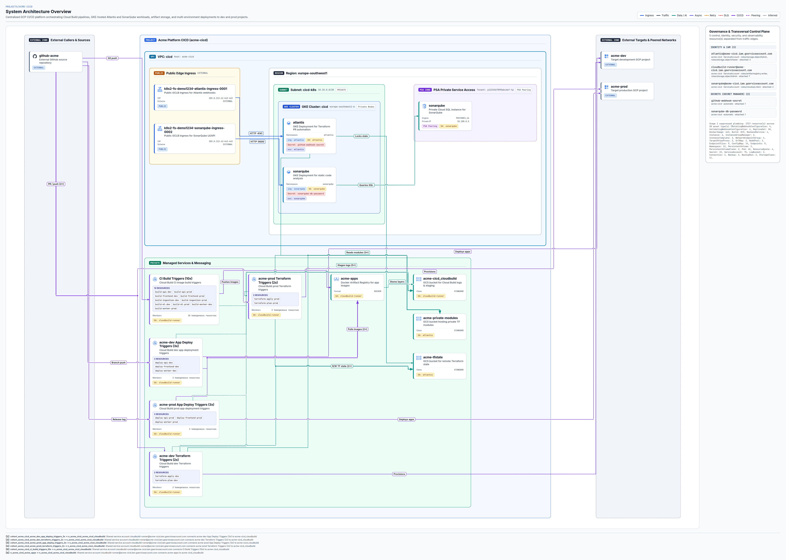

# Synthetic GCP Architecture Examples

This directory contains self-contained synthetic `architecture.yaml` (`schema_version: v1`) manifests and their offline-rendered deliverables (`.html`, `.pdf`, and `3x` per-view `.png` images). All project IDs, domains (RFC 2606), IP addresses (RFC 5737), and PSA tenant identifiers are fictional.

---

## 1. Multi-Project CI/CD, GKE DevOps & PSA Network (`platform-cicd/`)

**Scopes:** `acme-cicd` → out-of-scope targets `acme-dev`, `acme-prod`

Demonstrates a CI/CD and developer tooling platform spanning GitHub triggers, Cloud Build pipelines, Artifact Registry, Terraform state/module buckets, a GKE cluster hosting Atlantis and SonarQube behind Global HTTPS Load Balancers, and Private Services Access (PSA) peering to Cloud SQL.

- **Manifest:** [`platform-cicd/architecture.yaml`](platform-cicd/architecture.yaml) (kept identical to the test fixture [`../testdata/acme_cicd_expected.architecture.yaml`](../testdata/acme_cicd_expected.architecture.yaml))
- **Offline HTML Dossier:** [`platform-cicd/architecture.html`](platform-cicd/architecture.html)
- **Vector PDF Report:** [`platform-cicd/architecture.pdf`](platform-cicd/architecture.pdf)
- **Rendered View PNGs (`3x`):**
  - [`00-view_0_system_index.png`](platform-cicd/views/00-view_0_system_index.png) — System Index Map (`landscape_matrix`)
  - [`01-cicd_delivery_pipeline.png`](platform-cicd/views/01-cicd_delivery_pipeline.png) — CI/CD Delivery Pipeline (`stage_pipeline`)
  - [`02-gke_developer_platform.png`](platform-cicd/views/02-gke_developer_platform.png) — GKE Developer Platform & Ingress (`landscape_matrix`)
  - [`03-shared_network_psa.png`](platform-cicd/views/03-shared_network_psa.png) — Shared Network & PSA Topology (`hub_spoke`)



---

## 2. Cloud-Native E-Commerce Runtime, Data/AI Streaming & Shared VPC (`retail-cloud-native/`)

**Scopes:** `nova-retail-prod`, `nova-data-prod`, `nova-ai-prod`, `nova-shared-net`

Demonstrates a multi-project cloud-native retail platform combining Global HTTPS Load Balancing (with Cloud Armor), Cloud Run storefront and checkout services, Memorystore Redis over Private Service Connect (PSC), AlloyDB over Private Services Access (PSA), Shared VPC egress via Cloud NAT, Pub/Sub → Dataflow streaming analytics into Cloud Storage and BigQuery, Vertex AI recommendations, and Looker BI dashboards — including Day-2 curated `notes`, `INFERRED` edge footnotes, `excluded_resources`, and `rejected_edges`.

- **Manifest:** [`retail-cloud-native/architecture.yaml`](retail-cloud-native/architecture.yaml)
- **Offline HTML Dossier:** [`retail-cloud-native/architecture.html`](retail-cloud-native/architecture.html)
- **Vector PDF Report:** [`retail-cloud-native/architecture.pdf`](retail-cloud-native/architecture.pdf)
- **Rendered View PNGs (`3x`):**
  - [`00-view_0_system_index.png`](retail-cloud-native/views/00-view_0_system_index.png) — System Index Map (`landscape_matrix`)
  - [`01-data_ai_pipeline.png`](retail-cloud-native/views/01-data_ai_pipeline.png) — Streaming Analytics & Vertex AI Recommendations (`stage_pipeline`)
  - [`02-shared_vpc_connectivity.png`](retail-cloud-native/views/02-shared_vpc_connectivity.png) — Shared VPC & Private Service Connectivity (`hub_spoke`)
  - [`03-storefront_runtime.png`](retail-cloud-native/views/03-storefront_runtime.png) — Storefront & Checkout Runtime (`landscape_matrix`)


---

## Regenerating the Examples

Build the static binary and validate ([`../cmd/gcp-arch/validate.go`](../cmd/gcp-arch/validate.go)) + render ([`../cmd/gcp-arch/render.go`](../cmd/gcp-arch/render.go), [`../internal/render/`](../internal/render/)) each example completely offline (requires a local Chrome or Chromium binary for `pdf` and `png` output):

```bash
CGO_ENABLED=0 go build -o ./bin/gcp-arch ./cmd/gcp-arch

# 1. Platform CI/CD example
./bin/gcp-arch validate examples/platform-cicd/architecture.yaml
./bin/gcp-arch render examples/platform-cicd/architecture.yaml --format pdf,png,html -o examples/platform-cicd/

# 2. Retail Cloud-Native example
./bin/gcp-arch validate examples/retail-cloud-native/architecture.yaml
./bin/gcp-arch render examples/retail-cloud-native/architecture.yaml --format pdf,png,html -o examples/retail-cloud-native/
```
