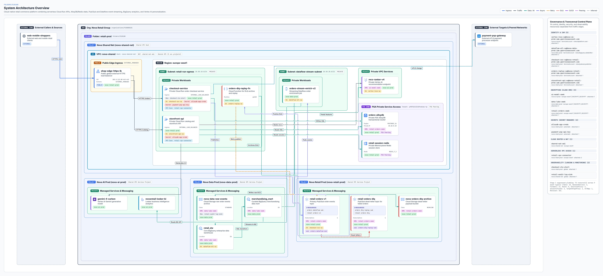
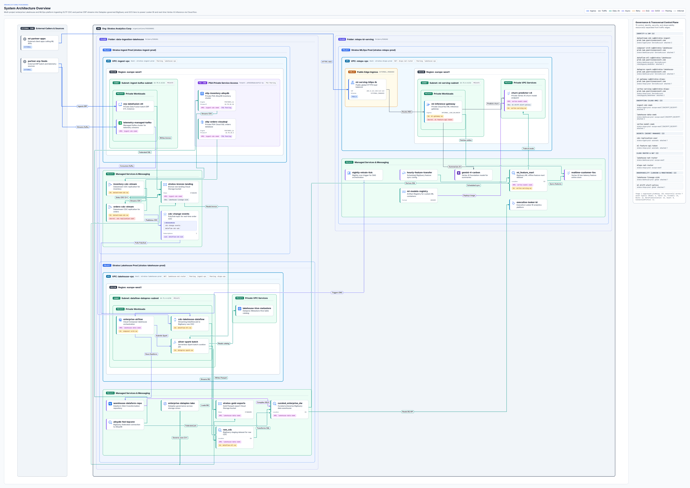
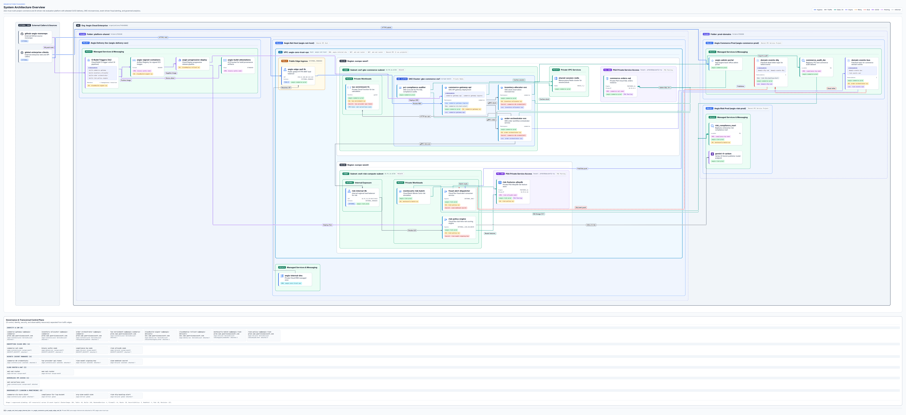

# Synthetic GCP Architecture Examples

This directory contains **6** self-contained synthetic `architecture.yaml` (`schema_version: v1`, `layered_flow`) reference bundles synthesized from paired Stage 1 `v3` facts fixtures (`testdata/acme_cicd_v3.facts.json` and `testdata/examples/*.facts.json`), together with their offline-rendered deliverables (`architecture.html`, 1:1 per-view vector `architecture.pdf`, and adaptive up to `2.0x` Retina `views/*.png` images).

Across all 6 bundles, the examples span **75 unique asset types** across **49 Google Cloud APIs** plus Kubernetes and external callers/targets, with `100%` Stage 1 resource & edge conservation (`conservation=PASS`, `view0=1.00`) and automated zero-overlap geometry and streaming PNG pixel verification (`render.InspectPNGFile`). All organization/folder/project IDs, domains (**RFC 2606**), public IPv4 addresses (**RFC 5737**), and PSA tenant identifiers are 100% synthetic.

| # | Bundle | Scope | Components / Primary | Views | Highlighted GCP Services |
| :-: | :--- | :--- | :---: | :---: | :--- |
| 1 | [`platform-cicd/`](platform-cicd/) | `projects/acme-cicd` → `acme-dev`, `acme-prod` | 17 / 39 | 3 | Cloud Build (20 triggers folded into 5 cohorts), GKE, Global HTTPS LB, Artifact Registry, Cloud SQL (PSA), GCS, Secret Manager, IAM |
| 2 | [`retail-cloud-native/`](retail-cloud-native/) | `folders/510100` (Shared VPC Host + 3 Service Projects) | 18 / 25 | 3 | Shared VPC, Cloud Run, Cloud Functions (DLQ replay), Global HTTPS LB, AlloyDB (PSA), Memorystore Redis (PSA), Pub/Sub + DLQ, Dataflow, BigQuery, Vertex AI + Gemini, Looker, Cloud NAT, Serverless VPC Access, KMS, Logging, Monitoring |
| 3 | [`fintech-global-payments/`](fintech-global-payments/) | `organizations/910100001` (2 Folders, 5 Projects) | 31 / 49 | 4 | Network Connectivity Center (Hub + Spokes), Dedicated Interconnect, HA VPN, Private Service Connect (Consumer EP + Producer Attachment), API Gateway, Private GKE + CronJob, Compute Engine MIG & Bastion, Cloud Run Service & Job, Cloud Functions (DLQ replay), Cloud Spanner, AlloyDB (PSA), Bigtable, Memorystore Cluster, Filestore, Cloud DNS, Pub/Sub + DLQ, Artifact Registry, KMS, Secret Manager |
| 4 | [`enterprise-lakehouse-mlops/`](enterprise-lakehouse-mlops/) | `organizations/920200001` (2 Folders, 3 Projects) | 30 / 39 | 4 | Managed Service for Apache Kafka, Cloud Data Fusion, Datastream CDC, Cloud Composer (Airflow), Dataflow Streaming, Dataproc Serverless Spark, Dataproc Metastore, Dataform, Dataplex, BigQuery + Federated Connection + Data Transfer, AlloyDB (PSA), Cloud SQL (PSA), Vertex AI Endpoint + Feature Online Store + Gemini, Looker, Cloud Run, Cloud Scheduler |
| 5 | [`agentic-ai-document-platform/`](agentic-ai-document-platform/) | `folders/540300` (Shared VPC Host + 2 Service Projects) | 25 / 32 | 3 | Vertex AI Reasoning Engine (Agent Engine), Vector Search IndexEndpoint, Gemini Foundation Model, Discovery Engine (Vertex AI Search + DataStore), Dialogflow CX, Document AI OCR, Eventarc, Cloud Workflows, Cloud Tasks, Cloud Scheduler, API Gateway, Cloud Run (MCP Gateway), Cloud Functions, Firestore, Memorystore Redis, BigQuery, Pub/Sub + DLQ |
| 6 | [`enterprise-zero-trust-mesh/`](enterprise-zero-trust-mesh/) | `organizations/940400001` (2 Folders, 4 Projects, 2 Regions) | 26 / 44 | 3 | Multi-Region Shared VPC (`europe-west1` + `europe-west4`), Cloud Build Cohort, Cloud Deploy, App Engine, Cloud Batch, Private GKE + CronJob, Internal Regional ILB, Global WAF LB, Cloud DNS, Cloud Run, Cloud Functions, Cloud SQL (PSA), AlloyDB (PSA), Memorystore Cluster, Pub/Sub + DLQ, BigQuery, Gemini, KMS, Log Bucket + SIEM Sink, Monitoring |

---

## 1. Multi-Project CI/CD, GKE DevOps & PSA Network (`platform-cicd/`)

**Facts Fixture:** [`../testdata/acme_cicd_v3.facts.json`](../testdata/acme_cicd_v3.facts.json) · **Scope:** `projects/acme-cicd` → out-of-scope `acme-dev`, `acme-prod` · **Conservation:** `PASS (39/39, view0=1.00)`

Centralized CI/CD and developer tooling platform folding 20 Cloud Build triggers into 5 homogeneous cohorts (`CI Build Triggers (10x)`, `Dev/Prod App Deploy Triggers (3x)`, `Dev/Prod Terraform Triggers (2x)`), GKE-hosted Atlantis and SonarQube behind Global HTTPS Load Balancers, Artifact Registry, GCS Terraform state/module buckets, and PSA-peered Cloud SQL. *(Note: the legacy hand-crafted fixture [`../testdata/acme_cicd_expected.architecture.yaml`](../testdata/acme_cicd_expected.architecture.yaml) remains frozen for legacy pipeline unit tests.)*

- **Deliverables:** [`architecture.yaml`](platform-cicd/architecture.yaml) · [`architecture.html`](platform-cicd/architecture.html) · [`architecture.pdf`](platform-cicd/architecture.pdf)
- **Rendered Views (Retina PNG):**
  - [`00-view_0_system_index.png`](platform-cicd/views/00-view_0_system_index.png) (`6240×4446` px) — System Architecture Overview (`17` components, `27` flows)
  - [`01-view_1.png`](platform-cicd/views/01-view_1.png) (`4164×4134` px) — Source Control, CI/CD Triggers & GKE Tooling (`10` components, `7` flows)
  - [`02-view_2.png`](platform-cicd/views/02-view_2.png) (`3400×2718` px) — Artifact Storage, State Backends & Target Envs (`7` components, `1` flow)


---

## 2. Cloud-Native E-Commerce Runtime, Data/AI Streaming & Shared VPC (`retail-cloud-native/`)

**Facts Fixture:** [`../testdata/examples/retail_cloud_native_v3.facts.json`](../testdata/examples/retail_cloud_native_v3.facts.json) · **Scope:** `folders/510100` (`nova-shared-net`, `nova-retail-prod`, `nova-data-prod`, `nova-ai-prod`) · **Conservation:** `PASS (25/25, view0=1.00)`

Multi-project Shared VPC e-commerce storefront and checkout runtime on Cloud Run behind a Global HTTPS Load Balancer, backed by PSA-isolated AlloyDB and Memorystore Redis, Pub/Sub event streaming with dead-letter queue replay via Cloud Functions, Dataflow streaming ETL into GCS and BigQuery, Vertex AI ranking + Gemini personalization, and Looker BI analytics.

- **Deliverables:** [`architecture.yaml`](retail-cloud-native/architecture.yaml) · [`architecture.html`](retail-cloud-native/architecture.html) · [`architecture.pdf`](retail-cloud-native/architecture.pdf)
- **Rendered Views (Retina PNG):**
  - [`00-view_0_system_index.png`](retail-cloud-native/views/00-view_0_system_index.png) (`7797×3585` px) — System Architecture Overview (`18` components, `20` flows)
  - [`01-view_1.png`](retail-cloud-native/views/01-view_1.png) (`3970×2454` px) — Edge Ingress & Storefront Compute (`4` components, `3` flows)
  - [`02-view_2.png`](retail-cloud-native/views/02-view_2.png) (`6954×3668` px) — Async Messaging, Data Platform & AI (`14` components, `10` flows)



---

## 3. Global FinTech Payments, Hybrid NCC Transit & Multi-Engine Ledger (`fintech-global-payments/`)

**Facts Fixture:** [`../testdata/examples/fintech_global_payments_v3.facts.json`](../testdata/examples/fintech_global_payments_v3.facts.json) · **Scope:** `organizations/910100001` (`Meridian FinTech Corp`, 2 folders, 5 projects) · **Conservation:** `PASS (49/49, view0=1.00)`

Regulated multi-folder global payments architecture uniting Dedicated Interconnect + HA VPN hybrid transit via Network Connectivity Center (NCC), Global WAF Load Balancing + OpenBanking API Gateway, Private Service Connect (PSC) consumer/producer fabrics, private GKE payment authorization and double-entry ledger microservices, Compute Engine HSM signing MIG and ops bastion, real-time Cloud Run + Bigtable fraud scoring, Pub/Sub settlement with DLQ replay and Cloud Run EOD Job, and multi-engine persistence across Cloud Spanner, PSA AlloyDB, Memorystore Cluster, and Filestore.

- **Deliverables:** [`architecture.yaml`](fintech-global-payments/architecture.yaml) · [`architecture.html`](fintech-global-payments/architecture.html) · [`architecture.pdf`](fintech-global-payments/architecture.pdf)
- **Rendered Views (Retina PNG):**
  - [`00-view_0_system_index.png`](fintech-global-payments/views/00-view_0_system_index.png) (`7105×3914` px) — System Architecture Overview (`31` components, `36` flows)
  - [`01-view_1.png`](fintech-global-payments/views/01-view_1.png) (`5576×3036` px) — Edge Ingress, Hybrid Transit & Scheduled Reconciler (`9` components, `6` flows)
  - [`02-view_2.png`](fintech-global-payments/views/02-view_2.png) (`6124×4527` px) — Core Payment Services, PSC Routing & Settlement Pipelines (`14` components, `14` flows)
  - [`03-view_3.png`](fintech-global-payments/views/03-view_3.png) (`6554×3148` px) — Financial Ledger Stores, Vaults & Card Network Egress (`8` components, off-page linked)


---

## 4. Enterprise CDC Lakehouse, Analytics Mesh & MLOps Platform (`enterprise-lakehouse-mlops/`)

**Facts Fixture:** [`../testdata/examples/enterprise_lakehouse_mlops_v3.facts.json`](../testdata/examples/enterprise_lakehouse_mlops_v3.facts.json) · **Scope:** `organizations/920200001` (`Stratos Analytics Corp`, 2 folders, 3 peered VPC projects) · **Conservation:** `PASS (39/39, view0=1.00)`

End-to-end enterprise data lakehouse and MLOps estate combining Managed Service for Apache Kafka, Cloud Data Fusion batch ERP ETL, Datastream CDC from PSA AlloyDB & Cloud SQL, Pub/Sub CDC events, Cloud Composer (Airflow), Dataflow streaming, Serverless Dataproc Spark + Dataproc Metastore, Dataform SQLX transformations, Dataplex data governance, BigQuery federated connections & scheduled transfers, Looker enterprise BI, and Vertex AI online inference (`Endpoint`, `FeatureOnlineStore`, `PublisherModel`) behind Global HTTPS Load Balancing and Cloud Run.

- **Deliverables:** [`architecture.yaml`](enterprise-lakehouse-mlops/architecture.yaml) · [`architecture.html`](enterprise-lakehouse-mlops/architecture.html) · [`architecture.pdf`](enterprise-lakehouse-mlops/architecture.pdf)
- **Rendered Views (Retina PNG):**
  - [`00-view_0_system_index.png`](enterprise-lakehouse-mlops/views/00-view_0_system_index.png) (`6249×4425` px) — System Architecture Overview (`30` components, `35` flows)
  - [`01-view_1.png`](enterprise-lakehouse-mlops/views/01-view_1.png) (`3974×2346` px) — External Ingress & Inference Gateway (`5` components, `2` flows)
  - [`02-view_2.png`](enterprise-lakehouse-mlops/views/02-view_2.png) (`3988×4790` px) — Streaming CDC, ETL & Orchestration Pipelines (`10` components, `5` flows)
  - [`03-view_3.png`](enterprise-lakehouse-mlops/views/03-view_3.png) (`6450×4323` px) — OLTP, Lakehouse Storage, Analytics & Vertex AI (`15` components, `10` flows)



---

## 5. Agentic AI, Enterprise RAG & Document OCR Platform (`agentic-ai-document-platform/`)

**Facts Fixture:** [`../testdata/examples/agentic_ai_document_platform_v3.facts.json`](../testdata/examples/agentic_ai_document_platform_v3.facts.json) · **Scope:** `folders/540300` (`Lumina AI Systems`, Shared VPC Host + 2 Service Projects) · **Conservation:** `PASS (32/32, view0=1.00)`

Production Generative AI and agentic workflow platform integrating Global HTTPS Load Balancing, API Gateway, Dialogflow CX, Cloud Run orchestrator and MCP tool gateway, Vertex AI Reasoning Engine (`Agent Engine`), Gemini 4 foundation model, Discovery Engine (`Vertex AI Search` + `DataStore`), Vertex Vector Search (`IndexEndpoint`), Firestore session state, Memorystore semantic cache, and an Eventarc + Cloud Workflows + Document AI OCR + Cloud Tasks + Pub/Sub DLQ document indexing pipeline.

- **Deliverables:** [`architecture.yaml`](agentic-ai-document-platform/architecture.yaml) · [`architecture.html`](agentic-ai-document-platform/architecture.html) · [`architecture.pdf`](agentic-ai-document-platform/architecture.pdf)
- **Rendered Views (Retina PNG):**
  - [`00-view_0_system_index.png`](agentic-ai-document-platform/views/00-view_0_system_index.png) (`6809×4092` px) — System Architecture Overview (`25` components, `29` flows)
  - [`01-view_1.png`](agentic-ai-document-platform/views/01-view_1.png) (`4582×2944` px) — Edge Ingress & Ingestion Triggers (`7` components, `3` flows)
  - [`02-view_2.png`](agentic-ai-document-platform/views/02-view_2.png) (`6400×4126` px) — RAG Agents, Document Pipelines & Datastores (`18` components, `19` flows)


---

## 6. Multi-Region Zero-Trust Mesh, Progressive Delivery & Risk AI (`enterprise-zero-trust-mesh/`)

**Facts Fixture:** [`../testdata/examples/enterprise_zero_trust_mesh_v3.facts.json`](../testdata/examples/enterprise_zero_trust_mesh_v3.facts.json) · **Scope:** `organizations/940400001` (`Aegis Cloud Enterprise`, 2 folders, 4 projects, `europe-west1` + `europe-west4`) · **Conservation:** `PASS (44/44, view0=1.00)`

Multi-region zero-trust enterprise mesh spanning a dual-region Shared VPC (`europe-west1` commerce GKE + Cloud Functions + App Engine admin portal; `europe-west4` internal regional ILB + Cloud Batch Monte Carlo simulation + Cloud Run risk scoring & alert dispatch), attested Cloud Build → Artifact Registry → Cloud Deploy progressive delivery, private Cloud DNS, PSA Cloud SQL & AlloyDB, Memorystore Cluster, Pub/Sub domain bus + DLQ, BigQuery compliance marts, Gemini risk reasoning, and 23 transversal security/governance controls.

- **Deliverables:** [`architecture.yaml`](enterprise-zero-trust-mesh/architecture.yaml) · [`architecture.html`](enterprise-zero-trust-mesh/architecture.html) · [`architecture.pdf`](enterprise-zero-trust-mesh/architecture.pdf)
- **Rendered Views (Retina PNG):**
  - [`00-view_0_system_index.png`](enterprise-zero-trust-mesh/views/00-view_0_system_index.png) (`7785×3566` px) — System Architecture Overview (`26` components, `32` flows)
  - [`01-view_1.png`](enterprise-zero-trust-mesh/views/01-view_1.png) (`6448×3156` px) — Edge Ingress, CI Triggers & Scheduled Batch (`8` components, `4` flows)
  - [`02-view_2.png`](enterprise-zero-trust-mesh/views/02-view_2.png) (`7326×3798` px) — Commerce Runtime, AI Risk Engine & Datastores (`18` components, `20` flows)



---

## Validating & Regenerating the Examples

Build the static binary and validate ([`../cmd/gcp-arch/validate.go`](../cmd/gcp-arch/validate.go)) + render ([`../cmd/gcp-arch/render.go`](../cmd/gcp-arch/render.go)) all 6 bundles offline against their paired `v3` facts fixtures (requires a local Chrome or Chromium binary for `pdf` and `png` output; append `--geometry-report` if you also want machine-readable `geometry_report.json` written to disk):

```bash
CGO_ENABLED=0 go build -o ./bin/gcp-arch ./cmd/gcp-arch

for pair in \
  "platform-cicd:testdata/acme_cicd_v3.facts.json" \
  "retail-cloud-native:testdata/examples/retail_cloud_native_v3.facts.json" \
  "fintech-global-payments:testdata/examples/fintech_global_payments_v3.facts.json" \
  "enterprise-lakehouse-mlops:testdata/examples/enterprise_lakehouse_mlops_v3.facts.json" \
  "agentic-ai-document-platform:testdata/examples/agentic_ai_document_platform_v3.facts.json" \
  "enterprise-zero-trust-mesh:testdata/examples/enterprise_zero_trust_mesh_v3.facts.json"
do
  slug="${pair%%:*}"
  facts="${pair#*:}"
  ./bin/gcp-arch validate "examples/$slug/architecture.yaml" --facts "$facts"
  ./bin/gcp-arch render "examples/$slug/architecture.yaml" --facts "$facts" --format pdf,png,html -o "examples/$slug/"
done
```

To re-synthesize `architecture.yaml` from scratch with Vertex AI Gemini 4 before rendering, run:

```bash
./bin/gcp-arch synthesize "$facts" \
  --vertex-project my-vertex-project \
  --vertex-location global \
  --model gemini-4-carbon \
  -o "examples/$slug/architecture.yaml"
```
