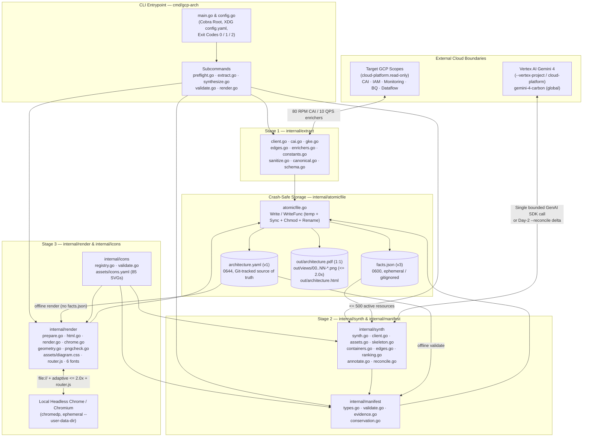
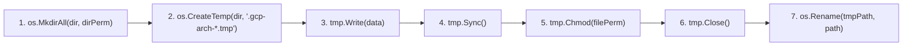

# System Architecture

`gcp-arch` is engineered as a strictly linear, three-stage architecture documentation pipeline packaged inside a single static Go binary (`CGO_ENABLED=0`). Each stage communicates solely through versioned, deterministic file contracts, cleanly separating read-only GCP cloud discovery from Vertex AI synthesis and 100% offline visual rendering.

---

## Architectural Philosophy & Core Design Invariants

Every package in `gcp-arch` enforces six non-negotiable engineering invariants:

1. **Strictly Linear Three-Stage Separation:** Cloud extraction (`extract`), LLM synthesis (`synthesize`), and visual export (`render` / `validate`) never bleed across boundaries. Credentials, network calls, and failure modes stay isolated to the exact stage that requires them.
2. **Git-Tracked `architecture.yaml` as Single Source of Truth:** `architecture.yaml` (`schema_version: v1`) embeds `{uri, asset_type, project_id}` inside every `backed_by` and `excluded_resources` entry. Teams review, curate, validate, and render `architecture.yaml` in Git completely independently of ephemeral `facts.json` snapshots.
3. **Deterministic Skeleton + Bounded Vertex AI Annotation:** Stage 2 never asks an LLM to invent URIs, services, or containment hierarchy. Go first constructs a deterministic containment skeleton (`internal/synth/{skeleton,containers,edges,ranking,assets}.go`) with 1:1 plumbing folds, homogeneous cohorts, transversal separation, topological ranks, and barycenter sub-ranks. A single bounded Vertex AI Gemini 4 call (`google.golang.org/genai` in `internal/synth/{annotate,client}.go`) supplies only semantic view partitioning, concise node subtitles, and edge verb/flow/tag enrichments. Go then enforces 100% resource and functional-edge conservation (`internal/manifest/conservation.go`), stateful datastore homogeneity, and strict `VERIFIED` directed-walk provenance via [`EvidenceIndex.WalkIssue` / `permissionOnly`](https://github.com/arrase/gcp-arch/blob/main/internal/manifest/evidence.go#L83-L120).
4. **Deterministic `View 0` Assembly & Day-2 Reconciliation:** `assembleManifest` in [`internal/synth/annotate.go`](https://github.com/arrase/gcp-arch/blob/main/internal/synth/annotate.go#L248-L315) locks canonical titles, view IDs (`view_0_system_index`, `view_1..view_3`), container hierarchy, and symmetric `off_page_refs` deterministically in Go. Day-2 reconciliation ([`internal/synth/reconcile.go`](https://github.com/arrase/gcp-arch/blob/main/internal/synth/reconcile.go)) takes a `< 5 ms`, `0`-LLM fast path when unchanged and preserves curated human component/view edits across delta runs.
5. **Zero-Network Offline Rendering & Streaming Verification:** Stage 3 embeds all 6 `.woff2` fonts (`Inter`, `JetBrains Mono`), all 85 inline SVG icons, `diagram.css`, and `router.js` directly into the binary. Generated HTML dossiers enforce strict [`Content-Security-Policy`](https://github.com/arrase/gcp-arch/blob/main/internal/render/html.go#L22) (`default-src 'none'; style-src 'unsafe-inline'; font-src data:; img-src data:; script-src 'unsafe-inline'`), headless Chrome runs with `--disable-background-networking` inside an ephemeral profile, and every PNG render automatically runs streaming scanline pixel & geometry verification (`internal/render/pngcheck.go`, `< 1 MB` Go RAM).
6. **Static Single-Binary Distribution (`CGO_ENABLED=0`):** Built with zero CGO dependencies and injected version metadata (`-ldflags "-s -w -X main.version=..."`), producing portable single-file binaries for Linux, macOS, and Windows.

---

## End-to-End System Architecture

The following diagram illustrates how the CLI (`cmd/gcp-arch`) coordinates all six `internal/` packages across external GCP read-only APIs, Vertex AI Gemini 4, local Chrome/Chromium (`chromedp`), and the on-disk artifact boundaries:

---

## Package & Source Map

The codebase is organized into one CLI entrypoint package ([`cmd/gcp-arch`](https://github.com/arrase/gcp-arch/tree/main/cmd/gcp-arch)), six focused internal packages ([`internal/*`](https://github.com/arrase/gcp-arch/tree/main/internal)) with strict acyclic dependency boundaries, and an end-to-end verification package ([`e2e/`](https://github.com/arrase/gcp-arch/tree/main/e2e)):

| Package | Source Files | Primary Responsibilities |
| :--- | :--- | :--- |
| **[`cmd/gcp-arch/`](https://github.com/arrase/gcp-arch/tree/main/cmd/gcp-arch)** | [`main.go`](https://github.com/arrase/gcp-arch/blob/main/cmd/gcp-arch/main.go), [`config.go`](https://github.com/arrase/gcp-arch/blob/main/cmd/gcp-arch/config.go), [`preflight.go`](https://github.com/arrase/gcp-arch/blob/main/cmd/gcp-arch/preflight.go), [`extract.go`](https://github.com/arrase/gcp-arch/blob/main/cmd/gcp-arch/extract.go), [`synthesize.go`](https://github.com/arrase/gcp-arch/blob/main/cmd/gcp-arch/synthesize.go), [`validate.go`](https://github.com/arrase/gcp-arch/blob/main/cmd/gcp-arch/validate.go), [`render.go`](https://github.com/arrase/gcp-arch/blob/main/cmd/gcp-arch/render.go), [`main_test.go`](https://github.com/arrase/gcp-arch/blob/main/cmd/gcp-arch/main_test.go), [`e2e_test.go`](https://github.com/arrase/gcp-arch/blob/main/cmd/gcp-arch/e2e_test.go) | Cobra command tree, `--version` metadata, `appDeps` dependency injection for offline CLI/E2E tests, `~/.config/gcp-arch/config.yaml` strict YAML loading & precedence (`CLI > env > config > defaults`), exit-code classification (`0` / `1` / `2`), and `lazyModelClient` deferral for zero-LLM Day-2 fast paths. |
| **[`internal/extract/`](https://github.com/arrase/gcp-arch/tree/main/internal/extract)** | [`client.go`](https://github.com/arrase/gcp-arch/blob/main/internal/extract/client.go), [`cai.go`](https://github.com/arrase/gcp-arch/blob/main/internal/extract/cai.go), [`gke.go`](https://github.com/arrase/gcp-arch/blob/main/internal/extract/gke.go), [`edges.go`](https://github.com/arrase/gcp-arch/blob/main/internal/extract/edges.go), [`enrichers.go`](https://github.com/arrase/gcp-arch/blob/main/internal/extract/enrichers.go), [`sanitize.go`](https://github.com/arrase/gcp-arch/blob/main/internal/extract/sanitize.go), [`canonical.go`](https://github.com/arrase/gcp-arch/blob/main/internal/extract/canonical.go), [`schema.go`](https://github.com/arrase/gcp-arch/blob/main/internal/extract/schema.go), [`constants.go`](https://github.com/arrase/gcp-arch/blob/main/internal/extract/constants.go), [`extract_test.go`](https://github.com/arrase/gcp-arch/blob/main/internal/extract/extract_test.go), [`schema_canonical_test.go`](https://github.com/arrase/gcp-arch/blob/main/internal/extract/schema_canonical_test.go), [`audit_test.go`](https://github.com/arrase/gcp-arch/blob/main/internal/extract/audit_test.go) | Read-only OAuth (`cloud-platform.read-only` via `cloud.google.com/go/auth` and `google.golang.org/api` options/transports) client setup, quota-project attribution, VPC-SC & error classification, `preflight` probes (`cloudresourcemanager/v1` + `synth.ProbeVertexModel`), `ReadTime`-pinned CAI `RESOURCE` + scoped `IAM_POLICY` streaming, GKE Ingress/NEG/Service/Workload Identity resolution, in-stream Cloud Build run folding, 7-day concurrent Monitoring (`consumed_api` + Vertex `PublisherModel` metrics) / BigQuery (`bigquery/v2`) / Dataflow (`dataflow/v1b3`) enrichers, per-asset allowlist attribute sanitization, AIP-122 URI canonicalization, and `v3` `facts.json` serialization. |
| **[`internal/synth/`](https://github.com/arrase/gcp-arch/tree/main/internal/synth)** | [`synth.go`](https://github.com/arrase/gcp-arch/blob/main/internal/synth/synth.go), [`client.go`](https://github.com/arrase/gcp-arch/blob/main/internal/synth/client.go), [`assets.go`](https://github.com/arrase/gcp-arch/blob/main/internal/synth/assets.go), [`skeleton.go`](https://github.com/arrase/gcp-arch/blob/main/internal/synth/skeleton.go), [`containers.go`](https://github.com/arrase/gcp-arch/blob/main/internal/synth/containers.go), [`edges.go`](https://github.com/arrase/gcp-arch/blob/main/internal/synth/edges.go), [`ranking.go`](https://github.com/arrase/gcp-arch/blob/main/internal/synth/ranking.go), [`annotate.go`](https://github.com/arrase/gcp-arch/blob/main/internal/synth/annotate.go), [`reconcile.go`](https://github.com/arrase/gcp-arch/blob/main/internal/synth/reconcile.go), [`synth_test.go`](https://github.com/arrase/gcp-arch/blob/main/internal/synth/synth_test.go), [`client_test.go`](https://github.com/arrase/gcp-arch/blob/main/internal/synth/client_test.go), [`reconcile_test.go`](https://github.com/arrase/gcp-arch/blob/main/internal/synth/reconcile_test.go) | `MaxActiveResources = 500` guardrail (`ScaleLimitError`), deterministic GCP containment skeleton (1:1 plumbing folds, homogeneous cohorts, unlimited hierarchy, transversal separation, Tarjan SCC cycle breaking, topological `TopoRank`, and 3-pass barycenter `SubRank`), Vertex AI Gemini 4 SDK client (`google.golang.org/genai` with `genai.BackendVertexAI` and `cloud.google.com/go/auth`, `gemini-4-carbon`, `genai.ThinkingLevel`, 240s per-attempt timeout, transient `genai.APIError` `429`/`503`/`504` retries), bounded single-call annotation & manifest assembly (`View 0` + stage-partitioned detail views + symmetric `off_page_refs`), and Day-2 `--reconcile` (`< 5 ms` zero-LLM fast path + curated edit preservation). |
| **[`internal/manifest/`](https://github.com/arrase/gcp-arch/tree/main/internal/manifest)** | [`types.go`](https://github.com/arrase/gcp-arch/blob/main/internal/manifest/types.go), [`validate.go`](https://github.com/arrase/gcp-arch/blob/main/internal/manifest/validate.go), [`evidence.go`](https://github.com/arrase/gcp-arch/blob/main/internal/manifest/evidence.go), [`conservation.go`](https://github.com/arrase/gcp-arch/blob/main/internal/manifest/conservation.go), [`manifest_test.go`](https://github.com/arrase/gcp-arch/blob/main/internal/manifest/manifest_test.go), [`rules_test.go`](https://github.com/arrase/gcp-arch/blob/main/internal/manifest/rules_test.go), [`conservation_test.go`](https://github.com/arrase/gcp-arch/blob/main/internal/manifest/conservation_test.go) | Git-tracked `architecture.yaml` (`v1`) Go schema, strict `yaml.v3` `KnownFields(true)` loader, deterministic canonical YAML marshaler, offline structural validator (`ValidateStructure`), deterministic primary-URI & functional-edge conservation verifier (`VerifyConservation`), and `--facts` provenance & coverage validator (`ValidateWithFacts` / `ValidateWithFactsAndConservation`). |
| **[`internal/render/`](https://github.com/arrase/gcp-arch/tree/main/internal/render)** | [`prepare.go`](https://github.com/arrase/gcp-arch/blob/main/internal/render/prepare.go), [`html.go`](https://github.com/arrase/gcp-arch/blob/main/internal/render/html.go), [`render.go`](https://github.com/arrase/gcp-arch/blob/main/internal/render/render.go), [`chrome.go`](https://github.com/arrase/gcp-arch/blob/main/internal/render/chrome.go), [`geometry.go`](https://github.com/arrase/gcp-arch/blob/main/internal/render/geometry.go), [`pngcheck.go`](https://github.com/arrase/gcp-arch/blob/main/internal/render/pngcheck.go), [`render_test.go`](https://github.com/arrase/gcp-arch/blob/main/internal/render/render_test.go), [`layout_test.go`](https://github.com/arrase/gcp-arch/blob/main/internal/render/layout_test.go), [`pngcheck_test.go`](https://github.com/arrase/gcp-arch/blob/main/internal/render/pngcheck_test.go), [`assets/diagram.css`](https://github.com/arrase/gcp-arch/blob/main/internal/render/assets/diagram.css), [`assets/router.js`](https://github.com/arrase/gcp-arch/blob/main/internal/render/assets/router.js), [`assets/fonts/*.woff2`](https://github.com/arrase/gcp-arch/tree/main/internal/render/assets/fonts) | Nested Flexbox container tree preparation (`PrepareDocument`), stage banners & transversal governance panels, self-contained strict-CSP HTML compilation with embedded base64 `.woff2` fonts, DOM-measured Hanan-grid A* orthogonal router + strict browser collision audit (`*LayoutCollisionError`), isolated `chromedp` 1:1 per-view vector PDF + adaptive up to `2.0x` Retina PNG export (`8,192px` max dim / `28M` px cap), and streaming scanline PNG pixel & geometry verification (`< 1 MB` Go RAM, `*GeometryReportError`, opt-in `geometry_report.json`). |
| **[`internal/icons/`](https://github.com/arrase/gcp-arch/tree/main/internal/icons)** | [`registry.go`](https://github.com/arrase/gcp-arch/blob/main/internal/icons/registry.go), [`validate.go`](https://github.com/arrase/gcp-arch/blob/main/internal/icons/validate.go), [`icons_test.go`](https://github.com/arrase/gcp-arch/blob/main/internal/icons/icons_test.go), [`assets/icons.yaml`](https://github.com/arrase/gcp-arch/blob/main/internal/icons/assets/icons.yaml) | Embedded 85-icon SVG catalog (`schema_version: v1`), strict `encoding/xml` anti-XSS/XXE validator (`ValidateSVG`), `<defs>` hoisting (`<filter>`, `<mask>`, gradients, `<clipPath>`, `<pattern>`), `icon-<key>-` ID prefixing, and deterministic pruned `<symbol>` sprite generation (`SymbolSprite`). |
| **[`internal/atomicfile/`](https://github.com/arrase/gcp-arch/tree/main/internal/atomicfile)** | [`atomicfile.go`](https://github.com/arrase/gcp-arch/blob/main/internal/atomicfile/atomicfile.go), [`atomicfile_test.go`](https://github.com/arrase/gcp-arch/blob/main/internal/atomicfile/atomicfile_test.go) | Crash-safe atomic file writer (`Write` and buffered `WriteFunc`) with explicit file and parent directory permissions and automatic temp-file cleanup on failure. |
| **[`e2e/`](https://github.com/arrase/gcp-arch/tree/main/e2e)** | [`catalog_e2e_test.go`](https://github.com/arrase/gcp-arch/blob/main/e2e/catalog_e2e_test.go), [`catalog_fixtures_test.go`](https://github.com/arrase/gcp-arch/blob/main/e2e/catalog_fixtures_test.go), [`geometry_test.go`](https://github.com/arrase/gcp-arch/blob/main/e2e/geometry_test.go) | Offline catalog fixture fidelity & manifest validation, streaming PNG regression and geometry verification matrices across reference bundles, stability checks (`CheckStability`), and gated live Vertex AI Gemini 4 + Chrome E2E suites (`GCP_ARCH_E2E=1`). |

---

## Data Contract Boundaries & Lifecycle

Each stage writes a distinct artifact class with explicit ownership, version control policy, and POSIX permissions:

| Artifact | Schema | Owner Stage | Git Status | Permissions (File / Dir) | Lifecycle & Guarantees |
| :--- | :---: | :--- | :--- | :---: | :--- |
| **`facts.json`** | `v3` (`FactsSchemaVersion`) | Stage 1 (`extract`) | **Ephemeral / gitignored** | `0600` / `0700` | Point-in-time (`ReadTime`-pinned) structural and 7-day runtime snapshot. Scrubbed of raw secret/env payloads via allowlists; deterministically sorted; consumed by `synthesize`, optional `validate --facts`, and optional `render --facts`. |
| **`architecture.yaml`** | `v1` (`manifest.SchemaVersion`) | Stage 2 (`synthesize`) + Human Curation | **Git-tracked source of truth** | `0644` / `0755` | Self-contained multi-view manifest carrying `{uri, asset_type, project_id}` provenance, curated titles, Day-2 `notes`, `transversal_items`, `structural_edges`, `excluded_resources`, `suppressed_plumbing_counts`, `rejected_edges`, and `acknowledged_edges`. Updated incrementally in place via `--reconcile`. |
| **`architecture.pdf`**, **`views/*.png`**, **`architecture.html`** *(+ opt-in `geometry_report.json`)* | PDF (1:1) / Retina PNG (`<= 2.0x`) / HTML5 | Stage 3 (`render`) | **Generated deliverables** (or committed in [`examples/`](https://github.com/arrase/gcp-arch/tree/main/examples)) | `0644` / `0755` | Produced strictly offline from `architecture.yaml` alone. Enforces `router.js` zero-collision checks (`*LayoutCollisionError`, exit `2`) and automatic streaming scanline PNG pixel & geometry verification (`*GeometryReportError`, exit `2`, `< 1 MB` Go RAM) on every PNG render. |

### Crash-Safe Atomic File Writes ([`internal/atomicfile/atomicfile.go`](https://github.com/arrase/gcp-arch/blob/main/internal/atomicfile/atomicfile.go))

Every file written by `gcp-arch` (`facts.json`, `architecture.yaml`, `architecture.pdf`, `views/*.png`, `architecture.html`, and optional `geometry_report.json`) passes through `atomicfile.Write(path, data, filePerm, dirPerm)` (or streaming `atomicfile.WriteFunc`):

- **Same-Directory Staging:** Creating the temporary file inside `filepath.Dir(path)` guarantees `os.Rename` operates on the same filesystem mount for atomic POSIX replacement.
- **Durability Before Visibility:** `tmp.Sync()` flushes file data to disk and `tmp.Chmod(filePerm)` applies exact permissions (`0600` for `facts.json`, `0644` for manifests and rendered outputs) *before* `os.Rename` exposes the target path.
- **Automatic Cleanup:** A deferred guard closes the file handle if still open and removes the temporary file if any step fails before `Rename` commits, ensuring interrupted runs never leave corrupted files or stray `.tmp` artifacts behind.

---

## Scale, Concurrency & Rate-Limiting Envelope

`gcp-arch` bounds cloud API rates, worker concurrency, and synthesis scope to stay safely inside GCP quotas and produce clean, readable diagrams:

| Subsystem | Guardrail / Parameter | Default / Cap | Source Location |
| :--- | :--- | :---: | :--- |
| **Cloud Asset Inventory (`ListAssets`)** | Token-bucket rate limiter | **`80` RPM** (`DefaultCAIRPM`, below GCP's 100 RPM ceiling; page size `1000`, `3` retries on 429/quota) | [`internal/extract/client.go`](https://github.com/arrase/gcp-arch/blob/main/internal/extract/client.go), [`cai.go`](https://github.com/arrase/gcp-arch/blob/main/internal/extract/cai.go) |
| **Cloud Monitoring (`ListTimeSeries`)** | Token-bucket rate limiter + worker pool | **`10` QPS** (`DefaultMonitoringQPS`), **`8` concurrent workers** (`maxEnrichWorkers`), 7-day lookback aligned daily | [`internal/extract/client.go`](https://github.com/arrase/gcp-arch/blob/main/internal/extract/client.go), [`enrichers.go`](https://github.com/arrase/gcp-arch/blob/main/internal/extract/enrichers.go#L27) |
| **BigQuery & Dataflow Enrichers** | Per-enricher rate limiter + worker pool | **`10` QPS** (`DefaultEnricherQPS`), **`8` concurrent workers** (`maxEnrichWorkers`), BigQuery capped at `20` pages × `1000` jobs (`enrichmentLookback = 7d`) | [`internal/extract/client.go`](https://github.com/arrase/gcp-arch/blob/main/internal/extract/client.go), [`enrichers.go`](https://github.com/arrase/gcp-arch/blob/main/internal/extract/enrichers.go) |
| **Cloud Build In-Stream Folding** | `--cloudbuild-runs` per trigger | **`3`** latest succeeded runs (`DefaultCloudBuildRuns`; `5` max triggerless runs) | [`internal/extract/cai.go`](https://github.com/arrase/gcp-arch/blob/main/internal/extract/cai.go) |
| **Stage 2 Active Resource Ceiling** | `MaxActiveResources` pre-LLM gate | **`<= 500`** active `FactResource` entries (`ScaleLimitError`, exit `2`, zero Vertex AI calls on overflow) | [`internal/synth/synth.go`](https://github.com/arrase/gcp-arch/blob/main/internal/synth/synth.go#L14) |
| **Stage 2 Vertex AI Annotation** | Single bounded GenAI SDK call + retries | **`1`** call per synthesis (`defaultVertexAttemptTimeout = 240s`, up to **`3`** attempts on `genai.APIError` `429`/`503`/`504`, EOF, or timeout; `2s`/`4s` backoff) | [`internal/synth/client.go`](https://github.com/arrase/gcp-arch/blob/main/internal/synth/client.go#L24-L27) |
| **Stage 2 Detail View Partitioning** | `targetDetailViewCount` & validator limits | `0` detail views for `<= 14` nodes, `2` for `15..28`, `3` for `> 28` (schema allows up to `16`); `<= 16`-rune edge verbs | [`internal/synth/annotate.go`](https://github.com/arrase/gcp-arch/blob/main/internal/synth/annotate.go#L156-L165), [`internal/manifest/validate.go`](https://github.com/arrase/gcp-arch/blob/main/internal/manifest/validate.go) |
| **Day-2 `--reconcile` Fast Path** | Zero-delta URI & conservation check | **`< 5 ms`**, **`0` Vertex AI calls** (`lazyModelClient` never initializes Vertex ADC; unchanged file untouched on disk) | [`cmd/gcp-arch/synthesize.go`](https://github.com/arrase/gcp-arch/blob/main/cmd/gcp-arch/synthesize.go), [`internal/synth/reconcile.go`](https://github.com/arrase/gcp-arch/blob/main/internal/synth/reconcile.go#L75-L106) |
| **Stage 3 PNG Raster & Memory Cap** | Adaptive Retina DPI + streaming scanlines | Up to **`2.0x`** DPI clamped to **`8,192px`** max dim & **`28M`** px area; streaming verifier uses **`< 1 MB`** Go RAM | [`internal/render/chrome.go`](https://github.com/arrase/gcp-arch/blob/main/internal/render/chrome.go#L26-L28), [`internal/render/pngcheck.go`](https://github.com/arrase/gcp-arch/blob/main/internal/render/pngcheck.go) |

---

## Next Steps

- **Stage 1 Details:** Dive into CAI folding, GKE resolution, and enrichers in [Stage 1 — Read-Only Extraction](extraction.md).
- **Stage 2 Details:** Explore the deterministic containment skeleton, bounded Vertex AI annotation, conservation checks, and Day-2 reconciliation in [Stage 2 — Gemini 4 Synthesis & Day-2](synthesis.md).
- **Stage 3 Details:** Inspect nested Flexbox layout, `router.js`, Chrome export, and streaming PNG verification in [Stage 3 — Offline Rendering & Routing](rendering.md).
- **Build, Test & Contribute:** Set up your local Go toolchain and run tests in the [Developer Guide](developer_guide.md).
