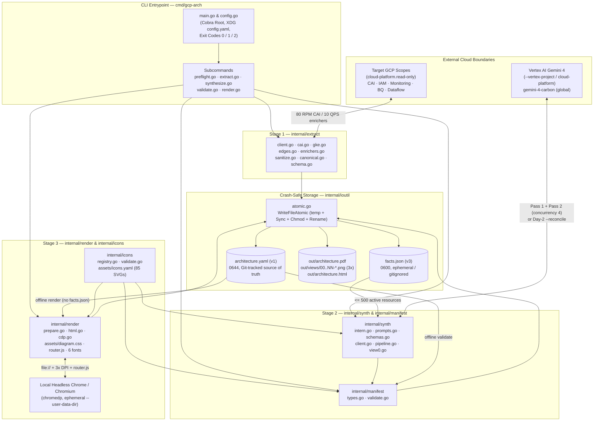
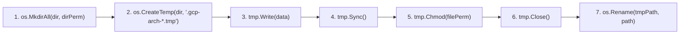

# System Architecture

`gcp-arch` is engineered as a strictly linear, three-stage architecture documentation pipeline packaged inside a single static Go binary (`CGO_ENABLED=0`). Each stage communicates solely through versioned, deterministic file contracts, cleanly separating read-only GCP cloud discovery from Vertex AI synthesis and 100% offline visual rendering.

---

## Architectural Philosophy & Core Design Invariants

Every package in `gcp-arch` enforces six non-negotiable engineering invariants:

1. **Strictly Linear Three-Stage Separation:** Cloud extraction (`extract`), LLM synthesis (`synthesize`), and visual export (`render` / `validate`) never bleed across boundaries. Credentials, network calls, and failure modes stay isolated to the exact stage that requires them.
2. **Git-Tracked `architecture.yaml` as Single Source of Truth:** `architecture.yaml` (`schema_version: v1`) embeds `{uri, asset_type, project_id}` inside every `backed_by` and `excluded_resources` entry. Teams review, curate, validate, and render `architecture.yaml` in Git completely independently of ephemeral `facts.json` snapshots.
3. **Closed-World Synthesis:** Stage 2 never asks an LLM to invent URIs, services, or relationships. Every resource and edge is interned into compact short IDs (`r_0001`, `e_0001`) before prompting, and Go deterministically enforces 100% resource accounting, stateful datastore homogeneity, and directed-walk `FactEdge` provenance on every `VERIFIED` edge.
4. **Deterministic `View 0` Projection:** `view_0_system_index` is never generated by an LLM. Go (`internal/synth/view0.go`) deterministically derives `View 0` from populated detail views whenever `>= 2` detail views exist, keeping cross-view maps reproducible across Day-1 generation and Day-2 reconciliation.
5. **Zero-Network Offline Rendering:** Stage 3 embeds all 6 `.woff2` fonts (`Inter`, `JetBrains Mono`), all 85 inline SVG icons, `diagram.css`, and `router.js` directly into the binary. Generated HTML dossiers enforce strict `Content-Security-Policy: default-src 'none'`, and headless Chrome runs with `--disable-background-networking` inside an ephemeral profile.
6. **Static Single-Binary Distribution (`CGO_ENABLED=0`):** Built with zero CGO dependencies and injected version metadata (`-ldflags "-s -w -X main.version=..."`), producing portable single-file binaries for Linux, macOS, and Windows.

---

## End-to-End System Architecture

The following diagram illustrates how the CLI (`cmd/gcp-arch`) coordinates all six `internal/` packages across external GCP read-only APIs, Vertex AI Gemini 4, local Chrome/Chromium (`chromedp`), and the on-disk artifact boundaries:

---

## Package & Source Map

The codebase is organized into one CLI entrypoint package (`cmd/gcp-arch`) and six focused internal packages (`internal/*`) with strict acyclic dependency boundaries:

| Package | Source Files | Primary Responsibilities |
| :--- | :--- | :--- |
| **`cmd/gcp-arch/`** | `main.go`, `config.go`, `preflight.go`, `extract.go`, `synthesize.go`, `validate.go`, `render.go`, `main_test.go`, `e2e_test.go` | Cobra command tree, `--version` metadata, `appDeps` dependency injection for offline CLI/E2E tests, `~/.config/gcp-arch/config.yaml` strict YAML loading & precedence (`CLI > env > config > defaults`), exit-code classification (`0` / `1` / `2`), and `lazyModelClient` deferral for zero-LLM Day-2 fast paths. |
| **`internal/extract/`** | `client.go`, `cai.go`, `gke.go`, `edges.go`, `enrichers.go`, `sanitize.go`, `canonical.go`, `schema.go`, `constants.go`, `extract_test.go`, `schema_canonical_test.go` | Read-only OAuth (`cloud-platform.read-only`) client setup, quota-project attribution, VPC-SC & error classification, `preflight` probes, `ReadTime`-pinned CAI `RESOURCE` + scoped `IAM_POLICY` streaming, GKE Ingress/NEG/Service/Workload Identity resolution, in-stream Cloud Build run folding, 7-day concurrent Monitoring (`consumed_api` + Vertex `PublisherModel` metrics) / BigQuery / Dataflow enrichers, per-asset allowlist attribute sanitization, AIP-122 URI canonicalization, and `v3` `facts.json` serialization. |
| **`internal/synth/`** | `pipeline.go`, `intern.go`, `prompts.go`, `schemas.go`, `client.go`, `view0.go`, `synth_test.go` | `MaxActiveResources = 500` guardrail (`ScaleLimitError`), deterministic short-ID interning (`r_0001..`, `e_0001..`), Pass 1 planning + Pre-Pass-2 gate, bounded concurrent Pass 2 per-view population (`errgroup`, up to `maxValidationRetries = 2` targeted retries), Vertex AI `google.golang.org/genai` client (`gemini-4-carbon`, `ThinkingLevel`), deterministic Go `View 0` (`BuildSystemIndexView`), and Day-2 `--reconcile` delta patching with `< 100 ms` zero-LLM unchanged/deletion-only fast paths. |
| **`internal/manifest/`** | `types.go`, `validate.go`, `manifest_test.go` | Git-tracked `architecture.yaml` (`v1`) Go schema, strict `yaml.v3` `KnownFields(true)` loader, deterministic canonical YAML marshaler (preserving placement/meta/evidence order), offline structural validator (`ValidateStructure`), and `--facts` provenance & 100% resource coverage validator (`ValidateWithFacts`) with dual-BFS directed-walk verification. |
| **`internal/render/`** | `prepare.go`, `html.go`, `cdp.go`, `render_test.go`, `assets/diagram.css`, `assets/router.js`, `assets/fonts/*.woff2` | Deterministic 3-sweep barycenter row ordering, dense column compaction, flat depth 1..2 container spans, explicit/auto bus spine grouping, clear horizontal waypoint selection, self-contained strict-CSP HTML compilation with embedded base64 `.woff2` fonts, orthogonal corridor router + 6-class collision checker (`LayoutCollisionError`), Chrome binary discovery, and isolated `chromedp` PDF / `3x` PNG / HTML export. |
| **`internal/icons/`** | `registry.go`, `validate.go`, `icons_test.go`, `assets/icons.yaml` | Embedded 85-icon SVG catalog (`schema_version: v1`), strict `encoding/xml` anti-XSS/XXE validator (`ValidateSVG`), `<defs>` hoisting (`<filter>`, `<mask>`, gradients, `<clipPath>`, `<pattern>`), `icon-<key>-` ID prefixing, and deterministic pruned `<symbol>` sprite generation (`SymbolSprite`). |
| **`internal/ioutil/`** | `atomic.go`, `atomic_test.go` | Crash-safe atomic file writer (`WriteFileAtomic`) with explicit file and parent directory permissions and automatic temp-file cleanup on failure. |

---

## Data Contract Boundaries & Lifecycle

Each stage writes a distinct artifact class with explicit ownership, version control policy, and POSIX permissions:

| Artifact | Schema | Owner Stage | Git Status | Permissions (File / Dir) | Lifecycle & Guarantees |
| :--- | :---: | :--- | :--- | :---: | :--- |
| **`facts.json`** | `v3` (`FactsSchemaVersion`) | Stage 1 (`extract`) | **Ephemeral / gitignored** | `0600` / `0700` | Point-in-time (`ReadTime`-pinned) structural and 7-day runtime snapshot. Scrubbed of raw secret/env payloads via allowlists; deterministically sorted; consumed by `synthesize` and optional `validate --facts`. |
| **`architecture.yaml`** | `v1` (`manifest.SchemaVersion`) | Stage 2 (`synthesize`) + Human Curation | **Git-tracked source of truth** | `0644` / `0755` | Self-contained multi-view manifest carrying `{uri, asset_type, project_id}` provenance, curated titles, Day-2 `notes`, `excluded_resources`, and `rejected_edges`. Updated incrementally in place via `--reconcile`. |
| **`architecture.pdf`**, **`views/*.png`**, **`architecture.html`** | PDF / PNG (`3x`) / HTML5 | Stage 3 (`render`) | **Generated deliverables** (or committed in `examples/`) | `0644` / `0755` | Produced strictly offline from `architecture.yaml` alone. Written only after `router.js` verifies zero layout collisions (`ok: true`). |

### Crash-Safe Atomic File Writes (`internal/ioutil/atomic.go`)

Every file written by `gcp-arch` (`facts.json`, `architecture.yaml`, `architecture.pdf`, `views/*.png`, and `architecture.html`) passes through `ioutil.WriteFileAtomic(path, data, filePerm, dirPerm)`:

- **Same-Directory Staging:** Creating the temporary file inside `filepath.Dir(path)` guarantees `os.Rename` operates on the same filesystem mount for atomic POSIX replacement.
- **Durability Before Visibility:** `tmp.Sync()` flushes file data to disk and `tmp.Chmod(filePerm)` applies exact permissions (`0600` for `facts.json`, `0644` for manifests and rendered outputs) *before* `os.Rename` exposes the target path.
- **Automatic Cleanup:** A deferred guard closes the file handle if still open and removes the temporary file if any step fails before `Rename` commits, ensuring interrupted runs never leave corrupted files or stray `.tmp` artifacts behind.

---

## Scale, Concurrency & Rate-Limiting Envelope

`gcp-arch` bounds cloud API rates, worker concurrency, and synthesis scope to stay safely inside GCP quotas and produce clean, readable diagrams:

| Subsystem | Guardrail / Parameter | Default / Cap | Source Location |
| :--- | :--- | :---: | :--- |
| **Cloud Asset Inventory (`ListAssets`)** | Token-bucket rate limiter | **`80` RPM** (`DefaultCAIRPM`, below GCP's 100 RPM ceiling; page size `1000`, `3` retries on 429/quota) | `internal/extract/client.go`, `cai.go` |
| **Cloud Monitoring (`ListTimeSeries`)** | Token-bucket rate limiter | **`10` QPS** (`DefaultMonitoringQPS`, 7-day lookback aligned daily) | `internal/extract/client.go`, `enrichers.go` |
| **BigQuery & Dataflow Enrichers** | Per-enricher rate limiter + worker pool | **`10` QPS** (`DefaultEnricherQPS`), **`8` concurrent workers** (`maxEnrichWorkers`), BigQuery capped at `20` pages × `1000` jobs (`enrichmentLookback = 7d`) | `internal/extract/client.go`, `enrichers.go` |
| **Cloud Build In-Stream Folding** | `--cloudbuild-runs` per trigger | **`3`** latest succeeded runs (`DefaultCloudBuildRuns`; `5` max triggerless runs) | `internal/extract/cai.go` |
| **Stage 2 Active Resource Ceiling** | `MaxActiveResources` pre-LLM gate | **`<= 500`** active `FactResource` entries (`ScaleLimitError`, exit `2`, zero Vertex AI calls on overflow) | `internal/synth/pipeline.go` |
| **Stage 2 Pass-2 View Synthesis** | `--concurrency` bounded `errgroup` | **`4`** concurrent view calls (`DefaultConcurrency`), up to **`2`** validation retries (`maxValidationRetries = 2`, 3 calls max) | `internal/synth/pipeline.go` |
| **View & Component Density Caps** | Schema / Validator limits | `1..12` blocks per detail view, `1..16` on `View 0`, container depth `<= 2`, `<= 4` `inline_meta` rows, `<= 16`-rune edge verbs | `internal/manifest/validate.go` |
| **Day-2 `--reconcile` Fast Path** | Zero-delta & deletion-only check | **`< 100 ms`**, **`0` Vertex AI calls** (`lazyModelClient` never initializes Vertex ADC; unchanged file untouched on disk) | `cmd/gcp-arch/synthesize.go`, `internal/synth/pipeline.go` |
| **Stage 3 Router Reflow** | Automatic corridor widening | Up to **`2`** widening passes (`MAX_REFLOW_PASSES`), capped at **`160px`** (`MAX_CORRIDOR_SIZE`) per corridor | `internal/render/assets/router.js` |

---

## Next Steps

- **Stage 1 Details:** Dive into CAI folding, GKE resolution, and enrichers in [Stage 1 — Read-Only Extraction](extraction.md).
- **Stage 2 Details:** Explore short-ID interning, prompts, `View 0`, and Day-2 reconciliation in [Stage 2 — Gemini 4 Synthesis & Day-2](synthesis.md).
- **Stage 3 Details:** Inspect CSS Grid corridors, `router.js`, and Chrome export in [Stage 3 — Offline Rendering & Routing](rendering.md).
- **Build, Test & Contribute:** Set up your local Go toolchain and run tests in the [Developer Guide](developer_guide.md).
