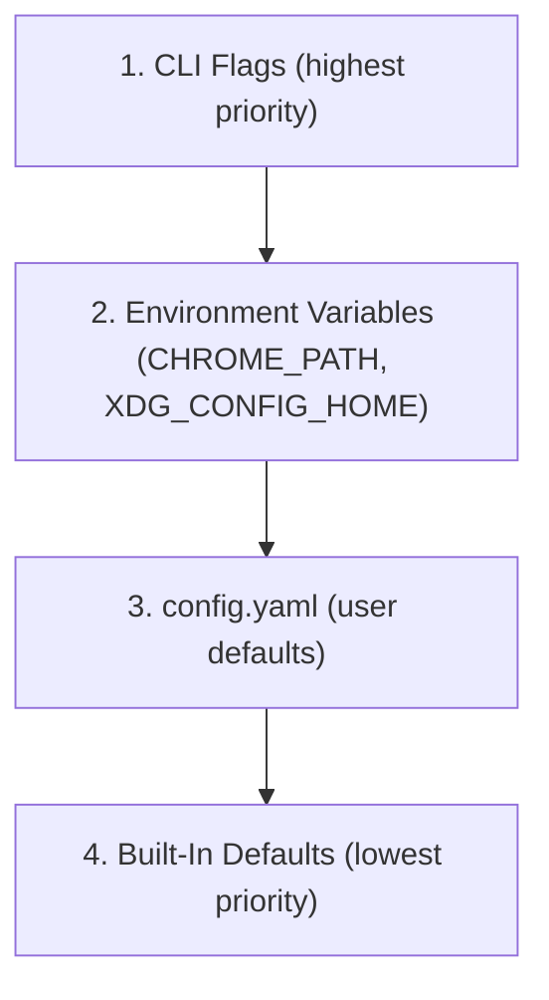
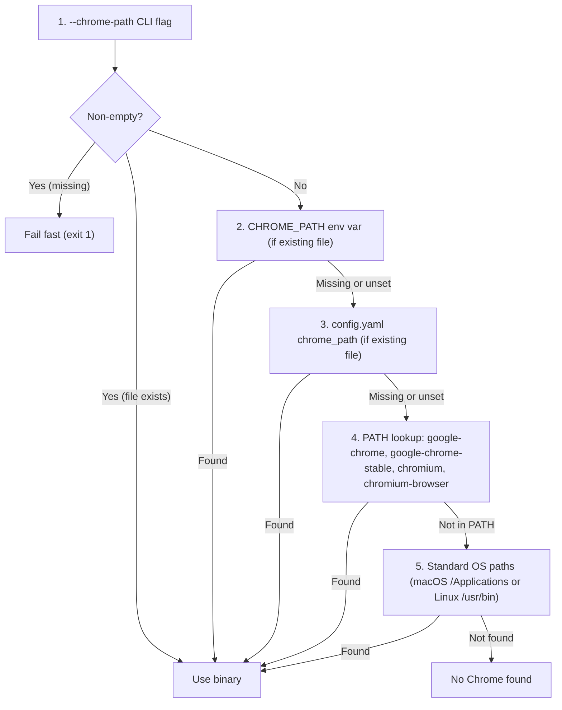

# CLI & Configuration Reference

**GCP Arch** (`gcp-arch`) is a static, single-binary Go CLI built on Cobra that orchestrates the entire three-stage architecture pipeline across five subcommands: `preflight`, `extract`, `synthesize`, `validate`, and `render`.

Every command supports zero-touch defaults via an optional XDG YAML configuration file (`~/.config/gcp-arch/config.yaml`), strict schema validation on startup, predictable machine-readable JSON reports, and deterministic exit codes tailored for both interactive engineering sessions and CI/CD automation.

---

## 30-Second Quickstart

=== "End-to-End Pipeline"
    Verify permissions, extract read-only facts, synthesize `architecture.yaml`, validate provenance, and render print-ready artifacts:

    ```bash
    # 1. Verify read-only target permissions and zero-token Vertex AI readiness
    gcp-arch preflight --projects acme-cicd --vertex-project consultant-ai-sandbox

    # 2. Extract sanitized v3 facts (0600, gitignored)
    gcp-arch extract --projects acme-cicd -o facts.json

    # 3. Synthesize Git-tracked architecture.yaml via Vertex AI Gemini 4
    gcp-arch synthesize facts.json --vertex-project consultant-ai-sandbox -o architecture.yaml

    # 4. Validate offline structure + 100% resource coverage & edge provenance
    gcp-arch validate architecture.yaml --facts facts.json

    # 5. Render offline PDF, 3x PNGs, and standalone HTML dossier
    gcp-arch render architecture.yaml --format pdf,png,html -o out/
    ```

=== "Day-2 Drift Reconciliation"
    Re-extract live facts and incrementally reconcile changes into an existing `architecture.yaml` in place:

    ```bash
    gcp-arch extract --projects acme-cicd -o facts.json
    gcp-arch synthesize facts.json --reconcile architecture.yaml --vertex-project consultant-ai-sandbox
    ```

=== "Offline CI/CD Gate"
    Validate and render a Git-tracked `architecture.yaml` with zero GCP credentials and zero network calls:

    ```bash
    gcp-arch validate architecture.yaml --json
    gcp-arch render architecture.yaml --format pdf,png,html -o dist/
    ```

---

## Root Command (`gcp-arch`)

Invoking `gcp-arch` prints pipeline help, configuration precedence, and exit code semantics ([`cmd/gcp-arch/main.go`](https://github.com/arrase/gcp-arch/blob/main/cmd/gcp-arch/main.go)).

```bash
gcp-arch [command]
gcp-arch --version
gcp-arch --help
```

| Behavior | Implementation Detail |
| :--- | :--- |
| **Binary Version (`--version`, `-v`)** | Defaults to `dev` (`var version = "dev"` in [`cmd/gcp-arch/main.go`](https://github.com/arrase/gcp-arch/blob/main/cmd/gcp-arch/main.go#L27)). Official release binaries inject the Git tag at build time via `-ldflags "-s -w -X main.version=${VERSION}"` ([`.github/workflows/release.yml`](https://github.com/arrase/gcp-arch/blob/main/.github/workflows/release.yml)). |
| **Shell Completion Command** | Disabled by default (`CompletionOptions{DisableDefaultCmd: true}`) to keep the CLI surface restricted to the five pipeline subcommands. |
| **Error & Usage Output** | `SilenceUsage: true` and `SilenceErrors: true` suppress duplicated Cobra usage dumps. Errors print once to `stderr` as `Error: <message>`. |
| **Strict Config Pre-Flight (`PersistentPreRunE`)** | Loads and strictly validates `~/.config/gcp-arch/config.yaml` (or `$XDG_CONFIG_HOME/gcp-arch/config.yaml`) before **every** subcommand executes—including offline `validate` and `render`. A typo, unknown YAML key, trailing YAML document, or out-of-range setting aborts immediately with exit code `2` before any command logic runs. |

!!! warning "`PersistentPreRunE` Applies to Offline Commands"
    Even though `validate` and `render` do not contact Google Cloud, `gcp-arch` still parses and validates your `config.yaml` on startup so broken configuration files never fail silently. If you maintain an invalid `config.yaml`, `validate` and `render` exit `2` until the configuration file is fixed (or `XDG_CONFIG_HOME` points elsewhere).

---

## Subcommands Reference

### 1. `preflight` — Permission & Vertex AI Readiness Probe

Probes target-scope read-only permissions (Cloud Asset Inventory, Folder `displayName` visibility, Cloud Monitoring, BigQuery `jobs.list`, and Dataflow `jobs.list`) using `cloud-platform.read-only` credentials. When `--vertex-project` is provided, also runs a zero-token Vertex AI IAM and model readiness check using `cloud-platform` credentials. See [Security, IAM & Preflight](security_iam.md) for probe internals.

```bash
gcp-arch preflight [flags]
```

**Arguments:** None (`cobra.NoArgs`). At least one target scope (`--org`, `--folder`, or `--projects`) must be provided via CLI or `config.yaml`.

#### Flags

| Flag | Short / Alias | Type | Default | `config.yaml` Key | Validation & Behavior |
| :--- | :--- | :--- | :--- | :--- | :--- |
| `--org` | — | `stringArray` | `[]` | `org` | Repeatable or comma-separated Organization IDs. Optional `organizations/` prefix is stripped; empty tokens, slashes, and whitespace are rejected. |
| `--folder` | — | `stringArray` | `[]` | `folder` | Repeatable or comma-separated Folder IDs. Optional `folders/` prefix is stripped; empty tokens, slashes, and whitespace are rejected. |
| `--projects` | `--project` | `stringArray` | `[]` | `projects` | Repeatable or comma-separated Project IDs (`--project` is normalized to `--projects`). Optional `projects/` prefix is stripped. |
| `--project-alias` | — | `stringArray` | `[]` | `project_aliases` | Repeatable `<NUMBER=ID>` mappings. `NUMBER` must be all ASCII digits; `ID` must start with `[a-zA-Z0-9]` and contain only `[a-zA-Z0-9_-]`. Conflicting aliases for the same number exit `2`. Overlays `config.yaml`. |
| `--quota-project` | — | `string` | `""` *(ADC `quota_project_id`)* | `quota_project` | Explicit GCP quota/billing project ID (`X-Goog-User-Project`). Never falls back to target workload projects. |
| `--vertex-project` | — | `string` | `""` | `vertex_project` | Optional GCP billing project ID for zero-token `vertex.iam` (`:testIamPermissions`) and `vertex.model` (`Models.Get`) probes. |
| `--vertex-location` | — | `string` | `"global"` | `vertex_location` | Vertex AI location for `vertex.model` probe (`extract.DefaultVertexLocation`). |
| `--model` | — | `string` | `"gemini-4-carbon"` | `model` | Vertex AI model ID for `vertex.model` probe (`extract.DefaultVertexModel`). |
| `--quiet` | `-q` | `bool` | `false` | — | Suppresses progress messages on `stderr`. The formatted table or `--json` report still writes to `stdout`. |
| `--json` | — | `bool` | `false` | — | Emits `PreflightReport` JSON to `stdout` instead of the aligned text table. |

#### Stdout vs. Stderr Behavior

* **`stdout` (default text mode):** Prints `Quota Project` (when resolved), `Scopes`, `Summary: <N> granted, <M> missing/degraded`, a tab-aligned table (`SCOPE`, `API`, `STATUS`, `REQUIRED ROLE`, `DETAIL` with appended `[vpc_sc_uuid=...]` when present), and a deduplicated `Remediation:` section listing copy-pasteable `gcloud` commands for non-`GRANTED` probes.
* **`stdout` (`--json` mode):** Prints indented, unescaped UTF-8 JSON conforming to `PreflightReport`. Even when a fatal quota/auth error triggers exit code `1`, any partial `PreflightReport` is still flushed to `stdout` before the error is reported.
* **`stderr`:** Receives throttled progress output (suppressed by `-q/--quiet`) and `Error: <message>` on fatal failures.

#### `PreflightReport` JSON Schema (`preflight --json`)

Defined in [`cmd/gcp-arch/preflight.go`](https://github.com/arrase/gcp-arch/blob/main/cmd/gcp-arch/preflight.go) (`PreflightReport`) and [`internal/extract/client.go`](https://github.com/arrase/gcp-arch/blob/main/internal/extract/client.go) (`PreflightProbe`):

```json
{
  "quota_project": "consultant-ops",
  "scopes": [
    "projects/acme-cicd"
  ],
  "granted_count": 5,
  "missing_count": 1,
  "probes": [
    {
      "scope": "projects/acme-cicd",
      "source": "bigquery.googleapis.com",
      "required_role": "roles/bigquery.resourceViewer",
      "status": "DENIED",
      "detail": "Access Denied: Project acme-cicd: User does not have bigquery.jobs.listAll permission",
      "remediation": "gcloud projects add-iam-policy-binding acme-cicd --member=<PRINCIPAL> --role=roles/bigquery.resourceViewer"
    },
    {
      "scope": "projects/acme-cicd",
      "source": "cloudasset.googleapis.com",
      "required_role": "roles/cloudasset.viewer",
      "status": "GRANTED"
    },
    {
      "scope": "projects/acme-cicd",
      "source": "dataflow.googleapis.com",
      "required_role": "roles/dataflow.viewer",
      "status": "GRANTED"
    },
    {
      "scope": "projects/acme-cicd",
      "source": "monitoring.googleapis.com",
      "required_role": "roles/monitoring.viewer",
      "status": "GRANTED"
    },
    {
      "scope": "projects/consultant-ai-sandbox",
      "source": "vertex.iam",
      "required_role": "roles/aiplatform.user",
      "status": "GRANTED"
    },
    {
      "scope": "projects/consultant-ai-sandbox",
      "source": "vertex.model",
      "required_role": "roles/aiplatform.user",
      "status": "GRANTED"
    }
  ]
}
```

| Field | Type | Presence | Description |
| :--- | :--- | :--- | :--- |
| `quota_project` | `string` | `omitempty` | Resolved caller quota project ID (`--quota-project` or ADC `quota_project_id`). |
| `scopes` | `[]string` | Always | Sorted canonical target scopes (e.g., `projects/acme-cicd`, `folders/555000111`). |
| `granted_count` | `int` | Always | Number of probes with `status == "GRANTED"`. |
| `missing_count` | `int` | Always | Number of probes with any non-`GRANTED` status. |
| `probes` | `[]PreflightProbe` | Always | Probes sorted by `(scope, source)`. Each item has `scope`, `source`, `required_role`, `status` (`GRANTED`, `DENIED`, `VPC_SC_BLOCKED`, `SERVICE_DISABLED`, `QUOTA_PROJECT_ERROR`, `ERROR`), optional `detail`, optional `vpc_sc_uuid`, and optional `remediation`. |
| `fatal_error` | `string` | `omitempty` | First fatal quota, authentication, or transport error message that causes exit code `1`. |

---

### 2. `extract` — Stage 1 Read-Only Extraction

Streams `ReadTime`-pinned Cloud Asset Inventory `RESOURCE` and scoped `IAM_POLICY` records, resolves GKE and in-stream Cloud Build references, runs concurrent 7-day BigQuery, Dataflow, and Cloud Monitoring enrichers, and atomically writes a credential-scrubbed `v3` `facts.json` file with `0600` permissions (`0700` parent directory). See [Stage 1 — Read-Only Extraction](extraction.md) for extraction internals.

```bash
gcp-arch extract [flags]
```

**Arguments:** None (`cobra.NoArgs`). At least one target scope (`--org`, `--folder`, or `--projects`) is required.

#### Flags

| Flag | Short / Alias | Type | Default | `config.yaml` Key | Validation & Behavior |
| :--- | :--- | :--- | :--- | :--- | :--- |
| `--org` | — | `stringArray` | `[]` | `org` | Repeatable or comma-separated Organization IDs. |
| `--folder` | — | `stringArray` | `[]` | `folder` | Repeatable or comma-separated Folder IDs. |
| `--projects` | `--project` | `stringArray` | `[]` | `projects` | Repeatable or comma-separated Project IDs (`--project` alias). |
| `--project-alias` | — | `stringArray` | `[]` | `project_aliases` | Repeatable `<NUMBER=ID>` mappings for cross-project references (e.g., out-of-scope Shared VPC hosts). Overlays `config.yaml`. |
| `--quota-project` | — | `string` | `""` *(ADC `quota_project_id`)* | `quota_project` | Explicit GCP quota project ID. |
| `--cloudbuild-runs` | — | `int` | `3` | `cloudbuild_runs` | Latest succeeded Cloud Build runs folded per trigger (`extract.DefaultCloudBuildRuns`). Must be `>= 1` (exit `2` otherwise). |
| `--quiet` | `-q` | `bool` | `false` | — | Suppresses progress lines on `stderr` and the `Wrote ...` summary on `stdout`. **Preserves actionable out-of-scope hints and degraded coverage warnings on `stderr`.** |
| `--out` | `-o` | `string` | `"facts.json"` | — | Output `v3` facts JSON file path. Trimmed path cannot be empty (exit `2`). |

#### Stdout vs. Stderr Behavior

* **`stdout`:** Prints `Wrote <outPath> (<R> resources, <E> edges)` on success (suppressed when `-q/--quiet` is set).
* **`stderr`:**
  * Streams throttled progress updates (`<= 1/sec`, suppressed by `-q/--quiet`), such as `CAI RESOURCE projects/acme-cicd: page 1 (1000 scanned, 94 retained)` and `Enrich Monitoring: 1/1 projects`.
  * **Always emits actionable diagnostics even with `-q/--quiet`** ([`cmd/gcp-arch/extract.go#L102-L103`](https://github.com/arrase/gcp-arch/blob/main/cmd/gcp-arch/extract.go#L102-L103)):
    * **Out-of-scope deployment targets** (sorted by `(target_project_id, source_kind)`):
      ```text
      Out-of-scope deployment target projects discovered (2):
        - acme-dev (cloudbuild_deploy_flag, referenced by 5 resource(s))
        - acme-prod (cloudbuild_deploy_flag, referenced by 5 resource(s))
      ```
    * **Degraded coverage warnings** (all `coverage_ledger` entries where `state != "OK"`, sorted by `(scope, source)`):
      ```text
      Coverage warnings (1 degraded):
        [IAM_DENIED] projects/acme-cicd (bq_jobs): Access Denied: Project acme-cicd
      ```

---

### 3. `synthesize` — Stage 2 Gemini 4 Synthesis & Day-2 Reconciliation

Runs two-pass closed-world Vertex AI Gemini 4 synthesis over a `v3` `facts.json` file to generate a Git-tracked `architecture.yaml` (`v1`) manifest (Day 1), or incrementally reconciles resource and edge deltas into an existing `architecture.yaml` (Day 2 via `--reconcile`). See [Stage 2 — Gemini 4 Synthesis & Day-2](synthesis.md) for synthesis internals.

```bash
gcp-arch synthesize <facts.json> [flags]
```

**Arguments:** Exactly one positional argument (`cobra.ExactArgs(1)`): path to a `v3` `facts.json` file.

#### Flags

| Flag | Short / Alias | Type | Default | `config.yaml` Key | Validation & Behavior |
| :--- | :--- | :--- | :--- | :--- | :--- |
| `--vertex-project` | — | `string` | `""` | `vertex_project` | GCP billing project ID for Vertex AI Gemini calls. Required for Day-1 synthesis (exit `2` if omitted). Optional for Day-2 `--reconcile` when zero deltas exist or only vanished resources are pruned; required if unclaimed resources or new inter-component edges invoke the LLM (exit `2` with `(pass --vertex-project)`). |
| `--vertex-location` | — | `string` | `"global"` | `vertex_location` | Vertex AI endpoint location (`synth.DefaultVertexLocation`). |
| `--model` | — | `string` | `"gemini-4-carbon"` | `model` | Vertex AI model ID (`synth.DefaultVertexModel`). |
| `--thinking-level` | — | `string` | `""` *(model default)* | `thinking_level` | Case-insensitive Gemini thinking effort: `minimal`, `low`, `medium`, `high`, or `xhigh`. Omit or leave empty to apply Vertex AI's model default. Invalid values exit `2`. |
| `--reconcile` | — | `string` | `""` | — | Path to an existing `architecture.yaml` manifest for Day-2 incremental delta reconciliation. |
| `--out` | `-o` | `string` | `"architecture.yaml"` *(or `--reconcile` path in place)* | — | Output `architecture.yaml` file path. Trimmed path cannot be empty (exit `2`). When `--reconcile` is set and `-o/--out` is **not** explicitly passed, writes atomically in place to the `--reconcile` file. |
| `--concurrency` | — | `int` | `4` | `concurrency` | Max concurrent Pass-2 detail-view synthesis calls (`synth.DefaultConcurrency`). Must be `>= 1` (exit `2` otherwise). |
| `--quiet` | `-q` | `bool` | `false` | — | Suppresses informational summary lines on `stdout`. |

#### Stdout, Lazy Vertex Initialization & Day-2 Fast Path

* **Lazy Vertex AI Client (`lazyModelClient`):** Vertex AI ADC discovery and client creation are deferred behind a `sync.Once` wrapper until `GenerateJSON` is actually invoked ([`cmd/gcp-arch/synthesize.go#L22-L40`](https://github.com/arrase/gcp-arch/blob/main/cmd/gcp-arch/synthesize.go#L22-L40)). Consequently:
  * Scale-limit overflow (`> 500` active resources -> `ScaleLimitError`, exit `2`) fails immediately before touching Vertex AI credentials.
  * Day-2 `--reconcile` with zero resource/edge deltas **or deletion-only deltas** (pruning vanished resources and running `finalizeManifest`, [`internal/synth/pipeline.go#L805-L833`](https://github.com/arrase/gcp-arch/blob/main/internal/synth/pipeline.go#L805-L833)) completes in `< 100 ms` with **0 LLM calls** and requires no `--vertex-project` or Vertex ADC.
* **In-Place `Unchanged` Fast Path vs. 0-LLM Provenance Refresh:** Even when zero resource or edge deltas exist, `Reconcile` runs `refreshEdgeProvenance` (which may downgrade a `VERIFIED` edge whose walk vanished to `INFERRED`, or restore a recovered edge back to `VERIFIED`) and refreshes `acknowledged_edges` ([`internal/synth/pipeline.go#L808-L810`](https://github.com/arrase/gcp-arch/blob/main/internal/synth/pipeline.go#L808-L810)). When reconciling in place (`filepath.Clean(targetPath) == filepath.Clean(reconcilePath)`), `gcp-arch` compares the canonical marshaled YAML bytes of the existing and reconciled manifests (`manifestsEqualInPlace`, [`cmd/gcp-arch/synthesize.go#L204-L237`](https://github.com/arrase/gcp-arch/blob/main/cmd/gcp-arch/synthesize.go#L204-L237)):
  * If canonical bytes are identical, the existing file is left untouched on disk (preserving mtime) and `stdout` prints:
    ```text
    Unchanged architecture.yaml (0 deltas)
    ```
  * If canonical bytes changed (for example, after deletion-only pruning or a `refreshEdgeProvenance` downgrade/restore in `0` LLM calls), `gcp-arch` atomically writes the updated manifest and prints `Reconciled ...`.
* **Day-1 & Changed Day-2 Output:** Atomically writes canonical 2-space YAML with `0644` permissions (`0755` dir) and prints to `stdout` (unless `-q`):
  * Day 1: `Wrote architecture.yaml (4 views, 21 components)`
  * Day 2 (updated or redirected via `-o`): `Reconciled architecture.yaml (4 views, 22 components)`

---

### 4. `validate` — Offline Manifest & Provenance Validation

Validates an `architecture.yaml` manifest completely offline with zero network calls ([`cmd/gcp-arch/validate.go`](https://github.com/arrase/gcp-arch/blob/main/cmd/gcp-arch/validate.go), [`internal/manifest/validate.go`](https://github.com/arrase/gcp-arch/blob/main/internal/manifest/validate.go)). Without `--facts`, enforces strict YAML decoding (`KnownFields(true)`, single document), schema version `v1`, `1..16` detail views (`TOO_MANY_DETAIL_VIEWS`), disjoint view/component IDs (`VIEW_COMPONENT_ID_COLLISION`), archetype column bounds, placement caps, container nesting depth `<= 2`, embedded icon keys, single-source/single-target `via_bus_id`, datastore homogeneity, non-exclusion of stateful datastores (`EXCLUDED_DATASTORE`), unique `1:1` URI accounting (`DUPLICATE_ACCOUNTED_URI`), `rejected_edges` / `acknowledged_edges` component checks (`UNKNOWN_PAIR_COMPONENT`), and cross-view edge verb/provenance consistency (`INCONSISTENT_CROSS_VIEW_EDGE`). With `--facts <facts.json>`, additionally enforces 100% `FactsFile` resource accounting, `parent_uri` container ancestry (`PLACEMENT_CONTAINER_MISMATCH`), and strict directed-walk `FactEdge` provenance via [`EvidenceIndex.WalkIssue`](https://github.com/arrase/gcp-arch/blob/main/internal/manifest/evidence.go#L76-L104) on every detail-view `VERIFIED` edge (rejecting `heuristic: true` edges, blocking walks through container-backed or third-component URIs, and requiring `flow_kind: ADMIN` on permission-only walks). See [Manifest Schema & Validation](manifest_schema.md) for the complete rule catalog.

```bash
gcp-arch validate <architecture.yaml> [flags]
```

**Arguments:** Exactly one positional argument (`cobra.ExactArgs(1)`): path to `architecture.yaml`.

#### Flags

| Flag | Short / Alias | Type | Default | `config.yaml` Key | Validation & Behavior |
| :--- | :--- | :--- | :--- | :--- | :--- |
| `--facts` | — | `string` | `""` | — | Optional `v3` `facts.json` file for 100% resource coverage, container ancestry, and directed-walk edge provenance verification. |
| `--json` | — | `bool` | `false` | — | Emits `ValidationReport` JSON to `stdout`. |

#### Stdout vs. Stderr Behavior

| Outcome | Text Mode (`stdout` / `stderr`) | `--json` Mode (`stdout` / `stderr`) | Exit Code |
| :--- | :--- | :--- | :---: |
| **Valid manifest** | `stdout`: `Valid: <path> (<V> views, <C> components)` — or `Valid: <path> (<V> views, <C> components, <E> excluded)` when `len(excluded_resources) > 0` ([`cmd/gcp-arch/validate.go#L78-L83`](https://github.com/arrase/gcp-arch/blob/main/cmd/gcp-arch/validate.go#L78-L83)) | `stdout`: `{"valid": true}` (includes `"excluded_count": <E>` when `len(excluded_resources) > 0`, [`cmd/gcp-arch/validate.go#L71-L76`](https://github.com/arrase/gcp-arch/blob/main/cmd/gcp-arch/validate.go#L71-L76)) | `0` |
| **Structural or `--facts` error** (`*manifest.ValidationError`) | `stderr`: `Error: manifest validation failed (N issue(s)): ...` | `stdout`: full `ValidationReport` JSON; `stderr`: `Error: manifest validation failed (...)` | `2` |
| **YAML syntax, unknown field, or trailing document** | `stderr`: `Error: decode manifest ...` | `stdout`: `ValidationReport` with `code: "YAML_DECODE_ERROR"`; `stderr`: `Error: decode manifest ...` | `2` |
| **Missing/unreadable file** (`*os.PathError`) | `stderr`: `Error: read manifest ...` | `stderr` only (no JSON written to `stdout`) | `1` |

#### `ValidationReport` JSON Schema (`validate --json`)

Defined in [`internal/manifest/types.go#L210-L222`](https://github.com/arrase/gcp-arch/blob/main/internal/manifest/types.go#L210-L222) (`ValidationReport`, `ValidationIssue`) and [`cmd/gcp-arch/validate.go#L71-L102`](https://github.com/arrase/gcp-arch/blob/main/cmd/gcp-arch/validate.go#L71-L102) (`YAML_DECODE_ERROR`):

=== "Valid Manifest (No Exclusions)"
    ```json
    {
      "valid": true
    }
    ```

=== "Valid Manifest (With `excluded_resources`)"
    ```json
    {
      "valid": true,
      "excluded_count": 2
    }
    ```

=== "Validation Failure (`ValidationError`)"
    ```json
    {
      "valid": false,
      "errors": [
        {
          "code": "INVALID_ICON_KEY",
          "subject": "comp_checkout_api",
          "message": "unknown or empty icon_key \"cloud_run_v2\""
        },
        {
          "code": "INVALID_EDGE_PROVENANCE",
          "view_id": "view_runtime",
          "subject": "comp_checkout_api -> comp_orders_db",
          "message": "VERIFIED edge comp_checkout_api -> comp_orders_db: evidence_edge_ids [e1] do not form a connected directed walk from comp_checkout_api.backed_by to comp_orders_db.backed_by"
        }
      ]
    }
    ```

=== "YAML Decode Error (`YAML_DECODE_ERROR`)"
    ```json
    {
      "valid": false,
      "errors": [
        {
          "code": "YAML_DECODE_ERROR",
          "subject": "architecture.yaml",
          "message": "decode manifest \"architecture.yaml\": yaml: unmarshal errors:\n  line 14: field unknown_key not found in type manifest.Component"
        }
      ]
    }
    ```

| Field | Type | Presence | Description |
| :--- | :--- | :--- | :--- |
| `valid` | `bool` | Always | `true` when zero structural and provenance issues exist. |
| `excluded_count` | `int` | `omitempty` | Number of entries in `excluded_resources`; emitted on valid manifests when `len(m.ExcludedResources) > 0` ([`internal/manifest/types.go#L212`](https://github.com/arrase/gcp-arch/blob/main/internal/manifest/types.go#L212), [`cmd/gcp-arch/validate.go#L72`](https://github.com/arrase/gcp-arch/blob/main/cmd/gcp-arch/validate.go#L72)). |
| `errors` | `[]ValidationIssue` | `omitempty` | Non-empty slice of validation issues when `valid` is `false`. |
| `errors[].code` | `string` | Always | Machine-readable validation error code (e.g., `INVALID_ICON_KEY`, `UNACCOUNTED_FACT_RESOURCE`, `INVALID_EDGE_PROVENANCE`, or `YAML_DECODE_ERROR`). |
| `errors[].view_id` | `string` | `omitempty` | View ID where a view-scoped issue occurred. |
| `errors[].subject` | `string` | `omitempty` | Component ID, container ID, edge `from -> to` ([`internal/manifest/validate.go#L268`](https://github.com/arrase/gcp-arch/blob/main/internal/manifest/validate.go#L268), [`#L762`](https://github.com/arrase/gcp-arch/blob/main/internal/manifest/validate.go#L762)), resource URI, or manifest file path (for `YAML_DECODE_ERROR`). |
| `errors[].message` | `string` | Always | Human-readable diagnostic explanation. |

---

### 5. `render` — Stage 3 Offline Rendering & Collision Verification

Validates `architecture.yaml` structurally offline (requiring no `facts.json` and zero network calls) and exports vector `architecture.pdf`, `3x` high-resolution per-view PNGs (`<out>/views/00..NN-<view_id>.png`), and self-contained offline `architecture.html` via local headless Chrome/Chromium with automated zero-collision verification. See [Stage 3 — Offline Rendering & Routing](rendering.md) for layout and routing details.

```bash
gcp-arch render <architecture.yaml> [flags]
```

**Arguments:** Exactly one positional argument (`cobra.ExactArgs(1)`): path to `architecture.yaml`.

#### Flags

| Flag | Short / Alias | Type | Default | `config.yaml` Key | Validation & Behavior |
| :--- | :--- | :--- | :--- | :--- | :--- |
| `--format` | — | `string` | `"pdf,png,html"` | `format` | Comma-separated list of `pdf`, `png`, `html` (case-insensitive, deduplicated). Empty or unsupported values exit `2`. |
| `--out` | `-o` | `string` | `"out"` | — | Output directory path. Trimmed directory cannot be empty (exit `2`). Created with `0755` permissions; artifacts written atomically with `0644`. |
| `--chrome-path` | — | `string` | `""` | `chrome_path` | Explicit path to a Chrome or Chromium executable. If set and the file does not exist, **always fails fast with exit `1`** (even for `--format html`). |
| `--quiet` | `-q` | `bool` | `false` | — | Suppresses `Wrote ...` lines on `stdout`. Does **not** suppress the Chrome-free fallback `warning:` on `stderr`. |

#### Stdout vs. Stderr Behavior

* **`stdout` (normal success, unless `-q`):** Prints one line per emitted artifact group:
  ```text
  Wrote out/architecture.pdf
  Wrote 4 view PNG(s) in out/views
  Wrote out/architecture.html
  ```
* **`stderr` & `stdout` (Chrome-free `--format html` fallback):** When `--format html` is requested **alone** (no `pdf` or `png`), `--chrome-path` was **not** passed, and no Chrome/Chromium binary is found ([`cmd/gcp-arch/render.go#L140-L155`](https://github.com/arrase/gcp-arch/blob/main/cmd/gcp-arch/render.go#L140-L155)):
  * `render.BuildHTML` first runs `PrepareDocument` pre-browser container collision checks (`container_frame_collision`, `container_overlap_collision`, [`internal/render/prepare.go#L468-L506`](https://github.com/arrase/gcp-arch/blob/main/internal/render/prepare.go#L468-L506)); any violation returns `*render.LayoutCollisionError` and exits **`2`** via [`classifyExitCode`](https://github.com/arrase/gcp-arch/blob/main/cmd/gcp-arch/main.go#L157-L160) without writing HTML.
  * Otherwise, `gcp-arch` writes a self-contained `<out>/architecture.html` containing the embedded JS router, prints `Wrote <out>/architecture.html` to `stdout` (unless `-q`, [`cmd/gcp-arch/render.go#L152-L154`](https://github.com/arrase/gcp-arch/blob/main/cmd/gcp-arch/render.go#L152-L154)), exits `0`, and prints to `stderr`:
    ```text
    warning: Chrome/Chromium not found (no Chrome or Chromium executable found; install Chrome or pass --chrome-path / CHROME_PATH); wrote self-contained out/architecture.html without CLI collision verification
    ```

---

## Configuration File (`config.yaml`)

`gcp-arch` reads optional user defaults from an XDG-compliant YAML configuration file ([`cmd/gcp-arch/config.go`](https://github.com/arrase/gcp-arch/blob/main/cmd/gcp-arch/config.go)).

### File Resolution & Missing/Empty Handling

1. If `$XDG_CONFIG_HOME` is non-empty after trimming whitespace, loads `$XDG_CONFIG_HOME/gcp-arch/config.yaml`.
2. Otherwise, resolves `os.UserHomeDir()` and loads `~/.config/gcp-arch/config.yaml`.
3. **Missing file (`os.ErrNotExist`):** Silently ignored; built-in defaults apply.
4. **Empty or comment-only file (`io.EOF`):** Silently treated as empty configuration; built-in defaults apply.
5. **Unreadable file or home-dir resolution error:** Fails immediately with exit code `1`.

### Strict Schema Validation

`loadConfigFile` decodes `config.yaml` with `yaml.NewDecoder` and **`KnownFields(true)`**, followed by a second decode check confirming `io.EOF`:

* Any unrecognized top-level YAML key fails immediately with exit code `2`.
* Multi-document YAML streams (`---` followed by another document) fail with `unexpected trailing YAML document` (exit `2`).
* All configured values are validated eagerly by `validateConfig` before any subcommand runs:
  * Scope values (`org`, `folder`, `projects`) undergo full token validation.
  * `project_aliases` keys must be all-digit project numbers, values must be valid project IDs, and duplicate conflicting mappings after trimming are rejected.
  * `thinking_level` must be empty or one of `minimal`, `low`, `medium`, `high`, `xhigh`.
  * `concurrency` and `cloudbuild_runs` (when present) must be `>= 1`.
  * `format` (when non-null) must be non-empty and contain only `pdf`, `png`, `html`; an empty non-null sequence `format: []` fails validation with exit code `2` (`--format cannot be empty`, [`cmd/gcp-arch/config.go#L139-L143`](https://github.com/arrase/gcp-arch/blob/main/cmd/gcp-arch/config.go#L139-L143)).

### Precedence Chain



!!! info "Scope Replacement vs. Alias Overlay Semantics"
    Two deliberate merging rules prevent subtle mistakes when combining `config.yaml` with one-off CLI invocations:

    * **Scope Replacement Rule (`org`, `folder`, `projects`):** Passing **any** of `--org`, `--folder`, or `--projects` (including `--project`) on the CLI replaces **all three** scope keys from `config.yaml` (`if !o.scopes.anyChanged(cmd)`). For example, if `config.yaml` sets `folder: "555000111"` and you run `gcp-arch extract --projects sandbox-a`, only `projects/sandbox-a` is scanned—never the folder.
    * **Project Aliases Overlay Rule (`project_aliases`):** Passing `--project-alias NUM=ID` **overlays** `config.yaml`'s `project_aliases` map (`mergeProjectAliases`). All configured aliases remain active, and any CLI alias for the same project number wins over `config.yaml`.

### All 13 `config.yaml` Keys

| YAML Key | Accepted YAML Shape | Applies To | Built-In Default | Description |
| :--- | :--- | :--- | :--- | :--- |
| `org` | Scalar string or list of strings (`stringSlice`) | `preflight`, `extract` | `[]` | Default GCP Organization ID(s); supports comma-separated strings or YAML sequences. |
| `folder` | Scalar string or list of strings (`stringSlice`) | `preflight`, `extract` | `[]` | Default GCP Folder ID(s). |
| `projects` | Scalar string or list of strings (`stringSlice`) | `preflight`, `extract` | `[]` | Default GCP Project ID(s). |
| `project_aliases` | Map (`<NUMBER>: <ID>`) | `preflight`, `extract` | `{}` | Maps numeric project numbers to canonical project IDs during AIP-122 normalization. Quote numeric keys in YAML (e.g., `"999000111222": shared-vpc-host`). |
| `quota_project` | `string` | `preflight`, `extract` | `""` *(ADC `quota_project_id`)* | Explicit caller quota project ID (`X-Goog-User-Project`). |
| `vertex_project` | `string` | `preflight`, `synthesize` | `""` | Separate GCP billing project ID for Vertex AI Gemini calls and preflight probes. |
| `vertex_location` | `string` | `preflight`, `synthesize` | `"global"` | Vertex AI endpoint location. |
| `model` | `string` | `preflight`, `synthesize` | `"gemini-4-carbon"` | Vertex AI Gemini model ID. |
| `thinking_level` | `string` | `synthesize` | `""` *(model default)* | Reasoning effort (`minimal`, `low`, `medium`, `high`, `xhigh`). |
| `concurrency` | `int` (`>= 1`) | `synthesize` | `4` | Max concurrent Pass-2 view synthesis RPCs. |
| `cloudbuild_runs` | `int` (`>= 1`) | `extract` | `3` | Latest succeeded Cloud Build runs folded per trigger. |
| `chrome_path` | `string` | `render` | `""` *(auto-discovered)* | Fallback Chrome/Chromium binary path (lower priority than `--chrome-path` and `CHROME_PATH`). |
| `format` | Scalar string or list of strings (`stringSlice`) | `render` | `["pdf", "png", "html"]` | Default output formats (`pdf`, `png`, `html`). |

!!! tip "Scalar-or-List (`stringSlice`) Flexibility"
    The four `stringSlice` keys (`org`, `folder`, `projects`, and `format`) accept `null`, a single scalar string (including comma-separated values like `format: "pdf,html"`), or a YAML sequence (`format: [pdf, html]`).

### Complete Annotated `config.yaml` Example

```yaml
# ==============================================================================
# GCP Arch User Configuration
# Location: ~/.config/gcp-arch/config.yaml
#           (or $XDG_CONFIG_HOME/gcp-arch/config.yaml)
# Strict validation: unknown keys or multi-document YAML exit with code 2.
# ==============================================================================

# --- Target Discovery Scope (preflight, extract) ------------------------------
# Accepts a single scalar string or a YAML list. Passing ANY of --org, --folder,
# or --projects on the CLI replaces ALL three keys below for that run.
# org: "123456789012"
# folder:
#   - "555000111"
projects:
  - acme-cicd
  - acme-prod

# --- Project Number -> ID Aliases (preflight, extract) ------------------------
# CLI --project-alias entries overlay this map (same number overrides config).
project_aliases:
  "999000111222": acme-shared-vpc-host
  "888000111222": acme-security-hub

# --- Caller Quota Project (preflight, extract) --------------------------------
# Overrides ADC quota_project_id. Never falls back to target workload projects.
quota_project: consultant-ops

# --- Vertex AI Synthesis Settings (preflight, synthesize) ---------------------
vertex_project: consultant-ai-sandbox
vertex_location: global
model: gemini-4-carbon
thinking_level: medium     # minimal | low | medium | high | xhigh (omit for model default)
concurrency: 4             # >= 1 concurrent Pass-2 detail-view synthesis workers

# --- Stage 1 Extraction Tuning (extract) --------------------------------------
cloudbuild_runs: 3         # >= 1 latest succeeded builds folded per trigger

# --- Stage 3 Offline Rendering (render) ---------------------------------------
chrome_path: /usr/bin/chromium
format:
  - pdf
  - png
  - html
```

---

## Chrome / Chromium Discovery & `--format` Matrix

For `render`, `render.FindChrome` ([`internal/render/cdp.go#L272-L301`](https://github.com/arrase/gcp-arch/blob/main/internal/render/cdp.go#L272-L301)) resolves a local Chrome or Chromium binary in strict 5-step priority order:



Standard OS fallback paths inspected in Step 5 (`defaultChromeOSPaths`):

* **macOS (`darwin`):**
  * `/Applications/Google Chrome.app/Contents/MacOS/Google Chrome`
  * `/Applications/Chromium.app/Contents/MacOS/Chromium`
* **Linux / other OSes:**
  * `/usr/bin/google-chrome`
  * `/usr/bin/google-chrome-stable`
  * `/usr/bin/chromium`
  * `/usr/bin/chromium-browser`

### `--format` × Chrome Availability Behavior Matrix

| Requested `--format` | `--chrome-path` Flag | Chrome Found? | Behavior | Exit Code |
| :--- | :--- | :---: | :--- | :---: |
| Contains `pdf` or `png` | Any | Yes | Runs isolated headless Chrome (`router.js` + zero-collision gate) and exports all requested formats. | `0` *(or `2` on layout collision)* |
| Contains `pdf` or `png` | Any | No | Aborts immediately: `Chrome/Chromium binary required for pdf/png output: ...` | `1` |
| `html` only | Omitted | Yes | Runs isolated headless Chrome to verify zero layout collisions and writes post-routed `architecture.html`. | `0` *(or `2` on layout collision)* |
| `html` only | Omitted | No | Runs pre-browser container collision checks (`PrepareDocument`), then writes self-contained `architecture.html` with embedded `router.js`, prints `warning: ... without CLI collision verification` to `stderr` and `Wrote <out>/architecture.html` to `stdout` (unless `-q`), and succeeds. | `0` *(or `2` on pre-browser container layout collision)* |
| `html` only | Set to missing file | No | Fails fast (`explicit chrome path "<path>" not found`); **does not** fall back to Chrome-free HTML. | `1` |

---

## Exit Codes Reference

`classifyExitCode` ([`cmd/gcp-arch/main.go#L145-L167`](https://github.com/arrase/gcp-arch/blob/main/cmd/gcp-arch/main.go#L145-L167)) maps every error returned by Cobra or a subcommand into three deterministic exit codes:

| Exit Code | Constant | Triggering Go Error Types & Conditions |
| :---: | :--- | :--- |
| **`0`** | `exitOK` | Command completed cleanly. Includes `preflight` when only non-fatal degradations (`DENIED`, `VPC_SC_BLOCKED`, `SERVICE_DISABLED`) occur, `extract` with degraded `coverage_ledger` warnings, Day-2 `synthesize --reconcile` zero-delta `Unchanged` fast path, and Chrome-free `render --format html` fallback (when pre-browser container checks pass). |
| **`1`** | `exitRuntime` | External, I/O, or runtime failures wrapped via `runtimeErr`: `*extract.QuotaProjectError` (`USER_PROJECT_DENIED`, caller `SERVICE_DISABLED`/`BILLING_DISABLED`), GCP `Unauthenticated` / transport failures, Vertex AI RPC errors, missing/unreadable input files (`*os.PathError` when reading `config.yaml`, `facts.json`, or `architecture.yaml`), atomic write failures, missing Chrome for `pdf`/`png`, or an explicit nonexistent `--chrome-path`. |
| **`2`** | `exitUsage` | CLI usage, schema, scale, or layout invariant failures: unknown flags or bad arg counts (unwrapped Cobra errors), invalid flags (`--cloudbuild-runs < 1`, `--concurrency < 1`, invalid `--thinking-level`, invalid `--project-alias`, empty scopes, unsupported `--format`), malformed or unknown-key `config.yaml` / `architecture.yaml` (`YAML_DECODE_ERROR`), invalid `facts.json` JSON or wrong `schema_version`, `*synth.ScaleLimitError` (`> 500` active resources), `*manifest.ValidationError` (structural or `--facts` provenance failure), and `*render.LayoutCollisionError` (both pre-browser `container_frame_collision` / `container_overlap_collision` from [`PrepareDocument`](https://github.com/arrase/gcp-arch/blob/main/internal/render/prepare.go#L129-L131) -> [`checkContainerFrames`](https://github.com/arrase/gcp-arch/blob/main/internal/render/prepare.go#L468-L506) — including on Chrome-free `--format html` fallback — and `router.js` unresolved browser overlaps). |

---

## Related Documentation

* [Security, IAM & Preflight](security_iam.md) — OAuth scope isolation, quota project semantics, minimum IAM roles, and credential scrubbing.
* [Stage 1 — Read-Only Extraction](extraction.md) — CAI streaming, plumbing suppression, GKE/Cloud Build resolution, and `v3` `facts.json` schema.
* [Stage 2 — Gemini 4 Synthesis & Day-2](synthesis.md) — Two-pass Vertex AI synthesis, `500`-resource ceiling, and `--reconcile` workflow.
* [Stage 3 — Offline Rendering & Routing](rendering.md) — Headless Chrome execution, orthogonal corridor router, and collision gates.
* [Manifest Schema & Validation](manifest_schema.md) — Full `architecture.yaml` `v1` specification and validation error codes.
