# Examples & Visual Gallery

`gcp-arch` ships **6** complete, end-to-end reference bundles under [`examples/`](https://github.com/arrase/gcp-arch/tree/main/examples), each synthesized from a paired Stage 1 `v3` facts fixture (`testdata/acme_cicd_v3.facts.json` or `testdata/examples/*.facts.json`) using the unified `layered_flow` pipeline. Every bundle includes a strict `architecture.yaml` (`schema_version: v1`) manifest, 1:1 per-view vector `.pdf`, self-contained `.html` dossier, and adaptive up to `2.0x` Retina per-view `.png` diagrams (20 rendered views total).

Across all 6 architectures, the gallery covers **75 unique asset types** across **49 Google Cloud APIs** plus Kubernetes and external systems, with `100%` Stage 1 primary-resource and edge conservation (`conservation=PASS`, `view0=1.00`) and streaming PNG pixel verification in [`e2e/geometry_test.go`](https://github.com/arrase/gcp-arch/blob/main/e2e/geometry_test.go).

!!! info "Synthetic Reference Data Notice"
    All GCP organization/folder/project IDs (`acme-*`, `nova-*`, `meridian-*`, `stratos-*`, `lumina-*`, `aegis-*`), domain names (`example.com`, `example.net` per **RFC 2606**), public IPv4 addresses (`198.51.100.0/24`, `203.0.113.0/24` per **RFC 5737**), and Private Services Access tenant identifiers (`p*-tp`) in these bundles are 100% synthetic.

---

## Bundle 1 — Multi-Project CI/CD, GKE DevOps & PSA Network

**Directory:** [`examples/platform-cicd/`](https://github.com/arrase/gcp-arch/tree/main/examples/platform-cicd)

### Scope & Inventory Summary

| Metric | Value |
| :--- | :--- |
| **Scanned Scope** | `projects/acme-cicd` → out-of-scope deployment targets `acme-dev`, `acme-prod` |
| **Facts Fixture** | [`testdata/acme_cicd_v3.facts.json`](https://github.com/arrase/gcp-arch/blob/main/testdata/acme_cicd_v3.facts.json) (**44** resources, **93** edges) |
| **Components / Governance** | **17** logical components (`39/39` primary resources, `conservation=PASS`, `view0=1.00`) · **10** containers · **5** transversal governance items |
| **Views** | **3** `layered_flow` views (`View 0` System Architecture Overview + `2` focused detail views) |
| **Delivered Artifacts** | [`architecture.yaml`](https://github.com/arrase/gcp-arch/blob/main/examples/platform-cicd/architecture.yaml) · [`architecture.pdf`](https://github.com/arrase/gcp-arch/blob/main/examples/platform-cicd/architecture.pdf) · [`architecture.html`](https://github.com/arrase/gcp-arch/blob/main/examples/platform-cicd/architecture.html) |

### Key Architectural Highlights

- **Homogeneous Cloud Build Trigger Cohorts:** Automatically folds all 20 `cloudbuild.googleapis.com/BuildTrigger` resources into 5 role-based cohorts (`CI Build Triggers (10x)`, `Dev/Prod App Deploy Triggers (3x)`, `Dev/Prod Terraform Triggers (2x)`) while preserving every individual trigger member inside the card.
- **Full VPC → Subnet → GKE & PSA Hierarchy:** Nests `Public Edge Ingress` (2 Global HTTPS LBs), `Region: europe-southwest1` → `Subnet: cicd-k8s` → `GKE Cluster: cicd` (`atlantis`, `sonarqube`), and `PSA Private Service Access` (`Cloud SQL POSTGRES_16`) inside `VPC: cicd`.
- **Governance & Transversal Control Plane:** Separates IAM Service Accounts (`atlantis`, `cloudbuild-runner`, `sonarqube`) and Secret Manager secrets (`github-webhook-secret`, `sonarqube-db-password`) into the right-hand governance panel while annotating attachment badges directly on workload cards.

### View Summary

| # | View ID | Title | Components | Flows | Dimensions (Retina PNG) |
| :---: | :--- | :--- | :---: | :---: | :---: |
| `00` | `view_0_system_index` | System Architecture Overview | 17 | 27 | `6240 × 4446` |
| `01` | `view_1` | Source Control, CI/CD Triggers & GKE Tooling | 10 | 7 | `4164 × 4134` |
| `02` | `view_2` | Artifact Storage, State Backends & Target Envs | 7 | 1 | `3400 × 2718` |

### Rendered Views

#### `00` — System Architecture Overview (`view_0_system_index`)

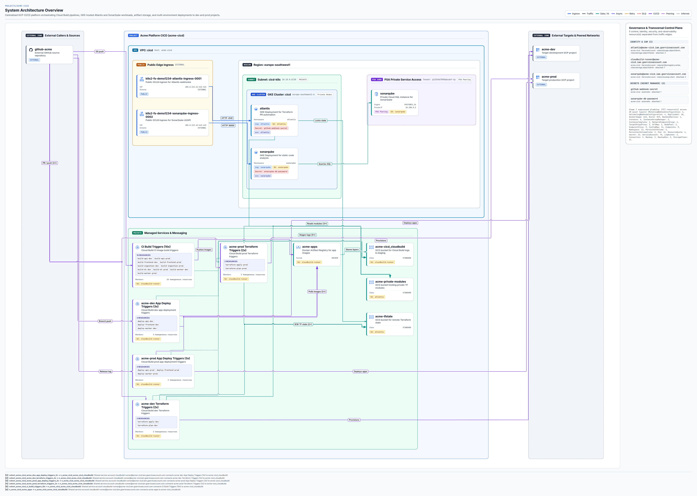

#### `01` — Source Control, CI/CD Triggers & GKE Tooling (`view_1`)

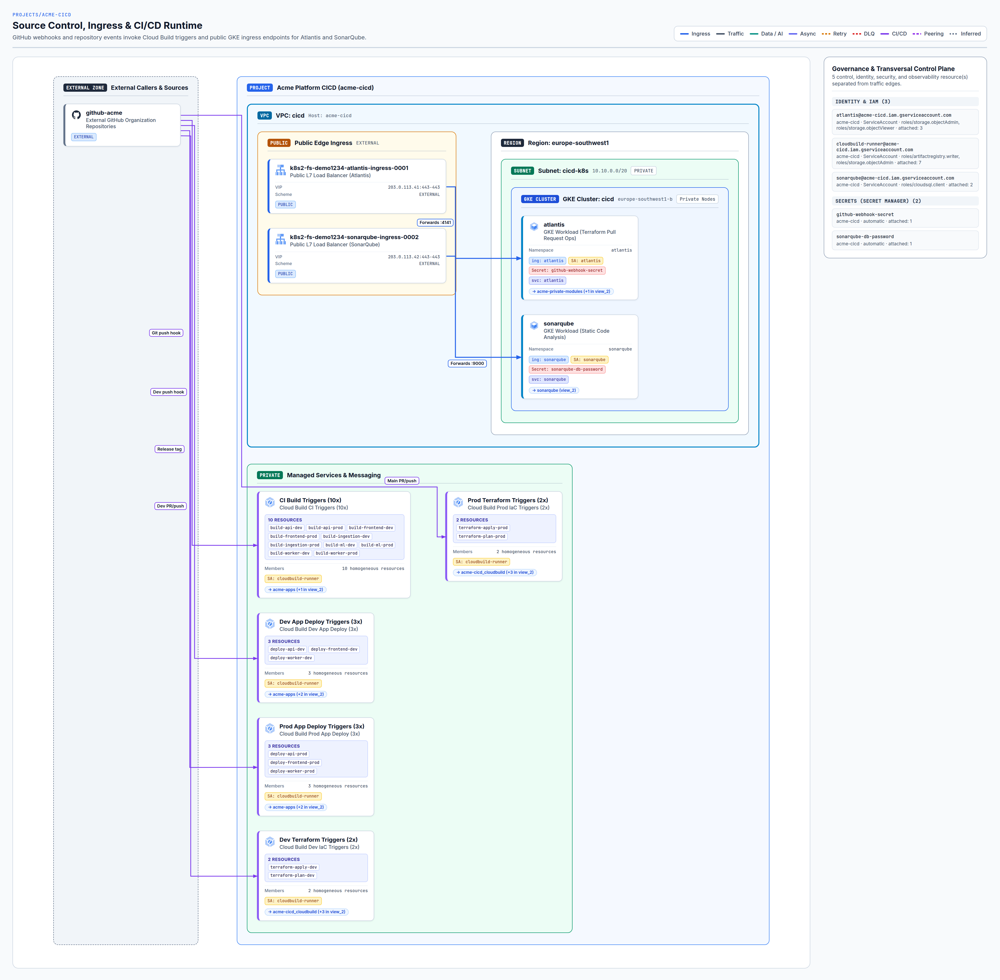

#### `02` — Artifact Storage, State Backends & Target Envs (`view_2`)

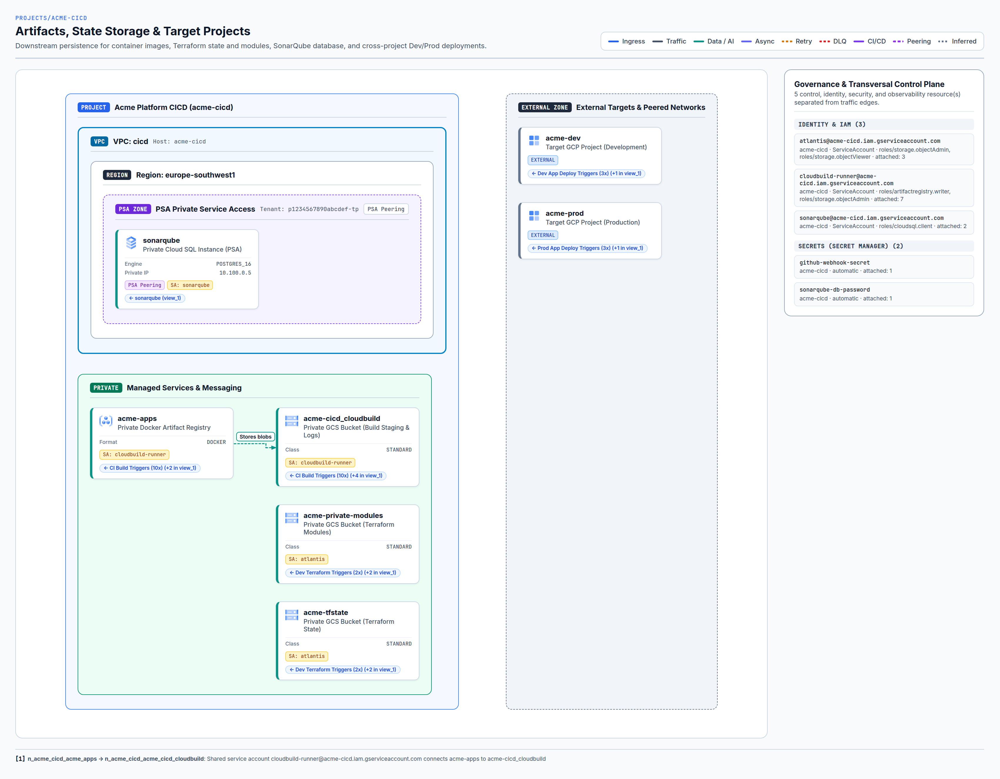

---

## Bundle 2 — Cloud-Native E-Commerce Runtime, Data/AI Streaming & Shared VPC

**Directory:** [`examples/retail-cloud-native/`](https://github.com/arrase/gcp-arch/tree/main/examples/retail-cloud-native)

### Scope & Inventory Summary

| Metric | Value |
| :--- | :--- |
| **Scanned Scope** | `folders/510100` (`retail-prod` under `Nova Retail Group`: `nova-shared-net` Shared VPC Host + `nova-retail-prod`, `nova-data-prod`, `nova-ai-prod`) |
| **Facts Fixture** | [`testdata/examples/retail_cloud_native_v3.facts.json`](https://github.com/arrase/gcp-arch/blob/main/testdata/examples/retail_cloud_native_v3.facts.json) (**37** resources, **45** edges) |
| **Components / Governance** | **18** logical components (`25/25` primary resources, `conservation=PASS`, `view0=1.00`) · **20** containers · **14** transversal governance items |
| **Views** | **3** `layered_flow` views (`View 0` + `2` focused detail views) |
| **Delivered Artifacts** | [`architecture.yaml`](https://github.com/arrase/gcp-arch/blob/main/examples/retail-cloud-native/architecture.yaml) · [`architecture.pdf`](https://github.com/arrase/gcp-arch/blob/main/examples/retail-cloud-native/architecture.pdf) · [`architecture.html`](https://github.com/arrase/gcp-arch/blob/main/examples/retail-cloud-native/architecture.html) |

### Key Architectural Highlights

- **Single-Host Shared VPC Topology:** Renders `VPC: nova-shared` once inside `nova-shared-net` (with Cloud NAT and Serverless VPC Access Connector badges) while tagging service-project workloads across `nova-retail-prod`, `nova-data-prod`, and `nova-ai-prod`.
- **Resilient Streaming & DLQ Replay:** Traces Pub/Sub `retail-orders-v1` → Dataflow `orders-stream-enrich-v2` → GCS + BigQuery (`retail_dw`, `merchandising_mart`) → Looker BI and Vertex AI (`recs-ranker-v4`, `gemini-4-carbon`), with explicit red DLQ and amber retry-publish flows via Cloud Functions (`orders-dlq-replay-fn`).
- **PSA Transactional Datastores & External PSP Egress:** Isolates `orders-alloydb` and `retail-session-redis` inside `PSA Private Service Access` (`p9876543210fedcba-tp`) and models mTLS checkout egress to `payment-psp-gateway`.

### View Summary

| # | View ID | Title | Components | Flows | Dimensions (Retina PNG) |
| :---: | :--- | :--- | :---: | :---: | :---: |
| `00` | `view_0_system_index` | System Architecture Overview | 18 | 20 | `7797 × 3585` |
| `01` | `view_1` | Edge Ingress & Storefront Compute | 4 | 3 | `3970 × 2454` |
| `02` | `view_2` | Async Messaging, Data Platform & AI | 14 | 10 | `6954 × 3668` |

### Rendered Views

#### `00` — System Architecture Overview (`view_0_system_index`)

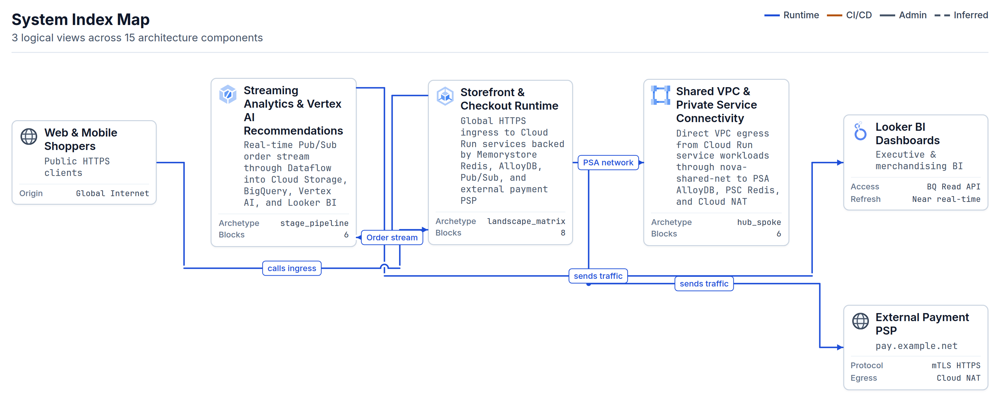

#### `01` — Edge Ingress & Storefront Compute (`view_1`)

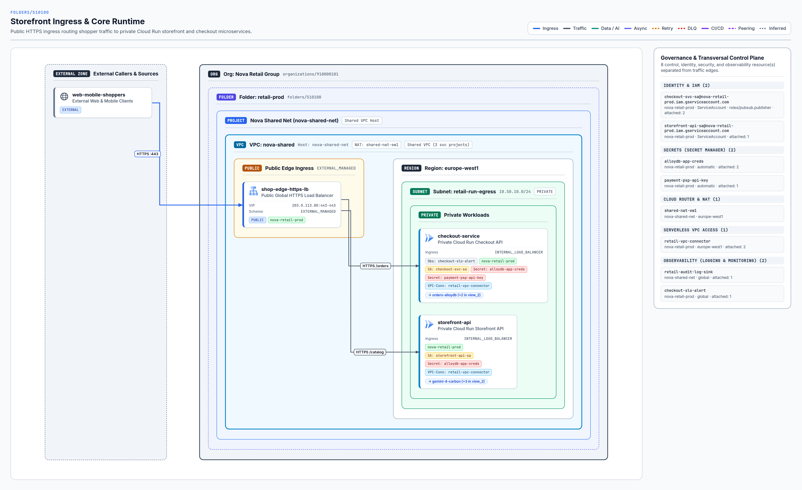

#### `02` — Async Messaging, Data Platform & AI (`view_2`)

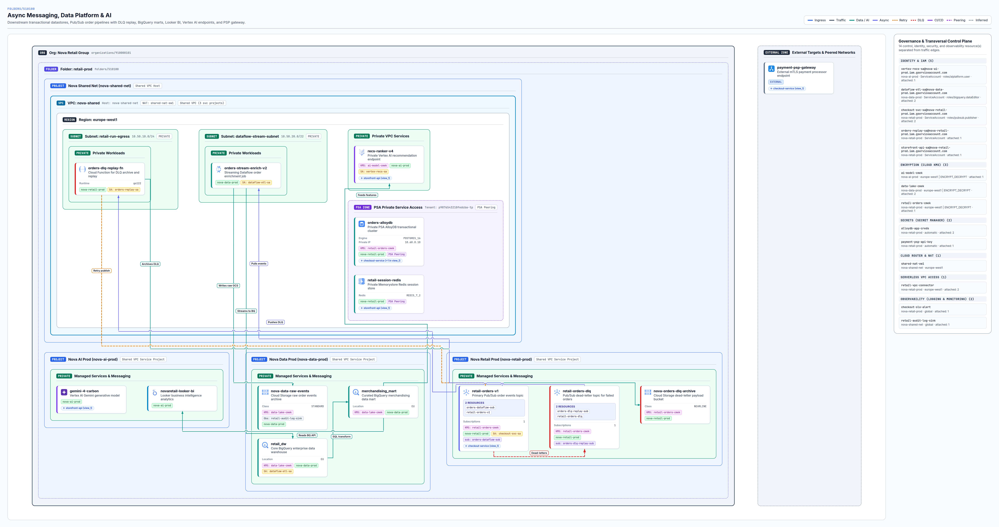

---

## Bundle 3 — Global FinTech Payments, Hybrid NCC Transit & Multi-Engine Ledger

**Directory:** [`examples/fintech-global-payments/`](https://github.com/arrase/gcp-arch/tree/main/examples/fintech-global-payments)

### Scope & Inventory Summary

| Metric | Value |
| :--- | :--- |
| **Scanned Scope** | `organizations/910100001` (`Meridian FinTech Corp`: `network-backbone` & `payments-core` folders across `meridian-ncc-hub`, `meridian-ops-sec`, `meridian-edge-prod`, `meridian-fraud-prod`, `meridian-ledger-prod`) |
| **Facts Fixture** | [`testdata/examples/fintech_global_payments_v3.facts.json`](https://github.com/arrase/gcp-arch/blob/main/testdata/examples/fintech_global_payments_v3.facts.json) (**63** resources, **60** edges) |
| **Components / Governance** | **31** logical components (`49/49` primary resources, `conservation=PASS`, `view0=1.00`) · **39** containers · **17** transversal governance items |
| **Views** | **4** `layered_flow` views (`View 0` + `3` focused detail views) |
| **Delivered Artifacts** | [`architecture.yaml`](https://github.com/arrase/gcp-arch/blob/main/examples/fintech-global-payments/architecture.yaml) · [`architecture.pdf`](https://github.com/arrase/gcp-arch/blob/main/examples/fintech-global-payments/architecture.pdf) · [`architecture.html`](https://github.com/arrase/gcp-arch/blob/main/examples/fintech-global-payments/architecture.html) |

### Key Architectural Highlights

- **Hybrid Connectivity & NCC Hub-and-Spoke:** Terminates 10G Dedicated Interconnect (`dc-frankfurt-interconnect`) and IPsec BGP HA VPN (`partner-ha-vpn`) from `core-banking-dc` inside a `HYBRID ZONE` into `Network Connectivity Center` (`enterprise-ncc-hub`), interconnecting 3 spoke VPCs alongside private Cloud DNS (`meridian-corp-dns`).
- **Private Service Connect (PSC) Isolation:** Bridges `meridian-edge-prod` (`ledger-psc-ep`) across VPC boundaries to `meridian-ledger-prod` (`ledger-psc-attachment` → `ledger-internal-ilb` → private GKE cluster `gke-payments-core`).
- **Five Purpose-Built Data & Security Engines:** Combines Cloud Spanner (`global-payments-spanner`), PSA AlloyDB (`cardholder-vault-alloydb`), Cloud Bigtable (`fraud-telemetry-bigtable`), Memorystore Cluster (`idempotency-redis-cluster`), Filestore (`clearing-files-filestore`), Compute Engine HSM signing MIG (`hsm-signing-mig`), Cloud Run EOD Job, and Cloud KMS CMEK across all sensitive stores.

### View Summary

| # | View ID | Title | Components | Flows | Dimensions (Retina PNG) |
| :---: | :--- | :--- | :---: | :---: | :---: |
| `00` | `view_0_system_index` | System Architecture Overview | 31 | 36 | `7105 × 3914` |
| `01` | `view_1` | Edge Ingress, Hybrid Transit & Scheduled Reconciler | 9 | 6 | `5576 × 3036` |
| `02` | `view_2` | Core Payment Services, PSC Routing & Settlement Pipelines | 14 | 14 | `6124 × 4527` |
| `03` | `view_3` | Financial Ledger Stores, Vaults & Card Network Egress | 8 | 0 *(off-page linked)* | `6554 × 3148` |

### Rendered Views

#### `00` — System Architecture Overview (`view_0_system_index`)

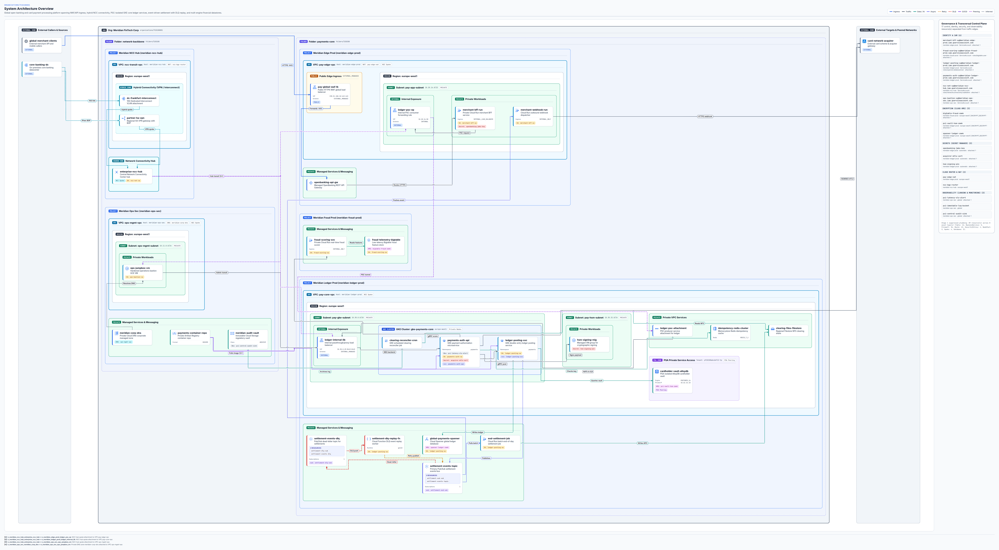

#### `01` — Edge Ingress, Hybrid Transit & Scheduled Reconciler (`view_1`)

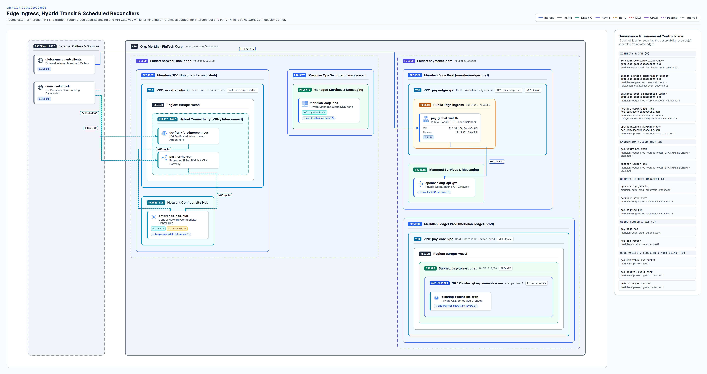

#### `02` — Core Payment Services, PSC Routing & Settlement Pipelines (`view_2`)

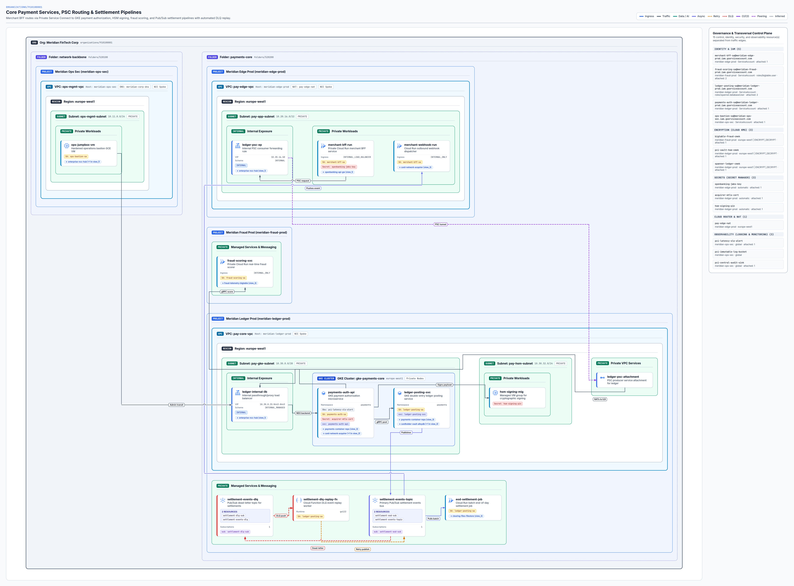

#### `03` — Financial Ledger Stores, Vaults & Card Network Egress (`view_3`)

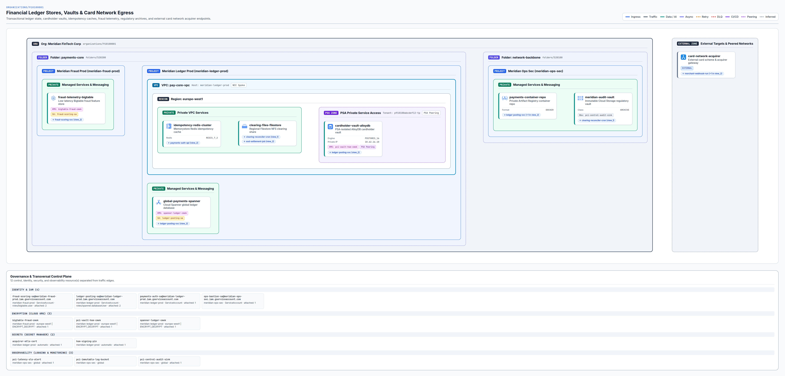

---

## Bundle 4 — Enterprise CDC Lakehouse, Analytics Mesh & MLOps Platform

**Directory:** [`examples/enterprise-lakehouse-mlops/`](https://github.com/arrase/gcp-arch/tree/main/examples/enterprise-lakehouse-mlops)

### Scope & Inventory Summary

| Metric | Value |
| :--- | :--- |
| **Scanned Scope** | `organizations/920200001` (`Stratos Analytics Corp`: `data-ingestion-lakehouse` & `mlops-bi-serving` folders across `stratos-ingest-prod`, `stratos-lakehouse-prod`, `stratos-mlops-prod`) |
| **Facts Fixture** | [`testdata/examples/enterprise_lakehouse_mlops_v3.facts.json`](https://github.com/arrase/gcp-arch/blob/main/testdata/examples/enterprise_lakehouse_mlops_v3.facts.json) (**52** resources, **61** edges) |
| **Components / Governance** | **30** logical components (`39/39` primary resources, `conservation=PASS`, `view0=1.00`) · **26** containers · **15** transversal governance items |
| **Views** | **4** `layered_flow` views (`View 0` + `3` focused detail views) |
| **Delivered Artifacts** | [`architecture.yaml`](https://github.com/arrase/gcp-arch/blob/main/examples/enterprise-lakehouse-mlops/architecture.yaml) · [`architecture.pdf`](https://github.com/arrase/gcp-arch/blob/main/examples/enterprise-lakehouse-mlops/architecture.pdf) · [`architecture.html`](https://github.com/arrase/gcp-arch/blob/main/examples/enterprise-lakehouse-mlops/architecture.html) |

### Key Architectural Highlights

- **Complete Modern GCP Data Estate:** Showcases Managed Service for Apache Kafka (`telemetry-managed-kafka`), Cloud Data Fusion (`erp-datafusion-etl`), Datastream CDC from PSA AlloyDB & Cloud SQL, Pub/Sub CDC bus, Cloud Composer (`enterprise-airflow`), Streaming Dataflow (`cdc-lakehouse-dataflow`), Serverless Dataproc Spark + Dataproc Metastore, Dataform SQLX (`warehouse-dataform-repo`), and Dataplex governance (`enterprise-dataplex-lake`).
- **Federated BigQuery Warehouse to BI & Online ML:** Links BigQuery `raw_cdc` → `curated_enterprise_dw` (with AlloyDB federated connection) → `ml_feature_mart` (BigQuery Data Transfer), feeding both Looker (`executive-looker-bi`) and Vertex AI (`realtime-customer-fos` Feature Online Store, `churn-predictor-v4` Endpoint, and `gemini-4-carbon`) behind `ml-serving-https-lb` and Cloud Run `ml-inference-gateway`.
- **Two-Folder Peered VPC Separation:** Separates ingestion & lakehouse (`ingest-vpc` ↔ `lakehouse-vpc`) on the left from MLOps & BI serving (`mlops-vpc`) on the right for balanced landscape legibility.

### View Summary

| # | View ID | Title | Components | Flows | Dimensions (Retina PNG) |
| :---: | :--- | :--- | :---: | :---: | :---: |
| `00` | `view_0_system_index` | System Architecture Overview | 30 | 35 | `6249 × 4425` |
| `01` | `view_1` | External Ingress & Inference Gateway | 5 | 2 | `3974 × 2346` |
| `02` | `view_2` | Streaming CDC, ETL & Orchestration Pipelines | 10 | 5 | `3988 × 4790` |
| `03` | `view_3` | OLTP, Lakehouse Storage, Analytics & Vertex AI | 15 | 10 | `6450 × 4323` |

### Rendered Views

#### `00` — System Architecture Overview (`view_0_system_index`)

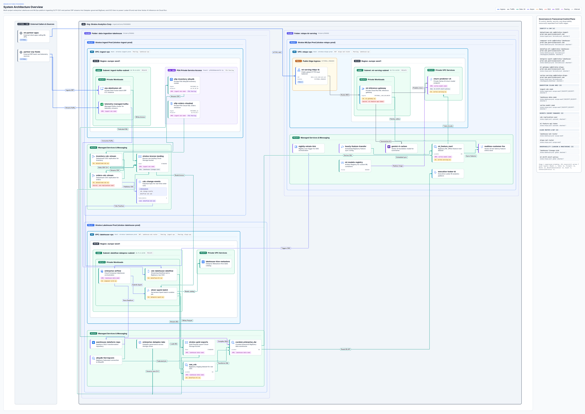

#### `01` — External Ingress & Inference Gateway (`view_1`)

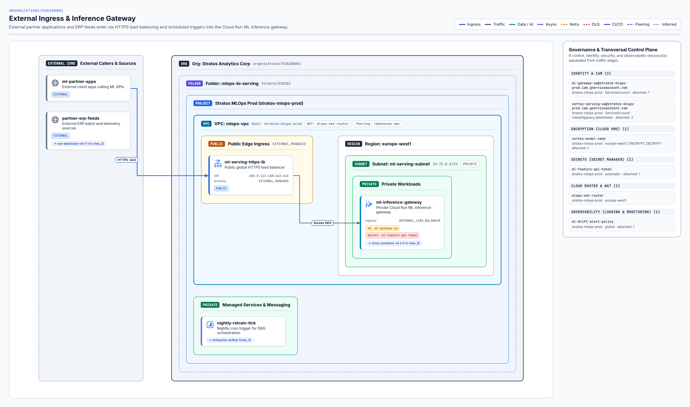

#### `02` — Streaming CDC, ETL & Orchestration Pipelines (`view_2`)

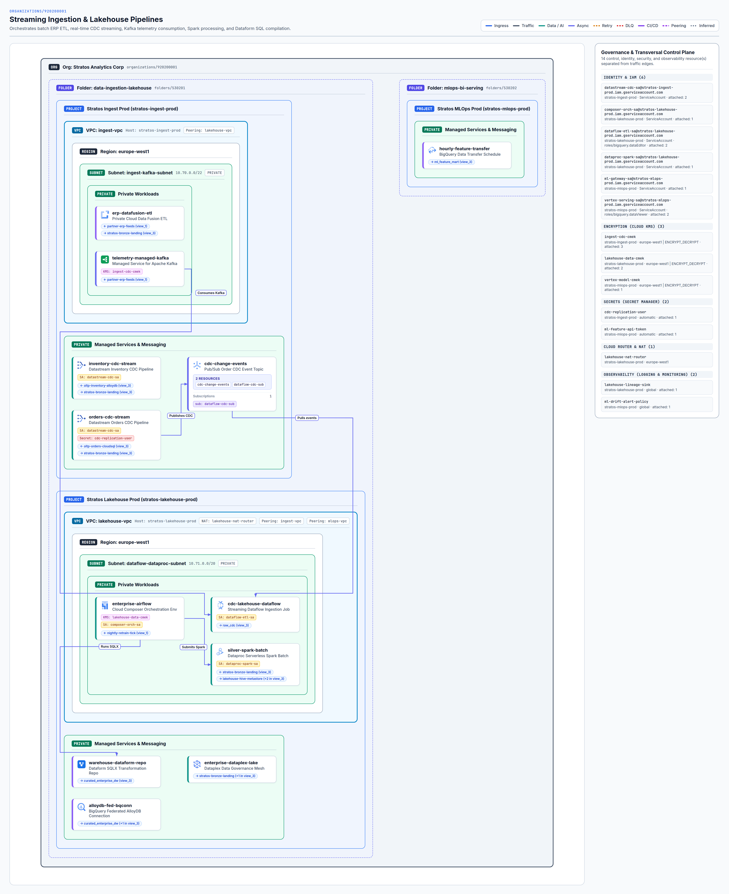

#### `03` — OLTP, Lakehouse Storage, Analytics & Vertex AI (`view_3`)

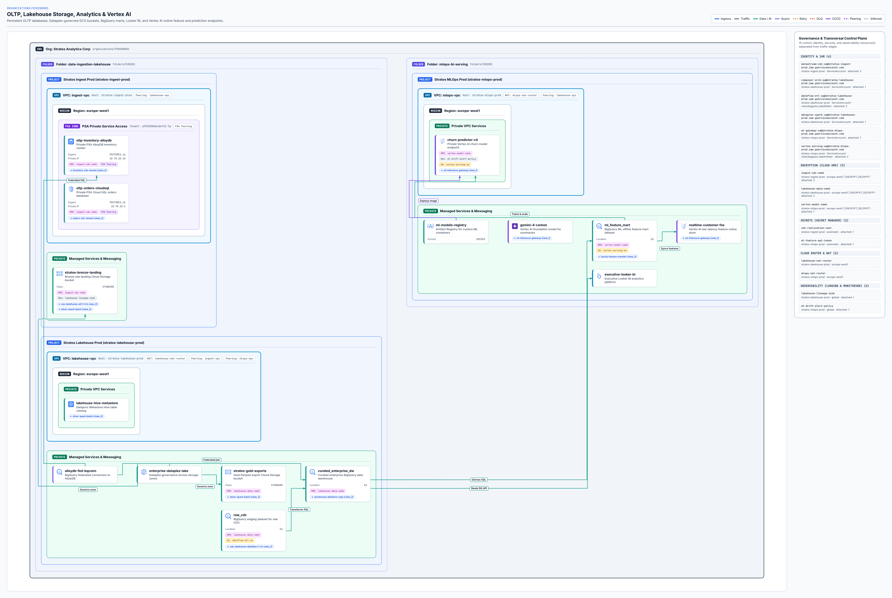

---

## Bundle 5 — Agentic AI, Enterprise RAG & Document OCR Platform

**Directory:** [`examples/agentic-ai-document-platform/`](https://github.com/arrase/gcp-arch/tree/main/examples/agentic-ai-document-platform)

### Scope & Inventory Summary

| Metric | Value |
| :--- | :--- |
| **Scanned Scope** | `folders/540300` (`genai-prod` under `Lumina AI Systems`: `lumina-edge-net` Shared VPC Host + `lumina-agents-prod`, `lumina-knowledge-prod`) |
| **Facts Fixture** | [`testdata/examples/agentic_ai_document_platform_v3.facts.json`](https://github.com/arrase/gcp-arch/blob/main/testdata/examples/agentic_ai_document_platform_v3.facts.json) (**45** resources, **51** edges) |
| **Components / Governance** | **25** logical components (`32/32` primary resources, `conservation=PASS`, `view0=1.00`) · **16** containers · **15** transversal governance items |
| **Views** | **3** `layered_flow` views (`View 0` + `2` focused detail views) |
| **Delivered Artifacts** | [`architecture.yaml`](https://github.com/arrase/gcp-arch/blob/main/examples/agentic-ai-document-platform/architecture.yaml) · [`architecture.pdf`](https://github.com/arrase/gcp-arch/blob/main/examples/agentic-ai-document-platform/architecture.pdf) · [`architecture.html`](https://github.com/arrase/gcp-arch/blob/main/examples/agentic-ai-document-platform/architecture.html) |

### Key Architectural Highlights

- **Full Vertex AI Agentic Stack:** Combines Global HTTPS Load Balancing, API Gateway, Dialogflow CX (`support-dialogflow-cx`), Cloud Run orchestrator (`agent-orchestrator-api`) and private MCP tool gateway (`mcp-tool-gateway`), Vertex AI Reasoning Engine (`enterprise-rag-agent`), Gemini 4 (`gemini-4-carbon`), Vertex AI Search (`enterprise-search-engine` + `enterprise-docs-datastore`), Vertex Vector Search (`embeddings-vector-idx`), Firestore session memory, Memorystore semantic cache, and BigQuery eval telemetry.
- **Event-Driven OCR & Embedding Pipeline:** Connects raw GCS documents via Eventarc (`doc-upload-eventarc`) and nightly Cloud Scheduler into Cloud Workflows (`doc-ingestion-workflow`) → Document AI OCR (`contracts-docai-ocr`) → Cloud Tasks retry queue (`doc-ocr-retry-tasks`) → Cloud Functions chunker/embedder (`doc-chunk-embed-fn`) → Pub/Sub (`doc-embed-events`) + dead-letter replay (`doc-embed-dlq` → `doc-dlq-replay-fn`).

### View Summary

| # | View ID | Title | Components | Flows | Dimensions (Retina PNG) |
| :---: | :--- | :--- | :---: | :---: | :---: |
| `00` | `view_0_system_index` | System Architecture Overview | 25 | 29 | `6809 × 4092` |
| `01` | `view_1` | Edge Ingress & Ingestion Triggers | 7 | 3 | `4582 × 2944` |
| `02` | `view_2` | RAG Agents, Document Pipelines & Datastores | 18 | 19 | `6400 × 4126` |

### Rendered Views

#### `00` — System Architecture Overview (`view_0_system_index`)

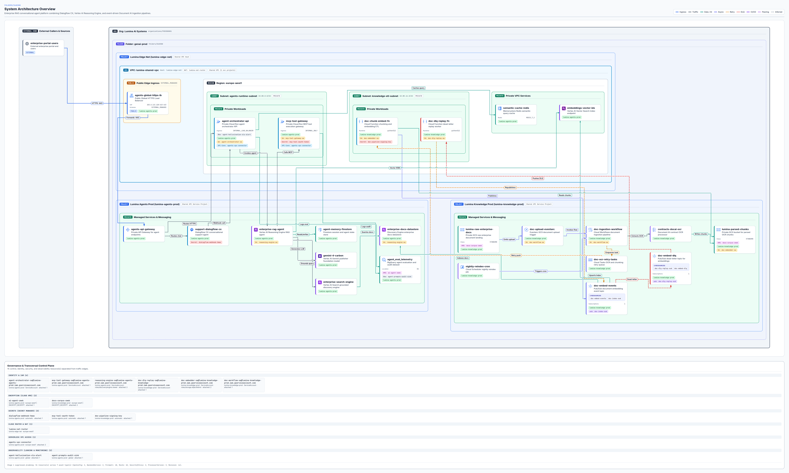

#### `01` — Edge Ingress & Ingestion Triggers (`view_1`)

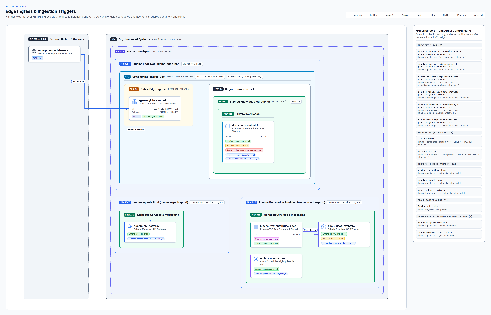

#### `02` — RAG Agents, Document Pipelines & Datastores (`view_2`)

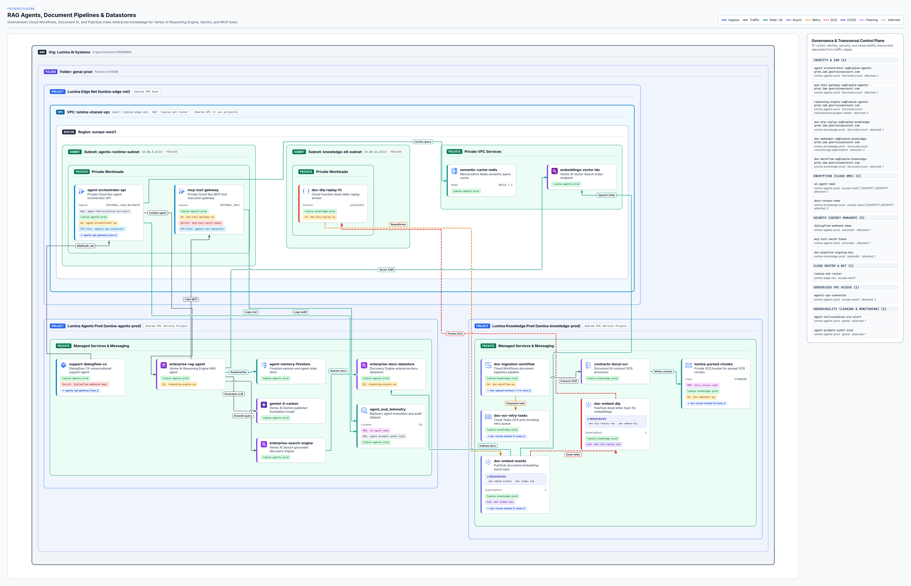

---

## Bundle 6 — Multi-Region Zero-Trust Mesh, Progressive Delivery & Risk AI

**Directory:** [`examples/enterprise-zero-trust-mesh/`](https://github.com/arrase/gcp-arch/tree/main/examples/enterprise-zero-trust-mesh)

### Scope & Inventory Summary

| Metric | Value |
| :--- | :--- |
| **Scanned Scope** | `organizations/940400001` (`Aegis Cloud Enterprise`: `platform-shared` & `prod-domains` folders across `aegis-delivery-sec`, `aegis-net-host`, `aegis-commerce-prod`, `aegis-risk-prod` in `europe-west1` + `europe-west4`) |
| **Facts Fixture** | [`testdata/examples/enterprise_zero_trust_mesh_v3.facts.json`](https://github.com/arrase/gcp-arch/blob/main/testdata/examples/enterprise_zero_trust_mesh_v3.facts.json) (**63** resources, **83** edges) |
| **Components / Governance** | **26** logical components (`44/44` primary resources, `conservation=PASS`, `view0=1.00`) · **26** containers · **23** transversal governance items |
| **Views** | **3** `layered_flow` views (`View 0` + `2` focused detail views) |
| **Delivered Artifacts** | [`architecture.yaml`](https://github.com/arrase/gcp-arch/blob/main/examples/enterprise-zero-trust-mesh/architecture.yaml) · [`architecture.pdf`](https://github.com/arrase/gcp-arch/blob/main/examples/enterprise-zero-trust-mesh/architecture.pdf) · [`architecture.html`](https://github.com/arrase/gcp-arch/blob/main/examples/enterprise-zero-trust-mesh/architecture.html) |

### Key Architectural Highlights

- **Dual-Region Shared VPC Segmentation:** Separates `Region: europe-west1` (Private GKE commerce microservices, CronJob PCI auditor, Cloud Functions tax enrichment, Memorystore Cluster, PSA Cloud SQL) from `Region: europe-west4` (Internal Regional ILB, Cloud Batch Monte Carlo simulation, Cloud Run risk policy engine & alert dispatcher, PSA AlloyDB) under a single zero-trust Shared VPC (`aegis-zero-trust-vpc`) with private Cloud DNS and per-region Cloud NAT.
- **Attested Supply Chain & Multi-Runtime Footprint:** Demonstrates Cloud Build cohorts (`CI Build Triggers (4x)`) → Artifact Registry (`aegis-signed-containers`) + GCS attestations → Cloud Deploy (`aegis-progressive-deploy`) deploying to both GKE and Cloud Run, alongside App Engine (`aegis-admin-portal`), Cloud Batch, Pub/Sub domain bus + DLQ, BigQuery compliance datasets, and Gemini 4 risk reasoning.
- **Rich Security & Compliance Control Plane:** Surfaces 23 transversal resources (8 IAM Service Accounts, 4 Cloud KMS keys, 4 Secret Manager secrets, 2 Cloud Routers/NATs, Serverless VPC Access, 7-year compliance Log Bucket, org SIEM Log Sink, and SLO/DLQ Monitoring Alert Policies).

### View Summary

| # | View ID | Title | Components | Flows | Dimensions (Retina PNG) |
| :---: | :--- | :--- | :---: | :---: | :---: |
| `00` | `view_0_system_index` | System Architecture Overview | 26 | 32 | `7785 × 3566` |
| `01` | `view_1` | Edge Ingress, CI Triggers & Scheduled Batch | 8 | 4 | `6448 × 3156` |
| `02` | `view_2` | Commerce Runtime, AI Risk Engine & Datastores | 18 | 20 | `7326 × 3798` |

### Rendered Views

#### `00` — System Architecture Overview (`view_0_system_index`)

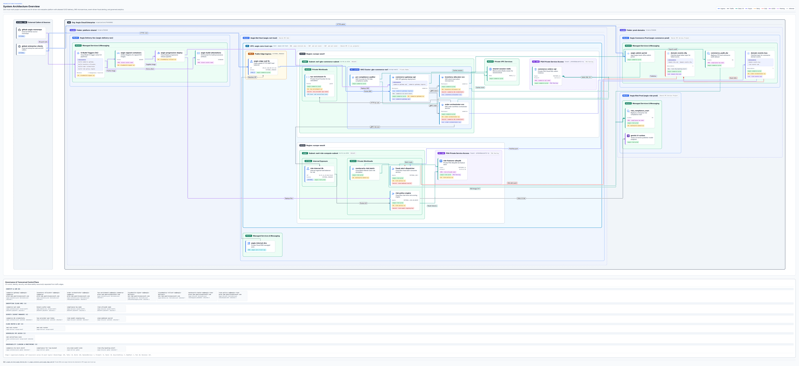

#### `01` — Edge Ingress, CI Triggers & Scheduled Batch (`view_1`)

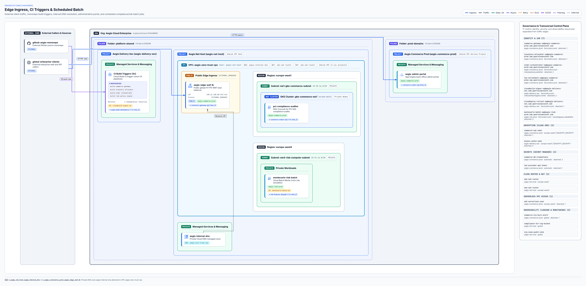

#### `02` — Commerce Runtime, AI Risk Engine & Datastores (`view_2`)

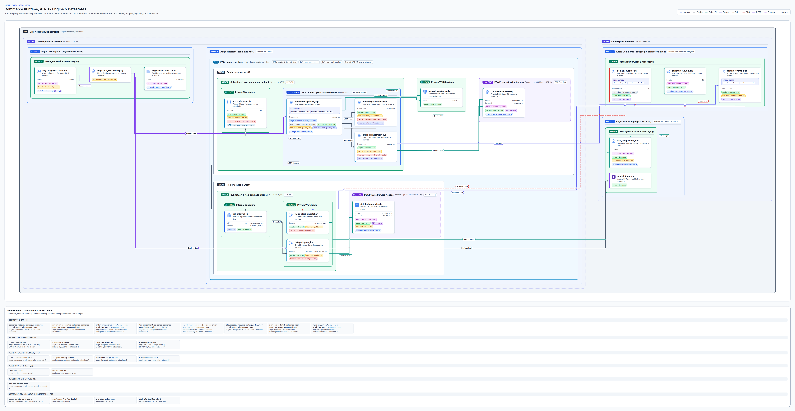

---

## Validate & Regenerate All 6 Bundles Offline

All 6 bundles can be validated ([`cmd/gcp-arch/validate.go`](https://github.com/arrase/gcp-arch/blob/main/cmd/gcp-arch/validate.go)) and regenerated ([`cmd/gcp-arch/render.go`](https://github.com/arrase/gcp-arch/blob/main/cmd/gcp-arch/render.go), [`internal/render/`](https://github.com/arrase/gcp-arch/tree/main/internal/render)) completely offline from a clean repository checkout (zero GCP credentials and zero external network calls). Local Chrome or Chromium is required for `pdf` and `png` export (pass `--geometry-report` to also emit `geometry_report.json`).

```bash
# 1. Build the static gcp-arch binary
CGO_ENABLED=0 go build -o ./bin/gcp-arch ./cmd/gcp-arch

# 2. Validate (including 100% --facts conservation) & render all 6 reference bundles
for pair in \
  "platform-cicd:testdata/acme_cicd_v3.facts.json" \
  "retail-cloud-native:testdata/examples/retail_cloud_native_v3.facts.json" \
  "fintech-global-payments:testdata/examples/fintech_global_payments_v3.facts.json" \
  "enterprise-lakehouse-mlops:testdata/examples/enterprise_lakehouse_mlops_v3.facts.json" \
  "agentic-ai-document-platform:testdata/examples/agentic_ai_document_platform_v3.facts.json" \
  "enterprise-zero-trust-mesh:testdata/examples/enterprise_zero_trust_mesh_v3.facts.json"
do
  slug="${pair%%:*}"
  facts="${pair#*:}"
  ./bin/gcp-arch validate "examples/$slug/architecture.yaml" --facts "$facts"
  ./bin/gcp-arch render "examples/$slug/architecture.yaml" --facts "$facts" --format pdf,png,html -o "examples/$slug/"
done
```

!!! tip "Automated Geometry & Streaming Pixel Quality Gate"
    Run `go test -v -run TestExamplesPNGStreamingRegression ./e2e` to execute [`TestExamplesPNGStreamingRegression`](https://github.com/arrase/gcp-arch/blob/main/e2e/geometry_test.go#L501-L530) across all 6 bundles, verifying dimensions, aspect ratio bounds, contrast/chroma diversity, and 1px border-clipping guards on all 20 PNGs via streaming scanline decoding (`< 1 MB` Go RAM). For live Vertex AI + Chrome verification across the synthetic catalog, run `GCP_ARCH_E2E=1 GCP_ARCH_VERTEX_PROJECT=my-vertex-project go test -v ./e2e`.
