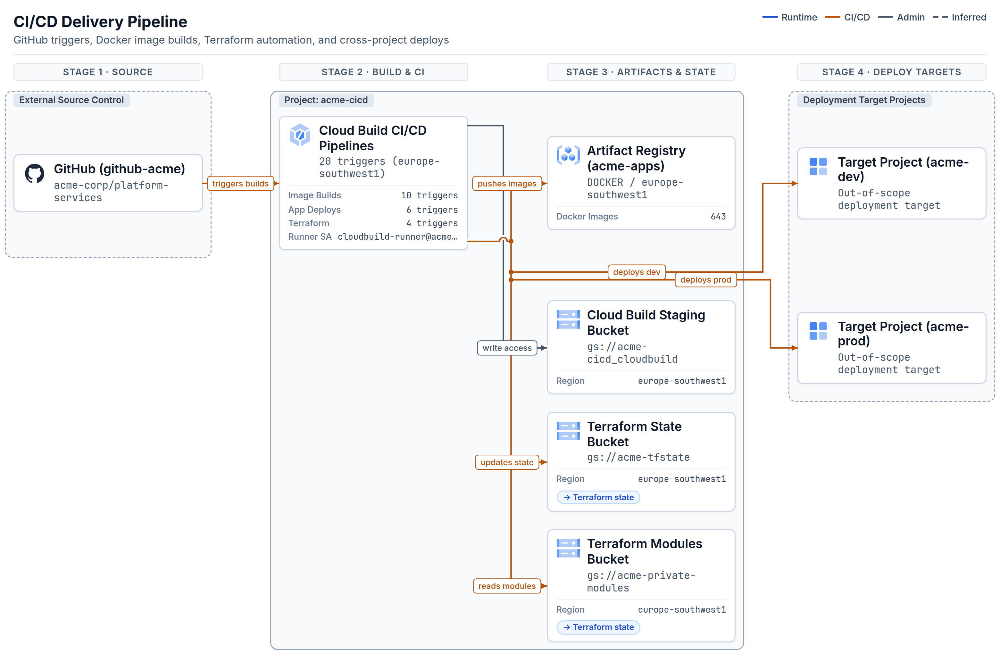
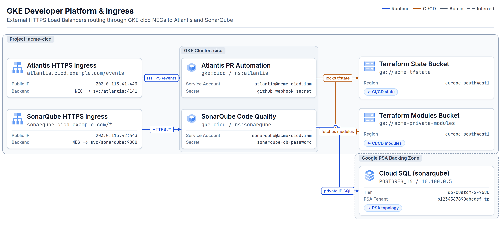
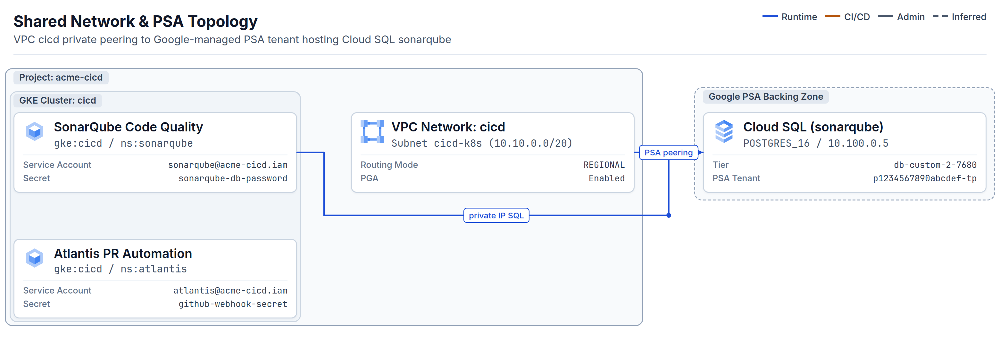
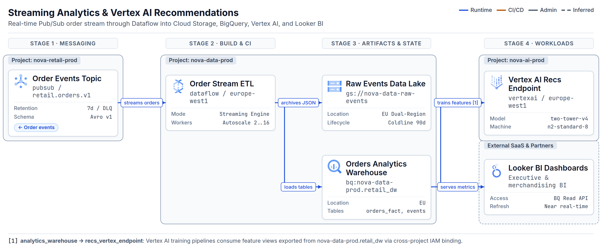
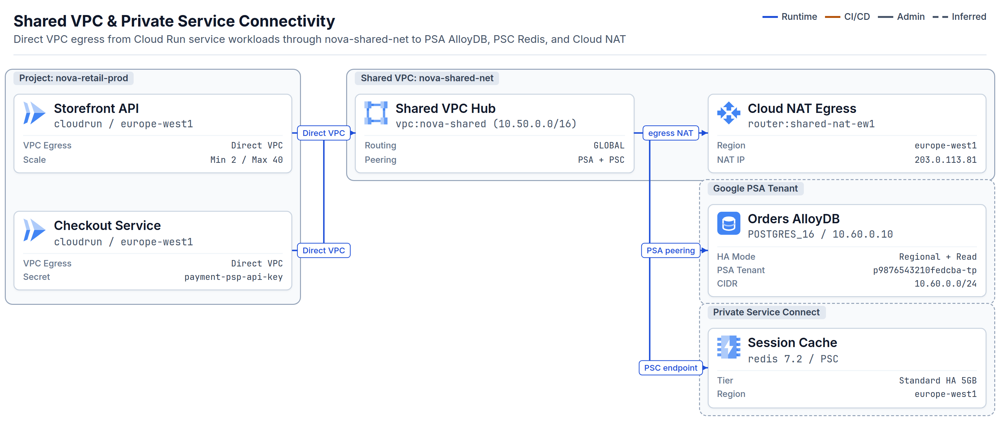
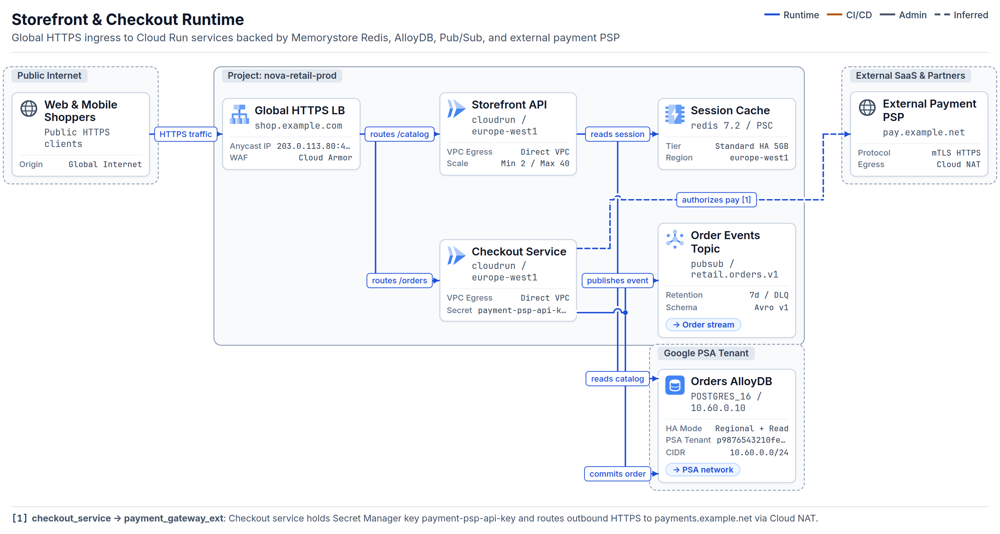

# Examples & Visual Gallery

`gcp-arch` ships two complete, end-to-end reference bundles under [`examples/`](https://github.com/arrase/gcp-arch/tree/main/examples), each containing a hand-verifiable `architecture.yaml` (`schema_version: v1`) manifest alongside its offline-rendered vector `.pdf`, self-contained `.html` dossier, and `3x` high-DPI (`3120px` wide) per-view `.png` diagrams.

!!! info "Synthetic Reference Data Notice"
    All GCP project IDs (`acme-*`, `nova-*`), domain names (`example.com`, `example.net` per **RFC 2606**), public IPv4 addresses (`203.0.113.0/24` per **RFC 5737**), and Private Services Access tenant identifiers (`p1234567890abcdef-tp`, `p9876543210fedcba-tp`) in these bundles are 100% synthetic.

---

## Bundle 1 — Multi-Project CI/CD, GKE DevOps & PSA Network

**Directory:** [`examples/platform-cicd/`](https://github.com/arrase/gcp-arch/tree/main/examples/platform-cicd)

### Scope & Inventory Summary

| Metric | Value |
| :--- | :--- |
| **Scanned Scope** | `projects/acme-cicd` → out-of-scope deployment targets `acme-dev`, `acme-prod` |
| **Components** | **14** logical components covering **43** underlying `FactResource` records (plus the 44th, `container.googleapis.com/Cluster` `cicd`, owned by resource-backed container `gke_cicd` — totaling 44 across components + containers in [`testdata/acme_cicd_v3.facts.json`](https://github.com/arrase/gcp-arch/blob/main/testdata/acme_cicd_v3.facts.json)) |
| **Containers** | **5** containers (`proj_acme_cicd`, nested `gke_cicd`, `psa_tenant`, `ext_source`, `ext_deploy_targets`) |
| **Views** | **4** views (`1` deterministic `View 0` + `3` detail views covering all three archetypes) |
| **Manifest Source** | [`examples/platform-cicd/architecture.yaml`](https://github.com/arrase/gcp-arch/blob/main/examples/platform-cicd/architecture.yaml) *(identical to [`testdata/acme_cicd_expected.architecture.yaml`](https://github.com/arrase/gcp-arch/blob/main/testdata/acme_cicd_expected.architecture.yaml))* |
| **Delivered Artifacts** | [`architecture.pdf`](https://github.com/arrase/gcp-arch/blob/main/examples/platform-cicd/architecture.pdf) · [`architecture.html`](https://github.com/arrase/gcp-arch/blob/main/examples/platform-cicd/architecture.html) · [`views/`](https://github.com/arrase/gcp-arch/tree/main/examples/platform-cicd/views) |

### Key Architectural Highlights

- **All Three Layout Archetypes:** Combines `landscape_matrix` (`View 0` and GKE platform), `stage_pipeline` (CI/CD delivery with automatic stage banners), and `hub_spoke` (VPC-to-PSA peering).
- **Depth-2 Container Nesting:** Places `GKE Cluster: cicd` (`gke_cicd`, `depth=2`) inside `Project: acme-cicd` (`proj_acme_cicd`, `depth=1`) with stacked top badges and `52px` reserved row corridors.
- **20-Trigger Cloud Build Folding & 5-Branch Fan-Out Bus:** Folds 20 `cloudbuild.googleapis.com/BuildTrigger` resources plus the `cloudbuild-runner` Service Account into a single `cloudbuild_triggers` component (`inline_meta`: 10 Image Builds, 6 App Deploys, 4 Terraform) connected to **5** `CICD` branches via an explicit `via_bus_id: cb_outputs` bus spine (**3** datastores: `acme_artifact_registry`, `acme_private_modules`, `acme_tfstate` + **2** out-of-scope target projects: `acme_dev`, `acme_prod`), alongside a standalone `ADMIN` edge (`verb: write access`, no `via_bus_id`) to the 4th datastore (`cloudbuild_staging_bucket`).
- **Mixed `CICD`, `RUNTIME` & `ADMIN` Flows:** Distinguishes amber `CICD` edges (`#B45309` — GitHub webhooks, builds, Terraform state/module locking), blue `RUNTIME` edges (`#1D4ED8` — Global HTTPS Load Balancers to GKE NEGs, private IP SQL over PSA), and slate `ADMIN` edges (`#475569` — `cloudbuild_triggers -> cloudbuild_staging_bucket` `write access`).
- **Google-Managed PSA Peering:** Isolates `Cloud SQL (sonarqube)` (`POSTGRES_16 / 10.100.0.5`) inside a dashed `PSA_ZONE` (`p1234567890abcdef-tp`).

### View Summary

| # | View ID | Archetype | Accent | Blocks | Edges | Highlights |
| :---: | :--- | :--- | :---: | :---: | :---: | :--- |
| `00` | `view_0_system_index` | `landscape_matrix` | `MIXED` | 6 | 5 | Deterministic Go-projected system map spanning 5 columns (`0..4`) from `github_acme` through all 3 detail views to `acme_dev` / `acme_prod`. |
| `01` | `cicd_delivery_pipeline` | `stage_pipeline` | `CICD` | 8 | 7 | 4-stage CI/CD flow with auto stage banners, `cb_outputs` 5-branch `CICD` fan-out bus + standalone `ADMIN` staging-bucket edge, and `→ Terraform state` off-page pills. |
| `02` | `gke_developer_platform` | `landscape_matrix` | `RUNTIME` | 7 | 5 | Depth-2 `gke_cicd` inside `proj_acme_cicd`, mixed `CICD` (`atlantis_gcs` bus) + `RUNTIME` ingress/SQL flows, and dashed `psa_tenant`. |
| `03` | `shared_network_psa` | `hub_spoke` | `RUNTIME` | 4 | 2 | Locked 3-column `hub_spoke` topology centering `VPC Network: cicd` (`10.10.0.0/20`) between GKE workloads and PSA Cloud SQL. |

### Rendered Views (`3x` High-DPI PNGs)

#### `00` — System Index Map (`view_0_system_index`)


*Deterministic `View 0` index projected in Go ([`internal/synth/view0.go`](https://github.com/arrase/gcp-arch/blob/main/internal/synth/view0.go)): places external source `github_acme` in column `0`, maps `cicd_delivery_pipeline` (`stage_pipeline` → col `1`), `gke_developer_platform` (`landscape_matrix` → col `2`), and `shared_network_psa` (`hub_spoke` → col `3`), and terminates at out-of-scope deployment projects `acme_dev` and `acme_prod` in column `4` (`data-cols="5"` compact mode).*

#### `01` — CI/CD Delivery Pipeline (`cicd_delivery_pipeline`)



*Four-column `stage_pipeline` view with automatic column stage banners (`Stage 1 · Source` through `Stage 4 · Deploy Targets`), `64px` default corridors, 20 folded Cloud Build triggers fanning out over the explicit `cb_outputs` `CICD` bus (5 branches: 3 datastores `acme_artifact_registry`, `acme_private_modules`, `acme_tfstate` + 2 out-of-scope target projects `acme_dev`, `acme_prod`) alongside a standalone slate `ADMIN` edge (`write access`, `#475569`) to `cloudbuild_staging_bucket`, plus `→ Terraform state` off-page references linking into the GKE view.*

#### `02` — GKE Developer Platform & Ingress (`gke_developer_platform`)



*`landscape_matrix` view demonstrating depth-2 `GKE Cluster: cicd` nested inside `Project: acme-cicd`, Global HTTPS Load Balancers folding `GlobalForwardingRule` + K8s `Ingress` + `Service`, mixed blue `RUNTIME` and amber `CICD` (`atlantis_gcs` bus) connectors, bidirectional off-page pills (`← CI/CD state`, `→ PSA topology`), and dashed `Google PSA Backing Zone`.*

#### `03` — Shared Network & PSA Topology (`shared_network_psa`)



*Locked 3-column `hub_spoke` network view centering `VPC Network: cicd` (`REGIONAL`, PGA enabled) between GKE workloads (`atlantis`, `sonarqube`) on the left and PSA-hosted `Cloud SQL (sonarqube)` on the right, showing a multi-column `private IP SQL` route cleanly bypassing the center hub card via a badge-free horizontal waypoint corridor.*

---

## Bundle 2 — Cloud-Native E-Commerce Runtime, Data/AI Streaming & Shared VPC

**Directory:** [`examples/retail-cloud-native/`](https://github.com/arrase/gcp-arch/tree/main/examples/retail-cloud-native)

### Scope & Inventory Summary

| Metric | Value |
| :--- | :--- |
| **Scanned Scopes** | `projects/nova-ai-prod`, `projects/nova-data-prod`, `projects/nova-retail-prod`, `projects/nova-shared-net` |
| **Components** | **15** logical components spanning Cloud Run, Global HTTPS LB + Cloud Armor, AlloyDB, Memorystore Redis, Pub/Sub, Dataflow, Cloud Storage, BigQuery, Vertex AI, Cloud NAT, Shared VPC, and external endpoints |
| **Containers** | **8** containers (`4` GCP `PROJECT` / `SHARED_HUB` containers, `2` `PSA_ZONE` containers for AlloyDB PSA & Redis PSC, `2` `EXTERNAL_ZONE` containers) |
| **Views** | **4** views (`1` deterministic `View 0` + `3` detail views) |
| **Governance & Day-2 Features** | **2** `excluded_resources` (default VPC + `_Default` log sink), **1** `rejected_edges` tombstone (`storefront_api -> raw_events_bucket`), **2** `INFERRED` edges with `[1]` footer footnotes, and curated Day-2 `notes` on `storefront_api` |
| **Manifest Source** | [`examples/retail-cloud-native/architecture.yaml`](https://github.com/arrase/gcp-arch/blob/main/examples/retail-cloud-native/architecture.yaml) |
| **Delivered Artifacts** | [`architecture.pdf`](https://github.com/arrase/gcp-arch/blob/main/examples/retail-cloud-native/architecture.pdf) · [`architecture.html`](https://github.com/arrase/gcp-arch/blob/main/examples/retail-cloud-native/architecture.html) · [`views/`](https://github.com/arrase/gcp-arch/tree/main/examples/retail-cloud-native/views) |

### Key Architectural Highlights

- **5-Column Compact Mode (`data-cols="5"`):** Both `view_0_system_index` and `storefront_runtime` span columns `0..4`, engaging compact typography and tighter padding so all five tiers fit cleanly within `1040px`.
- **Fan-In + Fan-Out Bus Composition:** `shared_vpc_connectivity` pairs an incoming fan-in bus (`vpc_egress_in`: two Cloud Run services → `shared_vpc_hub`) with an outgoing 3-branch fan-out bus (`vpc_hub_out`: `shared_vpc_hub` → `cloud_nat_egress`, `orders_alloydb`, `session_cache`).
- **Private Service Connectivity (PSA + PSC + Cloud NAT):** Models Direct VPC egress through `Shared VPC: nova-shared-net` (`SHARED_HUB`) to `Orders AlloyDB` (`PSA_ZONE`, `10.60.0.0/24`), `Session Cache` (`redis 7.2 / PSC`, backed by a PSC forwarding rule), and `Cloud NAT Egress`.
- **Streaming Data & AI Pipeline:** Traces `Order Events Topic` (Pub/Sub) → `Order Stream ETL` (Dataflow Streaming Engine) → `Raw Events Data Lake` (GCS) & `Orders Analytics Warehouse` (BigQuery) → `Vertex AI Recs Endpoint` (`INFERRED` `[1]`) & `Looker BI Dashboards`.
- **Day-2 Curation & Provenance Footnotes:** Demonstrates preserved `notes` on `storefront_api`, `excluded_resources` suppression of boilerplate GCP defaults, `rejected_edges` enforcement blocking a spurious direct `storefront_api -> raw_events_bucket` edge, and dashed `INFERRED` edges with numbered `[1]` rationales in the sheet footers.

### View Summary

| # | View ID | Archetype | Accent | Blocks | Edges | Highlights |
| :---: | :--- | :--- | :---: | :---: | :---: | :--- |
| `00` | `view_0_system_index` | `landscape_matrix` | `MIXED` | 6 | 5 | 5-column `View 0` system map linking `web_mobile_clients` through `storefront_runtime`, `data_ai_pipeline`, and `shared_vpc_connectivity` to `bi_looker_dashboards` and `payment_gateway_ext`. |
| `01` | `data_ai_pipeline` | `stage_pipeline` | `MIXED` | 6 | 5 | 4-stage streaming & AI pipeline (`Pub/Sub → Dataflow → GCS/BQ → Vertex AI/Looker`) with `dataflow_sinks` + `bq_consumers` buses and `INFERRED` footnote `[1]`. |
| `02` | `shared_vpc_connectivity` | `hub_spoke` | `RUNTIME` | 6 | 5 | 3-column `hub_spoke` Shared VPC hub combining left fan-in bus (`vpc_egress_in`) and right 3-branch fan-out bus (`vpc_hub_out`) across PSA, PSC, and Cloud NAT. |
| `03` | `storefront_runtime` | `landscape_matrix` | `RUNTIME` | 8 | 8 | 5-column compact mode (`data-cols="5"`) runtime flow with `lb_backends` + `checkout_out` buses, multi-column dashed `INFERRED` edge `[1]` to external PSP, and off-page refs. |

### Rendered Views (`3x` High-DPI PNGs)

#### `00` — System Index Map (`view_0_system_index`)


*Multi-project `View 0` index unifying 15 components across 4 GCP projects (`nova-retail-prod`, `nova-data-prod`, `nova-ai-prod`, `nova-shared-net`) and 2 external zones, showing multi-column cross-view connectors routed through badge-free horizontal waypoint corridors.*

#### `01` — Streaming Analytics & Vertex AI Recommendations (`data_ai_pipeline`)



*Four-stage `stage_pipeline` flow spanning 4 distinct project/external containers, featuring two chained fan-out buses (`dataflow_sinks` and `bq_consumers`), a `← Order events` off-page reference back to the storefront view, and a dashed `INFERRED` edge (`trains features [1]`) with its rationale rendered in the footer.*

#### `02` — Shared VPC & Private Service Connectivity (`shared_vpc_connectivity`)



*`hub_spoke` topology demonstrating simultaneous fan-in (`vpc_egress_in`) and 3-branch fan-out (`vpc_hub_out`) buses meeting on opposite sides of `Shared VPC Hub`, cleanly distinguishing the host network project (`SHARED_HUB`), AlloyDB `PSA_ZONE`, and Memorystore Redis PSC zone.*

#### `03` — Storefront & Checkout Runtime (`storefront_runtime`)



*Five-column (`data-cols="5"`) compact `landscape_matrix` illustrating Global HTTPS LB (with Cloud Armor WAF) fanning out to `Storefront API` and `Checkout Service`, perpendicular bridge halos where catalog/session/order connectors cross cleanly, off-page links (`→ Order stream`, `→ PSA network`), and a dashed multi-column `INFERRED` payment authorization route (`[1]`) to `External Payment PSP`.*

---

## Validate & Regenerate Both Bundles Offline

Both bundles can be validated ([`cmd/gcp-arch/validate.go`](https://github.com/arrase/gcp-arch/blob/main/cmd/gcp-arch/validate.go)) and regenerated ([`cmd/gcp-arch/render.go`](https://github.com/arrase/gcp-arch/blob/main/cmd/gcp-arch/render.go), [`internal/render/`](https://github.com/arrase/gcp-arch/tree/main/internal/render)) completely offline from a clean repository checkout (zero GCP credentials and zero external network calls). Local Chrome or Chromium is required for `pdf` and `png` export; `--format html` alone works even without Chrome when `--chrome-path` is unset.

```bash
# 1. Build the static gcp-arch binary
CGO_ENABLED=0 go build -o ./bin/gcp-arch ./cmd/gcp-arch

# 2. Validate & regenerate Bundle 1 (platform-cicd)
#    Includes --facts provenance check against the paired synthetic v3 facts fixture
./bin/gcp-arch validate examples/platform-cicd/architecture.yaml \
  --facts testdata/acme_cicd_v3.facts.json
./bin/gcp-arch render examples/platform-cicd/architecture.yaml \
  --format pdf,png,html \
  -o examples/platform-cicd/

# 3. Validate & regenerate Bundle 2 (retail-cloud-native)
./bin/gcp-arch validate examples/retail-cloud-native/architecture.yaml
./bin/gcp-arch render examples/retail-cloud-native/architecture.yaml \
  --format pdf,png,html \
  -o examples/retail-cloud-native/
```

!!! tip "Inspecting JSON Validation Output"
    Append `--json` to either `validate` command ([`cmd/gcp-arch/validate.go`](https://github.com/arrase/gcp-arch/blob/main/cmd/gcp-arch/validate.go#L71-L76)) to emit a machine-readable `ValidationReport` suitable for Git pull-request checks: Bundle 1 (`platform-cicd`, `0` exclusions) emits `{"valid": true}`, while Bundle 2 (`retail-cloud-native`, `2` `excluded_resources`) emits `{"valid": true, "excluded_count": 2}`. See [Manifest Schema & Validation](manifest_schema.md) and [Stage 3 — Offline Rendering & Routing](rendering.md) for full details.
