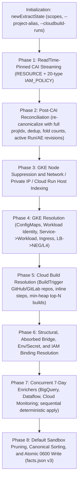
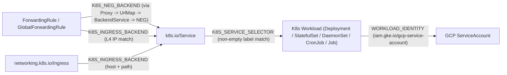

# Stage 1 — Read-Only Extraction (`facts.json` v3)

Stage 1 (`gcp-arch extract`) transforms raw, noisy, multi-project Google Cloud Platform inventories into a compact, deterministic, credential-scrubbed architectural fact graph (`facts.json`, schema `v3`).

Implemented in [`internal/extract/`](https://github.com/arrase/gcp-arch/tree/main/internal/extract) (with shared service hosts, asset types, and URI/flag constants in [`internal/extract/constants.go`](https://github.com/arrase/gcp-arch/blob/main/internal/extract/constants.go) and CLI wiring in [`cmd/gcp-arch/extract.go`](https://github.com/arrase/gcp-arch/blob/main/cmd/gcp-arch/extract.go)), Stage 1 runs strictly with `cloud-platform.read-only` credentials, collapses thousands of ephemeral plumbing resources (historical Cloud Build runs, Docker images, Kubernetes Pods/ReplicaSets, Load Balancer intermediates) into clean parent metrics and direct architectural edges, enriches structural topology with 7-day runtime telemetry at zero SQL slot cost, and writes atomically with `0600` permissions.

!!! note "CLI Scope Alias & Unconditional `stderr` Diagnostics"
    The `--project` flag is normalized as an alias for `--projects` ([`cmd/gcp-arch/main.go:176-181`](https://github.com/arrase/gcp-arch/blob/main/cmd/gcp-arch/main.go#L176-L181)). After writing `facts.json`, [`executeExtract`](https://github.com/arrase/gcp-arch/blob/main/cmd/gcp-arch/extract.go#L66-L109) always invokes [`writeOutOfScopeHints`](https://github.com/arrase/gcp-arch/blob/main/cmd/gcp-arch/extract.go#L102) ([`lines 132-147`](https://github.com/arrase/gcp-arch/blob/main/cmd/gcp-arch/extract.go#L132-L147)) and [`writeDegradedCoverage`](https://github.com/arrase/gcp-arch/blob/main/cmd/gcp-arch/extract.go#L149-L170) on `stderr`—even when `-q`/`--quiet` suppresses progress and `stdout` summaries.

---

## 8-Phase Execution Pipeline

[`extract.Extract`](https://github.com/arrase/gcp-arch/blob/main/internal/extract/cai.go#L315-L365) executes eight deterministic phases in strict order so that every downstream resolver operates over canonical project IDs, complete network indices, and deduplicated assets:



---

## Phase 1: `ReadTime`-Pinned CAI Streaming, Rate Limiters & Retries

### Point-in-Time Snapshot Pinning

To eliminate mid-scan drift across paginated multi-project inventories:

1. `collectCAIResources` streams `AssetService.ListAssets` with `ContentType: RESOURCE` and `PageSize: 1000` (`caiPageSize`) across every sorted target scope (`organizations/...`, `folders/...`, `projects/...`).
2. The first page response sets `*pinnedReadTime = resp.GetReadTime()` (and records `FactsFile.ReadTime` in UTC RFC3339).
3. Every subsequent `RESOURCE` page—and every `IAM_POLICY` page across all scopes—passes that exact `ReadTime` timestamp so resources and IAM bindings represent a single consistent point in time.
4. gRPC channels dial with a `32 MiB` max receive message size (`maxGRPCRecvMsgBytes = 32 << 20`) to handle large Kubernetes or IAM policy pages cleanly.

### 20-Type Scoped `IAM_POLICY` Listing

Instead of scanning IAM policies on every disk, route, or historical build, `collectCAIIAMPolicies` restricts `AssetTypes` to **20** architecturally significant resource types (`iamPolicyAssetTypes` in [`internal/extract/cai.go:34-55`](https://github.com/arrase/gcp-arch/blob/main/internal/extract/cai.go#L34-L55)):

| Category | Scoped `IAM_POLICY` Asset Types (20 Total) |
| :--- | :--- |
| **Hierarchy & Identity (4)** | `cloudresourcemanager.googleapis.com/Organization`, `cloudresourcemanager.googleapis.com/Folder`, `cloudresourcemanager.googleapis.com/Project`, `iam.googleapis.com/ServiceAccount` |
| **Networking (1)** | `compute.googleapis.com/Subnetwork` *(filtered in-stream to attachment roles only)* |
| **Storage & Data (6)** | `storage.googleapis.com/Bucket`, `bigquery.googleapis.com/Dataset`, `spanner.googleapis.com/Instance`, `bigtableadmin.googleapis.com/Instance`, `artifactregistry.googleapis.com/Repository`, `cloudkms.googleapis.com/CryptoKey` |
| **Messaging & Orchestration (4)** | `pubsub.googleapis.com/Topic`, `pubsub.googleapis.com/Subscription`, `cloudtasks.googleapis.com/Queue`, `workflows.googleapis.com/Workflow` |
| **Compute, AI & Secrets (5)** | `run.googleapis.com/Service`, `cloudfunctions.googleapis.com/CloudFunction`, `aiplatform.googleapis.com/Endpoint`, `aiplatform.googleapis.com/ReasoningEngine`, `secretmanager.googleapis.com/Secret` |

!!! note "Subnetwork `networkUser` In-Stream Filtering"
    For `compute.googleapis.com/Subnetwork` IAM policies, `ingestIAMPolicyAsset` retains only subnet-attachment bindings (`roles/compute.networkUser`, roles containing `networkUser`, or `compute.subnetworks.use`) to surface Shared VPC host-subnet grants without cluttering `facts.json` with administrative bindings.

### Rate Limiters, Quota Project Resolution & Error Classification

All discovery clients share token-bucket rate limiters (`golang.org/x/time/rate`) and exponential retry logic ([`internal/extract/client.go:35-50`](https://github.com/arrase/gcp-arch/blob/main/internal/extract/client.go#L35-L50), [`lines 322-369`](https://github.com/arrase/gcp-arch/blob/main/internal/extract/client.go#L322-L369)):

| Client / Enricher | Default Rate Limit | Burst | Retry Trigger | Retry Backoff |
| :--- | :--- | :---: | :--- | :--- |
| **Cloud Asset Inventory (`CAILimiter`)** | `80` RPM (`DefaultCAIRPM`, safely below GCP's 100 RPM ceiling) | `1` | gRPC `ResourceExhausted`, `RATE_LIMIT_EXCEEDED`, HTTP `429`, REST `rateLimitExceeded` | `maxRateLimitRetries = 3` retries (`100ms -> 200ms -> 400ms`, context-cancelable) |
| **Cloud Monitoring (`MonitoringLimiter`)** | `10` QPS (`DefaultMonitoringQPS`) | `1` | Same | Same (`100ms -> 200ms -> 400ms`) |
| **BigQuery (`BQLimiter`)** | `10` QPS (`DefaultEnricherQPS`) | `10` | Same | Same (`100ms -> 200ms -> 400ms`) |
| **Dataflow (`DataflowLimiter`)** | `10` QPS (`DefaultEnricherQPS`) | `10` | Same | Same (`100ms -> 200ms -> 400ms`) |

* **Quota Project Resolution ([`ResolveQuotaProject`](https://github.com/arrase/gcp-arch/blob/main/internal/extract/client.go#L453-L464)):** Uses explicit `--quota-project` (or `config.yaml` `quota_project`) when set; otherwise preserves `quota_project_id` embedded in the ADC JSON. It never falls back to a target workload project.
* **Fatal vs. Degraded Error Classification ([`ClassifyGCPError`](https://github.com/arrase/gcp-arch/blob/main/internal/extract/client.go#L132-L320)):** Inspects REST `*googleapi.Error` and gRPC `*errdetails.ErrorInfo` details to separate fatal caller failures—`ErrorKindQuotaFatal` (`QUOTA_FATAL`, e.g. `USER_PROJECT_DENIED` or `SERVICE_DISABLED`/`BILLING_DISABLED` on the caller's quota project) and `ErrorKindUnauthenticated` (`UNAUTHENTICATED`, gRPC `Unauthenticated` / HTTP `401`)—from non-fatal target-scope degradations (`ErrorKindIAMDenied`, `ErrorKindVPCSCBlocked`, `ErrorKindTargetServiceDisabled`) that record a warning in `coverage_ledger` and allow extraction to continue.

---

## Hierarchy Discovery & Enabled-API Gating

Four control-plane asset types are intercepted during CAI streaming by [`ingestHierarchyAsset`](https://github.com/arrase/gcp-arch/blob/main/internal/extract/cai.go#L667-L681) and never emitted as active workload resources:

* **`Organization`, `Folder`, `Project`:** Populate `FactsFile.Hierarchy` (`OrgNode`, `FolderNode`, `ProjectNode`) and register discovered `ProjectNumber -> ProjectID` mappings in `projIdx` (overlaid with `--project-alias` / `config.yaml` `project_aliases`).
* **`serviceusage.googleapis.com/Service`:** Records every enabled API (`state == "ENABLED"` or empty) per project in `enabledServices`. Phase 7 enrichers consult `isServiceMaybeEnabled` to skip BigQuery, Dataflow, Cloud Monitoring, and Vertex AI `PublisherModel` calls on projects where those APIs are confirmed disabled.
* **PSA Tenant Project Detection ([`IsPSATenantProject`](https://github.com/arrase/gcp-arch/blob/main/internal/extract/sanitize.go#L197-L199)):** Projects matching `^p[0-9a-f]{10,}-tp$` ([`psaTenantRe`](https://github.com/arrase/gcp-arch/blob/main/internal/extract/sanitize.go#L32), strictly hexadecimal with length `>= 10` after `strings.ToLower(strings.TrimSpace(projectID))`) or discovered via `servicenetworking` VPC peerings are flagged `ProjectNode.IsPSATenant = true`, excluded from out-of-scope target warnings, and skipped by enrichers.
* **Shared VPC Host Tracking (`recordSharedVPCHost`):** Whenever an active resource in project `A` references a VPC belonging to a different non-PSA project `B`, `ProjectNode.SharedVPCHostProject` is populated with `B`. If `B` lies outside the scanned scopes, an external project stub is registered and linked via `CONFIG_REF` (`detail: "shared_vpc"`).

---

## Deterministic Plumbing Suppression, Sanitization & Child Folding

Real-world GCP projects routinely hold thousands of ephemeral or low-level resources that destroy diagram clarity and bloat synthesis prompts. Stage 1 deterministically filters them into `suppressed_plumbing_counts` while preserving their architectural signals via in-memory folding and bridge tables.

### Suppression Lists & Sanitization ([`internal/extract/sanitize.go`](https://github.com/arrase/gcp-arch/blob/main/internal/extract/sanitize.go))

1. **`92` explicit `plumbingAssetTypes`:**
   * **Compute / VPC / LB intermediates (23):** `Route`, `Firewall`, `Policy`, `compute/Project`, `InstanceTemplate`, `Autoscaler`, `HealthCheck`, `Disk`, `Address`, `GlobalAddress`, `TargetHttpProxy`, `TargetHttpsProxy`, `TargetGrpcProxy`, `TargetTcpProxy`, `TargetSslProxy`, `SslCertificate`, `UrlMap`, `BackendService`, `BackendBucket`, `SecurityPolicy`, `NetworkEndpointGroup`, `ExternalVpnGateway`, `VpnTunnel`.
   * **Cloud Build history (1):** `cloudbuild.googleapis.com/Build` *(folded via min-heap before discard)*.
   * **GKE / Kubernetes plumbing (16):** `container/NodePool`, `gkehub/Membership`, `k8s.io/Namespace`, `ServiceAccount`, `Secret`, `ConfigMap`, `Endpoints`, `discovery.k8s.io/EndpointSlice`, `Pod`, `apps.k8s.io/ReplicaSet`, `Event`, `Node`, `ResourceQuota`, `PersistentVolume`, `PersistentVolumeClaim`, `storage.k8s.io/StorageClass`.
   * **Database, Storage, Analytics & AI absorbed children / backups (44):** Cloud SQL `Backup`/`BackupRun`, AlloyDB `Instance`, Spanner `Database`, Bigtable `Cluster`/`AppProfile`/`Table`, NetApp `Volume`, BigQuery `Table`/`Routine`/`Model`/`RowAccessPolicy`, Artifact Registry `DockerImage`/`Package`/`Version`, Cloud Run `Revision`, App Engine `Application`/`Version`, Cloud DNS `ResourceRecordSet`, NCC `Spoke`, Certificate Manager `Certificate`/`CertificateMap`, API Gateway `Api`/`ApiConfig`, Apigee `Instance`/`EnvironmentGroup`/`Environment`/`EndpointAttachment`/`ApiProxy`, Datastream `ConnectionProfile`/`PrivateConnection`, Dataproc `AutoscalingPolicy`, Dataform `Workspace`/`CompilationResult`/`WorkflowInvocation`/`WorkflowConfig`, Dataplex `Zone`/`Asset`, Analytics Hub `Listing`, Vertex AI `Model`/`Index`/`FeatureGroup`/`FeatureView`, Document AI `ProcessorVersion`.
   * **Control plane & security metadata (8):** CRM `Organization`/`Folder`/`Project`, `serviceusage/Service`, Access Context Manager `AccessPolicy`/`ServicePerimeter`, `servicenetworking/Connection`, `containeranalysis/Occurrence`.
2. **`5` `plumbingAssetPrefixes`:**
   * `admissionregistration.k8s.io/`
   * `rbac.authorization.k8s.io/`
   * `gateway.networking.k8s.io/`
   * `autoscaling.k8s.io/`
   * `servicedirectory.googleapis.com/`
3. **`16` `suppressedPlumbingServices` ([`sanitize.go:43-60`](https://github.com/arrase/gcp-arch/blob/main/internal/extract/sanitize.go#L43-L60)):** Control-plane APIs suppressed from active assets (except retained types under `compute.googleapis.com`, `container.googleapis.com`, and `iam.googleapis.com`) and excluded from Cloud Monitoring attribution:
   `sts`, `iamcredentials`, `iam`, `oauth2`, `oslogin`, `serviceusage`, `servicemanagement`, `servicecontrol`, `cloudresourcemanager`, `compute`, `container`, `cloudasset`, `orgpolicy`, `cloudbilling`, `recommender`, and `cloudapis` (all `.googleapis.com`).
4. **Credential Scrubbing & Allowlist Projection:**
   * **Default-Deny Allowlist Projection (`75` `assetAttrProjectors`, [`sanitize.go:478-585`](https://github.com/arrase/gcp-arch/blob/main/internal/extract/sanitize.go#L478-L585)):** `ProjectAttributes` builds `FactResource.Attributes` strictly from per-`asset_type` allowlist projectors; raw CAI `resource.data` maps are never forwarded. Unconditional exclusion of all **22** sensitive payload keys (`startup-script`, `startup-script-url`, `shutdown-script`, `user-data`, `env`, `envvariables`, `secretenv`, `environmentvariables`, `buildenvironmentvariables`, `args`, `command`, `script`, `data`, `binarydata`, `stringdata`, `substitutions`, `query`, `rawquery`, `schema`, `webhookconfig`, `kubectl.kubernetes.io/last-applied-configuration`, `last-applied-configuration`) is regression-tested via `poisonPayload` and `forbiddenAttrKeys` in [`internal/extract/extract_test.go`](https://github.com/arrase/gcp-arch/blob/main/internal/extract/extract_test.go).
   * **`SanitizeURL` ([`sanitize.go:202-221`](https://github.com/arrase/gcp-arch/blob/main/internal/extract/sanitize.go#L202-L221)):** Strips leading `jdbc:` prefixes (case-insensitive) alongside URL userinfo credentials, query strings, fragments, and trailing slashes.
   * **`ExtractSanitizedRefs` ([`sanitize.go:269-390`](https://github.com/arrase/gcp-arch/blob/main/internal/extract/sanitize.go#L269-L390)):** Scans raw env/arg/command/script/ConfigMap strings through targeted regex extractors, retaining only Secret Manager refs, Cloud SQL `/cloudsql/` and bare connection names, Artifact Registry repos, GCR projects, `--project`/`--cluster`/`gcloud run deploy` flags, AIP-122 URIs, `googleapis.com` URLs, `gs://` buckets, `*.run.app` and `*.cloudfunctions.net` endpoints, relative `projects/...` resource paths, private IPv4s (from connection URLs or bare text), and `<project>.<dataset>` / `<project>:<dataset>` pairs filtered against **`23` `excludedDatasetSuffixes`** ([`sanitize.go:34-40`](https://github.com/arrase/gcp-arch/blob/main/internal/extract/sanitize.go#L34-L40)).

### Child-to-Parent Folding

Before a suppressed child asset is discarded, its count and structural links are folded onto its parent resource ([`internal/extract/cai.go:683-780`](https://github.com/arrase/gcp-arch/blob/main/internal/extract/cai.go#L683-L780), with retained `CryptoKey` counting in [`extractCryptoKeyMetadata`](https://github.com/arrase/gcp-arch/blob/main/internal/extract/cai.go#L1873-L1875) and active Cloud Run / App Engine revision reconciliation in [`cai.go:2200-2275`](https://github.com/arrase/gcp-arch/blob/main/internal/extract/cai.go#L2200-L2275)):

| Child Asset Type | Parent Resource | Folded Attribute Key & Additional Folding |
| :--- | :--- | :--- |
| `bigquery.googleapis.com/Table` | BigQuery `Dataset` | `table_count` + `externalDataConfiguration` (`sourceUris`, `connectionId`) folded for edge resolution |
| `bigquery.googleapis.com/Routine` | BigQuery `Dataset` | `routine_count` + `remoteFunctionOptions` (`connection`, `endpoint`) |
| `bigquery.googleapis.com/Model` | BigQuery `Dataset` | `model_count` + `remoteModelInfo` (`connection`, `endpoint`) |
| `artifactregistry.googleapis.com/DockerImage` | Artifact Registry `Repository` | `image_count` |
| `artifactregistry.googleapis.com/Package` | Artifact Registry `Repository` | `package_count` |
| `artifactregistry.googleapis.com/Version` | Artifact Registry `Repository` | `version_count` |
| `spanner.googleapis.com/Database` | Spanner `Instance` | `database_count` |
| `bigtableadmin.googleapis.com/Cluster` | Bigtable `Instance` | `cluster_count` |
| `bigtableadmin.googleapis.com/Table` | Bigtable `Instance` | `table_count` |
| `container.googleapis.com/NodePool` | GKE `Cluster` | `node_pool_count` + captures `instanceGroupUrls` for GKE worker suppression |
| `k8s.io/Namespace` | GKE `Cluster` | `namespace_count` |
| `cloudkms.googleapis.com/CryptoKey` *(retained)* | KMS `KeyRing` | `key_count` (also retained as an active `CryptoKey` resource) |
| `networkconnectivity.googleapis.com/Spoke` | NCC `Hub` | `spoke_count` + bridged to linked VPCs / VPN Gateways / Interconnects |
| `run.googleapis.com/Revision` | Cloud Run `Service` | Active traffic-split revisions (or `latestReadyRevisionName`) merge `service_account`, `vpc_connector`, `vpc`, `subnet`, Cloud SQL instances, and sanitized env/secret refs onto the parent Service |
| `appengine.googleapis.com/Version` | App Engine `Service` | Versions receiving `split.allocations > 0` merge `service_account`, `vpc_connector`, and sanitized env/secret refs onto the parent Service |

### System Namespaces, GKE Worker Infrastructure & Default Sandbox Pruning

* **System K8s Namespaces (`isSystemK8sNamespace`):** Retained Kubernetes workloads, Services, and Ingresses in `kube-system`, `gmp-system`, or any `gke-managed-*` namespace are dropped into `suppressed_plumbing_counts`.
* **GKE Worker MIG & VM Suppression (`suppressGKENodeInfra`):** Suppresses `compute.googleapis.com/InstanceGroupManager` assets matching cluster `instanceGroupUrls` or `gke-<cluster>-` / `gk3-<cluster>-` prefixes, and suppresses `compute.googleapis.com/Instance` worker VMs matching `created-by` MIG, `cluster-name` metadata, `goog-gke-cluster-name` / `goog-k8s-cluster-name` labels, or `gke-<cluster>-` / `gk3-<cluster>-` name prefixes.
* **Default Sandbox Pruning (`pruneDefaultSandboxAssets`):** Executed in Phase 8 after all edges and enrichers complete:
  * **Default VPC (`default`), Default Subnetworks (`default` on VPC `default`), and Default Service Accounts** (`*-compute@developer.gserviceaccount.com`, `*@appspot.gserviceaccount.com`, `*@cloudservices.gserviceaccount.com`, `*@cloudbuild.gserviceaccount.com`, and `service-<num>@*.iam.gserviceaccount.com`) are suppressed **only if unreferenced** by any retained asset or edge.
  * **`logging.googleapis.com/LogBucket` named `_Default` or `_Required`** is **unconditionally suppressed**.

---

## In-Stream Cloud Build Resolution

Cloud Build projects can accumulate thousands of historical `cloudbuild.googleapis.com/Build` assets. Stage 1 extracts CI/CD deployment graphs in streaming memory with bounded heap size ([`internal/extract/cai.go:833-869`](https://github.com/arrase/gcp-arch/blob/main/internal/extract/cai.go#L833-L869), [`lines 2277-2350`](https://github.com/arrase/gcp-arch/blob/main/internal/extract/cai.go#L2277-L2350)):

1. **External Git Repository Synthesis (`BuildTrigger`):** Parses `github`, `sourceToBuild`, `triggerTemplate` (including the `github_<owner>_<repo>` Cloud Source mirror convention), and `repositoryEventConfig` ([`cai.go:1877-1910`](https://github.com/arrase/gcp-arch/blob/main/internal/extract/cai.go#L1877-L1910); falling back to `//github.com/repo/<shortName>` when `repositoryEventConfig.remoteUri` is empty) to synthesize external `external.github.com/Repository` or `external.gitlab.com/Repository` resources (`project_id: "external"`, `is_external: true`) connected to the trigger via `CLOUDBUILD_TRIGGER_REPO` with `detail` capturing the trigger filter (`push:<branch>`, `tag:<tag>`, or `pr:<branch>`). Inline `build` definitions on triggers are scanned immediately, and trigger/build `serviceAccount` attributes emit `CONFIG_REF` (`detail: "service_account"`) edges ([`cai.go:2304-2306, 2342-2348`](https://github.com/arrase/gcp-arch/blob/main/internal/extract/cai.go#L2304-L2348)).
2. **Bounded Min-Heap Folding (`cbBuildMinHeap`):** As historical `cloudbuild.googleapis.com/Build` records stream past:
   * Only `status == "SUCCESS"` builds are considered; every `Build` asset increments `suppressed_plumbing_counts["cloudbuild.googleapis.com/Build"]`.
   * Builds are keyed by `{projectID, triggerID}` into a min-heap ordered by `(createTime, uri)`.
   * Triggered builds retain only the **latest `N` succeeded runs** (`--cloudbuild-runs`, default `3`).
   * Triggerless manual/ad-hoc builds (`buildTriggerId == ""`) are capped at `maxTriggerlessCloudBuildRuns = 5` per project and attributed to the project URI (`//cloudresourcemanager.googleapis.com/projects/<proj>`).
3. **Step & Artifact Scanning (`extractCloudBuildPayloadRefs`):** Scans `steps[].name`, `entrypoint`, `script`, `args` (including space-joined `args` prefixed with `entrypoint` or `gcloud` when the step image contains `gcloud` or `cloud-sdk`), `images[]`, and `artifacts.objects.location` via `ExtractSanitizedRefs`:
   * Extracts Artifact Registry repos, GCR projects, GCS buckets, Secret Manager refs, `--project=<id>`, `--cluster=<name>`, and `gcloud run deploy <svc>`.
   * **Step-Scoped Cluster Attribution ([`scopeStepClusterRefs`](https://github.com/arrase/gcp-arch/blob/main/internal/extract/sanitize.go#L1384-L1395)):** Rewrites `--cluster=<name>` to `--cluster=<p1,p2>/<name>` whenever the same build step names `--project` targets, so bare cluster names resolve strictly within those target projects.
   * Resolves `--cluster` and `run-deploy:` against unique matching in-scope GKE Clusters or Cloud Run Services (scoped to explicit `--project` targets when present).
4. **Out-of-Scope Deployment Target Hints:** References to projects outside the scanned scopes (via `--project`, `gcr.io/<proj>`, or cross-project URIs) synthesize external `cloudresourcemanager.googleapis.com/Project` stubs, emit `CLOUDBUILD_STEP_REF` edges, and populate `out_of_scope_targets` (`source_kind: "cloudbuild_deploy_flag"`). Built-in public builder mirrors (13 namespaces such as `cloud-builders`, `google-containers`, `distroless`, `gke-release`) and PSA tenant projects are automatically excluded.

---

## GKE Resolution ([`internal/extract/gke.go`](https://github.com/arrase/gcp-arch/blob/main/internal/extract/gke.go))

Stage 1 retains **7** Kubernetes asset types (non-system namespaces only) and sets `parent_uri` to their owning GKE cluster URI:

* **Workloads (5):** `apps.k8s.io/Deployment`, `apps.k8s.io/StatefulSet`, `apps.k8s.io/DaemonSet`, `batch.k8s.io/CronJob`, `batch.k8s.io/Job`
* **Networking (2):** `k8s.io/Service`, `networking.k8s.io/Ingress`

`resolveGKE()` links the complete Kubernetes traffic and identity stack across four deterministic joins:



1. **ConfigMap Reference Folding:** Suppressed `k8s.io/ConfigMap` `data` maps are scanned in memory with `ExtractSanitizedRefs`. Workloads referencing ConfigMaps via `envFrom.configMapRef`, `valueFrom.configMapKeyRef`, or `volumes[].configMap` inherit those sanitized env and secret references (scanning both `containers[]` and `initContainers[]`).
2. **Workload Identity (`WORKLOAD_IDENTITY`):** Suppressed `k8s.io/ServiceAccount` annotations (`iam.gke.io/gcp-service-account`) map `(clusterURI, namespace, serviceAccountName)` (defaulting empty `serviceAccountName` to `"default"`) to the GCP Service Account email, setting `attributes.service_account` and emitting `WORKLOAD_IDENTITY` (`detail: "ksa:<ns>/<ksa>"`). Cross-project GSAs synthesize out-of-scope project stubs (`source_kind: "iam_cross_project"`).
3. **`k8s.io/Service` Resolution (`K8S_SERVICE_SELECTOR`):**
   * Parses the `cloud.google.com/neg-status` JSON annotation (`network_endpoint_groups: {port: negName}`) and extracts `status.loadBalancer.ingress[].ip` into `attributes.load_balancer_ips`.
   * Matches `spec.selector` against pod template labels on workloads in the same cluster and namespace. **Explicitly requires a non-empty selector** so headless or `ExternalName` Services never match every workload in the namespace.
4. **`Ingress` & `ForwardingRule` Chains (`K8S_INGRESS_BACKEND`, `K8S_NEG_BACKEND`):**
   * Extracts `spec.tls[].hosts`, `spec.rules[].host`, `http.paths[].path`, `defaultBackend`/`backend`, and `ingress.kubernetes.io/{,https-}forwarding-rule` annotations, populating `ingress_hosts` and `ingress_paths` on both the Ingress and linked ForwardingRules.
   * `traceForwardingRule` walks suppressed intermediates (`ForwardingRule -> Target{Http,Https,Grpc,Tcp,Ssl}Proxy -> UrlMap -> BackendService -> NEG`), resolving GKE NEGs by `(project, negName)` (`K8S_NEG_BACKEND`, `detail: "<paths> port:<p>"`) and L4 Service IPs (`K8S_INGRESS_BACKEND`, `detail: "L4:<ip>"`), while propagating `tls: true` for HTTPS/SSL proxies.

---

## Network, PSA/PSC, Retained Metadata, Absorbed Bridges & IAM Resolution

Implemented in [`internal/extract/edges.go`](https://github.com/arrase/gcp-arch/blob/main/internal/extract/edges.go) (with per-asset metadata extraction in [`internal/extract/cai.go:1364-1875`](https://github.com/arrase/gcp-arch/blob/main/internal/extract/cai.go#L1364-L1875)), Phase 3 and Phase 6 resolve networking topology, retained structural metadata, absorbed resource bridges, sanitized references, and IAM relationships:

### VPC Peerings vs. PSA / PSC Connectivity

* **Active VPC Peerings (`indexVPCPeerings`):** Inspects `ACTIVE` peerings on `compute.googleapis.com/Network`.
  * **PSA Peerings (`PSA_PEERING`):** Peerings whose target project matches `^p[0-9a-f]{10,}-tp$` ([`IsPSATenantProject`](https://github.com/arrase/gcp-arch/blob/main/internal/extract/sanitize.go#L197-L199)) or whose peering name contains `servicenetworking` record `psaTenants[vpcURI] = tenantProj`. PSA-managed services (`sqladmin/Instance`, `alloydb/Cluster`, `redis/Instance`, `memcache/Instance`, `file/Instance`) receive `PSA_PEERING` edges from their consumer VPC with `detail: "servicenetworking-googleapis-com (<tenant>)"` when a tenant project is recorded (plus attribute `psa_tenant_project`), or `"servicenetworking-googleapis-com"` otherwise ([`edges.go:418-421`](https://github.com/arrase/gcp-arch/blob/main/internal/extract/edges.go#L418-L421)).
  * **Standard VPC Peerings (`VPC_PEERING`):** In-scope VPC pairs emit a single canonically ordered edge (`src < dst`, `detail: <peeringName>`); out-of-scope peer projects emit an edge to an external project stub.
  * **PSC Redis Clusters:** `redis.googleapis.com/Cluster` emits `CONFIG_REF` (`detail: "psc_network"`) from its consumer VPC.

### Private IPv4 & Serverless HTTP Matching

* **Private IPv4 Matching (`parsePrivateIPv4`, `matchPrivateIP`):** Recognizes RFC 1918 (`10.0.0.0/8`, `172.16.0.0/12`, `192.168.0.0/16`) and CGNAT (`100.64.0.0/10`) addresses. Indexes private IPs of Compute Instances, internal ForwardingRules, Cloud SQL, AlloyDB (folded from absorbed `alloydb.googleapis.com/Instance`), Redis Instance/Cluster, Memcache, and Filestore by `(networkURI, ip)`. Env vars, ConfigMaps, and Datastream CDC profiles resolve private IPs across the source asset's VPC and directly peered VPCs (`reachableNetworks`)—emitting an edge **only when unambiguous (`len(matches) == 1`)**.
* **Cloud Run / Cloud Functions HTTP Matching (`indexCloudRunHosts`, `resolveHTTPTarget`):** Indexes sanitized URLs, hostnames, and short service names for retained `run.googleapis.com/Service` and `cloudfunctions.googleapis.com/CloudFunction` assets. Matches exact URLs, `*.run.app` hosts (including `<service>-<hash>-<region>.a.run.app` fallback when unique), `*.cloudfunctions.net/<fnName>`, and `.googleapis.com/` URLs across Pub/Sub push endpoints, Cloud Tasks, Cloud Scheduler, Dialogflow webhooks, BigQuery remote functions, and env vars.
* **Non-GKE Load Balancer Backends:** Resolves `BackendBucket` -> GCS Bucket, Serverless NEGs (Cloud Run, Cloud Functions, App Engine), PSC NEGs (`pscTargetService`), and MIG / InstanceGroup backends into `CONFIG_REF` edges.

### Retained Structural Metadata Extractors (`38` Asset Types)

During CAI ingestion, `extractRetainedMetadata` and its **`38` `retainedMetadataExtractors`** ([`internal/extract/cai.go:1364-1875`](https://github.com/arrase/gcp-arch/blob/main/internal/extract/cai.go#L1364-L1875)) populate `parent_uri` chains, private IPs, and inbound/outbound structural `CONFIG_REF` edges:

* **CMEK & Database Replication:** Any retained asset carrying `kms_key_uri` emits `CONFIG_REF` (`cmek`); Cloud SQL instances with `masterInstanceName` emit `replica_of`.
* **Eventing, Queues & Schedules:** Pub/Sub Subscriptions (`subscription` inbound from Topic, plus `pubsub.push`, `pubsub.bigquery_sink`, `pubsub.gcs_sink`, `dead_letter`), Eventarc Triggers (`eventarc.transport`, `eventarc.bucket`, `eventarc.destination` to Cloud Run/Functions/Workflows/GKE), Cloud Tasks (`cloudtasks.http`, `cloudtasks.appengine`), Cloud Scheduler (`scheduler.pubsub`, `scheduler.http`), and Cloud Functions (`event_trigger`, `vpc_connector`).
* **Data Pipelines, Analytics & AI:** Storage Transfer (`transfer.source`/`sink`/`notification`), BigQuery Data Transfer (`bqdt.destination`/`notification`), BigQuery Connections (`bqconnection.cloudsql`/`spanner`), Datastream (`datastream.source`/`dest`/`bigquery`), Dataproc Cluster/Batch & Metastore (`dataproc.*`, `metastore.artifacts`), Cloud Composer (`composer.gke`, `composer.dags`, env/secret refs), Discovery Engine & DataStore (`discovery.datastore`, `discovery.source`), Dialogflow (`dialogflow.webhook`), and Vertex AI ReasoningEngine (sanitized `env` and `secretEnv` refs).
* **Networking & Identity:** VPC peerings, Subnetwork/Instance/Cluster/Router/Interconnect/ServiceAttachment parents and `router.vpn`/`router.interconnect`/`interconnect.router`/`psc.target` links, plus ServiceAccount `email`/`uniqueId` indexing and KMS `CryptoKey` `key_count` folding.

### Absorbed Bridge Resolution

Suppressed intermediate resources are stored in `absorbed` and transparently bridged into direct `CONFIG_REF` edges ([`internal/extract/edges.go:765-888`](https://github.com/arrase/gcp-arch/blob/main/internal/extract/edges.go#L765-L888)):

| Absorbed Resource / Folded Source | Emitted Direct Edge (`CONFIG_REF`) | `detail` |
| :--- | :--- | :--- |
| `compute.googleapis.com/VpnTunnel` | `Cloud Router -> VpnGateway` | `vpn_tunnel` |
| `networkconnectivity.googleapis.com/Spoke` | `NCC Hub -> linked VPC / VpnGateway / InterconnectAttachment` | `ncc_spoke` |
| `aiplatform.googleapis.com/FeatureView` | `BigQuery Dataset -> FeatureOnlineStore` | `feature_sync` |
| `analyticshub.googleapis.com/Listing` | `BigQuery Dataset -> DataExchange` | `analytics_hub_listing` |
| `dataplex.googleapis.com/Asset` | `Dataplex Lake -> resourceSpec.name` | `dataplex_asset` |
| `datastream.googleapis.com/ConnectionProfile` & `PrivateConnection` | `Datastream Stream -> GCS Bucket` and `Private-IP DB -> Datastream Stream` *(matched via `PrivateConnection` VPC)* | `datastream.gcs`, `datastream.cdc:<ip>` |
| `alloydb.googleapis.com/Instance` | Folds `private_ip` onto parent `AlloyDB Cluster` for private-IP resolution | *(attribute folding)* |
| Folded BigQuery external URIs (`Table` / `Routine` / `Model`) | `GCS Bucket -> BigQuery Dataset`, `BigQuery Dataset -> Run/Fn`, `BigQuery Dataset -> BQ Connection` | `biglake`, `bq_remote_fn`, `bq_external` |

### IAM Binding Resolution (`resolveIAMBindings`)

Stage 1 processes `serviceAccount:<email>` bindings (excluding GKE Workload Identity Federation pool principals containing `[`) with strict anti-noise heuristics ([`internal/extract/edges.go:1098-1245`](https://github.com/arrase/gcp-arch/blob/main/internal/extract/edges.go#L1098-L1245)):

1. **Broad Ancestor Roles -> `ProjectCapabilities`:** `roles/owner`, `roles/editor`, `roles/viewer`, and `roles/browser` bound on an Organization, Folder, or Project are **never** expanded into noisy edges—they are folded into `FactResource.ProjectCapabilities` on the Service Account.
2. **`roles/iam.workloadIdentityUser`:** Skipped (already captured cleanly via `WORKLOAD_IDENTITY`).
3. **Direct Resource-Level Bindings:** Policies attached directly to a retained resource (Bucket, Dataset, Topic, Secret, Cloud Run Service, etc.) emit `IAM_RESOURCE_BINDING` (`SA -> resource`, `detail: <role>`, `heuristic: false`).
4. **CEL Condition-Pinned Project Bindings:** Project-level bindings with IAM CEL conditions matching `resource.name == "..."`, `resource.name.startsWith("...")`, or sanitized AIP-122 URIs emit `IAM_RESOURCE_BINDING` (`heuristic: false`) to those exact pinned resources.
5. **Single-Target 22-Service Heuristic (`serviceRoleTargetTypes`):** For non-default Service Accounts granted a service-specific project-level role across **22** role prefixes (`roles/cloudsql.`, `roles/alloydb.`, `roles/spanner.`, `roles/datastore.`, `roles/firestore.`, `roles/bigtable.`, `roles/redis.`, `roles/memcache.`, `roles/file.`, `roles/storage.`, `roles/bigquery.`, `roles/pubsub.`, `roles/cloudtasks.`, `roles/workflows.`, `roles/secretmanager.`, `roles/artifactregistry.`, `roles/cloudkms.`, `roles/run.`, `roles/cloudfunctions.`, `roles/discoveryengine.`, `roles/dialogflow.`, `roles/documentai.`), an `IAM_RESOURCE_BINDING` edge is emitted **if and only if exactly 1** active resource of that target type exists in the project, marked with **`heuristic: true`** ([`edges.go:1151, 1191, 1201`](https://github.com/arrase/gcp-arch/blob/main/internal/extract/edges.go#L1151-L1201)).

---

## Phase 7: Concurrent 7-Day Enrichers ([`internal/extract/enrichers.go`](https://github.com/arrase/gcp-arch/blob/main/internal/extract/enrichers.go))

All three enrichers fetch data in parallel via `errgroup.WithContext` over a `7`-day lookback window anchored to `ReadTime` (`enrichmentLookback = 7 * 24h`). Each per-project fan-out bounds concurrency to `maxEnrichWorkers = 8`, sorts its collected records deterministically, and **applies mutations sequentially on the main goroutine** (`Dataflow -> BigQuery -> Cloud Monitoring`) for reproducible output and zero data races.

### 1. Cloud Monitoring Enricher (`monitoring`)

Runs across non-empty, non-PSA projects where `monitoring.googleapis.com` is enabled (or unknown), aggregating with `ALIGN_SUM` / `REDUCE_SUM` on an `86400s` (daily) alignment period:

* **`consumed_api` Traffic (`serviceruntime.googleapis.com/api/request_count`):**
  * Grouped by `resource.labels.project_id`, `resource.labels.service`, `resource.labels.credential_id`, and `resource.labels.method`.
  * **Read-Only Discovery Filtering & `22` Data-Plane Read Allowlist ([`IsReadOnlyDiscoveryMethod`](https://github.com/arrase/gcp-arch/blob/main/internal/extract/enrichers.go#L184-L201), [`dataPlaneReadMethods`](https://github.com/arrase/gcp-arch/blob/main/internal/extract/enrichers.go#L93-L108)):** Excludes control-plane discovery/refresh methods (`get*`, `list*`, `aggregatedlist*`, `batchget*`, `*testiampermissions`, `watch*`, `poll*`) so Terraform refreshes and monitoring scrapers do not create false runtime dependencies, while **explicitly retaining `22` data-plane read methods** via `isDataPlaneReadMethod` so real runtime reads are never filtered out:
    * **Cloud Storage (5):** `objects.get`, `objects.list`, `getobject`, `readobject`, `listobjects`
    * **Firestore (6):** `listen`, `batchgetdocuments`, `getdocument`, `listdocuments`, `runquery`, `runaggregationquery`
    * **Datastore (1):** `lookup`
    * **Bigtable & BigQuery Storage (1):** `readrows`
    * **Spanner (4):** `read`, `streamingread`, `executesql`, `executestreamingsql`
    * **BigQuery (3):** `getqueryresults`, `tabledata.list`, `tabledataservice.list`
    * **Pub/Sub (2):** `pull`, `streamingpull`
  * **6 Companion API Aliases (`companionAPIHostMap`):** Maps `storage-component` / `storage-api` -> `storage.googleapis.com`, `bigquerystorage` / `bigquerymigration` -> `bigquery.googleapis.com`, `containerfilesystem` -> `container.googleapis.com`, and `bigtable` -> `bigtableadmin.googleapis.com`.
  * **Exclusion Lists:** Drops all **16** `suppressedPlumbingServices` and **10** `transversalControlAPIs` (`modelarmor`, `cloudtrace`, `logging`, `monitoring`, `secretmanager`, `cloudkms`, `dlp`, `artifactregistry`, `cloudbuild`, `clouddeploy` `.googleapis.com`).
  * **Caller Attribution & Heuristic Flag ([`resolveMonitoringSource`](https://github.com/arrase/gcp-arch/blob/main/internal/extract/enrichers.go#L1213-L1220) -> [`resolvePrincipalSource`](https://github.com/arrase/gcp-arch/blob/main/internal/extract/enrichers.go#L518-L527)):** Resolves `serviceaccount:<uniqueId>` callers to their unique workload when `len(wls) == 1`, and falls back to the unsuppressed Service Account URI for **both `0` and `> 1` workloads** (never skipped when multiple workloads share the SA). Emits `MONITORING_TRAFFIC` (`detail: "<host> (<N> reqs/7d)"`, **`heuristic: true`**, [`enrichers.go:1241`](https://github.com/arrase/gcp-arch/blob/main/internal/extract/enrichers.go#L1241)) when exactly 1 active target resource exists in the project for any of the **17** `consumedAPITargetTypes`.
* **Vertex AI `PublisherModel` Metrics** *(gated on `aiplatform.googleapis.com` enabled)*:
  * Queries `aiplatform.googleapis.com/publisher/online_serving/model_invocation_count` and (when invocations `> 0`) `aiplatform.googleapis.com/publisher/online_serving/consumed_token_throughput`, grouped by `project_id`, `location`, `publisher`, `model_user_id`, and `metric.labels.request_type`.
  * Synthesizes `aiplatform.googleapis.com/PublisherModel` resources (`//aiplatform.googleapis.com/projects/<proj>/locations/<loc>/publishers/<pub>/models/<model>`) with `publisher`, `model_id`, `invocations`, and optional `dedicated_throughput: true`.
  * Attributes `generateContent` / `embedContent` `consumed_api` SA calls (using `resolveMonitoringSource`) to the project's `PublisherModel` via `MONITORING_TRAFFIC` (**`heuristic: true`**, [`enrichers.go:1263`](https://github.com/arrase/gcp-arch/blob/main/internal/extract/enrichers.go#L1263)) when a single `PublisherModel` exists in that project and no non-SA GenAI calls occurred.

### 2. BigQuery Job Lineage Enricher (`bq_jobs`)

Runs across all discovered non-PSA projects where `bigquery.googleapis.com` is enabled:

* Calls the metadata-only REST API `bigquery.jobs.list` with `AllUsers(true)`, `Projection("full")`, `MinCreationTime(readTime - 7d)`, `MaxResults(1000)`, and a strict partial `Fields` selector—incurring **USD 0 BigQuery SQL slot cost** (never executes SQL or `INFORMATION_SCHEMA` queries).
* Capped at `maxBQJobPages = 20` pages (`20,000` jobs/project); hitting the cap records `TRUNCATING_CAP` in `coverage_ledger` and retains all jobs collected so far.
* Extracts `statistics.query.referencedTables`, `configuration.query.destinationTable`, `configuration.load.destinationTable`, and `configuration.copy` source/destination tables.
* Filters out hidden/temporary artifacts: datasets prefixed with `_`, tables prefixed with `_script`, and anonymous temp tables matching `^anon(?:_|[0-9a-f]{8,})`.
* Emits two `BQ_LINEAGE` edge patterns:
  * **Dataset-to-Dataset ELT (`detail: "sql_elt"`):** `referencedDataset -> destinationDataset` whenever they differ (`heuristic: false`).
  * **Principal-to-Dataset (`detail: "bq_job"`):** Resolves `principal_subject` (`serviceAccount:<email>`) or `user_email` via [`resolvePrincipalSource`](https://github.com/arrase/gcp-arch/blob/main/internal/extract/enrichers.go#L518-L527) to the unique workload (`len(wls) == 1`, `heuristic: false`) or the unsuppressed Service Account (`0` workloads -> `heuristic: false`; `> 1` shared workloads -> **`heuristic: true`**, [`enrichers.go:524`](https://github.com/arrase/gcp-arch/blob/main/internal/extract/enrichers.go#L524)) -> touched Dataset.

### 3. Active Dataflow Enricher (`dataflow_jobs`)

Runs across all discovered non-PSA projects where `dataflow.googleapis.com` is enabled:

* Lists active streaming/batch pipelines across all locations (`Projects.Locations.Jobs.List(proj, "-").Filter("ACTIVE")`) and retrieves each job with `Jobs.Get(proj, loc, id).View("JOB_VIEW_DESCRIPTION")`, defaulting an empty `summary.Location` to `"us-central1"` ([`enrichers.go:644-647`](https://github.com/arrase/gcp-arch/blob/main/internal/extract/enrichers.go#L644-L647)).
* Ensures a `dataflow.googleapis.com/Job` resource exists with `job_type`, `state`, `service_account`, `vpc`, and `subnet` (setting `parent_uri` to subnet or VPC).
* Scans `environment.tempStoragePrefix`, `environment.dataset`, `pipelineDescription.displayData`, and `originalPipelineTransform[].displayData` (`strValue` and `url`) via `ExtractSanitizedRefs` (`appendSanitizedRefs`, [`enrichers.go:696-704`](https://github.com/arrase/gcp-arch/blob/main/internal/extract/enrichers.go#L696-L704), retaining `envRefs` and discarding `secretRefs`) to emit `CONFIG_REF` edges (and `service_account` links).

---

## Complete `FactEdgeKind` Reference (12 Values) & `heuristic` Flag

Every edge in `facts.json` is classified by one of **12** `FactEdgeKind` constants ([`internal/extract/schema.go:23-36`](https://github.com/arrase/gcp-arch/blob/main/internal/extract/schema.go#L23-L36)) and carries an optional `heuristic` boolean ([`FactEdge.Heuristic`](https://github.com/arrase/gcp-arch/blob/main/internal/extract/schema.go#L108-L117), `json:"heuristic,omitempty"`):

| `FactEdgeKind` | Direction (`from_uri -> to_uri`) | Typical `detail` Format | `heuristic: true`? | Producer Phase |
| :--- | :--- | :--- | :--- | :--- |
| `CONFIG_REF` | Source resource -> referenced resource *(or inverted for inbound triggers like `Topic -> Subscription`)* | `cmek`, `vpc_connector`, `subscription`, `secret_ref`, `service_account`, `vpn_tunnel`, `ncc_spoke`, `biglake`, `bq_remote_fn`, `datastream.cdc:<ip>`, private IP, `gs://<bucket>`, etc. | Never | Phase 6 & Phase 7 (Dataflow) |
| `K8S_INGRESS_BACKEND` | `Ingress` or `ForwardingRule` (L4) -> `k8s.io/Service` | `<host><path>` (or `/*`) or `L4:<ip>` | Never | Phase 4 (GKE) |
| `K8S_NEG_BACKEND` | `ForwardingRule` -> `k8s.io/Service` (via Proxy -> UrlMap -> BackendService -> NEG) | `<paths> port:<port>` or `neg` | Never | Phase 4 (GKE) |
| `K8S_SERVICE_SELECTOR` | `k8s.io/Service` -> K8s Workload | Sorted selector `k1=v1,k2=v2` | Never | Phase 4 (GKE) |
| `WORKLOAD_IDENTITY` | K8s Workload -> GCP `ServiceAccount` *(or out-of-scope project stub)* | `ksa:<namespace>/<ksa>` *(or `ksa:<ns>/<ksa>-><email>`)* | Never | Phase 4 (GKE) |
| `CLOUDBUILD_TRIGGER_REPO` | External GitHub/GitLab `Repository` -> `BuildTrigger` | `push:<branch>`, `tag:<tag>`, `pr:<branch>` | Never | Phase 5 (Cloud Build) |
| `CLOUDBUILD_STEP_REF` | `BuildTrigger` *(or Project for triggerless builds)* -> target repo / bucket / secret / cluster / Cloud Run / out-of-scope project | `--project=<id>`, `--cluster=<name>`, `run-deploy:<svc>`, `secret_ref`, `gcr.io/<proj>`, Artifact Registry path | Never | Phase 5 (Cloud Build) |
| `IAM_RESOURCE_BINDING` | `ServiceAccount` *(or out-of-scope project stub)* -> target resource | IAM role (e.g., `roles/storage.objectAdmin`, `roles/cloudsql.client`) | Single-target 22-service project bindings only ([`edges.go:1151, 1191, 1201`](https://github.com/arrase/gcp-arch/blob/main/internal/extract/edges.go#L1151-L1201)) | Phase 6 (IAM) |
| `PSA_PEERING` | Consumer `VPC Network` -> PSA-managed service (`Cloud SQL`, `AlloyDB`, `Redis`, `Memcache`, `Filestore`) | `servicenetworking-googleapis-com (<tenant_project>)` or `servicenetworking-googleapis-com` | Never | Phase 3 (VPC/PSA) |
| `VPC_PEERING` | Lexicographically smaller `VPC Network` -> peer `VPC Network` *(or out-of-scope stub)* | Peering name | Never | Phase 3 (VPC/PSA) |
| `BQ_LINEAGE` | Source `Dataset` -> dest `Dataset`, or Workload/SA -> `Dataset` | `sql_elt` or `bq_job` | Shared-SA (`> 1` workloads) `bq_job` edges only ([`enrichers.go:505, 510, 524`](https://github.com/arrase/gcp-arch/blob/main/internal/extract/enrichers.go#L505-L527)) | Phase 7 (BigQuery) |
| `MONITORING_TRAFFIC` | Workload or `ServiceAccount` -> single-target service resource or `PublisherModel` | `<service_host> (<N> reqs/7d)` | **Always** ([`enrichers.go:1241, 1263`](https://github.com/arrase/gcp-arch/blob/main/internal/extract/enrichers.go#L1241-L1263)) | Phase 7 (Monitoring) |

### Structural-Wins Deduplication Merge (`putEdge`)

`FactEdge.Heuristic` marks correlation-derived edges (single-instance project target joins, shared-SA attribution, and Cloud Monitoring traffic) that may back `INFERRED` diagram edges in Stage 2 but **never** `VERIFIED` ones (see [Stage 2 — Conservation & Directed-Walk Provenance](synthesis.md#stage-2c-deterministic-conservation-provenance-gate)). When the same `EdgeID` is emitted multiple times during extraction, [`putEdge`](https://github.com/arrase/gcp-arch/blob/main/internal/extract/cai.go#L379-L392) merges duplicates with:

```go
st.edges[i].Heuristic = st.edges[i].Heuristic && e.Heuristic
```

so a direct structural edge (`Heuristic: false`) always overrides a heuristic duplicate (`Heuristic: true`).

---

## Complete `CoverageState` Reference (6 Values)

Every API scope queried during extraction—plus Phase 8 edge closure—is logged in `coverage_ledger` with one of **6** `CoverageState` constants ([`internal/extract/schema.go:42-49`](https://github.com/arrase/gcp-arch/blob/main/internal/extract/schema.go#L42-L49)):

| `CoverageState` | Meaning | Trigger Condition | `extract` CLI Behavior |
| :--- | :--- | :--- | :--- |
| `OK` | Complete discovery for `(scope, source)`. | All pages succeeded without truncation or errors. | No warning printed. |
| `IAM_DENIED` | Caller lacked target IAM permission on this scope/source. | `IAM_PERMISSION_DENIED`, gRPC `PermissionDenied`, or HTTP `403`. | Printed under `Coverage warnings` on `stderr` (even with `-q`); exit `0`. |
| `VPC_SC_BLOCKED` | Blocked by a VPC Service Controls perimeter. | `VPC_SERVICE_CONTROLS`, `SECURITY_POLICY_VIOLATED`, or `vpcServiceControlsUniqueIdentifier`. | Printed under `Coverage warnings` on `stderr`; exit `0`. |
| `SERVICE_DISABLED` | API disabled on a distinct target child project, or an optional enricher API disabled in a single-project scan where target == caller quota project. | `SERVICE_DISABLED` / `BILLING_DISABLED` whose `consumer` matches a distinct target child project, **or** `SERVICE_DISABLED` for `optionalEnricherServices` (`bigquery.googleapis.com`, `dataflow.googleapis.com`, `monitoring.googleapis.com`) when target == caller quota project ([`client.go:274-281`](https://github.com/arrase/gcp-arch/blob/main/internal/extract/client.go#L274-L281)). | Printed under `Coverage warnings` on `stderr`; exit `0`. |
| `TRUNCATING_CAP` | Safety pagination cap reached before exhausting records. | BigQuery `jobs.list` hit `maxBQJobPages = 20` (`20,000` jobs) within the 7-day window. | Printed under `Coverage warnings` on `stderr`; exit `0`. |
| `DANGLING_EDGES_DROPPED` | Residual edges referencing resources absent from `resources[]` were dropped during edge closure. | [`filterFactEdges`](https://github.com/arrase/gcp-arch/blob/main/internal/extract/cai.go#L2491-L2512) dropped `> 0` dangling edges after on-demand in-scope project materialization; logged under `Scope: "facts"`, `Source: "edge_closure"`. | Printed under `Coverage warnings` on `stderr` by [`writeDegradedCoverage`](https://github.com/arrase/gcp-arch/blob/main/cmd/gcp-arch/extract.go#L149-L170) (even with `-q`); exit `0`. |

### On-Demand Project Materialization & Edge Closure (`filterFactEdges`)

Before writing `facts.json`, [`filterFactEdges`](https://github.com/arrase/gcp-arch/blob/main/internal/extract/cai.go#L2491-L2512) enforces strict edge closure so every emitted edge endpoint exists in `resources[]`:

1. For each edge's `FromURI` and `ToURI`, [`maybeAddInScopeProjectResource`](https://github.com/arrase/gcp-arch/blob/main/internal/extract/cai.go#L2514-L2529) checks whether a missing `//cloudresourcemanager.googleapis.com/projects/<proj>` endpoint belongs to `inScopeProjects` (for example, triggerless Cloud Build runs or project-level references) and materializes a `cloudresourcemanager.googleapis.com/Project` node on demand.
2. Any edge whose endpoint still does not exist in `resources[]` is dropped, and a single `DANGLING_EDGES_DROPPED` (`CoverageDanglingEdges`) entry is appended to `coverage_ledger` (`Scope: "facts"`, `Source: "edge_closure"`).

---

## AIP-122 Canonicalization & `facts.json` `v3` Schema

### AIP-122 Normalization (`CanonicalizeAIP122`)

Because GCP APIs emit inconsistent resource identifiers (full REST `selfLink` URLs, `www.googleapis.com/<svc>/v1/...`, regional `us-central1-aiplatform.googleapis.com`, `gs://bucket`, numeric project IDs, and bare relative `projects/...` paths), every resource URI and edge endpoint passes through `CanonicalizeAIP122` / `CanonicalizeAIP122WithService` ([`internal/extract/canonical.go`](https://github.com/arrase/gcp-arch/blob/main/internal/extract/canonical.go)):

| Input Format | Canonical AIP-122 Output |
| :--- | :--- |
| `https://www.googleapis.com/compute/v1/projects/100200300401/locations/europe-southwest1/subnetworks/app` | `//compute.googleapis.com/projects/acme-cicd/regions/europe-southwest1/subnetworks/app` |
| `https://europe-southwest1-run.googleapis.com/v2/projects/100200300401/locations/europe-southwest1/services/api` | `//run.googleapis.com/projects/acme-cicd/locations/europe-southwest1/services/api` |
| `https://www.googleapis.com/sql/v1beta4/projects/100200300401/instances/sonarqube` | `//sqladmin.googleapis.com/projects/acme-cicd/instances/sonarqube` |
| `gs://acme-tfstate/prod/default.tfstate` | `//storage.googleapis.com/acme-tfstate` |
| `//container.googleapis.com/projects/acme-cicd/zones/europe-southwest1-a/clusters/ops` | `//container.googleapis.com/projects/acme-cicd/locations/europe-southwest1-a/clusters/ops` |
| `projects/100200300401/topics/events` | `//pubsub.googleapis.com/projects/acme-cicd/topics/events` |

Key normalization rules:
* Strips query strings (`?...`), fragments (`#...`), trailing slashes, regional host prefixes (`<region>-`, `global-`, `us-`, `eu-`), and API version path segments (`v1`, `v1beta1`, `v2alpha1`, `v1p1beta1`, etc.).
* Maps Compute Engine `/locations/global/...`, `/locations/<zone>/...`, and `/locations/<region>/...` into `/global/`, `/zones/`, and `/regions/`; maps GKE `/zones/.../clusters/` into `/locations/.../clusters/`.
* Substitutes every numeric project segment after `projects/` or `apps/` using `projIdx` (discovered `ProjectNode`s + `--project-alias`), then re-runs canonicalization across all maps and slices in Phase 2 (`reconcilePostCAI`) once every project number in scope has been discovered.

### Deterministic `EdgeID` Hashing & Canonical Sorting

Every `FactEdge.ID` is computed deterministically by [`extract.EdgeID`](https://github.com/arrase/gcp-arch/blob/main/internal/extract/schema.go#L136-L139):

```text
EdgeID = hex(sha256(kind + ":" + fromURI + ":" + toURI + ":" + detail))[:16]
```

Before writing to disk, `WriteFacts` runs `normalizedFactsCopy` to canonically sort `scopes`, `hierarchy.{organizations,folders,projects}`, `resources` (and each resource's `project_capabilities`), `edges` (backfilling any empty `id`), `out_of_scope_targets` (and each hint's `referenced_by_uris`), and `coverage_ledger`, then writes 2-space indented UTF-8 JSON atomically (`0600` file / `0700` dir).

### `FactsFile` (`v3`) Field Reference

| Top-Level Key | Type | Description |
| :--- | :--- | :--- |
| `schema_version` | `string` | Always `"v3"` (`extract.FactsSchemaVersion`). `LoadFacts` rejects any other version. |
| `read_time` | `string` | RFC3339 UTC timestamp pinned from the first CAI `ListAssets` response. |
| `scopes` | `[]string` | Sorted canonical target scopes scanned. |
| `hierarchy` | `Hierarchy` | Discovered `organizations[]`, `folders[]`, and `projects[]` (including `project_number`, `parent`, `is_psa_tenant`, `shared_vpc_host_project`). |
| `resources` | `[]FactResource` | Active retained, on-demand in-scope project, and external resources (`uri`, `asset_type`, `project_id`, `location`, `display_name`, `parent_uri`, `is_external`, allowlisted `attributes`, and `project_capabilities`). |
| `edges` | `[]FactEdge` | Deduplicated directed edges (`id`, `from_uri`, `to_uri`, `kind`, `detail`, optional `heuristic`), closed over `resources` via `filterFactEdges` (structural edges override heuristic duplicates). |
| `suppressed_plumbing_counts` | `map[string]int` | Exact count of suppressed plumbing, folded child, system-namespace, GKE-worker, and pruned default assets grouped by `asset_type`. |
| `out_of_scope_targets` | `[]OutOfScopeHint` | *(omitempty)* Cross-project targets referenced outside scanned scopes (`target_project_id`, `synthetic_uri`, `referenced_by_uris`, `source_kind`). |
| `coverage_ledger` | `[]CoverageEntry` | Complete audit log of every `(scope, source)` API query (plus `edge_closure`) and its `CoverageState`. |

### Annotated `facts.json` (`v3`) Example

```json
{
  "schema_version": "v3",
  "read_time": "2026-11-23T02:00:00Z",
  "scopes": [
    "projects/acme-cicd"
  ],
  "hierarchy": {
    "projects": [
      {
        "project_id": "acme-cicd",
        "project_number": "100200300401",
        "display_name": "Acme Platform CICD"
      },
      {
        "project_id": "p1234567890abcdef-tp",
        "display_name": "p1234567890abcdef-tp",
        "is_psa_tenant": true
      }
    ]
  },
  "resources": [
    {
      "uri": "//artifactregistry.googleapis.com/projects/acme-cicd/locations/europe-southwest1/repositories/acme-apps",
      "asset_type": "artifactregistry.googleapis.com/Repository",
      "project_id": "acme-cicd",
      "location": "europe-southwest1",
      "display_name": "acme-apps",
      "attributes": {
        "format": "DOCKER",
        "image_count": 643,
        "mode": "STANDARD_REPOSITORY"
      }
    },
    {
      "uri": "//github.com/acme-corp/platform-services",
      "asset_type": "external.github.com/Repository",
      "project_id": "external",
      "display_name": "platform-services",
      "is_external": true
    }
  ],
  "edges": [
    {
      "id": "eeb34650563cea4f",
      "from_uri": "//iam.googleapis.com/projects/acme-cicd/serviceAccounts/cloudbuild-runner@acme-cicd.iam.gserviceaccount.com",
      "to_uri": "//artifactregistry.googleapis.com/projects/acme-cicd/locations/europe-southwest1/repositories/acme-apps",
      "kind": "IAM_RESOURCE_BINDING",
      "detail": "roles/artifactregistry.writer"
    }
  ],
  "suppressed_plumbing_counts": {
    "artifactregistry.googleapis.com/DockerImage": 643,
    "cloudbuild.googleapis.com/Build": 819,
    "k8s.io/ConfigMap": 14,
    "logging.googleapis.com/LogBucket": 2
  },
  "out_of_scope_targets": [
    {
      "target_project_id": "acme-prod",
      "synthetic_uri": "//cloudresourcemanager.googleapis.com/projects/acme-prod",
      "referenced_by_uris": [
        "//cloudbuild.googleapis.com/projects/acme-cicd/locations/europe-southwest1/triggers/deploy-api-prod"
      ],
      "source_kind": "cloudbuild_deploy_flag"
    }
  ],
  "coverage_ledger": [
    {
      "scope": "projects/acme-cicd",
      "source": "bq_jobs",
      "state": "OK"
    },
    {
      "scope": "projects/acme-cicd",
      "source": "cai_iam_policy",
      "state": "OK"
    },
    {
      "scope": "projects/acme-cicd",
      "source": "cai_resource",
      "state": "OK"
    },
    {
      "scope": "projects/acme-cicd",
      "source": "dataflow_jobs",
      "state": "OK"
    },
    {
      "scope": "projects/acme-cicd",
      "source": "monitoring",
      "state": "OK"
    }
  ]
}
```

---

## Related Documentation

* [CLI & Configuration](cli_configuration.md) — `gcp-arch extract` flags, `--project-alias`, `--cloudbuild-runs`, and `config.yaml` defaults.
* [Security, IAM & Preflight](security_iam.md) — Required IAM roles, `preflight` checks, per-asset attribute allowlist, and credential scrubbing.
* [Stage 2 — Gemini 4 Synthesis & Day-2](synthesis.md) — How `facts.json` is transformed into a deterministic Go containment skeleton and enriched via a single bounded Vertex AI Gemini 4 annotation into `architecture.yaml`.
* [Manifest Schema & Validation](manifest_schema.md) — How `gcp-arch validate --facts` checks 100% resource accounting and directed-walk `FactEdge` provenance.
