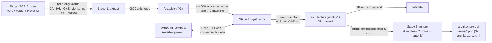

---
hide:
  - toc
---

<div class="hero-section">
  <div class="hero-eyebrow">
    <i class="fa-solid fa-diagram-project" aria-hidden="true"></i>
    <span>Semantic Multi-View GCP Architecture Pipeline</span>
  </div>
  <h1>GCP Arch</h1>
  <p class="hero-subtitle">
    A standalone static Go binary (<code>CGO_ENABLED=0</code>) that extracts read-only multi-project Google Cloud metadata, synthesizes evidence-backed multi-view architectures with Gemini 4 on Vertex AI, and renders offline vector PDF reports, high-DPI 3x PNG images, and self-contained HTML dossiers.
  </p>
  <div class="hero-badges">
    <a href="https://go.dev/"></a>
    <a href="https://github.com/arrase/gcp-arch/releases"></a>
    <a href="https://cloud.google.com/vertex-ai"></a>
    <a href="rendering/"></a>
  </div>
  <div class="hero-badges">
    <a href="https://sonarcloud.io/summary/overall?id=arrase_gcp-arch"></a>
    <a href="https://sonarcloud.io/summary/overall?id=arrase_gcp-arch&amp;metric=coverage" alt="Coverage"></a>
    <a href="https://sonarcloud.io/summary/overall?id=arrase_gcp-arch"></a>
    <a href="https://sonarcloud.io/summary/overall?id=arrase_gcp-arch"></a>
    <a href="https://sonarcloud.io/summary/overall?id=arrase_gcp-arch"></a>
    <a href="https://sonarcloud.io/summary/overall?id=arrase_gcp-arch"></a>
    <a href="https://sonarcloud.io/summary/overall?id=arrase_gcp-arch"></a>
    <a href="https://sonarcloud.io/summary/overall?id=arrase_gcp-arch"></a>
    <a href="https://sonarcloud.io/summary/overall?id=arrase_gcp-arch"></a>
    <a href="https://sonarcloud.io/summary/overall?id=arrase_gcp-arch"></a>
    <a href="https://sonarcloud.io/summary/overall?id=arrase_gcp-arch"></a>
  </div>
</div>

<div class="section-header">
  <h2>Key Features</h2>
  <span>Evidence-backed discovery, closed-world synthesis &amp; print-ready output</span>
</div>

<div class="projects-grid">
  <div class="feature-card">
    <div>
      <i class="fa-solid fa-magnifying-glass-chart feature-icon" aria-hidden="true"></i>
      <h3>Read-Only Multi-Project Discovery</h3>
      <p>Streams <code>ReadTime</code>-pinned Cloud Asset Inventory, scoped IAM policies, GKE Ingress/NEG/Workload Identity, Cloud Build triggers &amp; runs, Cloud Monitoring traffic (including Vertex AI <code>PublisherModel</code> metrics), BigQuery lineage, and active Dataflow jobs.</p>
    </div>
  </div>
  <div class="feature-card">
    <div>
      <i class="fa-solid fa-wand-magic-sparkles feature-icon" aria-hidden="true"></i>
      <h3>Closed-World Gemini 4 Synthesis</h3>
      <p>Two-pass structured Vertex AI synthesis over short-ID-interned facts (<code>&le; 500</code> active resources) enforces 100% resource accounting, stateful datastore homogeneity, and directed-walk provenance on every <code>VERIFIED</code> edge.</p>
    </div>
  </div>
  <div class="feature-card">
    <div>
      <i class="fa-solid fa-arrows-rotate feature-icon" aria-hidden="true"></i>
      <h3>Deterministic View 0 &amp; Day-2 Drift</h3>
      <p>Projects <code>view_0_system_index</code> deterministically in Go and reconciles Day-2 infrastructure drift in place—preserving curated titles, <code>notes</code>, and <code>rejected_edges</code> with a <code>0</code>-LLM fast path in <code>&lt; 100 ms</code> when unchanged.</p>
    </div>
  </div>
  <div class="feature-card">
    <div>
      <i class="fa-solid fa-file-pdf feature-icon" aria-hidden="true"></i>
      <h3>Offline PDF, 3x PNG &amp; HTML Dossiers</h3>
      <p>Compiles Git-tracked <code>architecture.yaml</code> completely offline with zero network calls and zero <code>facts.json</code> dependency, using embedded <code>Inter</code> and <code>JetBrains Mono</code> fonts and 85 inline SVG icons.</p>
    </div>
  </div>
  <div class="feature-card">
    <div>
      <i class="fa-solid fa-diagram-project feature-icon" aria-hidden="true"></i>
      <h3>Zero-Collision Orthogonal Router</h3>
      <p>Fixed-width <code>1040px</code> CSS Grid archetypes (<code>landscape_matrix</code>, <code>stage_pipeline</code>, <code>hub_spoke</code>) paired with an in-page orthogonal corridor router, jump-arc bridges, bus spines, and strict collision gates.</p>
    </div>
  </div>
  <div class="feature-card">
    <div>
      <i class="fa-solid fa-shield-halved feature-icon" aria-hidden="true"></i>
      <h3>Credential Isolation &amp; Sanitization</h3>
      <p>Strictly separates <code>cloud-platform.read-only</code> target discovery from <code>--vertex-project</code> billing, scrubs secrets via per-asset allowlists, and writes <code>0600</code> gitignored <code>facts.json</code> atomically.</p>
    </div>
  </div>
</div>

---

## Quick Installation

Build a zero-dependency static binary from source (requires **Go 1.26+**) or download a pre-built cross-platform binary from [GitHub Releases](https://github.com/arrase/gcp-arch/releases):

=== "Build from Source (Recommended)"

    ```bash
    git clone https://github.com/arrase/gcp-arch.git
    cd gcp-arch

    # Build a fully static binary (CGO_ENABLED=0)
    CGO_ENABLED=0 go build -o ./bin/gcp-arch ./cmd/gcp-arch

    # Verify static compilation metadata
    go version -m ./bin/gcp-arch | grep CGO_ENABLED=0
    ```

=== "Pre-Built Release Binaries"

    Static release binaries are published whenever a GitHub Release is published ([`.github/workflows/release.yml`](https://github.com/arrase/gcp-arch/blob/main/.github/workflows/release.yml)) for five targets (`linux/amd64`, `linux/arm64`, `darwin/amd64`, `darwin/arm64`, `windows/amd64`):

    ```bash
    # Example: Linux amd64
    curl -fL "https://github.com/arrase/gcp-arch/releases/latest/download/gcp-arch-linux-amd64" -o gcp-arch
    chmod +x gcp-arch
    ./gcp-arch --version
    ```

---

## Prerequisites

1. **Google Cloud Application Default Credentials (ADC)** *(for `preflight`, `extract`, and `synthesize`)*:
   ```bash
   gcloud auth application-default login
   ```
2. **Read-Only Target IAM & Separate Vertex AI Project**:
   - Target scopes need `roles/cloudasset.viewer` (plus recommended read-only roles for Monitoring, BigQuery, Dataflow, and Folder names).
   - Synthesis bills to a separate `--vertex-project` with `roles/aiplatform.user`. See [Security, IAM & Preflight](security_iam.md) for the exact permission matrix.
3. **Local Chrome or Chromium** *(for `render` PDF/PNG export & CLI collision verification)*:
   - Auto-discovered via `--chrome-path`, `CHROME_PATH`, `config.yaml`, `PATH`, or standard Linux/macOS install locations ([`internal/render/cdp.go`](https://github.com/arrase/gcp-arch/blob/main/internal/render/cdp.go)).
   - Runs in an isolated ephemeral `--user-data-dir` with `--headless=new` and `--disable-background-networking`.
   - `--format html` alone works even without Chrome/Chromium when `--chrome-path` is unset and auto-discovery finds no binary (writing a self-contained HTML dossier with a warning that CLI collision verification was skipped); passing an explicit nonexistent `--chrome-path` still fails fast with exit code `1` ([`cmd/gcp-arch/render.go`](https://github.com/arrase/gcp-arch/blob/main/cmd/gcp-arch/render.go#L137-L139)).

---

## 60-Second End-to-End Quick Start

`gcp-arch` runs as a strictly linear three-stage pipeline across five CLI subcommands:

```bash
# 1. Verify read-only target IAM + zero-token Vertex AI model availability
gcp-arch preflight --projects acme-cicd --vertex-project consultant-ai-sandbox

# 2. Stage 1: Extract sanitized v3 structural & runtime facts (0600, gitignored)
gcp-arch extract --projects acme-cicd -o facts.json

# 3. Stage 2: Synthesize Git-tracked multi-view architecture.yaml via Gemini 4
gcp-arch synthesize facts.json --vertex-project consultant-ai-sandbox -o architecture.yaml

# 4. Validate offline structure + 100% resource coverage & directed-walk provenance
gcp-arch validate architecture.yaml --facts facts.json

# 5. Stage 3: Render offline vector PDF, 3x PNGs, and self-contained HTML dossier
gcp-arch render architecture.yaml --format pdf,png,html -o out/
```

!!! tip "Day-2 Drift Reconciliation"
    After teams curate component titles, add `notes`, or tombstone noisy edges in `rejected_edges` inside Git, keep `architecture.yaml` synchronized without losing human edits:
    ```bash
    gcp-arch extract --projects acme-cicd -o facts.json
    gcp-arch synthesize facts.json --reconcile architecture.yaml --vertex-project consultant-ai-sandbox
    gcp-arch render architecture.yaml -o out/
    ```
    When no resources or unsettled structural inter-component edges changed (ignoring `heuristic: true` monitoring fluctuations) — or on deletion-only deltas — `--reconcile` finishes with **`0` Vertex AI calls** without needing `--vertex-project`. On the unchanged fast path (`< 100 ms`), it also runs `refreshEdgeProvenance` (downgrading or restoring transient `VERIFIED` edges in `0` LLM calls) and writes updated YAML only if the canonical bytes changed ([`internal/synth/pipeline.go`](https://github.com/arrase/gcp-arch/blob/main/internal/synth/pipeline.go#L805-L833), [`internal/synth/finalize.go`](https://github.com/arrase/gcp-arch/blob/main/internal/synth/finalize.go#L30-L64), [`cmd/gcp-arch/synthesize.go`](https://github.com/arrase/gcp-arch/blob/main/cmd/gcp-arch/synthesize.go#L204-L216)).

---

## Why `gcp-arch`?

| Capability | Manual Diagramming / Raw Resource Dumps | `gcp-arch` |
| :--- | :--- | :--- |
| **Signal vs. Noise** | Raw CAI/Terraform exports dump hundreds of routes, health checks, revisions, and default plumbing onto an unreadable canvas. | **Deterministic plumbing folding** collapses Load Balancer chains, Cloud Build runs, K8s plumbing, and 1:1 IAM/Secret resources before synthesis. |
| **Hallucination Risk** | Free-form LLM diagram prompts invent services, drop resources, and fabricate connections without proof. | **Closed-world verification** enforces 100% resource accounting and dual-BFS directed-walk provenance on every `VERIFIED` edge. |
| **Page Readability** | Massive wall-of-boxes graphs fail to print on A4 landscape or paste cleanly into Google Docs. | **Multi-view semantic partitioning** caps detail views at `1..12` blocks across three fixed-width `1040px` archetypes plus a deterministic `View 0` system map. |
| **Connector Routing** | Force-directed/layered auto-layouts overlap labels, clip through cards, and stack parallel lines. | **Orthogonal corridor router** deconflicts ports, allocates lanes, draws halo jump-arcs, and fails fast (exit `2`) if any collision remains. |
| **Day-2 Maintenance** | Re-generating diagrams wipes out human titles, annotations, and architectural grouping decisions. | **Incremental `--reconcile`** freezes existing view IDs, archetypes, curated titles, `notes`, and `rejected_edges`, patching only real drift. |
| **CI & Offline Portability** | Diagram rendering requires live cloud access, external CDNs, or SaaS editors. | **100% offline `validate` & `render`** operate solely on Git-tracked `architecture.yaml` with embedded fonts, icons, and strict CSP. |

---

## Visual Output Gallery

Both reference bundles in [`examples/`](https://github.com/arrase/gcp-arch/tree/main/examples) are validated and rendered completely offline from their synthetic `architecture.yaml` manifests:

| Platform CI/CD — System Index Map (`View 0`) | Retail Cloud-Native — System Index Map (`View 0`) |
| :---: | :---: |
|  |  |
| *`acme-cicd` → out-of-scope `acme-dev` / `acme-prod` across 4 views (`stage_pipeline`, `landscape_matrix`, `hub_spoke`)* | *4-project retail, Shared VPC, PSA/PSC & streaming AI platform across 4 views with 5-column compact mode* |

Explore all 8 high-DPI `3x` view diagrams in the [Examples & Visual Gallery](examples.md).

---

## How It Works



1. **Preflight (`gcp-arch preflight` — [`cmd/gcp-arch/preflight.go`](https://github.com/arrase/gcp-arch/blob/main/cmd/gcp-arch/preflight.go)):** Probes read-only target permissions (`cloudasset`, folder display names, `monitoring`, `bigquery`, `dataflow`) and runs zero-token Vertex AI IAM & model availability checks with copy-pasteable `gcloud` remediations.
2. **Stage 1 — Extract (`gcp-arch extract` — [`cmd/gcp-arch/extract.go`](https://github.com/arrase/gcp-arch/blob/main/cmd/gcp-arch/extract.go), [`internal/extract/`](https://github.com/arrase/gcp-arch/tree/main/internal/extract)):** Streams `ReadTime`-pinned CAI resources and scoped IAM policies, folds noisy sub-resources, resolves GKE/Cloud Build/network relationships, runs concurrent 7-day enrichers, and scrubs secrets into a deterministic `v3` `facts.json`.
3. **Stage 2 — Synthesize (`gcp-arch synthesize` — [`cmd/gcp-arch/synthesize.go`](https://github.com/arrase/gcp-arch/blob/main/cmd/gcp-arch/synthesize.go), [`internal/synth/`](https://github.com/arrase/gcp-arch/tree/main/internal/synth)):** Interns URIs and edges into compact handles (`r_0001`, `e_0001`), runs two-pass Gemini 4 structured synthesis (or Day-2 `--reconcile`), deterministically projects `View 0` (`view_0_system_index`), and validates 100% coverage + directed-walk provenance.
4. **Validate (`gcp-arch validate` — [`cmd/gcp-arch/validate.go`](https://github.com/arrase/gcp-arch/blob/main/cmd/gcp-arch/validate.go), [`internal/manifest/`](https://github.com/arrase/gcp-arch/tree/main/internal/manifest)):** Enforces strict `KnownFields(true)` YAML decoding and structural rules offline in Git PR CI, or full resource accounting & directed-walk provenance with `--facts`.
5. **Stage 3 — Render (`gcp-arch render` — [`cmd/gcp-arch/render.go`](https://github.com/arrase/gcp-arch/blob/main/cmd/gcp-arch/render.go), [`internal/render/`](https://github.com/arrase/gcp-arch/tree/main/internal/render), [`internal/icons/`](https://github.com/arrase/gcp-arch/tree/main/internal/icons)):** Compiles a strict-CSP self-contained HTML document with embedded `Inter`/`JetBrains Mono` fonts and 85 SVG icons, runs the orthogonal corridor router with zero-collision verification inside isolated headless Chrome, and exports vector A4 landscape `.pdf`, `3x` `.png`s (`3120px` nominal), and pre-routed `.html`.

---

## Practical Recipes

### 1. Multi-Project Scan with Shared VPC Host Alias

Resolve numeric project numbers seen in Shared VPC or cross-project URIs into readable IDs:

```bash
gcp-arch extract \
  --projects app-prod,data-prod \
  --project-alias 999000111222=shared-vpc-host \
  -o prod.facts.json
```

### 2. Clean-Checkout Git PR Validation Gate

Validate human edits to `architecture.yaml` in pull requests with zero GCP credentials and zero network access:

```bash
gcp-arch validate architecture.yaml --json
```

### 3. Tune Vertex AI Reasoning Effort & Concurrency

Control Pass-2 parallel view synthesis and Gemini 4 reasoning effort:

```bash
gcp-arch synthesize facts.json \
  --vertex-project consultant-ai-sandbox \
  --model gemini-4-carbon \
  --thinking-level high \
  --concurrency 4 \
  -o architecture.yaml
```

### 4. Standalone Offline HTML Dossier Export

Generate a single-file offline `.html` deliverable (works even on machines without Chrome/Chromium when `--chrome-path` is unset):

```bash
gcp-arch render architecture.yaml --format html -o out/
```

---

## CLI Commands & Exit Codes

Root CLI entrypoint, config loader, and atomic I/O live in [`cmd/gcp-arch/main.go`](https://github.com/arrase/gcp-arch/blob/main/cmd/gcp-arch/main.go), [`cmd/gcp-arch/config.go`](https://github.com/arrase/gcp-arch/blob/main/cmd/gcp-arch/config.go), and [`internal/ioutil/`](https://github.com/arrase/gcp-arch/tree/main/internal/ioutil).

| Command | Network / Auth Required | Primary Output |
| :--- | :--- | :--- |
| `gcp-arch preflight` | Target `read-only` + optional `--vertex-project` | Human table or `--json` `PreflightReport` |
| `gcp-arch extract` | Target `cloud-platform.read-only` | `facts.json` (`v3`, `0600` atomic write) |
| `gcp-arch synthesize <facts.json>` | `--vertex-project` (`cloud-platform`; optional on 0-LLM Day-2 paths) | `architecture.yaml` (`v1`, `0644` atomic write) |
| `gcp-arch validate <architecture.yaml>` | **Offline** (zero network) | Validation status or `--json` `ValidationReport` |
| `gcp-arch render <architecture.yaml>` | **Offline** (local Chrome/Chromium for `pdf`/`png`) | `architecture.pdf`, `views/*.png` (`3x`), `architecture.html` |

| Exit Code | Meaning |
| :--- | :--- |
| `0` | Success. |
| `1` | Runtime or external I/O failure: ADC/auth or quota project error, Vertex AI RPC error, missing input file, or missing Chrome/Chromium binary (for `pdf`/`png` or explicit missing `--chrome-path`). |
| `2` | Usage, config, schema, scale, validation, or layout failure: invalid flags/config, `> 500` active resources (`ScaleLimitError`), invalid YAML/unknown keys, `validate` violation (`ValidationError`), or unresolved overlap during `render` (`LayoutCollisionError`). |

<div class="section-header">
  <h2>Documentation</h2>
  <span>Complete guides, pipeline internals &amp; schema references</span>
</div>

<div class="projects-grid">
  <a href="cli_configuration/" class="feature-card">
    <div>
      <div class="card-top">
        <i class="fa-solid fa-terminal feature-icon" aria-hidden="true"></i>
        <span class="card-badge">Read →</span>
      </div>
      <h3>CLI &amp; Configuration</h3>
      <p>Complete reference for all five subcommands, flags, <code>~/.config/gcp-arch/config.yaml</code> precedence, Chrome discovery, and exit codes.</p>
    </div>
  </a>
  <a href="security_iam/" class="feature-card">
    <div>
      <div class="card-top">
        <i class="fa-solid fa-shield-halved feature-icon" aria-hidden="true"></i>
        <span class="card-badge">Read →</span>
      </div>
      <h3>Security, IAM &amp; Preflight</h3>
      <p>OAuth scope separation, minimum IAM role matrix, quota project handling, VPC-SC detection, preflight probes, and credential scrubbing.</p>
    </div>
  </a>
  <a href="extraction/" class="feature-card">
    <div>
      <div class="card-top">
        <i class="fa-solid fa-magnifying-glass-chart feature-icon" aria-hidden="true"></i>
        <span class="card-badge">Read →</span>
      </div>
      <h3>Stage 1 — Read-Only Extraction</h3>
      <p><code>ReadTime</code>-pinned CAI streaming, GKE &amp; Cloud Build resolution, 7-day Monitoring/BigQuery/Dataflow enrichers, and <code>facts.json</code> v3.</p>
    </div>
  </a>
  <a href="synthesis/" class="feature-card">
    <div>
      <div class="card-top">
        <i class="fa-solid fa-wand-magic-sparkles feature-icon" aria-hidden="true"></i>
        <span class="card-badge">Read →</span>
      </div>
      <h3>Stage 2 — Gemini 4 Synthesis</h3>
      <p>500-resource guardrail, short-ID interning, two-pass Vertex AI prompts &amp; schemas, deterministic <code>View 0</code> projection, and Day-2 <code>--reconcile</code>.</p>
    </div>
  </a>
  <a href="rendering/" class="feature-card">
    <div>
      <div class="card-top">
        <i class="fa-solid fa-file-pdf feature-icon" aria-hidden="true"></i>
        <span class="card-badge">Read →</span>
      </div>
      <h3>Stage 3 — Offline Rendering</h3>
      <p>1040px CSS Grid archetypes, barycenter ordering, orthogonal corridor router, halo jump-arcs, collision checks, <code>chromedp</code>, and 85 embedded icons.</p>
    </div>
  </a>
  <a href="manifest_schema/" class="feature-card">
    <div>
      <div class="card-top">
        <i class="fa-solid fa-file-code feature-icon" aria-hidden="true"></i>
        <span class="card-badge">Read →</span>
      </div>
      <h3>Manifest Schema &amp; Validation</h3>
      <p>Full <code>architecture.yaml</code> (<code>v1</code>) specification, strict YAML codec, all offline &amp; <code>--facts</code> validation codes, and Day-2 curation guide.</p>
    </div>
  </a>
  <a href="examples/" class="feature-card">
    <div>
      <div class="card-top">
        <i class="fa-solid fa-images feature-icon" aria-hidden="true"></i>
        <span class="card-badge">Read →</span>
      </div>
      <h3>Examples &amp; Visual Gallery</h3>
      <p>Walkthrough of the <code>platform-cicd</code> and <code>retail-cloud-native</code> reference bundles with all 8 rendered <code>3x</code> view PNGs and offline commands.</p>
    </div>
  </a>
  <a href="architecture/" class="feature-card">
    <div>
      <div class="card-top">
        <i class="fa-solid fa-sitemap feature-icon" aria-hidden="true"></i>
        <span class="card-badge">Read →</span>
      </div>
      <h3>System Architecture</h3>
      <p>End-to-end data flow, package boundaries, atomic crash-safe I/O, rate-limiting architecture, and design invariants.</p>
    </div>
  </a>
  <a href="developer_guide/" class="feature-card">
    <div>
      <div class="card-top">
        <i class="fa-solid fa-code feature-icon" aria-hidden="true"></i>
        <span class="card-badge">Read →</span>
      </div>
      <h3>Developer Guide</h3>
      <p>Go 1.26 static builds, race &amp; headless Chrome testing, <code>golangci-lint</code> v2, CodeQL/<code>govulncheck</code>/<code>zizmor</code> CI, and release packaging.</p>
    </div>
  </a>
</div>
