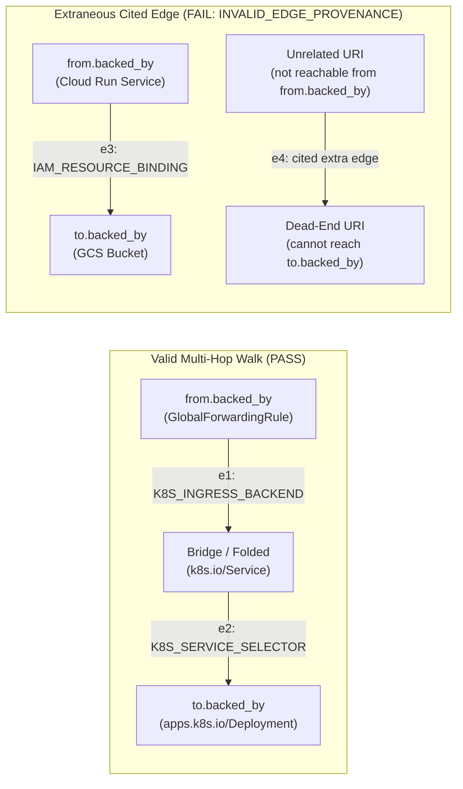

# Manifest Schema & Validation Reference

`architecture.yaml` (`schema_version: v1`) is the **Git-tracked source of truth** of the `gcp-arch` pipeline. It forms a clean contract between cloud-connected synthesis ([Stage 2 — Gemini 4 Synthesis & Day-2 Reconciliation](synthesis.md)) and 100% offline verification and diagram generation ([Stage 3 — Offline Rendering & Routing](rendering.md)).

Every `backed_by` entry (on components, containers, and transversal items) and every `excluded_resources` entry embeds its full `{uri, asset_type, project_id}` tuple directly inside `architecture.yaml`. Because of this self-contained design, `gcp-arch validate` and `gcp-arch render` operate completely offline in clean Git checkouts and pull-request CI pipelines—requiring **no `facts.json`**, **no GCP credentials**, and **zero network access**.

---

## Complete Annotated `architecture.yaml` Example

The example below illustrates the current `schema_version: v1`, `archetype: layered_flow` structure emitted by Stage 2 synthesis: `metadata`, `components` (with `service_project_id`, `topo_rank`, `sub_rank`, `notes`, 1:1 folded `backed_by`, `members`, `badges`, `folded_edge_ids`, and `inline_meta`), unlimited-depth `containers` (with `exposure`, `badges`, `order_hint`, `folded_edge_ids`, and container `backed_by`), `transversal_items`, `structural_edges`, `suppressed_plumbing_counts`, `excluded_resources`, `rejected_edges`, `acknowledged_edges`, `view_0_system_index` (placing 100% of components with `focus_summary`, `include_transversal_panel`, and evidence-backed `VERIFIED` edges), and stage-partitioned detail views featuring `off_page_refs`, `semantic_tag`, `is_retry_or_dlq`, `VERIFIED` and `INFERRED` edges, and shared `via_bus_id` bus spines. Legacy archetypes (`landscape_matrix`, `stage_pipeline`, and `hub_spoke`) remain supported for backward compatibility with existing `v1` manifests.

```yaml
schema_version: v1

metadata:
  generated_at: "2026-11-23T02:00:00Z"
  scopes:
    - projects/acme-cicd

components:
  - id: acme_tfstate
    title: Terraform State Bucket
    subtitle: GCS bucket · europe-southwest1
    icon_key: cloud_storage
    component_kind: DATASTORE
    project_id: acme-cicd
    topo_rank: 5
    sub_rank: 0
    backed_by:
      - uri: //storage.googleapis.com/acme-tfstate
        asset_type: storage.googleapis.com/Bucket
        project_id: acme-cicd
    members:
      - acme-tfstate
    inline_meta:
      - label: Class
        value: STANDARD

  - id: atlantis
    title: Atlantis PR Automation
    subtitle: GKE workload · +2 folded
    icon_key: k8s_workload
    component_kind: WORKLOAD
    project_id: acme-cicd
    service_project_id: acme-cicd
    topo_rank: 2
    sub_rank: 0
    # Human curation notes preserved across Day-2 --reconcile
    notes: Curated Terraform PR runner boundary; reviewed in ADR-014.
    # 1:1 folded Deployment + k8s.io/Service + networking.k8s.io/Ingress under one workload card
    backed_by:
      - uri: //container.googleapis.com/projects/acme-cicd/locations/europe-southwest1-b/clusters/cicd/k8s/namespaces/atlantis/apps/deployments/atlantis
        asset_type: apps.k8s.io/Deployment
        project_id: acme-cicd
      - uri: //container.googleapis.com/projects/acme-cicd/locations/europe-southwest1-b/clusters/cicd/k8s/namespaces/atlantis/networking.k8s.io/ingresses/atlantis
        asset_type: networking.k8s.io/Ingress
        project_id: acme-cicd
      - uri: //container.googleapis.com/projects/acme-cicd/locations/europe-southwest1-b/clusters/cicd/k8s/namespaces/atlantis/services/atlantis
        asset_type: k8s.io/Service
        project_id: acme-cicd
    members:
      - atlantis
    badges:
      - kind: ingress
        label: "ing: atlantis"
      - kind: project
        label: acme-cicd
      - kind: sa
        label: "SA: atlantis"
      - kind: secret
        label: "Secret: github-webhook-secret"
      - kind: svc
        label: "svc: atlantis"
    folded_edge_ids:
      - 2d646bade955f34c
      - bb189d721e6415c1
    # Up to 4 rows rendered inside the card in exact YAML order
    inline_meta:
      - label: Namespace
        value: atlantis

  - id: atlantis_https_lb
    title: Atlantis HTTPS Ingress
    subtitle: External HTTPS Load Balancer
    icon_key: cloud_load_balancing
    component_kind: INGRESS
    project_id: acme-cicd
    topo_rank: 1
    sub_rank: 0
    backed_by:
      - uri: //compute.googleapis.com/projects/acme-cicd/global/forwardingRules/k8s2-fs-demo1234-atlantis-ingress-0001
        asset_type: compute.googleapis.com/GlobalForwardingRule
        project_id: acme-cicd
    members:
      - k8s2-fs-demo1234-atlantis-ingress-0001
    badges:
      - kind: exposure
        label: PUBLIC
    inline_meta:
      - label: VIP
        value: 203.0.113.41:443
      - label: Scheme
        value: EXTERNAL_MANAGED

  - id: github_acme
    title: GitHub (github-acme)
    subtitle: acme-corp/platform-services
    icon_key: github
    component_kind: EXTERNAL_CALLER
    project_id: external
    topo_rank: 0
    sub_rank: 0
    backed_by:
      - uri: //github.com/acme-corp/platform-services
        asset_type: external.github.com/Repository
        project_id: external
    members:
      - acme-corp/platform-services
    badges:
      - kind: exposure
        label: EXTERNAL

  - id: sonarqube_db
    title: Cloud SQL (sonarqube)
    subtitle: POSTGRES_16 · private PSA
    icon_key: cloud_sql
    component_kind: DATASTORE
    project_id: acme-cicd
    topo_rank: 5
    sub_rank: 1
    backed_by:
      - uri: //sqladmin.googleapis.com/projects/acme-cicd/instances/sonarqube
        asset_type: sqladmin.googleapis.com/Instance
        project_id: acme-cicd
    members:
      - sonarqube
    badges:
      - kind: psa
        label: PSA Peering
    inline_meta:
      - label: Engine
        value: POSTGRES_16
      - label: Private IP
        value: 10.100.0.5

  - id: webhook_dlq
    title: Webhook DLQ Topic
    subtitle: Pub/Sub dead-letter topic
    icon_key: pubsub
    component_kind: MESSAGING
    project_id: acme-cicd
    topo_rank: 4
    sub_rank: 0
    backed_by:
      - uri: //pubsub.googleapis.com/projects/acme-cicd/topics/webhook-dlq
        asset_type: pubsub.googleapis.com/Topic
        project_id: acme-cicd
    members:
      - webhook-dlq

containers:
  - id: ext_source
    title: External Source Control
    subtitle: GitHub SaaS
    kind: EXTERNAL_ZONE
    exposure: EXTERNAL
    order_hint: 0

  # Unlimited-depth containment: proj_acme_cicd -> vpc_cicd -> gke_cicd
  - id: gke_cicd
    title: "GKE Cluster: cicd"
    subtitle: europe-southwest1-b (Standard)
    kind: GKE_CLUSTER
    exposure: PRIVATE
    parent_container_id: vpc_cicd
    order_hint: 1
    backed_by:
      - uri: //container.googleapis.com/projects/acme-cicd/locations/europe-southwest1-b/clusters/cicd
        asset_type: container.googleapis.com/Cluster
        project_id: acme-cicd

  - id: proj_acme_cicd
    title: "Project: acme-cicd"
    subtitle: europe-southwest1
    kind: PROJECT
    order_hint: 1

  - id: psa_tenant
    title: Google PSA Backing Zone
    subtitle: p1234567890abcdef-tp
    kind: PSA_ZONE
    exposure: PRIVATE
    parent_container_id: proj_acme_cicd
    badges:
      - PSA Peering
    order_hint: 2
    folded_edge_ids:
      - 44e5d4dcd096c550

  - id: vpc_cicd
    title: "VPC Network: cicd"
    subtitle: 10.10.0.0/20
    kind: VPC
    exposure: PRIVATE
    parent_container_id: proj_acme_cicd
    badges:
      - "Peering: servicenetworking"
    order_hint: 1
    folded_edge_ids:
      - 44e5d4dcd096c550
    backed_by:
      - uri: //compute.googleapis.com/projects/acme-cicd/global/networks/cicd
        asset_type: compute.googleapis.com/Network
        project_id: acme-cicd

# Transversal governance/security resources rendered in the right-hand governance panel
transversal_items:
  - id: tr_acme_cicd_serviceaccount_atlantis
    category: IAM_SA
    asset_type: iam.googleapis.com/ServiceAccount
    display_name: atlantis@acme-cicd.iam.gserviceaccount.com
    detail: ServiceAccount
    project_id: acme-cicd
    owner_container_id: proj_acme_cicd
    attached_node_ids:
      - atlantis
    backed_by:
      - uri: //iam.googleapis.com/projects/acme-cicd/serviceAccounts/atlantis@acme-cicd.iam.gserviceaccount.com
        asset_type: iam.googleapis.com/ServiceAccount
        project_id: acme-cicd
    backed_edge_ids:
      - 9f3c11d4a0210011
    roles:
      - roles/storage.objectAdmin

  - id: tr_acme_cicd_secret_github_webhook_secret
    category: SECRET
    asset_type: secretmanager.googleapis.com/Secret
    display_name: github-webhook-secret
    detail: automatic
    project_id: acme-cicd
    owner_container_id: proj_acme_cicd
    attached_node_ids:
      - atlantis
    backed_by:
      - uri: //secretmanager.googleapis.com/projects/acme-cicd/secrets/github-webhook-secret
        asset_type: secretmanager.googleapis.com/Secret
        project_id: acme-cicd
    backed_edge_ids:
      - 9f3c11d4a0210012

# Non-drawn structural, containment, and 1:1 folding edges recorded for 100% edge conservation
structural_edges:
  - edge_id: 2d646bade955f34c
    kind: K8S_SERVICE_SELECTOR
    from_uri: //container.googleapis.com/projects/acme-cicd/locations/europe-southwest1-b/clusters/cicd/k8s/namespaces/atlantis/services/atlantis
    to_uri: //container.googleapis.com/projects/acme-cicd/locations/europe-southwest1-b/clusters/cicd/k8s/namespaces/atlantis/apps/deployments/atlantis
    reason: 1to1_plumbing_fold
    target_id: atlantis
  - edge_id: 44e5d4dcd096c550
    kind: PSA_PEERING
    from_uri: //compute.googleapis.com/projects/acme-cicd/global/networks/cicd
    to_uri: //sqladmin.googleapis.com/projects/acme-cicd/instances/sonarqube
    reason: psa_container_boundary
    target_id: psa_tenant
  - edge_id: bb189d721e6415c1
    kind: K8S_INGRESS_BACKEND
    from_uri: //container.googleapis.com/projects/acme-cicd/locations/europe-southwest1-b/clusters/cicd/k8s/namespaces/atlantis/networking.k8s.io/ingresses/atlantis
    to_uri: //container.googleapis.com/projects/acme-cicd/locations/europe-southwest1-b/clusters/cicd/k8s/namespaces/atlantis/services/atlantis
    reason: 1to1_plumbing_fold
    target_id: atlantis

# Stage 1 plumbing asset counts suppressed before synthesis
suppressed_plumbing_counts:
  compute.googleapis.com/UrlMap: 1
  k8s.io/Endpoints: 3

# Active resources deliberately excluded from visual cards with audit rationale
excluded_resources:
  - uri: //compute.googleapis.com/projects/acme-cicd/global/networks/default
    asset_type: compute.googleapis.com/Network
    project_id: acme-cicd
    reason: Unused default GCP VPC network suppressed as boilerplate

# Curated tombstones forbidding specific directed edges across all views
rejected_edges:
  - from: atlantis_https_lb
    to: acme_tfstate
    reason: Ingress never accesses Terraform state directly; traffic terminates at Atlantis

# Non-heuristic FactEdge component pairs already offered to synthesis and intentionally left undrawn
acknowledged_edges:
  - from: github_acme
    to: webhook_dlq

views:
  # Always at views[0]; in layered_flow, places 100% of primary components with strict VERIFIED evidence
  - id: view_0_system_index
    title: System Architecture Overview
    subtitle: 6 components · 5 flows · 2 governance items
    focus_summary: GitHub PR webhooks enter via HTTPS Load Balancing into GKE Atlantis, persisting Terraform state, metadata, and failed events.
    include_transversal_panel: true
    archetype: layered_flow
    accent_mode: MIXED
    container_ids:
      - ext_source
      - gke_cicd
      - proj_acme_cicd
      - psa_tenant
      - vpc_cicd
    placements:
      - component_id: github_acme
        container_id: ext_source
        column: 0
      - component_id: atlantis_https_lb
        container_id: proj_acme_cicd
        column: 1
      - component_id: atlantis
        container_id: gke_cicd
        column: 2
      - component_id: webhook_dlq
        container_id: proj_acme_cicd
        column: 4
      - component_id: acme_tfstate
        container_id: proj_acme_cicd
        column: 5
      - component_id: sonarqube_db
        container_id: psa_tenant
        column: 5
    edges:
      - from: atlantis
        to: acme_tfstate
        verb: Locks tfstate
        flow_kind: CICD
        semantic_tag: cicd
        provenance: VERIFIED
        evidence_edge_ids:
          - c21876e6fb659711
        via_bus_id: atlantis_egress
      - from: atlantis
        to: sonarqube_db
        verb: Schema check
        flow_kind: ADMIN
        semantic_tag: data
        provenance: INFERRED
        inference_rationale: Migration verification hooks query Postgres metadata during release dry-runs.
        via_bus_id: atlantis_egress
      - from: atlantis
        to: webhook_dlq
        verb: Dead-letter
        flow_kind: RUNTIME
        semantic_tag: dlq
        is_retry_or_dlq: true
        provenance: VERIFIED
        evidence_edge_ids:
          - 7a09c41f002211ee
      - from: atlantis_https_lb
        to: atlantis
        verb: HTTPS /events
        flow_kind: RUNTIME
        semantic_tag: ingress
        provenance: VERIFIED
        evidence_edge_ids:
          - 8d41f3c0aa192011
      - from: github_acme
        to: atlantis_https_lb
        verb: Webhook POST
        flow_kind: RUNTIME
        semantic_tag: ingress
        provenance: VERIFIED
        evidence_edge_ids:
          - 190f6dfb3f1fa702

  - id: view_1
    title: Ingress & PR Automation Runtime
    subtitle: External webhook ingestion and GKE Atlantis runtime
    focus_summary: Public HTTPS ingress terminates GitHub webhooks and routes traffic into the private GKE Atlantis workload.
    include_transversal_panel: true
    archetype: layered_flow
    accent_mode: MIXED
    notes: Primary runtime entry point for PR automation webhooks.
    container_ids:
      - ext_source
      - gke_cicd
      - proj_acme_cicd
      - vpc_cicd
    placements:
      - component_id: github_acme
        container_id: ext_source
        column: 0
      - component_id: atlantis_https_lb
        container_id: proj_acme_cicd
        column: 1
      - component_id: atlantis
        container_id: gke_cicd
        column: 2
        off_page_refs:
          - target_view_id: view_2
            label: Terraform State Bucket (+2 in view_2)
            direction: OUT
    edges:
      - from: atlantis_https_lb
        to: atlantis
        verb: HTTPS /events
        flow_kind: RUNTIME
        semantic_tag: ingress
        provenance: VERIFIED
        evidence_edge_ids:
          - 8d41f3c0aa192011
      - from: github_acme
        to: atlantis_https_lb
        verb: Webhook POST
        flow_kind: RUNTIME
        semantic_tag: ingress
        provenance: VERIFIED
        evidence_edge_ids:
          - 190f6dfb3f1fa702

  - id: view_2
    title: Persistence & Dead-Letter Handling
    subtitle: Terraform state, Cloud SQL PSA datastore, and webhook DLQ
    focus_summary: Downstream storage, PSA-backed Postgres, and dead-letter queueing for PR automation runs.
    include_transversal_panel: true
    archetype: layered_flow
    accent_mode: MIXED
    container_ids:
      - proj_acme_cicd
      - psa_tenant
    placements:
      - component_id: webhook_dlq
        container_id: proj_acme_cicd
        column: 4
        off_page_refs:
          - target_view_id: view_1
            label: Atlantis PR Automation (view_1)
            direction: IN
      - component_id: acme_tfstate
        container_id: proj_acme_cicd
        column: 5
        off_page_refs:
          - target_view_id: view_1
            label: Atlantis PR Automation (view_1)
            direction: IN
      - component_id: sonarqube_db
        container_id: psa_tenant
        column: 5
        off_page_refs:
          - target_view_id: view_1
            label: Atlantis PR Automation (view_1)
            direction: IN
```

---

## Strict YAML Codec & Canonical Serialization

[`internal/manifest/types.go`](https://github.com/arrase/gcp-arch/blob/main/internal/manifest/types.go) implements strict decoding and deterministic serialization so human edits in Git stay clean, minimal, and free of silent typos.

### Strict Decoding (`manifest.Load`)

1. **`KnownFields(true)`:** [`manifest.Load`](https://github.com/arrase/gcp-arch/blob/main/internal/manifest/types.go#L328-L345) decodes YAML with `gopkg.in/yaml.v3` and `dec.KnownFields(true)`. Any unknown or misspelled field name (such as `icon:` instead of `icon_key:`) fails immediately rather than being silently ignored.
2. **Single-Document Guard:** After decoding `Manifest`, `manifest.Load` attempts a second decode and asserts `errors.Is(err, io.EOF)`. Multi-document YAML streams (`---`) are rejected with `unexpected trailing YAML document`.
3. **CLI Error Handling:** Under `gcp-arch validate --json` ([`cmd/gcp-arch/validate.go#L110-L126`](https://github.com/arrase/gcp-arch/blob/main/cmd/gcp-arch/validate.go#L110-L126)), decode errors emit a `ValidationReport` containing code `YAML_DECODE_ERROR` and exit with code **`2`**. Filesystem read errors (`*os.PathError`, such as a missing file) return CLI exit code **`1`**.

### Canonical Serialization (`manifest.Marshal` & `manifest.Write`)

[`manifest.Marshal`](https://github.com/arrase/gcp-arch/blob/main/internal/manifest/types.go#L350-L367) clones `m` (never mutating the caller's struct) and encodes deterministic **2-space indented UTF-8 YAML**. [`manifest.Write`](https://github.com/arrase/gcp-arch/blob/main/internal/manifest/types.go#L370-L376) persists the output atomically ([`atomicfile.Write`](https://github.com/arrase/gcp-arch/blob/main/internal/atomicfile/atomicfile.go#L21-L26)) with mode **`0644`** (creating parent directories with **`0755`**).

To produce stable Git diffs while preserving meaningful visual and cryptographic ordering, [`normalizedManifestCopy`](https://github.com/arrase/gcp-arch/blob/main/internal/manifest/types.go#L378-L397) (and its helpers in [`internal/manifest/types.go#L399-L624`](https://github.com/arrase/gcp-arch/blob/main/internal/manifest/types.go#L399-L624)) sorts structural collections deterministically and explicitly preserves three ordered slices:

| Path | Behavior on `Marshal` | Sort Key / Preservation Reason |
| :--- | :--- | :--- |
| `metadata.scopes` | **Sorted** | Lexicographical ascending. |
| `components` | **Sorted** | By `id` ([`normalizeComponents`](https://github.com/arrase/gcp-arch/blob/main/internal/manifest/types.go#L410-L428)). |
| `components[].backed_by` | **Sorted** | By `(uri, asset_type, project_id)` ([`sortedBackedResources`](https://github.com/arrase/gcp-arch/blob/main/internal/manifest/types.go#L611-L624)). |
| `components[].members` | **Sorted & Deduplicated** | Lexicographical ascending, duplicates collapsed via `slices.Compact` ([`sortedUniqueStrings`](https://github.com/arrase/gcp-arch/blob/main/internal/manifest/types.go#L494-L501)). |
| `components[].badges` | **Sorted & Deduplicated** | By `(kind, label)`, duplicates collapsed via `slices.Compact` ([`normalizeComponentBadges`](https://github.com/arrase/gcp-arch/blob/main/internal/manifest/types.go#L430-L439)). |
| `components[].folded_edge_ids` | **Sorted & Deduplicated** | Lexicographical ascending (`sortedUniqueStrings`). |
| `containers` | **Sorted** | By `id` ([`normalizeContainers`](https://github.com/arrase/gcp-arch/blob/main/internal/manifest/types.go#L441-L457)). |
| `containers[].badges` | **Sorted & Deduplicated** | Lexicographical ascending (`sortedUniqueStrings`). |
| `containers[].folded_edge_ids` | **Sorted & Deduplicated** | Lexicographical ascending (`sortedUniqueStrings`). |
| `containers[].backed_by` | **Sorted** | By `(uri, asset_type, project_id)`. |
| `transversal_items` | **Sorted** | By `(category, id)` ([`normalizeTransversalItems`](https://github.com/arrase/gcp-arch/blob/main/internal/manifest/types.go#L459-L476)). |
| `transversal_items[].attached_node_ids`, `backed_edge_ids`, `roles` | **Sorted & Deduplicated** | Lexicographical ascending (`sortedUniqueStrings`). |
| `transversal_items[].backed_by` | **Sorted** | By `(uri, asset_type, project_id)`. |
| `structural_edges` | **Sorted** | By `(edge_id, kind, from_uri, to_uri)` ([`normalizeStructuralEdges`](https://github.com/arrase/gcp-arch/blob/main/internal/manifest/types.go#L478-L492)). |
| `suppressed_plumbing_counts` | **Map Cloned (Key-Sorted YAML)** | Cloned via `maps.Clone` ([`types.go#L389`](https://github.com/arrase/gcp-arch/blob/main/internal/manifest/types.go#L389)); `gopkg.in/yaml.v3` emits map keys in lexicographical order. |
| `excluded_resources` | **Sorted** | By `(uri, asset_type, project_id, reason)` ([`normalizeExcludedResources`](https://github.com/arrase/gcp-arch/blob/main/internal/manifest/types.go#L503-L517)). |
| `rejected_edges` | **Sorted** | By `(from, to, reason)` ([`normalizeRejectedEdges`](https://github.com/arrase/gcp-arch/blob/main/internal/manifest/types.go#L519-L532)). |
| `acknowledged_edges` | **Sorted & Deduplicated** | By `(from, to)`, with adjacent duplicates collapsed via `slices.Compact` ([`normalizeComponentPairs`](https://github.com/arrase/gcp-arch/blob/main/internal/manifest/types.go#L399-L408)). |
| `views` | **Sorted** | `view_0_system_index` pinned at `views[0]`; all other views sorted by `id` ([`normalizeViews`](https://github.com/arrase/gcp-arch/blob/main/internal/manifest/types.go#L534-L553)). |
| `views[].container_ids` | **Sorted** | Lexicographical ascending ([`normalizeView`](https://github.com/arrase/gcp-arch/blob/main/internal/manifest/types.go#L555-L562)). |
| `views[].placements[].off_page_refs` | **Sorted** | By `(target_view_id, direction, label)` ([`normalizePlacements`](https://github.com/arrase/gcp-arch/blob/main/internal/manifest/types.go#L564-L584)). |
| `views[].edges` | **Sorted** | By `(from, to, flow_kind, verb, provenance, via_bus_id, inference_rationale, evidence_edge_ids)` ([`normalizeEdges`](https://github.com/arrase/gcp-arch/blob/main/internal/manifest/types.go#L586-L609)). |
| **`components[].inline_meta`** | **Order Preserved** | Controls top-to-bottom metadata row order inside rendered component cards. |
| **`views[].placements`** | **Order Preserved** | Preserves deterministic placement sequence (emitted by Stage 2 sorted by `(TopoRank, SubRank, ID)` and consumed in order by [`PrepareDocument`](https://github.com/arrase/gcp-arch/blob/main/internal/render/prepare.go#L125-L180)). |
| **`views[].edges[].evidence_edge_ids`** | **Order Preserved** | Preserves the human-readable directed-walk hop sequence from source to target. |

---

## Exhaustive Schema & Enum Reference

### Struct Field Reference

#### Root `Manifest` ([`types.go#L100-L112`](https://github.com/arrase/gcp-arch/blob/main/internal/manifest/types.go#L100-L112))

| YAML Key | Type | Required | Description |
| :--- | :--- | :---: | :--- |
| `schema_version` | `string` | **Yes** | Must equal `"v1"` ([`manifest.SchemaVersion`](https://github.com/arrase/gcp-arch/blob/main/internal/manifest/types.go#L21)). |
| `metadata` | `Metadata` | Optional | Generation timestamp and scanned GCP scopes. Always serialized by `manifest.Marshal` (no `omitempty`), but optional in `ValidateStructure` (omitting `metadata` passes both `manifest.Load` and `manifest.ValidateStructure`). |
| `components` | `[]Component` | **Yes** | Global logical architecture blocks referenced by views. |
| `containers` | `[]Container` | Optional | Global visual grouping frames (`omitempty`). |
| `transversal_items` | `[]TransversalItem` | Optional | IAM, KMS, Secret, Observability, NAT/Router, Firewall/Armor, and VPC Access governance items separated from primary graph wire routing (`omitempty`). |
| `structural_edges` | `[]StructuralEdge` | Optional | Explicit record of non-drawn structural, containment, and 1:1 folding edges ensuring 100% functional-edge conservation (`omitempty`). |
| `suppressed_plumbing_counts` | `map[string]int` | Optional | Counts of Stage 1 suppressed boilerplate/plumbing asset types preserved for transparency and rendered in the footer summary (`omitempty`). |
| `excluded_resources` | `[]ExcludedResource` | Optional | Active resources intentionally omitted from cards with audit reasons (`omitempty`). |
| `rejected_edges` | `[]RejectedEdge` | Optional | Curated tombstones suppressing directed `(from, to)` component edges (`omitempty`). |
| `acknowledged_edges` | `[]ComponentPair` | Optional | Directed `(from, to)` component pairs projected from non-heuristic `FactEdge`s that were already offered to synthesis and intentionally left undrawn, preventing repeated legacy Day-2 reconciliation churn (`omitempty`, [`internal/manifest/types.go#L110`](https://github.com/arrase/gcp-arch/blob/main/internal/manifest/types.go#L110)). |
| `views` | `[]View` | **Yes** | One or more diagram views (`views[0]` must be `view_0_system_index` when `>= 2` detail views exist, and may stand alone when `0` detail views exist; max `16` detail views). |

#### `Metadata` ([`types.go#L127-L130`](https://github.com/arrase/gcp-arch/blob/main/internal/manifest/types.go#L127-L130))

| YAML Key | Type | Required | Description |
| :--- | :--- | :---: | :--- |
| `generated_at` | `string` | Optional | RFC 3339 timestamp (populated from UTC clock during synthesis). |
| `scopes` | `[]string` | Optional | Canonical GCP scopes scanned (e.g., `projects/acme-cicd`, `folders/12345`, `organizations/67890`). |

#### `Component` ([`types.go#L152-L168`](https://github.com/arrase/gcp-arch/blob/main/internal/manifest/types.go#L152-L168))

| YAML Key | Type | Required | Description |
| :--- | :--- | :---: | :--- |
| `id` | `string` | **Yes** | Unique, non-empty canonical slug (conventionally `snake_case`). |
| `title` | `string` | **Yes** | Non-empty human-readable card title. |
| `subtitle` | `string` | Optional | Concise technical sublabel (`omitempty`). |
| `icon_key` | `string` | **Yes** | Registered icon slug present in the 85-icon embedded registry ([`internal/icons/assets/icons.yaml`](https://github.com/arrase/gcp-arch/blob/main/internal/icons/assets/icons.yaml)). |
| `component_kind` | `ComponentKind` | **Yes** | Architectural role enum (8 allowed values). |
| `project_id` | `string` | **Yes** | Non-empty owning GCP project ID (or `"external"` for external actors/targets). |
| `service_project_id` | `string` | Optional | Shared VPC service project ID when the component resides inside a consolidated host VPC container (`omitempty`). |
| `topo_rank` | `int` | Optional | Deterministic left-to-right topological stage rank computed by Stage 2 (`omitempty`). |
| `sub_rank` | `int` | Optional | Deterministic vertical ordering rank within a topological stage after barycenter refinement (`omitempty`). |
| `notes` | `string` | Optional | Free-form human curation notes stored in Git and preserved across Day-2 `--reconcile` (`omitempty`). |
| `backed_by` | `[]BackedResource` | **Yes** | At least 1 resource (`len >= 1`); must satisfy stateful datastore homogeneity. |
| `members` | `[]string` | Optional | Member resource display names retained for 1:1 folded children and homogeneous `COHORT` cards (`omitempty`). |
| `badges` | `[]ComponentBadge` | Optional | Compact security, governance, exposure, service-project, or folded-service chips rendered on the card (`omitempty`). |
| `folded_edge_ids` | `[]string` | Optional | `FactEdge.ID`s absorbed inside this component via 1:1 plumbing folds or intra-component edges (`omitempty`). |
| `inline_meta` | `[]InlineMeta` | Optional | `0..4` key-value detail rows rendered inside the card in exact YAML order (`omitempty`). |

#### `ComponentBadge` ([`types.go#L146-L149`](https://github.com/arrase/gcp-arch/blob/main/internal/manifest/types.go#L146-L149))

| YAML Key | Type | Required | Description |
| :--- | :--- | :---: | :--- |
| `kind` | `string` | Optional | Badge category slug controlling chip styling (e.g., `exposure`, `project`, `sa`, `kms`, `secret`, `armor`, `vpc_conn`, `nat`, `log`, `svc`, `ingress`, `backend`, `sub`, `vpn`, `psa`, `peering`, `dns`, `psc`, `ncc`, `transit`). |
| `label` | `string` | Optional | Concise display text shown inside the chip (e.g., `PUBLIC`, `SA: atlantis`, `svc: atlantis`). |

#### `BackedResource` ([`types.go#L133-L137`](https://github.com/arrase/gcp-arch/blob/main/internal/manifest/types.go#L133-L137))

| YAML Key | Type | Required | Description |
| :--- | :--- | :---: | :--- |
| `uri` | `string` | **Yes** | Non-empty canonical AIP-122 GCP resource URI (or synthetic external URI). |
| `asset_type` | `string` | **Yes** | Non-empty GCP CAI asset type (e.g., `run.googleapis.com/Service`, `sqladmin.googleapis.com/Instance`). |
| `project_id` | `string` | **Yes** | Non-empty owning GCP project ID (or `"external"`). |

#### `InlineMeta` ([`types.go#L140-L143`](https://github.com/arrase/gcp-arch/blob/main/internal/manifest/types.go#L140-L143))

| YAML Key | Type | Required | Description |
| :--- | :--- | :---: | :--- |
| `label` | `string` | **Yes** | Non-empty metadata row key (e.g., `VIP`, `Namespace`, `Engine`). |
| `value` | `string` | **Yes** | Non-empty metadata row value. |

#### `Container` ([`types.go#L171-L182`](https://github.com/arrase/gcp-arch/blob/main/internal/manifest/types.go#L171-L182))

| YAML Key | Type | Required | Description |
| :--- | :--- | :---: | :--- |
| `id` | `string` | **Yes** | Unique, non-empty container slug. |
| `title` | `string` | **Yes** | Non-empty container frame title. |
| `subtitle` | `string` | Optional | Region, network CIDR, or scope subtitle (`omitempty`). |
| `kind` | `ContainerKind` | **Yes** | Grouping boundary kind enum (**12** allowed values, [`types.go#L44-L57`](https://github.com/arrase/gcp-arch/blob/main/internal/manifest/types.go#L44-L57)). |
| `exposure` | `string` | Optional | Network exposure zone classification (e.g., `PUBLIC`, `PRIVATE`, `INTERNAL`, `EXTERNAL`; `omitempty`). |
| `parent_container_id` | `string` | Optional | ID of an existing parent container; must be acyclic (`CONTAINER_CYCLE`); nesting depth is **unlimited** (`omitempty`). |
| `badges` | `[]string` | Optional | Container-level annotation chips such as VPC peering, PSA peering, NAT router, DNS, or service-project badges (`omitempty`). |
| `order_hint` | `int` | Optional | Deterministic rendering sort hint among sibling containers (`omitempty`). |
| `folded_edge_ids` | `[]string` | Optional | `FactEdge.ID`s absorbed at this container boundary (e.g., PSA peering, VPC peering, NAT/router, private DNS, PSC attachments; `omitempty`). |
| `backed_by` | `[]BackedResource` | Optional | Optional resources accounted for by this container (e.g., `container.googleapis.com/Cluster`, `compute.googleapis.com/Network`, `compute.googleapis.com/Subnetwork`). Every entry requires non-empty `uri`, `asset_type`, and `project_id` (`omitempty`). |

#### `TransversalItem` ([`types.go#L186-L198`](https://github.com/arrase/gcp-arch/blob/main/internal/manifest/types.go#L186-L198))

| YAML Key | Type | Required | Description |
| :--- | :--- | :---: | :--- |
| `id` | `string` | **Yes** | Unique transversal item slug (e.g., `tr_<project>_<type>_<name>`). |
| `category` | `string` | **Yes** | Governance group (`IAM_SA`, `KMS`, `SECRET`, `OBSERVABILITY`, `NAT_ROUTER`, `FIREWALL_ARMOR`, `VPC_ACCESS`). |
| `asset_type` | `string` | **Yes** | Underlying GCP CAI asset type. |
| `display_name` | `string` | **Yes** | Human-readable resource name rendered in the transversal panel. |
| `detail` | `string` | Optional | Compact summary metadata (location, purpose, CIDR, replication, or direction; `omitempty`). |
| `project_id` | `string` | **Yes** | Owning GCP project ID. |
| `owner_container_id` | `string` | Optional | Enclosing project/VPC/region container ID (`omitempty`). |
| `attached_node_ids` | `[]string` | Optional | Primary component IDs referencing or governed by this item (`omitempty`). |
| `backed_by` | `[]BackedResource` | Optional | Underlying GCP resources accounted for by this transversal item (`omitempty`). |
| `backed_edge_ids` | `[]string` | Optional | Transversal `FactEdge.ID`s (e.g., IAM bindings, CMEK, secret refs, NAT/router links) absorbed by this item (`omitempty`). |
| `roles` | `[]string` | Optional | IAM `roles/...` strings observed on attached edges (`omitempty`). |

#### `StructuralEdge` ([`types.go#L202-L209`](https://github.com/arrase/gcp-arch/blob/main/internal/manifest/types.go#L202-L209))

| YAML Key | Type | Required | Description |
| :--- | :--- | :---: | :--- |
| `edge_id` | `string` | **Yes** | `FactEdge.ID` hash from `facts.json`. |
| `kind` | `string` | **Yes** | Original `FactEdgeKind` string (e.g., `K8S_SERVICE_SELECTOR`, `PSA_PEERING`, `VPC_PEERING`). |
| `from_uri` | `string` | **Yes** | Exact source `FactEdge.FromURI`. |
| `to_uri` | `string` | **Yes** | Exact target `FactEdge.ToURI`. |
| `reason` | `string` | **Yes** | Conservation classification; must be one of the 8 valid reasons in [`validStructuralEdgeReasons`](https://github.com/arrase/gcp-arch/blob/main/internal/manifest/conservation.go#L43-L52). |
| `target_id` | `string` | Optional | Associated component, container, or transversal item ID (required when `reason == "structural_link"`; `omitempty`). |

#### `ExcludedResource` ([`types.go#L212-L217`](https://github.com/arrase/gcp-arch/blob/main/internal/manifest/types.go#L212-L217))

| YAML Key | Type | Required | Description |
| :--- | :--- | :---: | :--- |
| `uri` | `string` | **Yes** | Non-empty canonical resource URI. Must be unique across `components[].backed_by`, `containers[].backed_by`, `transversal_items[].backed_by`, and `excluded_resources` (`DUPLICATE_ACCOUNTED_URI`). |
| `asset_type` | `string` | **Yes** | Non-empty CAI asset type. Must **not** be one of the 15 stateful datastore asset types (`EXCLUDED_DATASTORE`). |
| `project_id` | `string` | **Yes** | Non-empty owning project ID. |
| `reason` | `string` | **Yes** | Non-empty audit justification explaining why the resource is excluded from cards. |

#### `RejectedEdge` ([`types.go#L221-L225`](https://github.com/arrase/gcp-arch/blob/main/internal/manifest/types.go#L221-L225))

| YAML Key | Type | Required | Description |
| :--- | :--- | :---: | :--- |
| `from` | `string` | **Yes** | Non-empty source ID referencing a declared top-level `components[].id` ([`validateRejectedEdges`](https://github.com/arrase/gcp-arch/blob/main/internal/manifest/validate.go#L549-L561) -> [`validatePairComponents`](https://github.com/arrase/gcp-arch/blob/main/internal/manifest/validate.go#L394-L400)). Naming a detail `view.id` fails validation (`UNKNOWN_PAIR_COMPONENT`, because `VIEW_COMPONENT_ID_COLLISION` forbids sharing IDs between views and components). |
| `to` | `string` | **Yes** | Non-empty target ID referencing a declared top-level `components[].id` (`UNKNOWN_PAIR_COMPONENT` otherwise). |
| `reason` | `string` | **Yes** | Non-empty rationale explaining why this directed `(from, to)` edge is suppressed across all views. |

#### `ComponentPair` (`acknowledged_edges[]`, [`types.go#L230-L233`](https://github.com/arrase/gcp-arch/blob/main/internal/manifest/types.go#L230-L233))

| YAML Key | Type | Required | Description |
| :--- | :--- | :---: | :--- |
| `from` | `string` | **Yes** | Source ID referencing a declared top-level `components[].id` ([`validateAcknowledgedEdges`](https://github.com/arrase/gcp-arch/blob/main/internal/manifest/validate.go#L388-L400)). |
| `to` | `string` | **Yes** | Target ID referencing a declared top-level `components[].id` (`UNKNOWN_PAIR_COMPONENT` otherwise). |

#### `View` ([`types.go#L236-L248`](https://github.com/arrase/gcp-arch/blob/main/internal/manifest/types.go#L236-L248))

| YAML Key | Type | Required | Description |
| :--- | :--- | :---: | :--- |
| `id` | `string` | **Yes** | Unique, non-empty view slug (`view_0_system_index` pinned at `views[0]` when `>= 2` detail views exist, or as the sole view when `0` detail views exist). |
| `title` | `string` | **Yes** | Non-empty diagram page title. |
| `subtitle` | `string` | Optional | One-line diagram summary (`omitempty`). |
| `focus_summary` | `string` | Optional | One-line architectural focus banner rendered above the view canvas (`omitempty`). |
| `include_transversal_panel` | `bool` | Optional | When `true`, renders the right-hand transversal governance panel for items relevant to this view (`omitempty`). |
| `archetype` | `Archetype` | **Yes** | Visual layout archetype enum (`layered_flow`, `landscape_matrix`, `stage_pipeline`, or `hub_spoke`). |
| `accent_mode` | `AccentMode` | **Yes** | Color palette emphasis enum (`RUNTIME`, `CICD`, or `MIXED`). |
| `notes` | `string` | Optional | Human curation notes for the view (`omitempty`). |
| `container_ids` | `[]string` | Optional | Active global container IDs drawn in this view; unlimited acyclic nesting depth (`omitempty`). |
| `placements` | `[]Placement` | **Yes** | At least **`1`** placement (`len >= 1`, no upper cap). Order preserved. |
| `edges` | `[]Edge` | Optional | Directed edges between components placed in this view (`omitempty`). |

#### `Placement` ([`types.go#L251-L256`](https://github.com/arrase/gcp-arch/blob/main/internal/manifest/types.go#L251-L256))

| YAML Key | Type | Required | Description |
| :--- | :--- | :---: | :--- |
| `component_id` | `string` | **Yes** | References a global `Component.ID` (on detail views and `layered_flow` `View 0`) or a `Component.ID` / detail `View.ID` (on legacy `view_0_system_index`). Unique per view. |
| `container_id` | `string` | Optional | Active container ID; if set, MUST appear in the enclosing `view.container_ids` (`omitempty`). |
| `column` | `int` | **Yes** | 0-based stage/column index: topological rank `>= 0` (`0..N`) for `layered_flow`; `0..4` for `landscape_matrix`/`stage_pipeline`; `0..2` for `hub_spoke`. |
| `off_page_refs` | `[]OffPageRef` | Optional | Cross-view navigation badges displayed on the card (`omitempty`). |

#### `OffPageRef` ([`types.go#L259-L263`](https://github.com/arrase/gcp-arch/blob/main/internal/manifest/types.go#L259-L263))

| YAML Key | Type | Required | Description |
| :--- | :--- | :---: | :--- |
| `target_view_id` | `string` | **Yes** | ID of another existing view in `manifest.views` (must not equal the current view's ID). |
| `label` | `string` | **Yes** | Non-empty concise badge label populated symmetrically across detail views by [`populateOffPageRefs`](https://github.com/arrase/gcp-arch/blob/main/internal/synth/annotate.go#L596-L694). |
| `direction` | `string` | **Yes** | `"IN"` or `"OUT"`. |

#### `Edge` ([`types.go#L266-L277`](https://github.com/arrase/gcp-arch/blob/main/internal/manifest/types.go#L266-L277))

| YAML Key | Type | Required | Description |
| :--- | :--- | :---: | :--- |
| `from` | `string` | **Yes** | Placed source `component_id` in this view. |
| `to` | `string` | **Yes** | Placed target `component_id` in this view. |
| `verb` | `string` | **Yes** | Non-empty action verb, maximum **`16` UTF-8 runes** (`maxEdgeVerbRunes = 16`). Stage 2 clamps generated verbs to `14` runes. |
| `flow_kind` | `FlowKind` | **Yes** | Operational flow category (`RUNTIME`, `CICD`, or `ADMIN`). |
| `semantic_tag` | `string` | Optional | Semantic flow tag controlling connector styling; Stage 2 LLM annotation bounds this to 9 values: `ingress`, `traffic`, `data`, `async`, `retry`, `dlq`, `cicd`, `peering`, `hybrid` ([`internal/synth/annotate.go#L83-L85`](https://github.com/arrase/gcp-arch/blob/main/internal/synth/annotate.go#L83-L85); `omitempty`). |
| `is_retry_or_dlq` | `bool` | Optional | Marks retry/replay or dead-letter queue (DLQ) back-edges so ranking and routing treat them cleanly without distorting topological stages (`omitempty`). |
| `provenance` | `Provenance` | **Yes** | Evidence classification (`VERIFIED` or `INFERRED`). |
| `evidence_edge_ids` | `[]string` | Conditional | Required non-empty list of non-blank `FactEdge.ID` hashes for every `VERIFIED` edge — exempt **only** on legacy non-`layered_flow` `view_0_system_index` rollup views when `>= 2` detail views exist ([`validate.go#L771-L790`](https://github.com/arrase/gcp-arch/blob/main/internal/manifest/validate.go#L771-L790)). On `layered_flow` `view_0_system_index`, `VERIFIED` edges **are** strictly validated. Order preserved. |
| `inference_rationale` | `string` | Conditional | Required non-empty explanation when `provenance == INFERRED` (`omitempty`). |
| `via_bus_id` | `string` | Optional | Shared orthogonal bus spine group ID. All edges sharing one `via_bus_id` in a view must share either one common `from` (1-to-N) or one common `to` (N-to-1) (`omitempty`). |

#### `ConservationReport` (JSON Diagnostic Struct, [`conservation.go#L56-L68`](https://github.com/arrase/gcp-arch/blob/main/internal/manifest/conservation.go#L56-L68))

Emitted inside `ValidationReport.conservation` by `gcp-arch validate --facts --json` and inside `geometry_report.json` by `gcp-arch render --facts --geometry-report`:

| JSON Key | Type | Description |
| :--- | :--- | :--- |
| `status` | `string` | `"PASS"` when all conservation arrays are empty; `"FAIL"` otherwise. |
| `facts_primary_count` | `int` | Count of primary (non-core-transversal) `FactResource`s in `facts.json`. |
| `represented_primary_count` | `int` | Count of primary `FactResource`s validly represented in `components`, structural `containers`, or transversal-eligible `transversal_items`. |
| `missing_primary_uris` | `[]string` | Sorted primary `FactResource` URIs missing from the manifest. |
| `hallucinated_primary_uris` | `[]string` | Sorted manifest `backed_by` URIs absent from `facts.json`. |
| `facts_functional_edge_count` | `int` | Count of non-heuristic functional edges classified by `IsManifestFunctionalEdge`. |
| `missing_edge_ids` | `[]string` | Sorted functional `FactEdge.ID`s missing from `View 0` / valid structural accounting. |
| `unrepresented_transversal_uris` | `[]string` | Sorted core transversal resource URIs (`ServiceAccount`, `CryptoKey`, `Secret`, `LogSink`, `AlertPolicy`) missing from `transversal_items`. |
| `missing_transversal_edge_ids` | `[]string` | Sorted non-heuristic transversal `FactEdge.ID`s missing from `transversal_items[].backed_edge_ids` or `View 0`. |
| `view0_coverage` | `float64` | Fraction (`0.0..1.0`) of `manifest.components` placed in `views[0]` (must be `1.0` for `"PASS"`). |
| `view0_missing_node_ids` | `[]string` | Sorted `component.id`s absent from `views[0].placements`. |

---

### Enumerations Reference

#### `ComponentKind` (8 Values, [`types.go#L29-L38`](https://github.com/arrase/gcp-arch/blob/main/internal/manifest/types.go#L29-L38))

| Value | Architectural Role |
| :--- | :--- |
| `EXTERNAL_CALLER` | External user, client, SaaS webhook, on-prem datacenter, or upstream repository initiating flows (Stage 2 base layer **`0`** in [`internal/synth/assets.go#L39-L42`](https://github.com/arrase/gcp-arch/blob/main/internal/synth/assets.go#L39-L42)). |
| `INGRESS` | Load balancers, Cloud Armor/WAF frontends, API Gateways, Cloud DNS, Ingress/NEG front doors, and hybrid VPN/Interconnect/NCC gateways. |
| `WORKLOAD` | Application runtime services (GKE Deployments/StatefulSets, Cloud Run services/jobs, Compute Engine workloads, Cloud Functions, Vertex AI endpoints). |
| `PIPELINE` | Batch/streaming data pipelines and CI/CD execution runners (Cloud Build triggers, Cloud Deploy, Dataflow jobs, Dataproc, Cloud Composer, Workflows). |
| `MESSAGING` | Asynchronous brokers and event buses (Pub/Sub topics/subscriptions, Eventarc triggers, Cloud Tasks, Managed Kafka). |
| `DATASTORE` | Persistent databases, object storage, caches, warehouses, vector/search stores, and artifact registries. |
| `COHORT` | Homogeneous workload or trigger cohorts collapsed with 100% `members` retention (such as Cloud Build triggers, identically wired Deployments, Cloud Run Services/Jobs, Cloud Functions, or CronJobs in [`internal/synth/skeleton.go#L699-L794`](https://github.com/arrase/gcp-arch/blob/main/internal/synth/skeleton.go#L699-L794)), or grouped infrastructure cohorts in legacy manifests. |
| `EXTERNAL_TARGET` | Downstream out-of-scope GCP projects, external networks, payment PSPs, BI SaaS endpoints, or third-party sinks (Stage 2 base layer **`6`** in [`internal/synth/assets.go#L43-L47`](https://github.com/arrase/gcp-arch/blob/main/internal/synth/assets.go#L43-L47)). |

#### `ContainerKind` (12 Values, [`types.go#L44-L57`](https://github.com/arrase/gcp-arch/blob/main/internal/manifest/types.go#L44-L57))

| Value | Grouping Boundary |
| :--- | :--- |
| `ORG` | GCP Organization root boundary. |
| `FOLDER` | GCP Resource Manager Folder boundary. |
| `PROJECT` | GCP Project boundary. |
| `VPC` | VPC Network boundary (including consolidated single-host Shared VPCs). |
| `REGION` | GCP Region boundary nested inside a VPC or Project. |
| `SUBNET` | VPC Subnetwork boundary (with CIDR subtitle). |
| `EXPOSURE_ZONE` | Public/Private/Internal network exposure grouping. |
| `GKE_CLUSTER` | Google Kubernetes Engine cluster boundary. |
| `PSA_ZONE` | Google-managed Private Service Access (PSA) tenant or Private Service Connect (PSC) zone. |
| `EXTERNAL_ZONE` | Boundary grouping external SaaS, public internet, or out-of-scope GCP targets. |
| `SHARED_HUB` | Shared VPC host project or centralized networking hub boundary. |
| `HYBRID_ZONE` | On-premises / hybrid connectivity zone (Dedicated Interconnect, HA VPN, NCC transit). |

#### `Archetype` (4 Values, [`types.go#L63-L68`](https://github.com/arrase/gcp-arch/blob/main/internal/manifest/types.go#L63-L68))

| Value | Valid `column` Bounds | Layout Semantics |
| :--- | :---: | :--- |
| `layered_flow` | `>= 0` *(topological ranks `0..N`)* | Unified nested Flexbox containment tree with left-to-right topological flow, transversal governance panel, and DOM-measured Hanan-grid A* orthogonal routing (default emitted by Stage 2 synthesis). |
| `landscape_matrix` | `0..4` *(max 5 columns)* | Legacy application/ingress matrix archetype. |
| `stage_pipeline` | `0..4` *(max 5 columns)* | Legacy sequential left-to-right pipeline archetype. |
| `hub_spoke` | `0..2` *(fixed 3 columns)* | Legacy 3-column networking archetype (`spoke` col `0` -> `hub` col `1` -> `peered zone` col `2`). |

#### `AccentMode` (3 Values, [`types.go#L74-L78`](https://github.com/arrase/gcp-arch/blob/main/internal/manifest/types.go#L74-L78))

| Value | Visual Emphasis |
| :--- | :--- |
| `RUNTIME` | Production request/data plane emphasis (default runtime visual palette). |
| `CICD` | Delivery pipeline / automation emphasis. |
| `MIXED` | Views combining runtime and CI/CD or cross-cutting flows. |

#### `FlowKind`, `Provenance` & `OffPageRef.Direction`

| Enum | Allowed Values | Notes |
| :--- | :--- | :--- |
| **`FlowKind`** (3) | `RUNTIME`, `CICD`, `ADMIN` | Drives edge styling and semantic palette in Stage 3. |
| **`Provenance`** (2) | `VERIFIED`, `INFERRED` | `VERIFIED` renders as a solid evidence-backed connector; `INFERRED` renders dashed with a numbered footnote quoting `inference_rationale`. |
| **`OffPageRef.Direction`** (2) | `IN`, `OUT` | Symmetric cross-view navigation badges derived deterministically in [`populateOffPageRefs`](https://github.com/arrase/gcp-arch/blob/main/internal/synth/annotate.go#L596-L694) linking components across stage-partitioned detail views. |

---

## Stateful Datastore Homogeneity

To prevent architectural diagrams from collapsing fundamentally different persistence technologies (for example, Cloud SQL + Cloud Storage + BigQuery) into a single ambiguous "Databases" box, both Stage 2 ([`internal/synth/skeleton.go`](https://github.com/arrase/gcp-arch/blob/main/internal/synth/skeleton.go)) and offline validation ([`internal/manifest/validate.go#L82-L98`](https://github.com/arrase/gcp-arch/blob/main/internal/manifest/validate.go#L82-L98)) enforce **stateful datastore homogeneity** across the following **15** exact GCP CAI asset types (`statefulDatastoreAssetTypes`):

| # | Exact GCP CAI Asset Type | GCP Product |
| :---: | :--- | :--- |
| 1 | `sqladmin.googleapis.com/Instance` | Cloud SQL Instance |
| 2 | `alloydb.googleapis.com/Cluster` | AlloyDB Cluster |
| 3 | `alloydb.googleapis.com/Instance` | AlloyDB Instance |
| 4 | `spanner.googleapis.com/Instance` | Cloud Spanner Instance |
| 5 | `spanner.googleapis.com/Database` | Cloud Spanner Database |
| 6 | `bigtableadmin.googleapis.com/Instance` | Cloud Bigtable Instance |
| 7 | `firestore.googleapis.com/Database` | Firestore Database |
| 8 | `redis.googleapis.com/Instance` | Memorystore for Redis Instance |
| 9 | `redis.googleapis.com/Cluster` | Memorystore for Redis Cluster |
| 10 | `memcache.googleapis.com/Instance` | Memorystore for Memcached Instance |
| 11 | `storage.googleapis.com/Bucket` | Cloud Storage Bucket |
| 12 | `bigquery.googleapis.com/Dataset` | BigQuery Dataset |
| 13 | `artifactregistry.googleapis.com/Repository` | Artifact Registry Repository |
| 14 | `file.googleapis.com/Instance` | Cloud Filestore Instance |
| 15 | `pubsub.googleapis.com/Topic` | Pub/Sub Topic |

**How the checks work:**

* **Component Homogeneity (`HETEROGENEOUS_DATASTORE`):** For each component, [`validateComponentBackedBy`](https://github.com/arrase/gcp-arch/blob/main/internal/manifest/validate.go#L437-L456) collects the set of distinct `br.AssetType` values in `component.backed_by` that belong to the 15-entry map above. If `len(datastoreTypes) > 1`, validation emits **`HETEROGENEOUS_DATASTORE`**.
  * **Allowed:** One stateful datastore type folded with non-datastore helper resources (e.g., `pubsub.googleapis.com/Topic` + `pubsub.googleapis.com/Subscription`, `sqladmin.googleapis.com/Instance` + `kms.googleapis.com/CryptoKey`, or `storage.googleapis.com/Bucket` + `iam.googleapis.com/ServiceAccount`), or multiple resources of the *same* datastore asset type inside one component (e.g., two `storage.googleapis.com/Bucket` resources grouped into a `COHORT`), because `len(datastoreTypes) == 1`.
  * **Rejected (`HETEROGENEOUS_DATASTORE`):** Mixing two distinct asset types from the 15-entry table inside one `backed_by` list—such as `sqladmin.googleapis.com/Instance` + `storage.googleapis.com/Bucket`, or `alloydb.googleapis.com/Cluster` + `alloydb.googleapis.com/Instance`, or `spanner.googleapis.com/Instance` + `spanner.googleapis.com/Database`.
* **No Excluded Datastores (`EXCLUDED_DATASTORE`):** [`validateExcludedResources`](https://github.com/arrase/gcp-arch/blob/main/internal/manifest/validate.go#L531-L547) rejects placing any resource whose `asset_type` is in the 15-type set into `excluded_resources`. Stateful datastores must be diagrammed in a component (folding several of the same asset type into a `COHORT` if needed), never suppressed.

---

## Offline Structural Validation (`ValidateStructure`)

Running `gcp-arch validate <architecture.yaml>` executes strict YAML decoding followed by [`manifest.ValidateStructure`](https://github.com/arrase/gcp-arch/blob/main/internal/manifest/validate.go#L102-L108) ([`internal/manifest/validate.go`](https://github.com/arrase/gcp-arch/blob/main/internal/manifest/validate.go)) completely offline with zero network calls.

### Hard Structural Limits

| Constant ([`internal/manifest/validate.go#L76-L80`](https://github.com/arrase/gcp-arch/blob/main/internal/manifest/validate.go#L76-L80)) | Limit | Scope |
| :--- | :---: | :--- |
| `maxInlineMetaRows` | **`4`** | Maximum `inline_meta` key-value rows per component card. |
| `maxDetailViews` | **`16`** | Maximum number of detail views in `manifest.views`. |
| `maxEdgeVerbRunes` | **`16`** | Maximum UTF-8 rune count (`1..16`) for `edge.verb`. |

!!! note "Unbounded Placements & Unlimited Container Nesting"
    Each view requires **`>= 1` placement** (`VIEW_PLACEMENT_COUNT`) with **no upper placement cap**, and container parent-child nesting depth is **unlimited** (containers are checked only for existence and acyclicity via `UNKNOWN_PARENT_CONTAINER` and `CONTAINER_CYCLE`).

### Exhaustive Offline Validation Error Codes

All **53** offline structural error codes in [`internal/manifest/validate.go#L15-L74`](https://github.com/arrase/gcp-arch/blob/main/internal/manifest/validate.go#L15-L74) (**58** total in `validate.go` including the **5** `--facts` codes below, plus `YAML_DECODE_ERROR` from [`cmd/gcp-arch/validate.go#L119`](https://github.com/arrase/gcp-arch/blob/main/cmd/gcp-arch/validate.go#L119) and **7** `CONSERVATION_*` codes from [`internal/manifest/conservation.go#L72-L127`](https://github.com/arrase/gcp-arch/blob/main/internal/manifest/conservation.go#L72-L127)) are listed below:

#### YAML Decode & Schema

| Error Code | Trigger Condition | `view_id` / `subject` |
| :--- | :--- | :--- |
| `YAML_DECODE_ERROR` | *(CLI `validate --json`)* Invalid YAML syntax, unknown field rejected by `KnownFields(true)`, or trailing multi-document YAML stream. | `view_id: ""`, `subject: <manifestPath>` |
| `INVALID_SCHEMA_VERSION` | Manifest is `nil` or `schema_version != "v1"`. | `view_id: ""`, `subject: <schema_version>` |

#### Components

| Error Code | Trigger Condition | `view_id` / `subject` |
| :--- | :--- | :--- |
| `EMPTY_COMPONENT_ID` | `component.id` is empty or whitespace. | `subject: components[i]` |
| `DUPLICATE_COMPONENT_ID` | Two components share the same `id`. | `subject: <component.id>` |
| `EMPTY_COMPONENT_TITLE` | `component.title` is empty or whitespace. | `subject: <component.id>` |
| `INVALID_COMPONENT_KIND` | `component.component_kind` is not one of the 8 valid `ComponentKind` values. | `subject: <component.id>` |
| `EMPTY_PROJECT_ID` | `component.project_id` is empty or whitespace. | `subject: <component.id>` |
| `INVALID_ICON_KEY` | `component.icon_key` is blank or not registered in the 85-icon embedded `icons.Registry`. | `subject: <component.id>` |
| `EMPTY_BACKED_BY` | `component.backed_by` has `0` entries. | `subject: <component.id>` |
| `INVALID_BACKED_RESOURCE` | A `backed_by` entry (on a component **or** container) has an empty `uri`, `asset_type`, or `project_id`. | `subject: <component.id \| container.id>` |
| `INLINE_META_LIMIT` | `len(component.inline_meta) > 4`. | `subject: <component.id>` |
| `INVALID_INLINE_META` | An `inline_meta` row has an empty `label` or `value`. | `subject: <component.id>` |
| `HETEROGENEOUS_DATASTORE` | `component.backed_by` mixes `> 1` distinct asset types from the 15-type `statefulDatastoreAssetTypes` set. | `subject: <component.id>` |
| `UNPLACED_COMPONENT` | A global component is not placed in at least one detail view—or, when `len(detailViewIDs) == 0`, is not placed in `view_0_system_index` ([`validateAllComponentsPlaced`](https://github.com/arrase/gcp-arch/blob/main/internal/manifest/validate.go#L800-L817)). | `subject: <component.id>` |

#### Containers

| Error Code | Trigger Condition | `view_id` / `subject` |
| :--- | :--- | :--- |
| `EMPTY_CONTAINER_ID` | `container.id` is empty or whitespace. | `subject: containers[i]` |
| `DUPLICATE_CONTAINER_ID` | Two containers share the same `id`. | `subject: <container.id>` |
| `EMPTY_CONTAINER_TITLE` | `container.title` is empty or whitespace. | `subject: <container.id>` |
| `INVALID_CONTAINER_KIND` | `container.kind` is not one of the **12** valid `ContainerKind` values. | `subject: <container.id>` |
| `UNKNOWN_PARENT_CONTAINER` | `container.parent_container_id` does not match any defined container ID. | `subject: <container.id>` |
| `CONTAINER_CYCLE` | Walking `parent_container_id` links forms a cycle. | `subject: <container.id>` |

#### Exclusions, Resource Accounting & Component Pairs

| Error Code | Trigger Condition | `view_id` / `subject` |
| :--- | :--- | :--- |
| `INVALID_EXCLUDED_RESOURCE` | An `excluded_resources` entry has an empty `uri`, `asset_type`, or `project_id`. | `subject: <uri \| excluded_resources[i]>` |
| `MISSING_EXCLUSION_REASON` | An `excluded_resources` entry has an empty `reason`. | `subject: <uri \| excluded_resources[i]>` |
| `EXCLUDED_DATASTORE` | An `excluded_resources` entry has an `asset_type` in the 15-type `statefulDatastoreAssetTypes` set ([`validateExcludedResources`](https://github.com/arrase/gcp-arch/blob/main/internal/manifest/validate.go#L543-L545)). | `subject: <uri \| excluded_resources[i]>` |
| `DUPLICATE_ACCOUNTED_URI` | The same non-empty resource URI appears more than once across the 4 accounting buckets: `components[].backed_by`, `containers[].backed_by`, `transversal_items[].backed_by`, and `excluded_resources` ([`forEachAccountedURI`](https://github.com/arrase/gcp-arch/blob/main/internal/manifest/validate.go#L239-L254), [`validateAccountedURIUniqueness`](https://github.com/arrase/gcp-arch/blob/main/internal/manifest/validate.go#L376-L386)). | `view_id: ""`, `subject: <uri>` |
| `INVALID_REJECTED_EDGE` | A `rejected_edges` entry has an empty `from`, `to`, or `reason`. | `subject: rejected_edges[i]` |
| `UNKNOWN_PAIR_COMPONENT` | A `rejected_edges[i]` or `acknowledged_edges[i]` entry references a `from` or `to` ID not declared in top-level `components` ([`validateAcknowledgedEdges`](https://github.com/arrase/gcp-arch/blob/main/internal/manifest/validate.go#L388-L400), [`validateRejectedEdges`](https://github.com/arrase/gcp-arch/blob/main/internal/manifest/validate.go#L549-L561)). | `view_id: ""`, `subject: rejected_edges[i] \| acknowledged_edges[i]` |

#### Views & System Index (`View 0`)

| Error Code | Trigger Condition | `view_id` / `subject` |
| :--- | :--- | :--- |
| `NO_VIEWS` | `manifest.views` is empty (`0` views). | `view_id: ""`, `subject: ""` |
| `EMPTY_VIEW_ID` | `view.id` is empty or whitespace. | `subject: views[i]` |
| `DUPLICATE_VIEW_ID` | Two views share the same `id`. | `view_id: <view.id>`, `subject: <view.id>` |
| `EMPTY_VIEW_TITLE` | `view.title` is empty or whitespace. | `view_id: <view.id>`, `subject: <view.id>` |
| `VIEW_COMPONENT_ID_COLLISION` | A `view.id` collides with a top-level `component.id` (disallowed because `view_0_system_index` placements can reference both namespaces; [`validateViewIndex`](https://github.com/arrase/gcp-arch/blob/main/internal/manifest/validate.go#L586-L588)). | `view_id: <view.id>`, `subject: <view.id>` |
| `TOO_MANY_DETAIL_VIEWS` | Manifest defines more than `16` (`maxDetailViews`) detail views ([`validateViewIndex`](https://github.com/arrase/gcp-arch/blob/main/internal/manifest/validate.go#L590-L592)). | `view_id: ""`, `subject: ""` |
| `MISSING_SYSTEM_INDEX_VIEW` | `>= 2` detail views exist, but `view_0_system_index` is absent. | `view_id: ""`, `subject: view_0_system_index` |
| `UNEXPECTED_SYSTEM_INDEX_VIEW` | Exactly `1` detail view exists (`detailCount == 1`), yet `view_0_system_index` is present. Having `0` detail views with `view_0_system_index` alone is valid ([`validateSystemIndexPosition`](https://github.com/arrase/gcp-arch/blob/main/internal/manifest/validate.go#L597-L607)). | `view_id: view_0_system_index`, `subject: view_0_system_index` |
| `MISPLACED_SYSTEM_INDEX_VIEW` | `view_0_system_index` exists at an index `> 0` instead of `views[0]`. | `view_id: view_0_system_index`, `subject: view_0_system_index` |
| `INVALID_ARCHETYPE` | `view.archetype` is not `layered_flow`, `landscape_matrix`, `stage_pipeline`, or `hub_spoke`. | `view_id: <view.id>`, `subject: <archetype>` |
| `INVALID_ACCENT_MODE` | `view.accent_mode` is not `RUNTIME`, `CICD`, or `MIXED`. | `view_id: <view.id>`, `subject: <accent_mode>` |
| `UNKNOWN_CONTAINER_REF` | `view.container_ids` lists an ID not declared in top-level `containers`. | `view_id: <view.id>`, `subject: <container_id>` |

#### Placements & Off-Page References

| Error Code | Trigger Condition | `view_id` / `subject` |
| :--- | :--- | :--- |
| `VIEW_PLACEMENT_COUNT` | View has `< 1` placement ([`validatePlacementCount`](https://github.com/arrase/gcp-arch/blob/main/internal/manifest/validate.go#L663-L667); no upper cap). | `view_id: <view.id>`, `subject: <view.id>` |
| `DUPLICATE_PLACEMENT` | The same `component_id` appears more than once in `view.placements`. | `view_id: <view.id>`, `subject: <component_id>` |
| `UNKNOWN_COMPONENT_REF` | On a detail view: `component_id` not found in `components`. On `view_0_system_index`: `component_id` matches neither a `component.id` nor a detail `view.id`. | `view_id: <view.id>`, `subject: <component_id>` |
| `PLACEMENT_CONTAINER_NOT_IN_VIEW` | `placement.container_id` is non-empty but absent from `view.container_ids`. | `view_id: <view.id>`, `subject: <component_id>` |
| `COLUMN_OUT_OF_BOUNDS` | `placement.column < 0` (any archetype), `> 4` (`landscape_matrix`/`stage_pipeline`), or `> 2` (`hub_spoke`). For `layered_flow`, any `column >= 0` is valid ([`archetypeMaxColumn`](https://github.com/arrase/gcp-arch/blob/main/internal/manifest/validate.go#L890-L900)). | `view_id: <view.id>`, `subject: <component_id>` |
| `INVALID_OFF_PAGE_REF` | `target_view_id` does not exist or equals the current view ID; `direction` is not `"IN"` or `"OUT"`; or `label` is blank. | `view_id: <view.id>`, `subject: <component_id>` |

#### Edges & Shared Bus Groups

| Error Code | Trigger Condition | `view_id` / `subject` |
| :--- | :--- | :--- |
| `EDGE_ENDPOINT_NOT_PLACED` | `edge.from` or `edge.to` is not present in `view.placements`. | `view_id: <view.id>`, `subject: "<from> -> <to>"` |
| `REJECTED_EDGE_PRESENT` | `(edge.from, edge.to)` matches an entry in top-level `rejected_edges`. | `view_id: <view.id>`, `subject: "<from> -> <to>"` |
| `EMPTY_EDGE_VERB` | `edge.verb` is empty or whitespace. | `view_id: <view.id>`, `subject: "<from> -> <to>"` |
| `EDGE_VERB_TOO_LONG` | `utf8.RuneCountInString(edge.verb) > 16`. | `view_id: <view.id>`, `subject: "<from> -> <to>"` |
| `INVALID_FLOW_KIND` | `edge.flow_kind` is not `RUNTIME`, `CICD`, or `ADMIN`. | `view_id: <view.id>`, `subject: "<from> -> <to>"` |
| `INVALID_PROVENANCE` | `edge.provenance` is not `VERIFIED` or `INFERRED`. | `view_id: <view.id>`, `subject: "<from> -> <to>"` |
| `MISSING_EVIDENCE_EDGE_IDS` | `VERIFIED` edge has empty `evidence_edge_ids` or contains a blank ID string — exempt **only** on legacy non-`layered_flow` `view_0_system_index` when `>= 2` detail views exist ([`validate.go#L771-L790`](https://github.com/arrase/gcp-arch/blob/main/internal/manifest/validate.go#L771-L790)). `layered_flow` `view_0_system_index` `VERIFIED` edges are strictly enforced. | `view_id: <view.id>`, `subject: "<from> -> <to>"` |
| `MISSING_INFERENCE_RATIONALE` | `INFERRED` edge has an empty or whitespace `inference_rationale`. | `view_id: <view.id>`, `subject: "<from> -> <to>"` |
| `INCONSISTENT_CROSS_VIEW_EDGE` | The same `(from, to, flow_kind)` edge appears in multiple detail views with a different `verb` or `provenance` ([`validateCrossViewConsistency`](https://github.com/arrase/gcp-arch/blob/main/internal/manifest/validate.go#L739-L749)). | `view_id: <view.id>`, `subject: "<from> -> <to>"` |
| `INVALID_BUS_GROUP` | Edges sharing one `via_bus_id` within a view contain both `> 1` distinct `from` sources AND `> 1` distinct `to` targets. | `view_id: <view.id>`, `subject: <via_bus_id>` |

---

## `--facts` Provenance, Coverage & Conservation Validation

Passing `--facts <facts.json>` runs all **53** offline structural rules, **5** facts-coupled rules (**58** codes in [`internal/manifest/validate.go`](https://github.com/arrase/gcp-arch/blob/main/internal/manifest/validate.go)), **and** deterministic conservation verification via [`manifest.ValidateWithFactsAndConservation`](https://github.com/arrase/gcp-arch/blob/main/internal/manifest/validate.go#L128-L140), [`manifest.VerifyConservation`](https://github.com/arrase/gcp-arch/blob/main/internal/manifest/conservation.go#L188-L240), and [`EvidenceIndex.WalkIssue`](https://github.com/arrase/gcp-arch/blob/main/internal/manifest/evidence.go#L83-L111):

```bash
gcp-arch validate architecture.yaml --facts facts.json
```

### `--facts` Provenance & Accounting Codes (`ValidateWithFacts`)

| Error Code | Trigger Condition | `view_id` / `subject` |
| :--- | :--- | :--- |
| `NIL_FACTS` | `facts` argument passed to `ValidateWithFacts` / `ValidateWithFactsAndConservation` is `nil`. | `view_id: ""`, `subject: ""` |
| `UNACCOUNTED_FACT_RESOURCE` | A resource URI in `facts.Resources` does not appear in any of the 4 buckets: `components[].backed_by`, `containers[].backed_by`, `transversal_items[].backed_by`, or `excluded_resources` ([`validateFactResourceAccounting`](https://github.com/arrase/gcp-arch/blob/main/internal/manifest/validate.go#L264-L287)). | `view_id: ""`, `subject: <resource.uri>` |
| `UNKNOWN_EVIDENCE_EDGE` | A `VERIFIED` edge cites an `evidence_edge_ids` entry that does not exist in `facts.Edges` (enforced on all detail views and on `layered_flow` `view_0_system_index`; exempt only on legacy non-`layered_flow` `view_0_system_index` edges with empty `evidence_edge_ids`, [`validateFactEdgeProvenance`](https://github.com/arrase/gcp-arch/blob/main/internal/manifest/validate.go#L289-L307)). | `view_id: <view.id>`, `subject: "<from> -> <to>"` |
| `INVALID_EDGE_PROVENANCE` | A `VERIFIED` edge fails [`EvidenceIndex.WalkIssue`](https://github.com/arrase/gcp-arch/blob/main/internal/manifest/evidence.go#L83-L111): cites a `Heuristic: true` `FactEdge`, touches a container-backed or third-component URI, fails the dual-BFS directed walk, or uses permission-only evidence (`IAM_RESOURCE_BINDING` / `WORKLOAD_IDENTITY`) on a non-`ADMIN` edge. Enforced on detail views and `layered_flow` `view_0_system_index`. | `view_id: <view.id>`, `subject: "<from> -> <to>"` |
| `PLACEMENT_CONTAINER_MISMATCH` | A placement in **any view** (including `view_0_system_index`) assigns a component to a resource-backed container (`len(container.backed_by) > 0`, such as a GKE cluster or VPC), and the component's resources declare `parent_uri` metadata in `facts.json`, yet neither a component URI nor its `parent_uri` ancestor chain reaches any URI in `container.backed_by` ([`validatePlacementContainers`](https://github.com/arrase/gcp-arch/blob/main/internal/manifest/validate.go#L167-L198) -> [`ParentIndex`](https://github.com/arrase/gcp-arch/blob/main/internal/manifest/validate.go#L201-L209) / [`ComponentInsideContainer`](https://github.com/arrase/gcp-arch/blob/main/internal/manifest/validate.go#L214-L219)). Containers without `backed_by` and components with no `parent_uri` metadata pass. | `view_id: <view.id>`, `subject: <component_id>` |

### How `EvidenceIndex.WalkIssue` & the Dual-BFS Directed-Walk Proof Work

[`EvidenceIndex.WalkIssue`](https://github.com/arrase/gcp-arch/blob/main/internal/manifest/evidence.go#L83-L111) verifies every `VERIFIED` edge (including `layered_flow` `view_0_system_index` edges) against `facts.Edges` and the manifest's component/container ownership before accepting it:

1. **No Heuristic Evidence (`fe.Heuristic`):** Rejects any cited `FactEdge` with `Heuristic: true` (for example, `MONITORING_TRAFFIC`, shared-SA BigQuery jobs, or single-target project IAM bindings) with `INVALID_EDGE_PROVENANCE`; heuristic edges may only inform `INFERRED` edges.
2. **No Container or Third-Component Shortcuts (`EvidenceIndex.blocked`):** Rejects any cited edge whose `FromURI` or `ToURI` belongs to a container's `backed_by` set (`containers[].backed_by`) or to a third component's `backed_by` set (`owner != from && owner != to`). Walks may only traverse URIs owned by `from`, `to`, or unowned/excluded helper resources, preventing edges from routing through a shared VPC/cluster container or bypassing an intermediate component.
3. **Dual-BFS Directed Walk (`isValidDirectedWalk`):** Proves via [`isValidDirectedWalk`](https://github.com/arrase/gcp-arch/blob/main/internal/manifest/validate.go#L829-L849) that the cited `evidence_edge_ids` form an authentic, unbroken causal chain from `from.backed_by` to `to.backed_by` without extraneous padding:



   * **Subgraph Construction:** Build forward adjacency (`fe.FromURI -> fe.ToURI`) and reverse adjacency (`fe.ToURI -> fe.FromURI`) using **only** the `FactEdge`s listed in `edge.evidence_edge_ids`.
   * **Forward BFS (`fwdReach`):** Seed BFS with every URI in `from.backed_by` and follow forward edges.
   * **Reverse BFS (`bwdReach`):** Seed BFS with every URI in `to.backed_by` and follow reverse edges.
   * **Universal Walk Check:** Every cited edge `fe` MUST satisfy **both** `fwdReach[fe.FromURI]` and `bwdReach[fe.ToURI]`. Because every cited edge is checked individually, a single disconnected or unrelated `FactEdge.ID` inside `evidence_edge_ids` fails validation with `INVALID_EDGE_PROVENANCE` even if another subset of cited edges connects `from` to `to`.

4. **Permission-Only Evidence Requires `flow_kind: ADMIN`:** If every cited `FactEdge` has kind `IAM_RESOURCE_BINDING` or `WORKLOAD_IDENTITY` ([`permissionEdgeKinds`](https://github.com/arrase/gcp-arch/blob/main/internal/manifest/evidence.go#L13-L16), [`permissionOnly`](https://github.com/arrase/gcp-arch/blob/main/internal/manifest/evidence.go#L113-L120)), `edge.flow_kind` MUST equal `ADMIN` (IAM/identity grants prove access rather than live runtime traffic or CI/CD delivery).

Only legacy non-`layered_flow` `view_0_system_index` rollup edges with empty `evidence_edge_ids` are exempt from `evidence_edge_ids` and `WalkIssue` checks.

### Deterministic Conservation Verification (`VerifyConservation`)

[`manifest.ValidateWithFactsAndConservation`](https://github.com/arrase/gcp-arch/blob/main/internal/manifest/validate.go#L128-L140) shares a single `EvidenceIndex` between `ValidateWithFacts` and [`manifest.VerifyConservation`](https://github.com/arrase/gcp-arch/blob/main/internal/manifest/conservation.go#L188-L240). Under `gcp-arch validate --facts`, any conservation failure (`Status != "PASS"`) is appended as `CONSERVATION_*` validation errors (exit code **`2`**) whenever `m.IsLayeredFlow()` is true ([`cmd/gcp-arch/validate.go#L61-L71`](https://github.com/arrase/gcp-arch/blob/main/cmd/gcp-arch/validate.go#L61-L71)):

1. **Primary Resource Conservation:** Every `FactResource` outside the 5 core transversal types must be represented without hallucinations in `components[].backed_by`, in structural `containers[].backed_by` (non-external `compute.googleapis.com/Network`, `compute.googleapis.com/Subnetwork`, `container.googleapis.com/Cluster`, [`conservation.go#L27-L31`](https://github.com/arrase/gcp-arch/blob/main/internal/manifest/conservation.go#L27-L31)), or in `transversal_items[].backed_by` for the 7 transversal-eligible primary types (non-external `Router`, `vpcaccess.googleapis.com/Connector`, `Firewall`, `Policy`, `SecurityPolicy`, `Route`, `LogBucket`, [`conservation.go#L33-L41`](https://github.com/arrase/gcp-arch/blob/main/internal/manifest/conservation.go#L33-L41)). Any `backed_by` URI absent from `facts.json` fails as hallucinated.
2. **Core Transversal Resource Conservation:** Every resource of the 5 `TransversalAccountingAssetTypes` (`iam.googleapis.com/ServiceAccount`, `cloudkms.googleapis.com/CryptoKey`, `secretmanager.googleapis.com/Secret`, `logging.googleapis.com/LogSink`, `monitoring.googleapis.com/AlertPolicy`, [`conservation.go#L13-L19`](https://github.com/arrase/gcp-arch/blob/main/internal/manifest/conservation.go#L13-L19)) must be represented in `transversal_items[].backed_by`.
3. **Functional Edge Conservation:** Every edge classified by [`IsManifestFunctionalEdge`](https://github.com/arrase/gcp-arch/blob/main/internal/manifest/conservation.go#L131-L151) (non-heuristic; excluding `IAM_RESOURCE_BINDING`, `WORKLOAD_IDENTITY`, `MONITORING_TRAFFIC`, transversal-asset endpoints, and `CONFIG_REF` with `cmek`/`secret_ref`/`service_account`) must be accounted for:
   * Edges connecting two distinct components **must** appear in `views[0]` (`View 0`) `VERIFIED` edges passing `WalkIssue`.
   * Remaining functional edges must appear in `View 0`, `components[].folded_edge_ids` (same-component endpoints), `containers[].folded_edge_ids` (touching a container URI or `PSA_PEERING` on a `PSA_ZONE`), `transversal_items[].backed_edge_ids`, or a valid `structural_edges` entry whose `reason` is one of the **8** allowed values in [`validStructuralEdgeReasons`](https://github.com/arrase/gcp-arch/blob/main/internal/manifest/conservation.go#L43-L52): `1to1_plumbing_fold`, `intra_component_fold`, `psa_container_boundary`, `vpc_peering`, `vpc_peering_container_link`, `container_attachment`, `heuristic_correlation`, or `structural_link` (which additionally requires `target_id` to reference a valid container or transversal item and neither endpoint to be transversal).
4. **Transversal Edge Conservation:** Every non-heuristic, non-`MONITORING_TRAFFIC` edge not classified as functional must be accounted for in `transversal_items[].backed_edge_ids` (touching that item's `backed_by` and not connecting two primary components) or in `View 0`.
5. **100% `View 0` Coverage (`view0_coverage == 1.0`):** Every declared component in `manifest.components` must be placed in `views[0].placements`.

#### Conservation Issue Codes (7 Codes, [`conservation.go#L72-L127`](https://github.com/arrase/gcp-arch/blob/main/internal/manifest/conservation.go#L72-L127))

| Error Code | Trigger Condition | `view_id` / `subject` |
| :--- | :--- | :--- |
| `CONSERVATION_MISSING_PRIMARY` | A primary `FactResource` URI is not represented in components, structural containers, or transversal-eligible `transversal_items`. | `view_id: ""`, `subject: <uri>` |
| `CONSERVATION_HALLUCINATED_PRIMARY` | A manifest `backed_by` URI does not exist in `facts.Resources`. | `view_id: ""`, `subject: <uri>` |
| `CONSERVATION_MISSING_EDGE` | A functional `FactEdge.ID` is missing from `View 0` or valid folded/structural accounting. | `view_id: ""`, `subject: <edge_id>` |
| `CONSERVATION_UNREPRESENTED_TRANSVERSAL` | A core transversal resource URI (`ServiceAccount`, `CryptoKey`, `Secret`, `LogSink`, `AlertPolicy`) is missing from `transversal_items[].backed_by`. | `view_id: ""`, `subject: <uri>` |
| `CONSERVATION_MISSING_TRANSVERSAL_EDGE` | A non-heuristic transversal `FactEdge.ID` is missing from `transversal_items[].backed_edge_ids` (and `View 0`). | `view_id: ""`, `subject: <edge_id>` |
| `CONSERVATION_VIEW0_COVERAGE` | A declared component is missing from `views[0].placements` (`view0_coverage < 1.0`). | `view_id: view_0_system_index`, `subject: <component.id>` |
| `CONSERVATION_FAILED` | Fallback conservation error emitted if `Status != "PASS"` without a more specific list entry (e.g., `nil` manifest/facts). | `view_id: ""`, `subject: ""` |

---

## `--json` Output & Git PR CI Workflow

Passing `--json` to `gcp-arch validate` emits a structured [`ValidationReport`](https://github.com/arrase/gcp-arch/blob/main/internal/manifest/types.go#L280-L293):

```go
type ValidationReport struct {
    Valid         bool                `json:"valid"`
    ExcludedCount int                 `json:"excluded_count,omitempty"`
    Conservation  *ConservationReport `json:"conservation,omitempty"`
    Errors        []ValidationIssue   `json:"errors,omitempty"`
}

type ValidationIssue struct {
    Code    string `json:"code"`
    ViewID  string `json:"view_id,omitempty"`
    Subject string `json:"subject,omitempty"`
    Message string `json:"message"`
}
```

=== "Passing Manifest (Offline, Exit Code 0)"

    ```json
    {
      "valid": true,
      "excluded_count": 1
    }
    ```

    *(`excluded_count` is omitted when `excluded_resources` is empty; `conservation` is omitted unless `--facts` is supplied.)*

=== "Passing Manifest (With `--facts`, Exit Code 0)"

    ```json
    {
      "valid": true,
      "excluded_count": 1,
      "conservation": {
        "status": "PASS",
        "facts_primary_count": 39,
        "represented_primary_count": 39,
        "missing_primary_uris": [],
        "hallucinated_primary_uris": [],
        "facts_functional_edge_count": 42,
        "missing_edge_ids": [],
        "unrepresented_transversal_uris": [],
        "missing_transversal_edge_ids": [],
        "view0_coverage": 1,
        "view0_missing_node_ids": []
      }
    }
    ```

=== "Failing Manifest (Exit Code 2)"

    ```json
    {
      "valid": false,
      "errors": [
        {
          "code": "EDGE_VERB_TOO_LONG",
          "view_id": "view_1",
          "subject": "atlantis -> acme_tfstate",
          "message": "edge verb \"reads and writes terraform state\" has 32 chars (max 16)"
        },
        {
          "code": "REJECTED_EDGE_PRESENT",
          "view_id": "view_0_system_index",
          "subject": "atlantis_https_lb -> acme_tfstate",
          "message": "edge (atlantis_https_lb -> acme_tfstate) is forbidden by rejected_edges"
        }
      ]
    }
    ```

| Exit Code | Meaning ([`cmd/gcp-arch/validate.go#L72-L126`](https://github.com/arrase/gcp-arch/blob/main/cmd/gcp-arch/validate.go#L72-L126)) |
| :---: | :--- |
| `0` | Manifest is valid. Text mode prints `Valid: <file> (<V> views, <C> components)`—appending `, <E> excluded` when `len(excluded_resources) > 0` and `, conservation=<STATUS> primary=<R>/<F>, view0=<V0>` (e.g., `, conservation=PASS primary=39/39, view0=1.00`) when `--facts` is provided ([`cmd/gcp-arch/validate.go#L95-L106`](https://github.com/arrase/gcp-arch/blob/main/cmd/gcp-arch/validate.go#L95-L106)). Under `--json`, prints `{"valid": true}` with optional `"excluded_count"` and `"conservation"` fields ([`cmd/gcp-arch/validate.go#L84-L93`](https://github.com/arrase/gcp-arch/blob/main/cmd/gcp-arch/validate.go#L84-L93)). |
| `1` | Runtime / I/O failure (e.g., unreadable or missing `architecture.yaml` or `--facts` file). |
| `2` | YAML decode failure (`YAML_DECODE_ERROR`), invalid `--facts` JSON/schema version, or one or more structural, provenance, or `CONSERVATION_*` `ValidationError` issues. |

### GitHub Actions PR Validation Gate

Because `gcp-arch validate` needs zero GCP credentials and zero Chrome installation, it makes an ideal fast pull-request gate whenever engineers curate `architecture.yaml`:

```yaml
name: Validate Architecture Manifest

on:
  pull_request:
    paths:
      - "docs/architecture.yaml"

permissions:
  contents: read

jobs:
  validate-manifest:
    runs-on: ubuntu-latest
    steps:
      - uses: actions/checkout@v4

      - name: Download gcp-arch static binary
        run: |
          curl -fL "https://github.com/arrase/gcp-arch/releases/latest/download/gcp-arch-linux-amd64" -o gcp-arch
          chmod +x gcp-arch

      - name: Validate architecture.yaml offline
        run: ./gcp-arch validate docs/architecture.yaml --json
```

---

## Day-2 Manual Curation Guide

Teams are encouraged to review and polish `architecture.yaml` in Git pull requests. [`synth.Reconcile`](https://github.com/arrase/gcp-arch/blob/main/internal/synth/reconcile.go#L22-L57) executes one of **two paths** when synchronizing fresh `facts.json` into a curated manifest:

1. **Zero-Delta Fast Path (`< 5 ms`, `0` LLM calls, [`tryZeroDeltaFastPath`](https://github.com/arrase/gcp-arch/blob/main/internal/synth/reconcile.go#L75-L106)):** When active `facts.Resources` URIs match the manifest 1:1, [`refreshEdgeProvenance`](https://github.com/arrase/gcp-arch/blob/main/internal/synth/reconcile.go#L176-L211) succeeds, and `ValidateWithFactsAndConservation` passes (`Status == "PASS"` for `layered_flow`, or no unsettled projected pairs for legacy manifests), **every manual edit in the file is retained untouched** (only broken/recovered `VERIFIED` edge walks are refreshed; if canonical YAML is byte-identical in place, the file on disk is not rewritten).
2. **Delta Re-Synthesis + Curated Edit Preservation ([`preserveCuratedEdits`](https://github.com/arrase/gcp-arch/blob/main/internal/synth/reconcile.go#L213-L261)):** When resources are added/removed or functional/transversal edges drift, `Reconcile` runs `Synthesize` against the new `facts.json` to guarantee 100% resource and edge conservation, then copies forward **only** the curated text fields below onto matching IDs:

| Editable Field | Validation Rules to Respect | Zero-Delta Fast Path (`0` LLM) | Delta Re-Synthesis (`preserveCuratedEdits`) |
| :--- | :--- | :--- | :--- |
| **`components[].title`, `subtitle`, `notes`** | `title` must remain non-empty. | **Preserved** | **Preserved** on every matching `component.id` ([`reconcile.go#L218-L232`](https://github.com/arrase/gcp-arch/blob/main/internal/synth/reconcile.go#L218-L232)). |
| **`views[].title`, `notes`** | `title` must remain non-empty. | **Preserved** | **Preserved** on every matching `view.id` ([`reconcile.go#L234-L255`](https://github.com/arrase/gcp-arch/blob/main/internal/synth/reconcile.go#L234-L255)). |
| **`views[].subtitle`** | Any valid YAML string. | **Preserved** | **Preserved** on matching `view.id`, **except** `view_0_system_index` when its subtitle still equals the auto-generated `overviewSubtitle` (in which case counts refresh automatically; [`reconcile.go#L239-L252`](https://github.com/arrase/gcp-arch/blob/main/internal/synth/reconcile.go#L239-L252)). |
| **`views[].focus_summary`** | Any valid YAML string. | **Preserved** | **Not preserved** — regenerated from the updated synthesis so the summary reflects the latest topology. |
| **`components[].inline_meta` & `icon_key`** | Max **`4`** `inline_meta` rows (non-empty `label`/`value`); `icon_key` in the 85-icon embedded registry (`INVALID_ICON_KEY`). | **Preserved** | **Regenerated** from `facts.json` during re-synthesis. |
| **`views[].placements` order & `column`** | `column >= 0` (`layered_flow`), `0..4` (`landscape_matrix`/`stage_pipeline`), `0..2` (`hub_spoke`); `>= 1` placement per view; every component placed in `>= 1` detail view (or `view_0_system_index` when `0` detail views exist). | **Preserved** | **Regenerated** deterministically from topological ranking and stage partitioning. |
| **`rejected_edges`, `acknowledged_edges`, manual `INFERRED` edges, `excluded_resources`** | Endpoints must be declared `components[].id` (`UNKNOWN_PAIR_COMPONENT`); `rejected_edges` cannot remain in `views[].edges` (`REJECTED_EDGE_PRESENT`); `INFERRED` edges require `inference_rationale` and `1..16` rune `verb`; `excluded_resources` cannot exclude any of the 15 stateful datastores (`EXCLUDED_DATASTORE`) or duplicate a URI (`DUPLICATE_ACCOUNTED_URI`). | **Preserved** | **Regenerated** from `facts.json` during re-synthesis (re-apply any tombstones or custom annotations in PR review if infrastructure deltas triggered a full re-synthesis). |

!!! warning "Edits That Trigger Reconciliation Deltas"
    * **Removing URIs from `backed_by`:** Deleting an active GCP resource URI from `components[].backed_by`, `containers[].backed_by`, or `transversal_items[].backed_by` without placing it in another valid bucket (or `excluded_resources`) fails `validate --facts` (`UNACCOUNTED_FACT_RESOURCE`) and forces the next `--reconcile` off the Zero-Delta Fast Path into full Delta Re-Synthesis.
    * **Breaking `layered_flow` conservation:** Removing a primary component from `view_0_system_index` or dropping a required functional edge causes `VerifyConservation` to return `Status: "FAIL"`, which also exits the Zero-Delta Fast Path and triggers Delta Re-Synthesis.

---

## Next Steps

* **Stage 2 Pipeline Internals:** Understand the deterministic containment skeleton, single bounded Vertex AI call, conservation gate, and Day-2 `--reconcile` in [Stage 2 — Gemini 4 Synthesis & Day-2 Reconciliation](synthesis.md).
* **Stage 3 Offline Rendering:** See how `architecture.yaml` drives nested Flexbox containers, Hanan-grid A* orthogonal routing, streaming PNG verification, and 1:1 vector PDF pagination in [Stage 3 — Offline Rendering & Routing](rendering.md).
* **Visual Reference Bundles:** Inspect complete real-world `architecture.yaml` manifests and their Retina rendered diagrams in [Examples & Visual Gallery](examples.md).
* **CLI & Configuration:** Review all flags, exit codes, and `config.yaml` defaults in [CLI & Configuration](cli_configuration.md).
