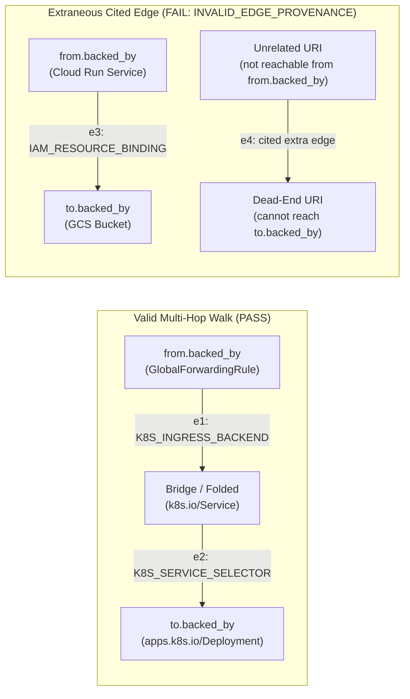

# Manifest Schema & Validation Reference

`architecture.yaml` (`schema_version: v1`) is the **Git-tracked source of truth** of the `gcp-arch` pipeline. It forms a clean contract between cloud-connected synthesis ([Stage 2 — Gemini 4 Synthesis & Day-2 Reconciliation](synthesis.md)) and 100% offline verification and diagram generation ([Stage 3 — Offline Rendering & Routing](rendering.md)).

Every `backed_by` entry (on components and containers) and every `excluded_resources` entry embeds its full `{uri, asset_type, project_id}` tuple directly inside `architecture.yaml`. Because of this self-contained design, `gcp-arch validate` and `gcp-arch render` operate completely offline in clean Git checkouts and pull-request CI pipelines—requiring **no `facts.json`**, **no GCP credentials**, and **zero network access**.

---

## Complete Annotated `architecture.yaml` Example

The example below illustrates every top-level section and feature supported by `schema_version: v1`: `metadata`, `components` (with `notes`, folded `backed_by`, and `inline_meta`), `containers` (with depth-2 `parent_container_id` and container `backed_by`), `excluded_resources`, `rejected_edges`, `view_0_system_index`, and detail views featuring `off_page_refs`, `VERIFIED` and `INFERRED` edges, and shared `via_bus_id` bus spines.

```yaml
schema_version: v1

metadata:
  generated_at: "2026-11-23T02:00:00Z"
  scopes:
    - projects/acme-cicd

components:
  - id: acme_tfstate
    title: Terraform State Bucket
    subtitle: gs://acme-tfstate
    icon_key: cloud_storage
    component_kind: DATASTORE
    project_id: acme-cicd
    backed_by:
      - uri: //storage.googleapis.com/acme-tfstate
        asset_type: storage.googleapis.com/Bucket
        project_id: acme-cicd
    inline_meta:
      - label: Region
        value: europe-southwest1

  - id: atlantis
    title: Atlantis PR Automation
    subtitle: gke:cicd / ns:atlantis
    icon_key: k8s_workload
    component_kind: WORKLOAD
    project_id: acme-cicd
    # Human curation notes preserved across Day-2 --reconcile
    notes: Curated Terraform PR runner boundary; reviewed in ADR-014.
    # 1:1 folded Deployment + ServiceAccount + Secret under one workload card
    backed_by:
      - uri: //container.googleapis.com/projects/acme-cicd/locations/europe-southwest1-b/clusters/cicd/k8s/namespaces/atlantis/apps/deployments/atlantis
        asset_type: apps.k8s.io/Deployment
        project_id: acme-cicd
      - uri: //iam.googleapis.com/projects/acme-cicd/serviceAccounts/atlantis@acme-cicd.iam.gserviceaccount.com
        asset_type: iam.googleapis.com/ServiceAccount
        project_id: acme-cicd
      - uri: //secretmanager.googleapis.com/projects/acme-cicd/secrets/github-webhook-secret
        asset_type: secretmanager.googleapis.com/Secret
        project_id: acme-cicd
    # Up to 4 rows rendered inside the card in exact YAML order
    inline_meta:
      - label: Service Account
        value: atlantis@acme-cicd.iam
      - label: Secret
        value: github-webhook-secret

  - id: atlantis_https_lb
    title: Atlantis HTTPS Ingress
    subtitle: atlantis.cicd.example.com/events
    icon_key: cloud_load_balancing
    component_kind: INGRESS
    project_id: acme-cicd
    backed_by:
      - uri: //compute.googleapis.com/projects/acme-cicd/global/forwardingRules/k8s2-fs-demo1234-atlantis-ingress-0001
        asset_type: compute.googleapis.com/GlobalForwardingRule
        project_id: acme-cicd
      - uri: //container.googleapis.com/projects/acme-cicd/locations/europe-southwest1-b/clusters/cicd/k8s/namespaces/atlantis/networking.k8s.io/ingresses/atlantis
        asset_type: networking.k8s.io/Ingress
        project_id: acme-cicd
      - uri: //container.googleapis.com/projects/acme-cicd/locations/europe-southwest1-b/clusters/cicd/k8s/namespaces/atlantis/services/atlantis
        asset_type: k8s.io/Service
        project_id: acme-cicd
    inline_meta:
      - label: Public IP
        value: 203.0.113.41:443

  - id: github_acme
    title: GitHub (github-acme)
    subtitle: acme-corp/platform-services
    icon_key: github
    component_kind: EXTERNAL_CALLER
    project_id: external
    backed_by:
      - uri: //github.com/acme-corp/platform-services
        asset_type: external.github.com/Repository
        project_id: external

  - id: sonarqube_db
    title: Cloud SQL (sonarqube)
    subtitle: POSTGRES_16 / 10.100.0.5
    icon_key: cloud_sql
    component_kind: DATASTORE
    project_id: acme-cicd
    backed_by:
      - uri: //sqladmin.googleapis.com/projects/acme-cicd/instances/sonarqube
        asset_type: sqladmin.googleapis.com/Instance
        project_id: acme-cicd

  - id: vpc_cicd_net
    title: "VPC Network: cicd"
    subtitle: Subnet cicd-k8s (10.10.0.0/20)
    icon_key: virtual_private_cloud
    component_kind: COHORT
    project_id: acme-cicd
    backed_by:
      - uri: //compute.googleapis.com/projects/acme-cicd/global/networks/cicd
        asset_type: compute.googleapis.com/Network
        project_id: acme-cicd

containers:
  - id: ext_source
    title: External Source Control
    subtitle: GitHub SaaS
    kind: EXTERNAL_ZONE

  # Depth-2 nested container: gke_cicd -> parent proj_acme_cicd
  - id: gke_cicd
    title: "GKE Cluster: cicd"
    subtitle: europe-southwest1-b (Standard)
    kind: GKE_CLUSTER
    parent_container_id: proj_acme_cicd
    backed_by:
      - uri: //container.googleapis.com/projects/acme-cicd/locations/europe-southwest1-b/clusters/cicd
        asset_type: container.googleapis.com/Cluster
        project_id: acme-cicd

  - id: proj_acme_cicd
    title: "Project: acme-cicd"
    subtitle: europe-southwest1
    kind: PROJECT

  - id: psa_tenant
    title: Google PSA Backing Zone
    subtitle: p1234567890abcdef-tp
    kind: PSA_ZONE

# Active resources deliberately excluded from visual cards with audit rationale
excluded_resources:
  - uri: //compute.googleapis.com/projects/acme-cicd/global/networks/default
    asset_type: compute.googleapis.com/Network
    project_id: acme-cicd
    reason: Unused default GCP VPC network suppressed as boilerplate

# Curated tombstones forbidding specific directed edges across all views & Day-2 reconcile
rejected_edges:
  - from: atlantis_https_lb
    to: acme_tfstate
    reason: Ingress never accesses Terraform state directly; traffic terminates at Atlantis

views:
  # Required at views[0] whenever >= 2 detail views exist; projected deterministically by Go
  - id: view_0_system_index
    title: System Index Map
    subtitle: 2 logical views across 6 architecture components
    archetype: landscape_matrix
    accent_mode: MIXED
    placements:
      - component_id: github_acme
        column: 0
      - component_id: gke_developer_platform
        column: 2
      - component_id: shared_network_psa
        column: 3
    edges:
      - from: github_acme
        to: gke_developer_platform
        verb: calls ingress
        flow_kind: RUNTIME
        provenance: VERIFIED
      - from: gke_developer_platform
        to: shared_network_psa
        verb: PSA topology
        flow_kind: RUNTIME
        provenance: VERIFIED

  - id: gke_developer_platform
    title: GKE Developer Platform & Ingress
    subtitle: External HTTPS Load Balancer routing to Atlantis and Terraform state
    archetype: landscape_matrix
    accent_mode: RUNTIME
    notes: Primary runtime entry point for PR automation webhooks.
    container_ids:
      - ext_source
      - gke_cicd
      - proj_acme_cicd
      - psa_tenant
    # Placement order within each column is preserved as the Stage 3 barycenter tie-breaker
    placements:
      - component_id: github_acme
        container_id: ext_source
        column: 0
      - component_id: atlantis_https_lb
        container_id: proj_acme_cicd
        column: 1
      - component_id: atlantis
        container_id: gke_cicd
        column: 2
      - component_id: acme_tfstate
        container_id: proj_acme_cicd
        column: 3
      - component_id: sonarqube_db
        container_id: psa_tenant
        column: 3
        off_page_refs:
          - target_view_id: shared_network_psa
            label: PSA topology
            direction: OUT
    edges:
      - from: atlantis
        to: acme_tfstate
        verb: locks tfstate
        flow_kind: CICD
        provenance: VERIFIED
        evidence_edge_ids:
          - c21876e6fb659711
        via_bus_id: atlantis_egress
      - from: atlantis
        to: sonarqube_db
        verb: schema check
        flow_kind: ADMIN
        provenance: INFERRED
        inference_rationale: Migration verification hooks query Postgres metadata during release dry-runs.
        via_bus_id: atlantis_egress
      - from: atlantis_https_lb
        to: atlantis
        verb: HTTPS /events
        flow_kind: RUNTIME
        provenance: VERIFIED
        # Multi-hop directed walk: ForwardingRule -> Ingress -> Service -> Deployment
        evidence_edge_ids:
          - bb189d721e6415c1
          - 2d646bade955f34c
      - from: github_acme
        to: atlantis_https_lb
        verb: webhook POST
        flow_kind: RUNTIME
        provenance: VERIFIED
        evidence_edge_ids:
          - 190f6dfb3f1fa702

  - id: shared_network_psa
    title: Shared Network & PSA Topology
    subtitle: VPC cicd private peering to Google-managed PSA tenant
    archetype: hub_spoke
    accent_mode: RUNTIME
    container_ids:
      - gke_cicd
      - proj_acme_cicd
      - psa_tenant
    placements:
      - component_id: atlantis
        container_id: gke_cicd
        column: 0
      - component_id: vpc_cicd_net
        container_id: proj_acme_cicd
        column: 1
      - component_id: sonarqube_db
        container_id: psa_tenant
        column: 2
    edges:
      - from: vpc_cicd_net
        to: sonarqube_db
        verb: PSA peering
        flow_kind: RUNTIME
        provenance: VERIFIED
        evidence_edge_ids:
          - 44e5d4dcd096c550
```

---

## Strict YAML Codec & Canonical Serialization

`internal/manifest/types.go` implements strict decoding and deterministic serialization so human edits in Git stay clean, minimal, and free of silent typos.

### Strict Decoding (`manifest.Load`)

1. **`KnownFields(true)`:** `manifest.Load` decodes YAML with `gopkg.in/yaml.v3` and `dec.KnownFields(true)`. Any unknown or misspelled field name (such as `icon:` instead of `icon_key:`) fails immediately rather than being silently ignored.
2. **Single-Document Guard:** After decoding `Manifest`, `manifest.Load` attempts a second decode and asserts `errors.Is(err, io.EOF)`. Multi-document YAML streams (`---`) are rejected with `unexpected trailing YAML document`.
3. **CLI Error Handling:** Under `gcp-arch validate --json`, decode errors emit a `ValidationReport` containing code `YAML_DECODE_ERROR` and exit with code **`2`**. Filesystem read errors (`*os.PathError`, such as a missing file) return CLI exit code **`1`**.

### Canonical Serialization (`manifest.Marshal` & `manifest.Write`)

`manifest.Marshal` clones `m` (never mutating the caller's struct) and encodes deterministic **2-space indented UTF-8 YAML**. `manifest.Write` persists the output atomically (`ioutil.WriteFileAtomic`) with mode **`0644`** (creating parent directories with **`0755`**).

To produce stable Git diffs while preserving meaningful visual and cryptographic ordering, `normalizedManifestCopy` sorts structural sets deterministically and explicitly preserves three ordered slices:

| Slice Path | Behavior on `Marshal` | Sort Key / Preservation Reason |
| :--- | :--- | :--- |
| `metadata.scopes` | **Sorted** | Lexicographical ascending. |
| `components` | **Sorted** | By `id`. |
| `components[].backed_by` | **Sorted** | By `(uri, asset_type, project_id)`. |
| `containers` | **Sorted** | By `id`. |
| `containers[].backed_by` | **Sorted** | By `(uri, asset_type, project_id)`. |
| `excluded_resources` | **Sorted** | By `(uri, asset_type, project_id, reason)`. |
| `rejected_edges` | **Sorted** | By `(from, to, reason)`. |
| `views` | **Sorted** | `view_0_system_index` pinned at `views[0]`; all other views sorted by `id`. |
| `views[].container_ids` | **Sorted** | Lexicographical ascending. |
| `views[].placements[].off_page_refs` | **Sorted** | By `(target_view_id, direction, label)`. |
| `views[].edges` | **Sorted** | By `(from, to, flow_kind, verb, provenance, via_bus_id, inference_rationale, evidence_edge_ids)`. |
| **`components[].inline_meta`** | **Order Preserved** | Controls top-to-bottom metadata row order inside rendered component cards. |
| **`views[].placements`** | **Order Preserved** | Encodes preferred top-to-bottom column order and acts as the deterministic **barycenter tie-breaker** (`yamlIdx` in `internal/render/prepare.go`) during Stage 3 rendering. |
| **`views[].edges[].evidence_edge_ids`** | **Order Preserved** | Preserves the human-readable directed-walk hop sequence from source to target. |

---

## Exhaustive Schema & Enum Reference

### Struct Field Reference

#### Root `Manifest`

| YAML Key | Type | Required | Description |
| :--- | :--- | :---: | :--- |
| `schema_version` | `string` | **Yes** | Must equal `"v1"` (`manifest.SchemaVersion`). |
| `metadata` | `Metadata` | **Yes** | Generation timestamp and scanned GCP scopes. |
| `components` | `[]Component` | **Yes** | Global logical architecture blocks referenced by detail views. |
| `containers` | `[]Container` | Optional | Global visual grouping frames (`omitempty`). |
| `excluded_resources` | `[]ExcludedResource` | Optional | Active resources intentionally omitted from cards with audit reasons (`omitempty`). |
| `rejected_edges` | `[]RejectedEdge` | Optional | Curated tombstones suppressing directed `(from, to)` edges (`omitempty`). |
| `views` | `[]View` | **Yes** | One or more diagram views (`views[0]` must be `view_0_system_index` when `>= 2` detail views exist). |

#### `Metadata`

| YAML Key | Type | Required | Description |
| :--- | :--- | :---: | :--- |
| `generated_at` | `string` | Optional | RFC 3339 timestamp (populated from `facts.ReadTime` or UTC clock during Day-1 synthesis). |
| `scopes` | `[]string` | Optional | Canonical GCP scopes scanned (e.g., `projects/acme-cicd`, `folders/12345`, `organizations/67890`). |

#### `Component`

| YAML Key | Type | Required | Description |
| :--- | :--- | :---: | :--- |
| `id` | `string` | **Yes** | Unique, non-empty canonical slug (conventionally `snake_case`). |
| `title` | `string` | **Yes** | Non-empty human-readable card title. |
| `subtitle` | `string` | Optional | Concise technical sublabel (`omitempty`). |
| `icon_key` | `string` | **Yes** | Registered icon slug present in the 85-icon embedded registry (`internal/icons/assets/icons.yaml`). |
| `component_kind` | `ComponentKind` | **Yes** | Architectural role enum (8 allowed values). |
| `project_id` | `string` | **Yes** | Non-empty owning GCP project ID (or `"external"` for external actors/targets). |
| `notes` | `string` | Optional | Free-form human curation notes stored in Git and preserved across Day-2 `--reconcile` (`omitempty`). |
| `backed_by` | `[]BackedResource` | **Yes** | At least 1 resource (`len >= 1`); must satisfy stateful datastore homogeneity. |
| `inline_meta` | `[]InlineMeta` | Optional | `0..4` key-value detail rows rendered inside the card in exact YAML order (`omitempty`). |

#### `BackedResource`

| YAML Key | Type | Required | Description |
| :--- | :--- | :---: | :--- |
| `uri` | `string` | **Yes** | Non-empty canonical AIP-122 GCP resource URI (or synthetic external URI). |
| `asset_type` | `string` | **Yes** | Non-empty GCP CAI asset type (e.g., `run.googleapis.com/Service`, `sqladmin.googleapis.com/Instance`). |
| `project_id` | `string` | **Yes** | Non-empty owning GCP project ID (or `"external"`). |

#### `InlineMeta`

| YAML Key | Type | Required | Description |
| :--- | :--- | :---: | :--- |
| `label` | `string` | **Yes** | Non-empty metadata row key (e.g., `Public IP`, `Service Account`). |
| `value` | `string` | **Yes** | Non-empty metadata row value. |

#### `Container`

| YAML Key | Type | Required | Description |
| :--- | :--- | :---: | :--- |
| `id` | `string` | **Yes** | Unique, non-empty container slug. |
| `title` | `string` | **Yes** | Non-empty container frame title. |
| `subtitle` | `string` | Optional | Region, network, or scope subtitle (`omitempty`). |
| `kind` | `ContainerKind` | **Yes** | Grouping boundary kind enum (6 allowed values). |
| `parent_container_id` | `string` | Optional | ID of an existing parent container; acyclic; active nesting depth within any view must be `<= 2` (`omitempty`). |
| `backed_by` | `[]BackedResource` | Optional | Optional resources accounted for by this container (e.g., `container.googleapis.com/Cluster`, `compute.googleapis.com/Network`). Every entry requires non-empty `uri`, `asset_type`, and `project_id` (`omitempty`). |

#### `ExcludedResource`

| YAML Key | Type | Required | Description |
| :--- | :--- | :---: | :--- |
| `uri` | `string` | **Yes** | Non-empty canonical resource URI. |
| `asset_type` | `string` | **Yes** | Non-empty CAI asset type. |
| `project_id` | `string` | **Yes** | Non-empty owning project ID. |
| `reason` | `string` | **Yes** | Non-empty audit justification explaining why the resource is excluded from cards. |

#### `RejectedEdge`

| YAML Key | Type | Required | Description |
| :--- | :--- | :---: | :--- |
| `from` | `string` | **Yes** | Non-empty source component ID (or View 0 node ID). |
| `to` | `string` | **Yes** | Non-empty target component ID (or View 0 node ID). |
| `reason` | `string` | **Yes** | Non-empty rationale explaining why this directed `(from, to)` edge is suppressed. |

#### `View`

| YAML Key | Type | Required | Description |
| :--- | :--- | :---: | :--- |
| `id` | `string` | **Yes** | Unique, non-empty view slug (`view_0_system_index` reserved for `views[0]` when `>= 2` detail views exist). |
| `title` | `string` | **Yes** | Non-empty diagram page title. |
| `subtitle` | `string` | Optional | One-line diagram summary (`omitempty`). |
| `archetype` | `Archetype` | **Yes** | Visual grid archetype enum (`landscape_matrix`, `stage_pipeline`, or `hub_spoke`). |
| `accent_mode` | `AccentMode` | **Yes** | Color palette emphasis enum (`RUNTIME`, `CICD`, or `MIXED`). |
| `notes` | `string` | Optional | Human curation notes for the view (`omitempty`). |
| `container_ids` | `[]string` | Optional | Active global container IDs drawn in this view; max active nesting depth `2` (`omitempty`). |
| `placements` | `[]Placement` | **Yes** | `1..12` placements on detail views; `1..16` placements on `view_0_system_index`. Order preserved. |
| `edges` | `[]Edge` | Optional | Directed edges between components placed in this view (`omitempty`). |

#### `Placement`

| YAML Key | Type | Required | Description |
| :--- | :--- | :---: | :--- |
| `component_id` | `string` | **Yes** | References a global `Component.ID` (on detail views) or a `Component.ID` / detail `View.ID` (on `view_0_system_index`). Unique per view. |
| `container_id` | `string` | Optional | Active container ID; if set, MUST appear in the enclosing `view.container_ids` (`omitempty`). |
| `column` | `int` | **Yes** | 0-based grid column index: `0..4` for `landscape_matrix`/`stage_pipeline`; `0..2` for `hub_spoke`. |
| `off_page_refs` | `[]OffPageRef` | Optional | Cross-view navigation badges displayed on the card (`omitempty`). |

#### `OffPageRef`

| YAML Key | Type | Required | Description |
| :--- | :--- | :---: | :--- |
| `target_view_id` | `string` | **Yes** | ID of another existing view in `manifest.views` (must not equal the current view's ID). |
| `label` | `string` | **Yes** | Non-empty concise badge label (also projected as a `View 0` edge verb when `direction == "OUT"`). |
| `direction` | `string` | **Yes** | `"IN"` or `"OUT"`. |

#### `Edge`

| YAML Key | Type | Required | Description |
| :--- | :--- | :---: | :--- |
| `from` | `string` | **Yes** | Placed source `component_id` in this view. |
| `to` | `string` | **Yes** | Placed target `component_id` in this view. |
| `verb` | `string` | **Yes** | Non-empty action verb, maximum **`16` UTF-8 runes** (`maxEdgeVerbRunes = 16`). |
| `flow_kind` | `FlowKind` | **Yes** | Operational flow category (`RUNTIME`, `CICD`, or `ADMIN`). |
| `provenance` | `Provenance` | **Yes** | Evidence classification (`VERIFIED` or `INFERRED`). |
| `evidence_edge_ids` | `[]string` | Conditional | Required non-empty list of non-blank `FactEdge.ID` hashes for detail-view `VERIFIED` edges (exempt on `view_0_system_index`). Order preserved. |
| `inference_rationale` | `string` | Conditional | Required non-empty explanation when `provenance == INFERRED` (`omitempty`). |
| `via_bus_id` | `string` | Optional | Shared orthogonal bus spine group ID. All edges sharing one `via_bus_id` in a view must share either one common `from` (1-to-N) or one common `to` (N-to-1) (`omitempty`). |

---

### Enumerations Reference

#### `ComponentKind` (8 Values)

| Value | Architectural Role |
| :--- | :--- |
| `EXTERNAL_CALLER` | External user, client, SaaS webhook, or upstream repository initiating flows (placed in Column `0` on `View 0`). |
| `INGRESS` | Load balancers, Cloud Armor/WAF frontends, API Gateways, Ingress/NEG front doors, and Cloud NAT egress gateways. |
| `WORKLOAD` | Application runtime services (GKE Deployments/StatefulSets, Cloud Run services, Compute Engine workloads, Cloud Functions). |
| `PIPELINE` | Batch/streaming data pipelines and CI/CD execution runners (Cloud Build triggers, Dataflow jobs, Cloud Composer). |
| `MESSAGING` | Asynchronous brokers and event buses (Pub/Sub topics/subscriptions, Eventarc triggers, Cloud Tasks). |
| `DATASTORE` | Persistent databases, object storage, caches, warehouses, and artifact registries. |
| `COHORT` | Grouped infrastructure or shared network/project cohorts (VPC network hubs, subnetwork cohorts). |
| `EXTERNAL_TARGET` | Downstream out-of-scope GCP projects, external payment PSPs, BI SaaS endpoints, or third-party sinks (placed in Column `3` or `4` on `View 0`). |

#### `ContainerKind` (6 Values)

| Value | Grouping Boundary |
| :--- | :--- |
| `PROJECT` | GCP Project boundary. |
| `VPC` | VPC Network or subnet boundary. |
| `GKE_CLUSTER` | Google Kubernetes Engine cluster boundary (commonly nested depth-2 inside a `PROJECT` container). |
| `PSA_ZONE` | Google-managed Private Service Access (PSA) tenant or Private Service Connect (PSC) zone. |
| `EXTERNAL_ZONE` | Boundary grouping external SaaS, public internet, or out-of-scope GCP targets. |
| `SHARED_HUB` | Shared VPC host project or centralized networking hub boundary. |

#### `Archetype` (3 Values)

| Value | Valid `column` Bounds | Layout Semantics |
| :--- | :---: | :--- |
| `landscape_matrix` | `0..4` *(max 5 columns)* | Application, ingress, and multi-tier runtime landscapes (also used by `view_0_system_index`). Unused columns collapse densely in Stage 3; 5 active columns trigger compact mode. |
| `stage_pipeline` | `0..4` *(max 5 columns)* | Sequential left-to-right CI/CD delivery, streaming ETL, or ML pipelines. |
| `hub_spoke` | `0..2` *(fixed 3 columns)* | Networking topologies (`spoke` col `0` -> `hub` col `1` -> `peered zone` col `2`). Stage 3 always preserves all 3 grid tracks `{0, 1, 2}`. |

#### `AccentMode` (3 Values)

| Value | Visual Emphasis |
| :--- | :--- |
| `RUNTIME` | Production request/data plane emphasis (default runtime visual palette). |
| `CICD` | Delivery pipeline / automation emphasis (`View 0` off-page edges originating from a `CICD` view inherit `flow_kind: CICD`). |
| `MIXED` | Hybrid views combining runtime and CI/CD or cross-cutting flows (fixed on `view_0_system_index`). |

#### `FlowKind`, `Provenance` & `OffPageRef.Direction`

| Enum | Allowed Values | Notes |
| :--- | :--- | :--- |
| **`FlowKind`** (3) | `RUNTIME`, `CICD`, `ADMIN` | Drives edge styling in Stage 3 and priority ranking (`RUNTIME > CICD > ADMIN`) in `View 0` external flow projection. |
| **`Provenance`** (2) | `VERIFIED`, `INFERRED` | `VERIFIED` renders as a solid evidence-backed connector; `INFERRED` renders dashed with a numbered footnote quoting `inference_rationale`. |
| **`OffPageRef.Direction`** (2) | `IN`, `OUT` | `OUT` badges are deterministically projected into `View 0` cross-view summary edges. |

---

## Stateful Datastore Homogeneity

To prevent architectural diagrams from collapsing fundamentally different persistence technologies (for example, Cloud SQL + Cloud Storage + BigQuery) into a single ambiguous "Databases" box, both Stage 2 (`internal/synth/pipeline.go`) and offline validation (`internal/manifest/validate.go`) enforce **stateful datastore homogeneity** across the following **15** exact GCP CAI asset types (`statefulDatastoreAssetTypes`):

| # | Exact GCP CAI Asset Type | GCP Product |
| :---: | :--- | :--- |
| 1 | `sqladmin.googleapis.com/Instance` | Cloud SQL Instance |
| 2 | `alloydb.googleapis.com/Cluster` | AlloyDB Cluster |
| 3 | `alloydb.googleapis.com/Instance` | AlloyDB Instance |
| 4 | `spanner.googleapis.com/Instance` | Cloud Spanner Instance |
| 5 | `spanner.googleapis.com/Database` | Cloud Spanner Database |
| 6 | `bigtableadmin.googleapis.com/Instance` | Cloud Bigtable Instance |
| 7 | `firestore.googleapis.com/Database` | Firestore Database |
| 8 | `redis.googleapis.com/Instance` | Memorystore for Redis Instance |
| 9 | `redis.googleapis.com/Cluster` | Memorystore for Redis Cluster |
| 10 | `memcache.googleapis.com/Instance` | Memorystore for Memcached Instance |
| 11 | `storage.googleapis.com/Bucket` | Cloud Storage Bucket |
| 12 | `bigquery.googleapis.com/Dataset` | BigQuery Dataset |
| 13 | `artifactregistry.googleapis.com/Repository` | Artifact Registry Repository |
| 14 | `file.googleapis.com/Instance` | Cloud Filestore Instance |
| 15 | `pubsub.googleapis.com/Topic` | Pub/Sub Topic |

**How the check works:** For each component, `validateComponentBackedBy` collects the set of distinct `br.AssetType` values in `component.backed_by` that belong to the 15-entry map above. If `len(datastoreTypes) > 1`, validation emits **`HETEROGENEOUS_DATASTORE`**.

* **Allowed:**
  * One stateful datastore type folded with non-datastore helper resources—for example, `pubsub.googleapis.com/Topic` + `pubsub.googleapis.com/Subscription`, `sqladmin.googleapis.com/Instance` + `kms.googleapis.com/CryptoKey`, or `storage.googleapis.com/Bucket` + `iam.googleapis.com/ServiceAccount`.
  * Multiple resources of the *same* datastore asset type inside one component (for example, two `storage.googleapis.com/Bucket` resources grouped intentionally), because `len(datastoreTypes) == 1`.
* **Rejected (`HETEROGENEOUS_DATASTORE`):**
  * Mixing two distinct asset types from the 15-entry table inside one `backed_by` list—such as `sqladmin.googleapis.com/Instance` + `storage.googleapis.com/Bucket`, or `alloydb.googleapis.com/Cluster` + `alloydb.googleapis.com/Instance`, or `spanner.googleapis.com/Instance` + `spanner.googleapis.com/Database`.

---

## Offline Structural Validation (`ValidateStructure`)

Running `gcp-arch validate <architecture.yaml>` executes strict YAML decoding followed by `manifest.ValidateStructure` (`internal/manifest/validate.go`) completely offline with zero network calls.

### Hard Structural Limits

| Constant (`internal/manifest/validate.go`) | Limit | Scope |
| :--- | :---: | :--- |
| `maxInlineMetaRows` | **`4`** | Maximum `inline_meta` key-value rows per component card. |
| `maxDetailViewPlacements` | **`12`** | Maximum component placements (`1..12`) per detail view. |
| `maxSystemIndexPlacements` | **`16`** | Maximum placements (`1..16`) on `view_0_system_index`. |
| `maxContainerNestingDepth` | **`2`** | Maximum active container parent-child nesting depth within any view. |
| `maxEdgeVerbRunes` | **`16`** | Maximum UTF-8 rune count (`1..16`) for `edge.verb`. |

### Exhaustive Offline Validation Error Codes

All **48** structural error codes in `internal/manifest/validate.go` (plus `YAML_DECODE_ERROR` from `cmd/gcp-arch/validate.go`) are listed below:

#### YAML Decode & Schema

| Error Code | Trigger Condition | `view_id` / `subject` |
| :--- | :--- | :--- |
| `YAML_DECODE_ERROR` | *(CLI `validate --json`)* Invalid YAML syntax, unknown field rejected by `KnownFields(true)`, or trailing multi-document YAML stream. | `view_id: ""`, `subject: <manifestPath>` |
| `INVALID_SCHEMA_VERSION` | Manifest is `nil` or `schema_version != "v1"`. | `view_id: ""`, `subject: <schema_version>` |

#### Components

| Error Code | Trigger Condition | `view_id` / `subject` |
| :--- | :--- | :--- |
| `EMPTY_COMPONENT_ID` | `component.id` is empty or whitespace. | `subject: components[i]` |
| `DUPLICATE_COMPONENT_ID` | Two components share the same `id`. | `subject: <component.id>` |
| `EMPTY_COMPONENT_TITLE` | `component.title` is empty or whitespace. | `subject: <component.id>` |
| `INVALID_COMPONENT_KIND` | `component.component_kind` is not one of the 8 valid `ComponentKind` values. | `subject: <component.id>` |
| `EMPTY_PROJECT_ID` | `component.project_id` is empty or whitespace. | `subject: <component.id>` |
| `INVALID_ICON_KEY` | `component.icon_key` is blank or not registered in the 85-icon embedded `icons.Registry`. | `subject: <component.id>` |
| `EMPTY_BACKED_BY` | `component.backed_by` has `0` entries. | `subject: <component.id>` |
| `INVALID_BACKED_RESOURCE` | A `backed_by` entry (on a component **or** container) has an empty `uri`, `asset_type`, or `project_id`. | `subject: <component.id \| container.id>` |
| `INLINE_META_LIMIT` | `len(component.inline_meta) > 4`. | `subject: <component.id>` |
| `INVALID_INLINE_META` | An `inline_meta` row has an empty `label` or `value`. | `subject: <component.id>` |
| `HETEROGENEOUS_DATASTORE` | `component.backed_by` mixes `> 1` distinct asset types from the 15-type `statefulDatastoreAssetTypes` set. | `subject: <component.id>` |
| `UNPLACED_COMPONENT` | A global component is not placed in at least one **detail view** (placement solely on `view_0_system_index` does not count). | `subject: <component.id>` |

#### Containers

| Error Code | Trigger Condition | `view_id` / `subject` |
| :--- | :--- | :--- |
| `EMPTY_CONTAINER_ID` | `container.id` is empty or whitespace. | `subject: containers[i]` |
| `DUPLICATE_CONTAINER_ID` | Two containers share the same `id`. | `subject: <container.id>` |
| `EMPTY_CONTAINER_TITLE` | `container.title` is empty or whitespace. | `subject: <container.id>` |
| `INVALID_CONTAINER_KIND` | `container.kind` is not one of the 6 valid `ContainerKind` values. | `subject: <container.id>` |
| `UNKNOWN_PARENT_CONTAINER` | `container.parent_container_id` does not match any defined container ID. | `subject: <container.id>` |
| `CONTAINER_CYCLE` | Walking `parent_container_id` links forms a cycle. | `subject: <container.id>` |
| `CONTAINER_DEPTH_EXCEEDED` | Active nesting depth of a container within `view.container_ids` exceeds `2`. | `view_id: <view.id>`, `subject: <container.id>` |

#### Exclusions & Tombstones

| Error Code | Trigger Condition | `view_id` / `subject` |
| :--- | :--- | :--- |
| `INVALID_EXCLUDED_RESOURCE` | An `excluded_resources` entry has an empty `uri`, `asset_type`, or `project_id`. | `subject: <uri \| excluded_resources[i]>` |
| `MISSING_EXCLUSION_REASON` | An `excluded_resources` entry has an empty `reason`. | `subject: <uri \| excluded_resources[i]>` |
| `INVALID_REJECTED_EDGE` | A `rejected_edges` entry has an empty `from`, `to`, or `reason`. | `subject: rejected_edges[i]` |

#### Views & System Index (`View 0`)

| Error Code | Trigger Condition | `view_id` / `subject` |
| :--- | :--- | :--- |
| `NO_VIEWS` | `manifest.views` is empty (`0` views). | `view_id: ""`, `subject: ""` |
| `EMPTY_VIEW_ID` | `view.id` is empty or whitespace. | `subject: views[i]` |
| `DUPLICATE_VIEW_ID` | Two views share the same `id`. | `view_id: <view.id>`, `subject: <view.id>` |
| `EMPTY_VIEW_TITLE` | `view.title` is empty or whitespace. | `view_id: <view.id>`, `subject: <view.id>` |
| `MISSING_SYSTEM_INDEX_VIEW` | `>= 2` detail views exist, but `view_0_system_index` is absent. | `view_id: ""`, `subject: view_0_system_index` |
| `UNEXPECTED_SYSTEM_INDEX_VIEW` | `< 2` detail views exist, yet `view_0_system_index` is present. | `view_id: view_0_system_index`, `subject: view_0_system_index` |
| `MISPLACED_SYSTEM_INDEX_VIEW` | `view_0_system_index` exists at an index `> 0` instead of `views[0]`. | `view_id: view_0_system_index`, `subject: view_0_system_index` |
| `INVALID_ARCHETYPE` | `view.archetype` is not `landscape_matrix`, `stage_pipeline`, or `hub_spoke`. | `view_id: <view.id>`, `subject: <archetype>` |
| `INVALID_ACCENT_MODE` | `view.accent_mode` is not `RUNTIME`, `CICD`, or `MIXED`. | `view_id: <view.id>`, `subject: <accent_mode>` |
| `UNKNOWN_CONTAINER_REF` | `view.container_ids` lists an ID not declared in top-level `containers`. | `view_id: <view.id>`, `subject: <container_id>` |

#### Placements & Off-Page References

| Error Code | Trigger Condition | `view_id` / `subject` |
| :--- | :--- | :--- |
| `VIEW_PLACEMENT_COUNT` | Detail view has `< 1` or `> 12` placements; `view_0_system_index` has `< 1` or `> 16` placements. | `view_id: <view.id>`, `subject: <view.id>` |
| `DUPLICATE_PLACEMENT` | The same `component_id` appears more than once in `view.placements`. | `view_id: <view.id>`, `subject: <component_id>` |
| `UNKNOWN_COMPONENT_REF` | On a detail view: `component_id` not found in `components`. On `view_0_system_index`: `component_id` matches neither a `component.id` nor a detail `view.id`. | `view_id: <view.id>`, `subject: <component_id>` |
| `PLACEMENT_CONTAINER_NOT_IN_VIEW` | `placement.container_id` is non-empty but absent from `view.container_ids`. | `view_id: <view.id>`, `subject: <component_id>` |
| `COLUMN_OUT_OF_BOUNDS` | `placement.column` is `< 0` or `> 4` (`landscape_matrix`/`stage_pipeline`), or `< 0` or `> 2` (`hub_spoke`). | `view_id: <view.id>`, `subject: <component_id>` |
| `INVALID_OFF_PAGE_REF` | `target_view_id` does not exist or equals the current view ID; `direction` is not `"IN"` or `"OUT"`; or `label` is blank. | `view_id: <view.id>`, `subject: <component_id>` |

#### Edges & Shared Bus Groups

| Error Code | Trigger Condition | `view_id` / `subject` |
| :--- | :--- | :--- |
| `EDGE_ENDPOINT_NOT_PLACED` | `edge.from` or `edge.to` is not present in `view.placements`. | `view_id: <view.id>`, `subject: "<from> -> <to>"` |
| `REJECTED_EDGE_PRESENT` | `(edge.from, edge.to)` matches an entry in top-level `rejected_edges`. | `view_id: <view.id>`, `subject: "<from> -> <to>"` |
| `EMPTY_EDGE_VERB` | `edge.verb` is empty or whitespace. | `view_id: <view.id>`, `subject: "<from> -> <to>"` |
| `EDGE_VERB_TOO_LONG` | `utf8.RuneCountInString(edge.verb) > 16`. | `view_id: <view.id>`, `subject: "<from> -> <to>"` |
| `INVALID_FLOW_KIND` | `edge.flow_kind` is not `RUNTIME`, `CICD`, or `ADMIN`. | `view_id: <view.id>`, `subject: "<from> -> <to>"` |
| `INVALID_PROVENANCE` | `edge.provenance` is not `VERIFIED` or `INFERRED`. | `view_id: <view.id>`, `subject: "<from> -> <to>"` |
| `MISSING_EVIDENCE_EDGE_IDS` | Detail-view `VERIFIED` edge has empty `evidence_edge_ids` or contains a blank ID string *(exempt on `view_0_system_index`)*. | `view_id: <view.id>`, `subject: "<from> -> <to>"` |
| `MISSING_INFERENCE_RATIONALE` | `INFERRED` edge has an empty or whitespace `inference_rationale`. | `view_id: <view.id>`, `subject: "<from> -> <to>"` |
| `INVALID_BUS_GROUP` | Edges sharing one `via_bus_id` within a view contain both `> 1` distinct `from` sources AND `> 1` distinct `to` targets. | `view_id: <view.id>`, `subject: <via_bus_id>` |

---

## `--facts` Provenance & Coverage Validation (`ValidateWithFacts`)

Passing `--facts <facts.json>` runs all 48 offline structural rules **plus** four facts-coupled guarantees via `manifest.ValidateWithFacts` (`internal/manifest/validate.go`):

```bash
gcp-arch validate architecture.yaml --facts facts.json
```

| Error Code | Trigger Condition | `view_id` / `subject` |
| :--- | :--- | :--- |
| `NIL_FACTS` | `facts` argument passed to `ValidateWithFacts` is `nil`. | `view_id: ""`, `subject: ""` |
| `UNACCOUNTED_FACT_RESOURCE` | A resource URI in `facts.Resources` does not appear in any of `components[].backed_by`, `containers[].backed_by`, or `excluded_resources`. | `view_id: ""`, `subject: <resource.uri>` |
| `UNKNOWN_EVIDENCE_EDGE` | A detail-view `VERIFIED` edge cites an `evidence_edge_ids` entry that does not exist in `facts.Edges`. | `view_id: <view.id>`, `subject: "<from> -> <to>"` |
| `INVALID_EDGE_PROVENANCE` | The cited `evidence_edge_ids` on a detail-view `VERIFIED` edge do not pass the dual-BFS directed-walk check from `from.backed_by` to `to.backed_by`. | `view_id: <view.id>`, `subject: "<from> -> <to>"` |

### How the Dual-BFS Directed-Walk Proof Works

`isValidDirectedWalk(cited, fromURIs, toURIs)` proves that an edge's `evidence_edge_ids` form an authentic, unbroken causal chain without extraneous padding:



1. **Subgraph Construction:** Build forward adjacency (`fe.FromURI -> fe.ToURI`) and reverse adjacency (`fe.ToURI -> fe.FromURI`) using **only** the `FactEdge`s listed in `edge.evidence_edge_ids`.
2. **Forward BFS (`fwdReach`):** Seed BFS with every URI in `from.backed_by` and follow forward edges.
3. **Reverse BFS (`bwdReach`):** Seed BFS with every URI in `to.backed_by` and follow reverse edges.
4. **Universal Walk Check:** Every cited edge `fe` MUST satisfy **both** `fwdReach[fe.FromURI]` and `bwdReach[fe.ToURI]`.

Because every cited edge is checked individually, a single disconnected or unrelated `FactEdge.ID` inside `evidence_edge_ids` fails validation with `INVALID_EDGE_PROVENANCE` even if another subset of cited edges connects `from` to `to`. Edges on `view_0_system_index` are exempt from `evidence_edge_ids` because they are deterministic view-level rollups rather than direct resource walks.

---

## `--json` Output & Git PR CI Workflow

Passing `--json` to `gcp-arch validate` emits a structured `ValidationReport` (`internal/manifest/types.go`):

```go
type ValidationReport struct {
    Valid  bool              `json:"valid"`
    Errors []ValidationIssue `json:"errors,omitempty"`
}

type ValidationIssue struct {
    Code    string `json:"code"`
    ViewID  string `json:"view_id,omitempty"`
    Subject string `json:"subject,omitempty"`
    Message string `json:"message"`
}
```

=== "Passing Manifest (Exit Code 0)"

    ```json
    {
      "valid": true
    }
    ```

=== "Failing Manifest (Exit Code 2)"

    ```json
    {
      "valid": false,
      "errors": [
        {
          "code": "EDGE_VERB_TOO_LONG",
          "view_id": "gke_developer_platform",
          "subject": "atlantis -> acme_tfstate",
          "message": "edge verb \"reads and writes terraform state\" has 32 chars (max 16)"
        },
        {
          "code": "REJECTED_EDGE_PRESENT",
          "view_id": "gke_developer_platform",
          "subject": "atlantis_https_lb -> acme_tfstate",
          "message": "edge (atlantis_https_lb -> acme_tfstate) is forbidden by rejected_edges"
        }
      ]
    }
    ```

| Exit Code | Meaning (`gcp-arch validate`) |
| :---: | :--- |
| `0` | Manifest is valid (prints `Valid: <file> (<V> views, <C> components)` or `{"valid": true}`). |
| `1` | Runtime / I/O failure (e.g., unreadable or missing `architecture.yaml` or `--facts` file). |
| `2` | YAML decode failure (`YAML_DECODE_ERROR`), invalid `--facts` JSON/schema version, or one or more `ValidationError` issues. |

### GitHub Actions PR Validation Gate

Because `gcp-arch validate` needs zero GCP credentials and zero Chrome installation, it makes an ideal fast pull-request gate whenever engineers curate `architecture.yaml`:

```yaml
name: Validate Architecture Manifest

on:
  pull_request:
    paths:
      - "docs/architecture.yaml"

permissions:
  contents: read

jobs:
  validate-manifest:
    runs-on: ubuntu-latest
    steps:
      - uses: actions/checkout@v4

      - name: Download gcp-arch static binary
        run: |
          curl -fL "https://github.com/arrase/gcp-arch/releases/latest/download/gcp-arch-linux-amd64" -o gcp-arch
          chmod +x gcp-arch

      - name: Validate architecture.yaml offline
        run: ./gcp-arch validate docs/architecture.yaml --json
```

---

## Day-2 Manual Curation Guide

Teams are encouraged to review and polish `architecture.yaml` in Git pull requests. The table below summarizes which manual edits are safe, which validation rules still apply, and how [Day-2 `--reconcile`](synthesis.md#day-2-reconciliation-reconcile) treats them:

| Editable Field | Safe Manual Curation Examples | Validation Rules to Respect | Behavior Under `--reconcile` |
| :--- | :--- | :--- | :--- |
| **`components[].title` & `subtitle`** | Rename auto-generated labels to domain terminology (e.g., `Checkout Service` instead of raw service slug). | `title` must remain non-empty. | **Frozen & preserved.** |
| **`components[].notes` & `views[].notes`** | Add ADR references, ownership notes, or security review context. | Any valid YAML string. | **Frozen & preserved.** |
| **`components[].inline_meta`** | Reorder, trim, or enrich card metadata rows (e.g., SLO tier, CIDR, VPC egress mode). | Max **`4`** rows; non-empty `label` and `value`. | **Frozen & preserved** (exact row order maintained). |
| **`components[].icon_key`** | Swap a component's icon to a more specific product icon. | Must exist in the 85-icon embedded registry (`INVALID_ICON_KEY`). | **Frozen & preserved.** |
| **`views[].placements` order & `column`** | Reorder cards top-to-bottom within a column (sets Stage 3 barycenter tie-breaker) or move a card to another valid column. | `column` within `0..4` (`0..2` for `hub_spoke`); `1..12` placements per detail view; every component placed in `>= 1` detail view. | **Preserved** on existing placements; new components are appended only to views with remaining capacity (`< 12`). |
| **`rejected_edges`** | Tombstone a noisy or architecturally misleading edge (remove it from `views[].edges` and add `{from, to, reason}` to `rejected_edges`). | Non-empty `from`, `to`, and `reason`; matching edge must not remain in any view (`REJECTED_EDGE_PRESENT`). | **Frozen & strictly respected** across Paths A, B, and C as well as deterministic `View 0` projection. |
| **Manual `INFERRED` edges** | Document logical or out-of-band flows not visible in CAI/Monitoring facts. | `provenance: INFERRED`, non-empty `inference_rationale`, `verb` `1..16` runes, endpoints placed in the view. | **Preserved** across all Day-2 paths as long as both endpoints remain placed. |
| **`excluded_resources`** | Move boilerplate resources out of components into `excluded_resources` with an audit reason. | Non-empty `uri`, `asset_type`, `project_id`, and `reason`; remaining components must keep `>= 1` `backed_by` resource. | **Preserved** until the resource vanishes from GCP (at which point Path B prunes it). |

!!! warning "Edits That Trigger Reconciliation Deltas or Overwrites"
    * **Do not hand-edit `view_0_system_index` expecting changes to survive drift:** On Path A (zero deltas), `view_0_system_index` is left untouched on disk. Whenever Path B (deletions) or Path C (drift patch) runs, `rebuildSystemIndex` regenerates `view_0_system_index` deterministically from the detail views. To customize a `View 0` edge label, edit the source placement's `off_page_refs[].label` (`direction: OUT`) or add a `rejected_edges` tombstone instead.
    * **Removing URIs from `backed_by`:** Deleting an active GCP resource URI from `components[].backed_by` without placing it in another component, a container, or `excluded_resources` will fail `validate --facts` (`UNACCOUNTED_FACT_RESOURCE`) and cause the next `--reconcile` to treat that URI as an unclaimed resource (triggering Path C).

---

## Next Steps

* **Stage 2 Pipeline Internals:** Understand short-ID interning, two-pass Gemini 4 schemas, `View 0` projection, and Day-2 `--reconcile` paths in [Stage 2 — Gemini 4 Synthesis & Day-2 Reconciliation](synthesis.md).
* **Stage 3 Offline Rendering:** See how `architecture.yaml` drives `1040px` CSS Grid archetypes, barycenter row ordering, and zero-collision orthogonal edge routing in [Stage 3 — Offline Rendering & Routing](rendering.md).
* **Visual Reference Bundles:** Inspect complete real-world `architecture.yaml` manifests and their `3x` rendered diagrams in [Examples & Visual Gallery](examples.md).
* **CLI & Configuration:** Review all flags, exit codes, and `config.yaml` defaults in [CLI & Configuration](cli_configuration.md).
