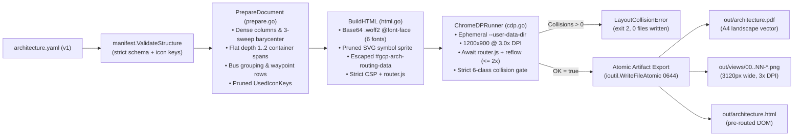
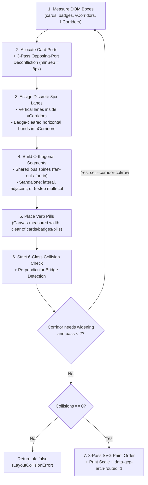

# Stage 3 — Offline Rendering & Routing

Stage 3 (`gcp-arch render`) compiles a validated, Git-tracked `architecture.yaml` manifest into print-ready deliverables — vector **A4 landscape PDF** (`out/architecture.pdf`), high-DPI **`3x` per-view PNGs** (`out/views/<00..NN>-<view_id>.png`), and a self-contained **HTML dossier** (`out/architecture.html`).

Rendering operates **100% offline** with zero external network calls and zero `facts.json` dependency. Fonts, service icons, stylesheets, and the orthogonal corridor router are all embedded directly inside the static `gcp-arch` binary via Go `//go:embed`.

---

## Compilation Pipeline

`render.Render` (`internal/render/cdp.go`) orchestrates structural validation, layout preparation, self-contained HTML assembly, headless browser routing + collision verification, and crash-safe atomic writes:

1. **Structural Gate (`manifest.ValidateStructure`):** Rejects schema, archetype, container nesting, verb length, bus group, or icon key errors before any rendering work begins (exit `2`). See [Manifest Schema & Validation](manifest_schema.md).
2. **Layout Preparation (`PrepareDocument` in `internal/render/prepare.go`):** Resolves dense grid columns, executes a deterministic 3-sweep barycenter sort per view, calculates flat container bounding spans, assigns explicit and automatic bus spines, picks clear horizontal waypoint corridors, computes dynamic card port heights, and collects the exact subset of `UsedIconKeys`.
3. **Offline HTML Compilation (`BuildHTML` in `internal/render/html.go`):** Executes Go's `html/template` with bundled base64 `.woff2` fonts, `diagram.css`, the pruned SVG icon sprite, JSON-escaped routing metadata, and `router.js`.
4. **Headless Routing & Export (`ChromeDPRunner.Render` in `internal/render/cdp.go`):** Opens the compiled HTML via `file://` in an isolated local Chrome/Chromium instance, awaits `window.__GCP_ARCH_RENDER_PROMISE__`, fails immediately with `*LayoutCollisionError` (exit `2`, writing zero files) if any overlap remains after corridor widening, and captures `3x` PNGs, vector PDF pages, and pre-routed HTML.
5. **Atomic Artifact Writes (`internal/ioutil/atomic.go`):** Persists all requested outputs via temp file → `Sync` → `Chmod(0644)` → `Close` → `Rename`, guaranteeing consumers never observe partial artifacts.

---

## Zero-Network & Security Guarantees

Every HTML dossier emitted by `BuildHTML` is designed to be safe when opened locally from `file://`, attached to tickets, or shared across air-gapped environments:

| Security Control | Implementation (`internal/render/html.go` & `internal/icons/`) | Guarantee |
| :--- | :--- | :--- |
| **Strict Content Security Policy** | `<meta http-equiv="Content-Security-Policy" content="default-src 'none'; style-src 'unsafe-inline'; font-src data:; img-src data:; script-src 'unsafe-inline'">` (`ContentSecurityPolicy`) | Blocks all external network fetches (`http:`, `https:`, `ws:`, XHR, beacons, external stylesheets/fonts/images). |
| **HTML Context Escaping** | Go `html/template` auto-escapes all manifest fields (titles, subtitles, `inline_meta`, `off_page_refs`, `inference_rationale`, container badges) | Neutralizes raw HTML/script injection payloads across all text and attribute contexts. |
| **Safe JSON `` breakout attacks from crafted edge verbs or component IDs. |
| **XML Attribute & Text Escaping** | `encoding/xml.EscapeText` (`escapeXML`) escapes all compiled `<symbol>` attributes and text nodes | Prevents XML injection in inline SVG sprites. |
| **Embedded Base64 `.woff2` Fonts** | 6 bundled `.woff2` files encoded once via `sync.Once` into inline `data:font/woff2;base64,...` `@font-face` rules with `font-display:block` | Identical typography and deterministic pill text measurement offline across Linux, macOS, and Windows. |
| **Pruned Inline SVG Sprite** | `reg.SymbolSprite(doc.UsedIconKeys)` emits only `<symbol id="gcp-icon-<key>">` definitions actually referenced by the manifest (plus hoisted `<defs>`) | Zero external image requests and minimal HTML payload size. |

### Bundled Embedded Fonts

Six `.woff2` font weights are embedded via `//go:embed assets/fonts/*.woff2` (`internal/render/assets/fonts/`):

| Font Family | Weight | Embedded File | Usage in Diagrams |
| :--- | :---: | :--- | :--- |
| **Inter** | `400` | `Inter-Regular.woff2` | View subtitles, footnotes, general body text |
| **Inter** | `500` | `Inter-Medium.woff2` | Legend labels, `inline_meta` keys, SVG connector verb pills (`8.5px`) |
| **Inter** | `600` | `Inter-SemiBold.woff2` | Component titles (`13px`), container badges (`9.5px`), stage banners, off-page pills |
| **Inter** | `700` | `Inter-Bold.woff2` | View header titles (`16px`) |
| **JetBrains Mono** | `400` | `JetBrainsMono-Regular.woff2` | Component subtitles (`10.5px`) and `inline_meta` values (`9px`) |
| **JetBrains Mono** | `500` | `JetBrainsMono-Medium.woff2` | Numbered `[N]` footnote tags in the view footer |

---

## Sheet Geometry & CSS Grid Layout

Each view renders inside a `<section class="view-sheet">` container with fixed horizontal geometry (`internal/render/assets/diagram.css`):

- **Fixed Sheet Width:** `.document-root` and `.view-sheet` are locked to **`1040px`** wide (`padding: 12px 14px 10px 14px`), with `break-after: page` and `break-inside: avoid` so every view maps cleanly to one PDF page.
- **A4 Landscape Print Page:** `@page { size: A4 landscape; margin: 10mm; }` paired with `print-color-adjust: exact`.
- **Automatic Print-Only Scaling:** After injecting connectors, `router.js` measures each sheet's height. Whenever `height > 708px`, it sets `--print-scale: (708 / h).toFixed(4)` on the `.view-sheet`, applied exclusively inside `@media print { .view-sheet { zoom: var(--print-scale, 1); } }` so screen and PNG rendering remain unscaled while PDF pages never spill onto a second page.
- **5-Column Compact Mode (`data-cols="5"`):** Views spanning all 5 columns (`0..4`) automatically receive tighter sheet padding (`10px 12px 8px 12px`), compact card padding (`6px 7px`), `20×20px` icons (down from `24×24px`), `11.5px` titles, `9.5px` subtitles, and `8.5px` metadata rows so 5-column matrices remain readable within `1040px`.

### Interleaved Content & Corridor Grid Tracks

Instead of overlapping connectors directly over card margins, `buildGridTracks` (`internal/render/prepare.go`) interleaves explicit content tracks and routing corridor tracks inside `.view-grid`:

- **Column Tracks (`ColTracksCSS`):** Content columns use `minmax(0, 1fr)` at odd CSS Grid indices (`1, 3, 5, ...`), separated by vertical corridor columns (`var(--corridor-col-<i>, var(--corridor-col-default))`) at even indices (`2, 4, 6, ...`).
  - Default `--corridor-col-default` is **`56px`** (`landscape_matrix`, `hub_spoke`), widened to **`64px`** on `data-archetype="stage_pipeline"`.
  - If a single-column view contains a same-column lateral edge, `HasRightEdgeCol` appends a trailing vertical corridor on the right (`corridorCols` count = `numCols`).
- **Row Tracks (`RowTracksCSS`):** Horizontal corridor rows sit at odd CSS Grid indices (`1, 3, 5, ...`, spanning `0..numRows`), sandwiching `auto`-sized card content rows at even indices (`2, 4, 6, ...`). Each horizontal corridor starts with a deterministic default height based on what occupies that row boundary:

| Priority | Condition at Corridor Row `r` (`defaultRowCorridorTrack`) | Default Track Size | Purpose |
| :---: | :--- | :--- | :--- |
| 1 | `hasWaypoint && hasInnerTop` | `calc(var(--corridor-row-default) + 46px)` (**`94px`**) | Multi-column waypoint lanes above nested depth-1 + depth-2 top badges (`48px + 46px`) |
| 2 | `hasInnerTop` | **`52px`** | Stacked depth-1 outer container badge (`-43px`) + depth-2 inner badge (`-19px`) sharing `minRow` |
| 3 | `hasWaypoint` | `var(--corridor-row-default)` (**`48px`**) | Multi-column horizontal waypoint trunk + verb pills |
| 4 | `hasBadge` | **`32px`** | Standard depth-1 or standalone container top badge (`-23px`) |
| 5 | Default (no waypoint, no badge) | **`18px`** | Clean vertical breathing room between adjacent rows |

- **Dynamic Card Port Heights:** When a component card accumulates `>= 3` edge ports on its left or right side (`max(portCounts[id|L], portCounts[id|R])`), `buildPreparedCards` sets an explicit inline `min-height: max(54, 24 + (maxPorts - 1) * 24)px` so ports always retain generous vertical separation.

### Deterministic 3-Sweep Barycenter Row Ordering

Before container spans or routes are computed, `runBarycenterSweeps` (`internal/render/prepare.go`) reduces edge crossings across columns deterministically:

1. **Sweep 1 (Left → Right):** Sorts columns `1 .. numCols-1` by the median row index (barycenter) of each card's cross-column neighbors.
2. **Sweep 2 (Right → Left):** Sorts columns `numCols-2 .. 0` back toward the left edge.
3. **Sweep 3 (Final Right Column Polish):** Re-sorts the rightmost column `numCols-1` against the stabilized interior columns.

Container contiguity is strictly preserved: cards are grouped first by their outer depth-1 container key (`outerCont`), then by their inner depth-2 container key (`innerCont`), and finally by individual slot barycenter. Whenever barycenters tie (or a card has no cross-column neighbors), ordering falls back deterministically to the original `placements[]` YAML index (`yamlIdx`), allowing manifest authors to control tie-breaking directly.

### Archetypes, Containers, Edges & Visual Conventions

#### Layout Archetypes

| Archetype | Column Bounds | Column Compaction | Special Rendering Behavior |
| :--- | :---: | :--- | :--- |
| `landscape_matrix` | `0..4` | Sparse columns compacted into dense indices | General multi-tier landscapes and `view_0_system_index`; enters compact mode at `data-cols="5"`. |
| `stage_pipeline` | `0..4` | Sparse columns compacted into dense indices | Widens `--corridor-col-default` to `64px` and renders automatic uppercase `.stage-banners` above every column derived from the dominant `ComponentKind` (`Stage N · Source`, `Ingress`, `Build & CI`, `Workloads`, `Messaging`, `Artifacts & State`, `Services`, `Deploy Targets`, or `Stage N`). |
| `hub_spoke` | `0..2` (locked) | Always fixed 3 columns (`0`, `1`, `2`) | Centers the hub component(s) in column `1` with left (`0`) and right (`2`) spoke columns, supporting directional hub fan-out/fan-in buses. |

#### Flat Depth-1 & Depth-2 Containers

Containers are rendered as flat background grid items (`.arch-container`) spanning `2*minCol+1 / 2*maxCol+2` and `2*minRow+2 / 2*maxRow+3` with separate top-left badges (`.arch-container-badge`) anchored strictly inside `(minCol, minRow)`:

- **Depth 1 (`data-depth="1"`):** `#F8FAFC` background, `1px solid #94A3B8` border, negative top margin `-26px` (expanded to `-46px` when `data-has-inner-top="1"` because a depth-2 child starts on the same `minRow`).
- **Depth 2 (`data-depth="2"`):** `#F1F5F9` nested background, `1px solid #CBD5E1` border, `-22px` top margin, `z-index: 2` (painted above depth 1 and below cards at `z-index: 3`).
- **Dashed Boundary Zones:** Containers with `kind: PSA_ZONE` or `kind: EXTERNAL_ZONE` automatically render with `border-style: dashed` to distinguish Google-managed Private Services Access / PSC zones and external SaaS/Internet boundaries from customer-owned GCP projects and VPCs.

#### Edge Flow Color Tokens, Provenance & `AccentMode`

| Token / Attribute | Color / Style | Meaning & Usage |
| :--- | :--- | :--- |
| `flow_kind: RUNTIME` | `#1D4ED8` (blue, `1.5px` solid) | Live runtime traffic, ingress, database/cache access, streaming pipelines, and PSA/PSC peering. |
| `flow_kind: CICD` | `#B45309` (amber, `1.5px` solid) | Source triggers, builds, artifact pushes, Terraform state/modules, and cross-project deployments. |
| `flow_kind: ADMIN` | `#475569` (slate, `1.5px` solid) | Administrative, telemetry, IAM, or control-plane flows. |
| `provenance: INFERRED` | `stroke-dasharray: "5 3"` + `[N]` suffix on verb pill | Model-inferred edge without a complete `FactEdge` walk; automatically appends a numbered `[N] from -> to: <rationale>` footnote below the view sheet. |
| `accent_mode` (`RUNTIME`, `CICD`, `MIXED`) | View-level semantic accent | Used by `systemIndexViewIcon` (`prepare.go`) to choose default `View 0` card icons for `landscape_matrix` detail views (`cloud_build` when `CICD`, `google_kubernetes_engine` otherwise) and by `BuildSystemIndexView` (`internal/synth/view0.go`) to classify cross-view `View 0` edges via `flowFromAccent` (`CICD` vs `RUNTIME`). |

#### Off-Page Reference Pills & Bus Spine Grouping

- **Off-Page References (`off_page_refs`):** Rendered at the bottom of a card as rounded blue pills (`.off-page-pill`, `#EFF6FF` fill, `#1D4ED8` text) prefixed with `←` (`IN`) or `→` (`OUT`), signaling navigation into sibling views.
- **Shared Bus Grouping (`assignBusGroups` in `prepare.go`):** Reduces connector clutter by merging `>= 2` same-direction horizontal edges into a shared vertical bus spine with `2.5px` junction dots:
  1. **Explicit Buses (`via_bus_id`):** Edges sharing `(via_bus_id, horizontal_dir)` with `len >= 2` form an explicit bus (`explicit_<via_bus_id>_<dir>`). Splitting by direction (`-1` left, `+1` right) allows a central hub in `hub_spoke` views to fan out bidirectionally under one `via_bus_id`. When all edges share one source, `bus_kind = "out"` (fan-out); otherwise `bus_kind = "in"` (fan-in).
  2. **Automatic Fan-Out & Fan-In Buses:** Remaining ungrouped horizontal edges with `len >= 2` sharing `(from, flow_kind, dir)` auto-group into `auto_out_*` fan-out buses, followed by `(to, flow_kind, dir)` into `auto_in_*` fan-in buses.

---

## Orthogonal Corridor Router (`router.js`)

After fonts finish loading (`await document.fonts.ready`) and two animation frames settle CSS Grid layout, `internal/render/assets/router.js` measures DOM bounding boxes and constructs crisp orthogonal SVG connectors inside `<svg class="connector-layer">` (`z-index: 4`) for every `.view-sheet`.

### Exact Routing & Collision Constants

| Constant | Value | Role |
| :--- | :---: | :--- |
| `CARD_CLEARANCE` | `4px` | Minimum clearance between any non-incident connector segment or verb pill and any `.arch-card` |
| `BADGE_CLEARANCE` | `4px` | Minimum clearance between any connector segment or verb pill and any `.arch-container-badge` |
| `PILL_CLEARANCE` | `4px` | Minimum separation between any two placed verb pills |
| `COLLINEAR_MIN_SEP` | `6px` | Minimum orthogonal separation between parallel segments of distinct edges with `> 1px` overlap |
| `LANE_STEP` | `8px` | Center-to-center spacing between adjacent discrete lanes inside a corridor |
| `CORRIDOR_WALL_PAD` | `12px` | Inset padding from vertical and horizontal corridor walls when allocating lanes |
| `MAX_CORRIDOR_SIZE` | `160px` | Upper bound for automatic `--corridor-col-*` / `--corridor-row-*` widening during reflow |
| `MAX_REFLOW_PASSES` | `2` | Maximum automatic corridor-widening reflow passes after initial pass `0` (up to 3 total passes) |
| `PORT_CORNER_MARGIN` | `10px` | Top/bottom inset along card sides when evenly distributing edge ports |
| `PILL_HEIGHT` | `15px` | Fixed height of SVG connector verb pills (`PILL_PAD_X = 5px`, `PILL_FONT_SIZE = 8.5px`) |
| `BRIDGE_RADIUS` | `4px` | Semicircular jump-arc radius (`A 4 4`) where a horizontal segment crosses a perpendicular vertical segment |
| `JUNCTION_RADIUS` | `2.5px` | Filled circle radius at shared bus trunk and branch taps |

### Routing Algorithm Walkthrough

1. **Port Allocation & 3-Pass Opposing-Port Deconfliction:**
   - Ports on each card side (`left` or `right`) are sorted by neighbor `cy` (`sortY`) and distributed evenly between `card.top + 10px` and `card.bottom - 10px`.
   - `deconflictCorridorPorts` then runs **3 passes** across opposing left-side and right-side ports sharing the same vertical corridor, nudging distinct edge/bus ports apart to at least `minSep = COLLINEAR_MIN_SEP + 2` (**`8px`**) so opposing horizontal taps never collide collinearly.
2. **Discrete Corridor Lane Assignment:**
   - Vertical lanes (`assignVerticalLanes`) distribute buses and standalone turns across `[vc.left + 12px, vc.right - 12px]` at `8px` (`LANE_STEP`) intervals.
   - Horizontal lanes (`assignHorizontalLanes`) first subtract any overlapping `.arch-container-badge` intervals (`clearHorizontalBand`) before placing multi-column horizontal trunks in the widest unobstructed band.
3. **Bus Spines vs. Standalone Edge Topologies:**
   - **Shared Bus Spines (`routeAllBuses`):** Draws a single trunk from the shared node to a vertical spine (`computeBusSpineX` biases single-spine buses in `>= 72px` corridors toward the trunk side to open horizontal room for branch verb pills), taps each adjacent branch horizontally (or routes remote multi-column branches through their assigned `waypoint_row`), and drops `2.5px` junction dots where branches join the spine.
   - **Same-Column Lateral Edges (`es.dir === 0`):** Detours orthogonally into the assigned adjacent corridor (`lateral_side`: `right`, or `left` for the rightmost column) via a 3-step loop.
   - **Adjacent-Column Edges (`|Δcol| === 1`):** Draws a direct horizontal line when `|pFrom.y - pTo.y| < 1px`, or a 3-step orthogonal jog through the intervening vertical corridor lane.
   - **Multi-Column Edges (`|Δcol| > 1`):** Routes a **5-step** orthogonal path: source tap → vertical drop/rise in `startVC` → horizontal trunk along the badge-free `waypoint_row` corridor chosen by `pickClearWaypointRow` → vertical segment in `endVC` → target tap.
4. **Verb Pill Placement (`placeVerbPills`):** Measures exact label widths using an offscreen HTML5 `<canvas>` context configured with `500 8.5px Inter, sans-serif` (appending `[N]` for `INFERRED` edges), then scans candidate positions along horizontal segments (`dy` offsets `0, ±12, ±22` and fractional spans) and vertical segments until a rectangle clears all cards (`4px`), badges (`4px`), and previously placed pills (`4px`).
5. **Corridor-Widening Reflow (Up to `2` Passes):** Before accepting a layout, `applyCorridorWidening` compares each corridor's measured size against its lane demand (`24 + 8 * lanes`) and verb pill width reserve (`labelW + 10px`), or pushes corridors toward `MAX_CORRIDOR_SIZE` (`160px`) if collisions remain, setting `--corridor-col-<c>` / `--corridor-row-<r>` CSS custom properties and forcing synchronous reflow.
6. **3-Pass SVG Paint Order (`injectConnectorSVG`):**
   - **Pass 1:** Draws all non-bridged `<line>` segments (including every vertical segment and bus spine) underneath bridges.
   - **Pass 2:** Draws bridged horizontal `<path>` segments on top: first a `5.5px` `#FFFFFF` halo (`data-bridge-halo="1"`) that cleanly masks underlying vertical lines, then the `1.5px` colored arc path (`data-bridge="1"`, radius `4px`, dashed `5 3` if `INFERRED`).
   - **Pass 3:** Paints `2.5px` bus junction circles, crisp `6 × 6.4px` triangular arrowheads, and white-filled rounded verb pill groups (`<g class="verb-pill">`) on top of all lines.

### Strict Collision Verification & `LayoutCollisionError`

After the final reflow pass, `router.js` verifies six strict geometric collision classes across every view. Any non-zero collision list sets `ok: false`, causing `gcp-arch render` to abort with `*LayoutCollisionError` (**exit code `2`**) and write **zero** output files:

| Collision Kind (`Collision.Kind`) | Trigger Condition |
| :--- | :--- |
| `card_segment_collision` | A connector segment penetrates an incident card's interior (`1.5px` inset) or violates `4px` (`CARD_CLEARANCE`) around any non-incident card. |
| `badge_segment_collision` | A connector segment violates `4px` (`BADGE_CLEARANCE`) around any `.arch-container-badge`. |
| `pill_card_collision` | A placed verb pill overlaps any `.arch-card` within `4px` (`CARD_CLEARANCE`). |
| `pill_badge_collision` | A placed verb pill overlaps any `.arch-container-badge` within `4px` (`BADGE_CLEARANCE`). |
| `pill_pill_collision` | Any two placed verb pills violate `4px` (`PILL_CLEARANCE`) separation. |
| `collinear_collision` | Parallel segments from distinct edges run closer than `6px` (`COLLINEAR_MIN_SEP`) while overlapping longitudinally by more than `1px`. |

!!! note "Zero-Overlap Philosophy"
    Perpendicular crossings between distinct edges are **not** collisions — they are resolved cleanly with `4px` jump-arc bridges and `5.5px` white halos. Only true visual defects (lines touching cards/badges, overlapping pills, or merged/touching parallel tracks) trigger `LayoutCollisionError`.

---

## Headless Chrome / `chromedp` Export

`ChromeDPRunner` (`internal/render/cdp.go`) drives a single local Chrome or Chromium session over the Chrome DevTools Protocol (`chromedp`):

- **Session Isolation:** Creates a fresh `gcp-arch-chrome-*` temporary directory containing an ephemeral `0700` `profile/` (`--user-data-dir`) and `0600` `input.html`, then deletes the entire directory on exit (`defer os.RemoveAll`). Safe to run concurrently alongside an active desktop Chrome browser.
- **Hardened Launch Flags:** Launches with `--headless=new`, `--disable-gpu`, `--no-first-run`, `--no-default-browser-check`, `--disable-background-networking`, `--disable-sync`, `--disable-extensions`, `--metrics-recording-only`, and `--mute-audio`.
- **Conditional Container `--no-sandbox` Auto-Detection (`needsNoSandbox`):** Never disables the sandbox on normal Linux/macOS workstations. Automatically appends `--no-sandbox` **only** on Linux when container markers are present (`/.dockerenv`, `/run/.containerenv`, or `docker`/`kubepods`/`containerd` in `/proc/1/cgroup`) **and** either `/proc/sys/kernel/unprivileged_userns_clone == "0"` or the process runs as `root` (`euid == 0`).
- **Upfront `3x` High-DPI Viewport:** Issues `emulation.SetDeviceMetricsOverride` (`Width: 1200`, `Height: 900`, `DeviceScaleFactor: 3.0`, `Mobile: false`) *before* navigating to `file://<workDir>/input.html`, so layout measurement and `page.CaptureScreenshot` share exact `3x` metrics.

### Output Artifacts & `--format` Behavior Matrix

| Artifact | Path | Format & Geometry |
| :--- | :--- | :--- |
| **Vector PDF** | `out/architecture.pdf` | One A4 landscape page per view (`PrintBackground: true`, `PreferCSSPageSize: true`), selectable embedded vector text & SVG connectors. |
| **3x View PNGs** | `out/views/<00..NN>-<view_id>.png` | Clipped per `.view-sheet` (`CaptureBeyondViewport: true`, `Scale: 1` at `3.0x` device scale → **`3120px`** wide for `1040px` sheets), ideal for Google Docs & slides. |
| **Standalone HTML** | `out/architecture.html` | Single self-contained offline dossier (`0644`). Pre-routed (`data-gcp-arch-routed="1"` with baked `<svg class="connector-layer">` and `--print-scale`) when Chrome runs, or unrouted when Chrome-free fallback triggers. |

| Requested `--format` | Chrome Available | Explicit `--chrome-path` Missing | Auto-Discovery Finds No Chrome |
| :--- | :--- | :--- | :--- |
| `pdf,png,html` *(default)* | Writes vector PDF, `3x` PNGs, and pre-routed HTML; enforces collision gate (exit `0` / `2`). | Fails fast (exit `1`). | Fails fast (exit `1`): Chrome/Chromium required for `pdf`/`png`. |
| `pdf` or `png` | Writes requested PDF/PNG artifacts; enforces collision gate. | Fails fast (exit `1`). | Fails fast (exit `1`). |
| `html` *(alone)* | Runs headless Chrome, verifies zero collisions, writes **pre-routed** `architecture.html` (`data-gcp-arch-routed="1"`). | Fails fast (exit `1`). | Graceful fallback: writes **unrouted** self-contained `architecture.html` (routes on open in any browser) + prints warning to `stderr` (exit `0`). |

For Chrome discovery precedence (`--chrome-path` > `CHROME_PATH` > `config.yaml` > `PATH` > OS defaults) and all CLI flags, see [CLI & Configuration](cli_configuration.md).

---

## Embedded Icon Registry (`internal/icons/`)

`gcp-arch` embeds **85** curated inline SVG icons in `internal/icons/assets/icons.yaml` (`schema_version: v1`), loaded lazily via `icons.Load()`. Every `component.icon_key` in `architecture.yaml` must match one of these 85 keys.

### Complete 85-Icon Reference

| Category | Count | Registered `icon_key` Values |
| :--- | :---: | :--- |
| **Standard GCP2 Services** | **57** | `compute_engine`, `google_kubernetes_engine`, `anthos`, `cloud_run`, `cloud_functions`, `app_engine`, `batch`, `virtual_private_cloud`, `cloud_load_balancing`, `cloud_armor`, `cloud_router`, `cloud_vpn`, `cloud_interconnect`, `cloud_dns`, `cloud_external_ip_addresses`, `cloud_firewall_rules`, `certificate_manager`, `network_connectivity_center`, `private_service_connect`, `api_gateway`, `apigee_api_platform`, `identity_aware_proxy`, `cloud_storage`, `persistent_disk`, `filestore`, `cloud_sql`, `cloud_spanner`, `firestore`, `cloud_bigtable`, `memorystore`, `pubsub`, `eventarc`, `cloud_tasks`, `cloud_scheduler`, `workflows`, `bigquery`, `data_transfer`, `dataflow`, `datastream`, `dataproc`, `cloud_composer`, `dataplex`, `cloud_data_fusion`, `looker`, `vertexai`, `dialogflow`, `document_ai`, `identity_and_access_management`, `secret_manager`, `key_management_service`, `data_loss_prevention_api`, `artifact_registry`, `cloud_build`, `cloud_deploy`, `cloud_logging`, `cloud_monitoring`, `cloud_trace` |
| **Newer AI / Data / DB Services** | **12** | `alloydb`, `managed_kafka`, `dataproc_metastore`, `dataform`, `analytics_hub`, `vertex_agent_engine`, `vertex_vector_search`, `vertex_search`, `vertex_rag`, `foundation_model`, `mcp_server`, `model_armor` |
| **Generic Family Fallbacks** | **8** | `family_compute`, `family_network`, `family_storage`, `family_data`, `family_ai`, `family_integration`, `family_transversal`, `unclassified_warning` |
| **Governance & Hierarchy (L0)** | **3** | `gcp_organization`, `gcp_folder`, `project_cohort` |
| **External, PSA & Kubernetes** | **5** | `github`, `external_client`, `private_services_access`, `k8s_workload`, `k8s_ingress` |

### SVG Security Validation & `<defs>` Hoisting

At load time, every icon in `icons.yaml` passes through two deterministic compilation phases:

1. **Strict XML/XSS Validation (`ValidateSVG` in `internal/icons/validate.go`):**
   - Requires well-formed XML with a single `<svg>` root element and zero trailing content.
   - Rejects XML directives (`<!DOCTYPE ...>`, preventing XXE) and processing instructions (`<?xml-stylesheet ...?>`).
   - Rejects forbidden elements: `<script>`, `<foreignObject>`, `<iframe>`, `<embed>`, `<object>`.
   - Rejects all `on*` event handler attributes and any `xmlns` other than `http://www.w3.org/2000/svg` (including arbitrary prefixed `xmlns:*`).
   - Rejects dangerous URI schemes (`javascript:`, `vbscript:`, `data:`), `http://` / `https://` external URLs, protocol-relative `//` hrefs (including whitespace- and entity-obfuscated variants), CSS `@import`, `expression()`, backslash escapes, and any CSS `url(...)` not targeting a local `#id`.
2. **Symbol Compilation & `<defs>` Hoisting (`compileIconSymbol` in `internal/icons/registry.go`):**
   - Compiles each `<svg>` into `<symbol id="gcp-icon-<key>" viewBox="...">` (defaulting to `0 0 24 24` and `preserveAspectRatio="xMidYMid meet"` when absent).
   - Hoists `<defs>` blocks and standalone definition elements (`<filter>`, `<mask>`, `<linearGradient>`, `<radialGradient>`, `<clipPath>`, `<pattern>`) into a shared root `<defs>` inside the hidden sprite `<svg style="display:none">` — required so Chrome reliably resolves SVG filters/masks inside `<use href="#gcp-icon-...">` shadow trees (e.g., `pubsub`'s `<filter>` and `<mask>`).
   - Prefixes every internal `id`, `href="#..."`, `xlink:href="#..."`, and CSS/attribute `url(#...)` with `icon-<key>-` (such as `icon-pubsub-A` and `icon-pubsub-B`), preventing cross-icon ID collisions across the 85-icon catalog.

---

## Next Steps

- **Browse Rendered Output:** Inspect all 8 rendered `3x` PNGs across both reference architectures in [Examples & Visual Gallery](examples.md).
- **Manifest Rules:** Review every schema constraint enforced before rendering in [Manifest Schema & Validation](manifest_schema.md).
- **Extend Icons or Renderer:** Follow the icon-addition and Chrome test workflows in the [Developer Guide](developer_guide.md).
