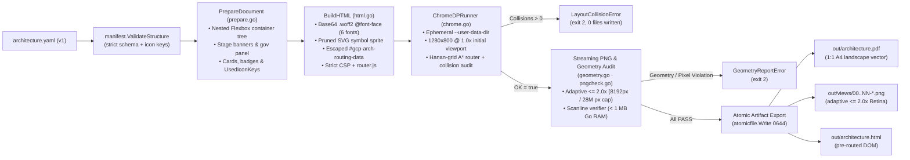

# Stage 3 — Offline Rendering & Routing

Stage 3 (`gcp-arch render`) compiles a validated, Git-tracked `architecture.yaml` manifest into print-ready deliverables — 1:1 per-view vector **A4 landscape PDF** (`out/architecture.pdf`), adaptive up to **`2.0x` Retina per-view PNGs** (`out/views/<00..NN>-<view_id>.png`), a self-contained **HTML dossier** (`out/architecture.html`), and an opt-in machine-readable **`geometry_report.json`** (`--geometry-report`).

Rendering operates **100% offline** with zero external network calls and zero required `facts.json` dependency. Fonts, service icons, stylesheets, and the DOM-measured Hanan-grid A* orthogonal router are all embedded directly inside the static `gcp-arch` binary via Go `//go:embed`.

---

## Compilation Pipeline

[`render.Render`](https://github.com/arrase/gcp-arch/blob/main/internal/render/render.go#L54-L118) ([`internal/render/render.go`](https://github.com/arrase/gcp-arch/blob/main/internal/render/render.go)), invoked by [`cmd/gcp-arch/render.go`](https://github.com/arrase/gcp-arch/blob/main/cmd/gcp-arch/render.go) with defaults from [`cmd/gcp-arch/config.go`](https://github.com/arrase/gcp-arch/blob/main/cmd/gcp-arch/config.go), orchestrates structural validation, nested Flexbox container preparation, self-contained HTML assembly, isolated headless Chrome routing, streaming scanline PNG verification, and crash-safe atomic writes:

1. **Structural Gate ([`manifest.ValidateStructure`](https://github.com/arrase/gcp-arch/blob/main/internal/manifest/validate.go#L102-L110)):** Rejects schema, archetype, container nesting, verb length, bus group, or icon key errors before any rendering work begins (exit `2`). See [Manifest Schema & Validation](manifest_schema.md).
2. **Layout Preparation ([`PrepareDocument`](https://github.com/arrase/gcp-arch/blob/main/internal/render/prepare.go#L125-L172) in [`internal/render/prepare.go`](https://github.com/arrase/gcp-arch/blob/main/internal/render/prepare.go)):** Constructs the nested Flexbox container hierarchy (`ORG > FOLDER > PROJECT > VPC > REGION > SUBNET > ExposureZone/GKE/PSA/Hybrid`), resolves card widths, badges, and `members`, generates stage banners, filters per-view transversal governance items, attaches URI-sorted `excluded_resources` to `views[0]`, and collects the exact subset of `UsedIconKeys`.
3. **Offline HTML Compilation ([`BuildHTML`](https://github.com/arrase/gcp-arch/blob/main/internal/render/html.go#L286-L339) in [`internal/render/html.go`](https://github.com/arrase/gcp-arch/blob/main/internal/render/html.go)):** Executes Go's `html/template` with bundled base64 `.woff2` fonts, [`diagram.css`](https://github.com/arrase/gcp-arch/blob/main/internal/render/assets/diagram.css), the pruned SVG icon sprite, JSON-escaped routing metadata, and [`router.js`](https://github.com/arrase/gcp-arch/blob/main/internal/render/assets/router.js).
4. **Headless Routing, Export & Streaming Verification ([`internal/render/chrome.go`](https://github.com/arrase/gcp-arch/blob/main/internal/render/chrome.go), [`geometry.go`](https://github.com/arrase/gcp-arch/blob/main/internal/render/geometry.go), [`pngcheck.go`](https://github.com/arrase/gcp-arch/blob/main/internal/render/pngcheck.go)):** Opens the compiled HTML via `file://` in an isolated local Chrome/Chromium instance, awaits `window.__GCP_ARCH_RENDER_PROMISE__`, fails immediately with `*LayoutCollisionError` (exit `2`, writing zero files) if any collision or text clipping remains, exports 1:1 per-view vector PDF, isolates and captures each view as an adaptive up to `2.0x` Retina PNG, and verifies every PNG with a streaming scanline pixel & geometry verifier (`< 1 MB` Go RAM, returning `*GeometryReportError`, exit `2`, on violation).
5. **Atomic Artifact Writes ([`internal/atomicfile/atomicfile.go`](https://github.com/arrase/gcp-arch/blob/main/internal/atomicfile/atomicfile.go#L19-L90)):** Persists all requested outputs (`architecture.pdf`, `views/*.png`, `architecture.html`, and optional `geometry_report.json`) via temp file → `Sync` → `Chmod(0644)` → `Close` → `Rename`, guaranteeing consumers never observe partial artifacts.

---

## Zero-Network & Security Guarantees

Every HTML dossier emitted by `BuildHTML` is designed to be safe when opened locally from `file://`, attached to tickets, or shared across air-gapped environments:

| Security Control | Implementation ([`internal/render/html.go`](https://github.com/arrase/gcp-arch/blob/main/internal/render/html.go) & [`internal/icons/`](https://github.com/arrase/gcp-arch/tree/main/internal/icons)) | Guarantee |
| :--- | :--- | :--- |
| **Strict Content Security Policy** | `<meta http-equiv="Content-Security-Policy" content="default-src 'none'; style-src 'unsafe-inline'; font-src data:; img-src data:; script-src 'unsafe-inline'">` ([`ContentSecurityPolicy`](https://github.com/arrase/gcp-arch/blob/main/internal/render/html.go#L22)) | Blocks all external network fetches (`http:`, `https:`, `ws:`, XHR, beacons, external stylesheets/fonts/images). |
| **HTML Context Escaping** | Go `html/template` auto-escapes all manifest fields (titles, subtitles, `inline_meta`, `off_page_refs`, `inference_rationale`, `excluded_resources`, container badges, transversal items) | Neutralizes raw HTML/script injection payloads across all text and attribute contexts. |
| **Safe JSON `` breakout attacks from crafted edge verbs or component IDs. |
| **XML Attribute & Text Escaping** | `encoding/xml.EscapeText` escapes all compiled `<symbol>` attributes and text nodes | Prevents XML injection in inline SVG sprites. |
| **Embedded Base64 `.woff2` Fonts** | 6 bundled `.woff2` files encoded once via `sync.Once` into inline `data:font/woff2;base64,...` `@font-face` rules with `font-display:block` | Identical typography and deterministic pill text measurement offline across Linux, macOS, and Windows. |
| **Pruned Inline SVG Sprite** | [`reg.SymbolSprite(doc.UsedIconKeys)`](https://github.com/arrase/gcp-arch/blob/main/internal/icons/registry.go) emits only `<symbol id="gcp-icon-<key>">` definitions actually referenced by the manifest (plus hoisted `<defs>`) | Zero external image requests and minimal HTML payload size. |

### Bundled Embedded Fonts

Six `.woff2` font weights are embedded via `//go:embed assets/fonts/*.woff2` ([`internal/render/assets/fonts/`](https://github.com/arrase/gcp-arch/tree/main/internal/render/assets/fonts)):

| Font Family | Weight | Embedded File | Usage in Diagrams |
| :--- | :---: | :--- | :--- |
| **Inter** | `400` | `Inter-Regular.woff2` | View subtitles, `INFERRED` edge footnotes, `excluded_resources` footer entries, general body text |
| **Inter** | `500` | `Inter-Medium.woff2` | Legend labels, `inline_meta` keys, SVG connector verb pills (`9px`) |
| **Inter** | `600` | `Inter-SemiBold.woff2` | Component titles, container headers/badges, stage banners, off-page pills |
| **Inter** | `700` | `Inter-Bold.woff2` | View header titles |
| **JetBrains Mono** | `400` | `JetBrainsMono-Regular.woff2` | Component subtitles, raw resource names, and `inline_meta` values |
| **JetBrains Mono** | `500` | `JetBrainsMono-Medium.woff2` | View kickers, numbered `[N]` footnote tags, and `Excluded (<N>)` tags |

---

## Nested Flexbox Layout & Print Pagination

Each view renders inside a `<section class="view-sheet">` container styled by [`internal/render/assets/diagram.css`](https://github.com/arrase/gcp-arch/blob/main/internal/render/assets/diagram.css):

* **Unlimited-Depth Nested Flexbox Containers (`.arch-box`):** Containers nest cleanly in the DOM (`data-depth="1..N"`) with zero negative margins, zero `text-overflow: ellipsis` truncation, and `min-width: 0` clean word/underscore wrapping so long resource names and multi-level hierarchies (`Org > Folder > Project > VPC > Region > Subnet > GKE / PSA / Hybrid`) never clip or collide.
* **Balanced Transversal Governance Panel:** IAM Service Accounts, Cloud KMS keys, Secret Manager secrets, Observability, Cloud NAT/Routers, and Firewall/Cloud Armor items dock cleanly in a multi-column governance panel (`.dock-bottom` / `.wide-gov`) alongside workload attachment chips, keeping primary request/data flows uncluttered.
* **1:1 Per-View Vector PDF Pagination:** `@page { size: A4 landscape; margin: 10mm; }` pairs with `.view-sheet { break-after: page; break-inside: avoid; }` and `applyPrintScale` ([`internal/render/assets/router.js#L2229-L2240`](https://github.com/arrase/gcp-arch/blob/main/internal/render/assets/router.js#L2229-L2240)). `applyPrintScale` computes `scale = Math.min(1, PRINT_MAX_HEIGHT / h, PRINT_MAX_WIDTH / w)` (`PRINT_MAX_WIDTH = 1024`, `PRINT_MAX_HEIGHT = 685`) and sets `--print-scale` applied exclusively inside `@media print`, guaranteeing exact **1:1 per-view vector PDF pagination** (`N` views → `N` pages) while PNGs remain full-resolution and unscaled.

### Semantic Flow Palette

[`router.js`](https://github.com/arrase/gcp-arch/blob/main/internal/render/assets/router.js#L18-L29) styles connectors by semantic tag (`SEMANTIC_STYLES`), with `provenance: INFERRED` rendering dashed with a numbered `[N]` footnote quoting `inference_rationale`:

| Semantic Tag | Color | Stroke / Dash | Architectural Meaning |
| :--- | :---: | :---: | :--- |
| `ingress` | `#2563eb` (blue) | `2.0px` solid | Public / edge ingress traffic |
| `traffic` | `#475569` (slate) | `1.6px` solid | Internal service-to-service runtime traffic |
| `data` | `#0d9488` (teal) | `1.6px` solid | Database, storage, warehouse, and analytics flows |
| `async` | `#6366f1` (indigo) | `1.6px` solid | Pub/Sub, Eventarc, Workflows, and task queues |
| `retry` | `#d97706` (amber) | `2.0px` dashed (`6 4`) | Retry push / replay paths |
| `dlq` | `#dc2626` (red) | `2.0px` dashed (`6 4`) | Dead-letter queue flows |
| `cicd` | `#7c3aed` (violet) | `1.6px` solid | CI/CD build, artifact, and deployment pipelines |
| `peering` | `#9333ea` (purple) | `1.8px` dashed (`6 4`) | VPC peering, PSA, and PSC fabric links |
| `hybrid` | `#0891b2` (cyan) | `1.8px` dashed (`5 3`) | Dedicated Interconnect, HA VPN, and NCC hybrid links |
| `admin` | `#64748b` (slate) | `1.5px` solid | Administrative / IAM control-plane links |

---

## Hanan-Grid A* Orthogonal Router (`router.js`)

After fonts finish loading (`await document.fonts.ready`) and layout settles, [`internal/render/assets/router.js`](https://github.com/arrase/gcp-arch/blob/main/internal/render/assets/router.js) measures live DOM bounding boxes and routes every connector orthogonally inside `<svg class="connector-layer">`:

* **DOM-Measured Hanan-Grid A* Search:** Builds an obstacle-aware Hanan grid from card, container header, and border coordinates, routing orthogonal paths around non-endpoint cards and container headers (`CARD_CLEARANCE`, `LANE_STEP = 7.5px`, up to `MAX_REFLOW_PASSES = 3`).
* **Eager Bus Trunk Bundling & Crossing Halos:** Bundles shared fan-out/fan-in trunks cleanly and draws `4.5px` (`BRIDGE_RADIUS`) jump-arc bridges with white masking halos (`data-bridge-halo="1"`, `data-bridge="1"`) at perpendicular wire crossings.
* **Canvas-Measured Verb Pills:** Measures exact pill bounds via HTML5 `<canvas>` (`9px` Inter, `PILL_HEIGHT = 15px`, `PILL_PAD_X = 5px`), placing every pill clear of cards, headers, borders, and neighboring wires with zero silent pill drops (`unplaced_label` audit).
* **Comprehensive Text & Geometry Collision Audit:** Checks `card_collision`, `header_card_collision`, `container_overlap`, `wire_card_collision`, `wire_header_collision`, `pill_wire_collision`, `pill_border_collision`, `unplaced_label`, `text_ellipsis`, `text_overflow`, and `text_orphan_wrap` across all 22 text selectors (`TEXT_AUDIT_SELECTOR`). Any violation returns `ok: false` → `*render.LayoutCollisionError` (**exit code `2`**, writing zero output files).

---

## Headless Chrome Export & Streaming PNG Verification

[`ChromeDPRunner`](https://github.com/arrase/gcp-arch/blob/main/internal/render/chrome.go#L130-L207) ([`internal/render/chrome.go`](https://github.com/arrase/gcp-arch/blob/main/internal/render/chrome.go)) drives a single isolated local Chrome or Chromium session over CDP (`chromedp`):

* **Session Isolation & Hardened Flags:** Creates an ephemeral `gcp-arch-chrome-*` temp directory with a `0700` `--user-data-dir` and `0600` `input.html` (removed via `defer os.RemoveAll`), launching with `--headless=new`, `--disable-gpu`, `--mute-audio`, `--disk-cache-size=1`, `--media-cache-size=1`, `--renderer-process-limit=1`, and `chromedp.DefaultExecAllocatorOptions` (`--disable-background-networking`, `--disable-sync`, `--disable-extensions`, etc.). `--no-sandbox` is appended **only** inside Linux containers without unprivileged user namespaces or when running as UID `0` (`needsNoSandbox`, [`internal/render/chrome.go#L399-L430`](https://github.com/arrase/gcp-arch/blob/main/internal/render/chrome.go#L399-L430)).
* **Compact `1.0x` Viewport + Adaptive Retina PNG Scaling (`computeAdaptiveScale`):** Runs navigation, routing, and `PrintToPDF` in a compact `1280×800 @ 1.0x` viewport to minimize Chromium software raster tile memory. For each view PNG, Chrome isolates the `.view-sheet` at `(0, 0)` (`window.__GCP_ARCH_ISOLATE_VIEW__`), captures via `page.CaptureScreenshot` with `CaptureBeyondViewport: true` at an adaptive scale up to **`2.0x` Retina DPI** clamped to **`8,192px`** max dimension (`maxRasterDim`) and **`28M` px** total area (`maxRasterPixels`, floor `1.0x`), then immediately hides the view (`__GCP_ARCH_HIDE_VIEW__`) to drop Chromium's display layer before capturing the next sheet ([`internal/render/chrome.go#L26-L28`](https://github.com/arrase/gcp-arch/blob/main/internal/render/chrome.go#L26-L28), [`#L289-L391`](https://github.com/arrase/gcp-arch/blob/main/internal/render/chrome.go#L289-L391)).

### Automatic Streaming Scanline PNG & Geometry Verification

Every PNG render (`gcp-arch render --format png` or default `pdf,png,html`) streams each captured view PNG directly into [`internal/render/pngcheck.go`](https://github.com/arrase/gcp-arch/blob/main/internal/render/pngcheck.go) and [`internal/render/geometry.go`](https://github.com/arrase/gcp-arch/blob/main/internal/render/geometry.go) **automatically**—even when `--geometry-report` is not passed:

* **`< 1 MB` Go RAM Streaming Decoder (`InspectPNGBytes` / `InspectPNGFile`):** Decodes 8-bit non-interlaced PNG scanlines directly from the zlib `IDAT` stream without allocating a full decoded RGBA bitmap in Go heap memory.
* **Enforced Invariants (`*render.GeometryReportError`, exit code `2` on failure):**
  * **Minimum Dimensions & Aspect Ratio:** `>= 600×400` px and aspect ratio within `[0.35, 2.60]` (`PNGMinWidth`, `PNGMinHeight`, `PNGMinAspectRatio`, `PNGMaxAspectRatio`).
  * **Pixel Diversity & Skia Dropout Guards:** Rejects blank, solid-color, low-contrast, monochrome, 1px border-clipped PNGs, and blanked `NodeBox`/`BadgeBox` regions (`png_box_blank`).
  * **Layout Diagnostics:** Fails if any view reports non-empty `overlaps`, `clipped_texts`, `overflow_texts`, or `unplaced_labels`.
  * **Optional Conservation Check (`--facts <facts.json>`):** When `--facts` is supplied to `gcp-arch render`, embeds `manifest.VerifyConservation` status in the geometry check and fails with exit code `2` if conservation is not `PASS`.
* **Opt-In Report Output (`--geometry-report`):** Writes the full machine-readable `out/geometry_report.json` (`GeometryReport`, `ViewReport`, `Box` pixel coordinates, and optional `conservation` summary) alongside rendered PNGs.

### Output Artifacts & `--format` Behavior Matrix

| Artifact | Path | Format & Geometry |
| :--- | :--- | :--- |
| **Vector PDF** | `out/architecture.pdf` | Exact 1:1 per-view A4 landscape pagination (`PrintBackground: true`, `PreferCSSPageSize: true`), selectable embedded vector text & SVG connectors (`--print-scale` fitted to `1024×685` DIP). |
| **Retina View PNGs** | `out/views/<00..NN>-<view_id>.png` | Per-view isolated capture at adaptive up to `2.0x` Retina DPI (`8,192px` max dim / `28M` px cap), automatically verified via streaming scanline pixel & geometry checks (`< 1 MB` Go RAM). |
| **Standalone HTML** | `out/architecture.html` | Single self-contained offline dossier (`0644`). Pre-routed (`data-gcp-arch-routed="1"` with baked `<svg class="connector-layer">` and `--print-scale`) when Chrome runs, or unrouted when Chrome-free fallback triggers. |
| **Geometry Report** *(opt-in)* | `out/geometry_report.json` | Emitted when `--geometry-report` is passed alongside PNG rendering; captures per-view PNG dimensions, aspect ratios, bounding boxes, and optional `--facts` conservation results. |

| Requested `--format` | Chrome Available | Explicit `--chrome-path` Missing | Auto-Discovery Finds No Chrome |
| :--- | :--- | :--- | :--- |
| `pdf,png,html` *(default)* | Writes 1:1 vector PDF, adaptive `<= 2.0x` PNGs, pre-routed HTML (and `geometry_report.json` if `--geometry-report`); runs collision & streaming pixel verification (exit `0` / `2`). | Fails fast (exit `1`). | Fails fast (exit `1`): Chrome/Chromium required for `pdf`/`png`. |
| `pdf` or `png` | Writes requested PDF/PNG artifacts with collision & streaming PNG verification. | Fails fast (exit `1`). | Fails fast (exit `1`). |
| `html` *(alone)* | Runs headless Chrome, verifies zero layout collisions, writes **pre-routed** `architecture.html` (`data-gcp-arch-routed="1"`). | Fails fast (exit `1`). | Graceful fallback ([`cmd/gcp-arch/render.go#L142-L172`](https://github.com/arrase/gcp-arch/blob/main/cmd/gcp-arch/render.go#L142-L172)): validates manifest structure, writes **unrouted** self-contained `architecture.html` (routes on open in any browser), prints `Wrote <out>/architecture.html` to `stdout` (unless `-q`), and prints a warning to `stderr` that CLI collision checks were skipped (exit `0`). |

For Chrome discovery precedence (`--chrome-path` > `CHROME_PATH` > `config.yaml` > `PATH` > OS defaults, implemented in [`FindChrome`](https://github.com/arrase/gcp-arch/blob/main/internal/render/chrome.go#L94-L123) and [`cmd/gcp-arch/config.go`](https://github.com/arrase/gcp-arch/blob/main/cmd/gcp-arch/config.go)) and all CLI flags, see [CLI & Configuration](cli_configuration.md).

---

## Embedded Icon Registry ([`internal/icons/`](https://github.com/arrase/gcp-arch/tree/main/internal/icons))

`gcp-arch` embeds **85** curated inline SVG icons in [`internal/icons/assets/icons.yaml`](https://github.com/arrase/gcp-arch/blob/main/internal/icons/assets/icons.yaml) (`schema_version: v1`), loaded lazily via [`icons.Load()`](https://github.com/arrase/gcp-arch/blob/main/internal/icons/registry.go). Every `component.icon_key` in `architecture.yaml` must match one of these 85 keys.

### Complete 85-Icon Reference

| Category | Count | Registered `icon_key` Values |
| :--- | :---: | :--- |
| **Standard GCP2 Services** | **57** | `compute_engine`, `google_kubernetes_engine`, `anthos`, `cloud_run`, `cloud_functions`, `app_engine`, `batch`, `virtual_private_cloud`, `cloud_load_balancing`, `cloud_armor`, `cloud_router`, `cloud_vpn`, `cloud_interconnect`, `cloud_dns`, `cloud_external_ip_addresses`, `cloud_firewall_rules`, `certificate_manager`, `network_connectivity_center`, `private_service_connect`, `api_gateway`, `apigee_api_platform`, `identity_aware_proxy`, `cloud_storage`, `persistent_disk`, `filestore`, `cloud_sql`, `cloud_spanner`, `firestore`, `cloud_bigtable`, `memorystore`, `pubsub`, `eventarc`, `cloud_tasks`, `cloud_scheduler`, `workflows`, `bigquery`, `data_transfer`, `dataflow`, `datastream`, `dataproc`, `cloud_composer`, `dataplex`, `cloud_data_fusion`, `looker`, `vertexai`, `dialogflow`, `document_ai`, `identity_and_access_management`, `secret_manager`, `key_management_service`, `data_loss_prevention_api`, `artifact_registry`, `cloud_build`, `cloud_deploy`, `cloud_logging`, `cloud_monitoring`, `cloud_trace` |
| **Newer AI / Data / DB Services** | **12** | `alloydb`, `managed_kafka`, `dataproc_metastore`, `dataform`, `analytics_hub`, `vertex_agent_engine`, `vertex_vector_search`, `vertex_search`, `vertex_rag`, `foundation_model`, `mcp_server`, `model_armor` |
| **Generic Family Fallbacks** | **8** | `family_compute`, `family_network`, `family_storage`, `family_data`, `family_ai`, `family_integration`, `family_transversal`, `unclassified_warning` |
| **Governance & Hierarchy (L0)** | **3** | `gcp_organization`, `gcp_folder`, `project_cohort` |
| **External, PSA & Kubernetes** | **5** | `github`, `external_client`, `private_services_access`, `k8s_workload`, `k8s_ingress` |

### SVG Security Validation & `<defs>` Hoisting

At load time, every icon in `icons.yaml` passes through two deterministic compilation phases:

1. **Strict XML/XSS Validation ([`ValidateSVG`](https://github.com/arrase/gcp-arch/blob/main/internal/icons/validate.go)):**
   - Requires well-formed XML with a single `<svg>` root element and zero trailing content.
   - Rejects XML directives (`<!DOCTYPE ...>`, preventing XXE) and processing instructions (`<?xml-stylesheet ...?>`).
   - Rejects forbidden elements: `<script>`, `<foreignObject>`, `<iframe>`, `<embed>`, `<object>`.
   - Rejects all `on*` event handler attributes and any `xmlns` other than `http://www.w3.org/2000/svg` (including arbitrary prefixed `xmlns:*`).
   - Rejects dangerous URI schemes (`javascript:`, `vbscript:`, `data:`), `http://` / `https://` external URLs, protocol-relative `//` hrefs (including whitespace- and entity-obfuscated variants), CSS `@import`, `expression()`, backslash escapes, and any CSS `url(...)` not targeting a local `#id`.
2. **Symbol Compilation & `<defs>` Hoisting ([`compileIconSymbol`](https://github.com/arrase/gcp-arch/blob/main/internal/icons/registry.go)):**
   - Compiles each `<svg>` into `<symbol id="gcp-icon-<key>" viewBox="...">`, synthesizing a fallback `viewBox` from positive root `width`/`height` or `"0 0 24 24"`, filtering root attributes through an 8-attribute allowlist, and defaulting `preserveAspectRatio="xMidYMid meet"`.
   - Hoists `<defs>` blocks and standalone definition elements (`<filter>`, `<mask>`, `<linearGradient>`, `<radialGradient>`, `<clipPath>`, `<pattern>`) into a shared root `<defs>` inside the hidden sprite `<svg style="display:none">` so Chrome resolves SVG filters/masks reliably inside `<use href="#gcp-icon-...">` shadow trees.
   - Prefixes every internal `id`, `href="#..."`, `xlink:href="#..."`, and CSS/attribute `url(#...)` with `icon-<key>-`, preventing cross-icon ID collisions across the 85-icon catalog.

---

## Next Steps

- **Browse Rendered Output:** Inspect all 20 rendered Retina PNGs across all 6 reference architectures in [Examples & Visual Gallery](examples.md).
- **Manifest Rules:** Review every schema constraint enforced before rendering in [Manifest Schema & Validation](manifest_schema.md).
- **Extend Icons or Renderer:** Follow the icon-addition and headless Chrome test workflows in the [Developer Guide](developer_guide.md).
