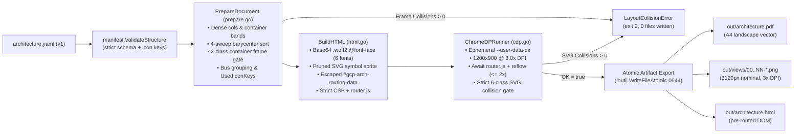
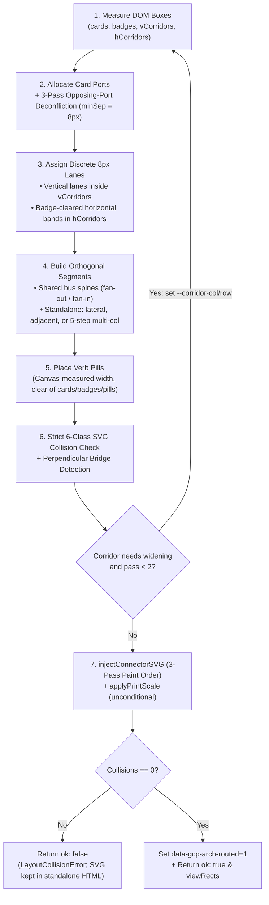

# Stage 3 — Offline Rendering & Routing

Stage 3 (`gcp-arch render`) compiles a validated, Git-tracked `architecture.yaml` manifest into print-ready deliverables — vector **A4 landscape PDF** (`out/architecture.pdf`), high-DPI **`3x` per-view PNGs** (`out/views/<00..NN>-<view_id>.png`), and a self-contained **HTML dossier** (`out/architecture.html`).

Rendering operates **100% offline** with zero external network calls and zero `facts.json` dependency. Fonts, service icons, stylesheets, and the orthogonal corridor router are all embedded directly inside the static `gcp-arch` binary via Go `//go:embed`.

---

## Compilation Pipeline

[`render.Render`](https://github.com/arrase/gcp-arch/blob/main/internal/render/cdp.go#L119-L169) ([`internal/render/cdp.go`](https://github.com/arrase/gcp-arch/blob/main/internal/render/cdp.go)), invoked by [`cmd/gcp-arch/render.go`](https://github.com/arrase/gcp-arch/blob/main/cmd/gcp-arch/render.go) with defaults from [`cmd/gcp-arch/config.go`](https://github.com/arrase/gcp-arch/blob/main/cmd/gcp-arch/config.go), orchestrates structural validation, layout preparation, self-contained HTML assembly, headless browser routing + collision verification, and crash-safe atomic writes:

1. **Structural Gate ([`manifest.ValidateStructure`](https://github.com/arrase/gcp-arch/blob/main/internal/manifest/validate.go#L107-L113)):** Rejects schema, archetype, container nesting, verb length, bus group, or icon key errors before any rendering work begins (exit `2`). See [Manifest Schema & Validation](manifest_schema.md).
2. **Layout Preparation ([`PrepareDocument`](https://github.com/arrase/gcp-arch/blob/main/internal/render/prepare.go#L105-L151) in [`internal/render/prepare.go`](https://github.com/arrase/gcp-arch/blob/main/internal/render/prepare.go)):** Resolves dense grid columns, packs non-overlapping card and container-frame row bands in `placements[]` order ([`allocateContainerBands`](https://github.com/arrase/gcp-arch/blob/main/internal/render/prepare.go#L304-L331)), executes `2` bidirectional barycenter passes (**4 sweeps** via [`runBarycenterSweeps`](https://github.com/arrase/gcp-arch/blob/main/internal/render/prepare.go#L372-L394)), verifies container frames against 2 pre-browser structural collision classes ([`checkContainerFrames`](https://github.com/arrase/gcp-arch/blob/main/internal/render/prepare.go#L468-L506), returning `*LayoutCollisionError` before HTML emission or Chrome launch), calculates flat container bounding spans, assigns explicit and automatic bus spines, picks clear horizontal waypoint corridors, computes dynamic card port heights, attaches URI-sorted `excluded_resources` to `views[0].Excluded`, and collects the exact subset of `UsedIconKeys`.
3. **Offline HTML Compilation ([`BuildHTML`](https://github.com/arrase/gcp-arch/blob/main/internal/render/html.go#L194-L242) in [`internal/render/html.go`](https://github.com/arrase/gcp-arch/blob/main/internal/render/html.go)):** Executes Go's `html/template` with bundled base64 `.woff2` fonts, [`diagram.css`](https://github.com/arrase/gcp-arch/blob/main/internal/render/assets/diagram.css), the pruned SVG icon sprite, JSON-escaped routing metadata, and [`router.js`](https://github.com/arrase/gcp-arch/blob/main/internal/render/assets/router.js).
4. **Headless Routing & Export ([`ChromeDPRunner.Render`](https://github.com/arrase/gcp-arch/blob/main/internal/render/cdp.go#L316-L433) in [`internal/render/cdp.go`](https://github.com/arrase/gcp-arch/blob/main/internal/render/cdp.go)):** Opens the compiled HTML via `file://` in an isolated local Chrome/Chromium instance, awaits `window.__GCP_ARCH_RENDER_PROMISE__`, fails immediately with `*LayoutCollisionError` (exit `2`, writing zero files) if any of the 6 SVG geometry collisions remain after corridor widening, and captures `3x` PNGs, vector PDF pages, and pre-routed HTML.
5. **Atomic Artifact Writes ([`internal/ioutil/atomic.go`](https://github.com/arrase/gcp-arch/blob/main/internal/ioutil/atomic.go#L19-L67)):** Persists all requested outputs via temp file → `Sync` → `Chmod(0644)` → `Close` → `Rename`, guaranteeing consumers never observe partial artifacts.

---

## Zero-Network & Security Guarantees

Every HTML dossier emitted by `BuildHTML` is designed to be safe when opened locally from `file://`, attached to tickets, or shared across air-gapped environments:

| Security Control | Implementation ([`internal/render/html.go`](https://github.com/arrase/gcp-arch/blob/main/internal/render/html.go) & [`internal/icons/`](https://github.com/arrase/gcp-arch/tree/main/internal/icons)) | Guarantee |
| :--- | :--- | :--- |
| **Strict Content Security Policy** | `<meta http-equiv="Content-Security-Policy" content="default-src 'none'; style-src 'unsafe-inline'; font-src data:; img-src data:; script-src 'unsafe-inline'">` ([`ContentSecurityPolicy`](https://github.com/arrase/gcp-arch/blob/main/internal/render/html.go#L22)) | Blocks all external network fetches (`http:`, `https:`, `ws:`, XHR, beacons, external stylesheets/fonts/images). |
| **HTML Context Escaping** | Go `html/template` auto-escapes all manifest fields (titles, subtitles, `inline_meta`, `off_page_refs`, `inference_rationale`, `excluded_resources`, container badges) | Neutralizes raw HTML/script injection payloads across all text and attribute contexts. |
| **Safe JSON `` breakout attacks from crafted edge verbs or component IDs. |
| **XML Attribute & Text Escaping** | `encoding/xml.EscapeText` ([`escapeXML`](https://github.com/arrase/gcp-arch/blob/main/internal/icons/registry.go#L398-L403)) escapes all compiled `<symbol>` attributes and text nodes | Prevents XML injection in inline SVG sprites. |
| **Embedded Base64 `.woff2` Fonts** | 6 bundled `.woff2` files encoded once via `sync.Once` into inline `data:font/woff2;base64,...` `@font-face` rules with `font-display:block` | Identical typography and deterministic pill text measurement offline across Linux, macOS, and Windows. |
| **Pruned Inline SVG Sprite** | [`reg.SymbolSprite(doc.UsedIconKeys)`](https://github.com/arrase/gcp-arch/blob/main/internal/icons/registry.go#L112-L157) emits only `<symbol id="gcp-icon-<key>">` definitions actually referenced by the manifest (plus hoisted `<defs>`) | Zero external image requests and minimal HTML payload size. |

### Bundled Embedded Fonts

Six `.woff2` font weights are embedded via `//go:embed assets/fonts/*.woff2` ([`internal/render/assets/fonts/`](https://github.com/arrase/gcp-arch/tree/main/internal/render/assets/fonts)):

| Font Family | Weight | Embedded File | Usage in Diagrams |
| :--- | :---: | :--- | :--- |
| **Inter** | `400` | `Inter-Regular.woff2` | View subtitles, `INFERRED` edge footnotes, `excluded_resources` footer entries, general body text |
| **Inter** | `500` | `Inter-Medium.woff2` | Legend labels, `inline_meta` keys, SVG connector verb pills (`8.5px`) |
| **Inter** | `600` | `Inter-SemiBold.woff2` | Component titles (`13px`), container badges (`9.5px`), stage banners, off-page pills |
| **Inter** | `700` | `Inter-Bold.woff2` | View header titles (`16px`) |
| **JetBrains Mono** | `400` | `JetBrainsMono-Regular.woff2` | Component subtitles (`10.5px`) and `inline_meta` values (`9px`) |
| **JetBrains Mono** | `500` | `JetBrainsMono-Medium.woff2` | Numbered `[N]` footnote tags and `Excluded (<N>)` tag in the view footer |

---

## Sheet Geometry & CSS Grid Layout

Each view renders inside a `<section class="view-sheet">` container with fixed nominal horizontal geometry ([`internal/render/assets/diagram.css`](https://github.com/arrase/gcp-arch/blob/main/internal/render/assets/diagram.css)):

- **Fixed Nominal Sheet Width:** `.document-root` and `.view-sheet` start locked to **`1040px`** wide (`padding: 12px 14px 10px 14px`), with `break-after: page` and `break-inside: avoid` so every view maps cleanly to one PDF page. During routing, corridor widening can expand `sheet.scrollWidth` past `1040px`.
- **A4 Landscape Print Page:** `@page { size: A4 landscape; margin: 10mm; }` paired with `print-color-adjust: exact`.
- **Automatic Print-Only Scaling (`applyPrintScale`):** After injecting connectors, [`applyPrintScale`](https://github.com/arrase/gcp-arch/blob/main/internal/render/assets/router.js#L1312-L1320) computes `scale = Math.min(1, PRINT_MAX_HEIGHT / height, PRINT_MAX_WIDTH / sheet.scrollWidth)` (where `PRINT_MAX_HEIGHT = 708` and `PRINT_MAX_WIDTH = 1040`). Whenever `scale < 1`, it sets `--print-scale: scale.toFixed(4)` on `.view-sheet`, applied exclusively inside `@media print { .view-sheet { zoom: var(--print-scale, 1); } }` so screen and PNG rendering remain unscaled while tall or corridor-widened sheets still fit cleanly on one A4 landscape PDF page.
- **5-Column Compact Mode (`data-cols="5"`):** Views spanning all 5 columns (`0..4`) automatically receive tighter sheet padding (`10px 12px 8px 12px`), compact card padding (`6px 7px`), `20×20px` icons (down from `24×24px`), `11.5px` titles, `9.5px` subtitles, and `8.5px` metadata rows so 5-column matrices remain readable within `1040px`.

### Interleaved Content & Corridor Grid Tracks

Instead of overlapping connectors directly over card margins, [`buildGridTracks`](https://github.com/arrase/gcp-arch/blob/main/internal/render/prepare.go#L783-L831) ([`internal/render/prepare.go`](https://github.com/arrase/gcp-arch/blob/main/internal/render/prepare.go)) interleaves explicit content tracks and routing corridor tracks inside `.view-grid`:

- **Column Tracks (`ColTracksCSS`):** Content columns use `minmax(0, 1fr)` at odd CSS Grid indices (`1, 3, 5, ...`), separated by vertical corridor columns (`var(--corridor-col-<i>, var(--corridor-col-default))`) at even indices (`2, 4, 6, ...`).
  - Default `--corridor-col-default` is **`56px`** (`landscape_matrix`, `hub_spoke`), widened to **`64px`** on `data-archetype="stage_pipeline"`.
  - If a single-column view contains a same-column lateral edge, `HasRightEdgeCol` appends a trailing vertical corridor on the right (`corridorCols` count = `numCols`).
- **Row Tracks (`RowTracksCSS`):** Horizontal corridor rows sit at odd CSS Grid indices (`1, 3, 5, ...`, spanning `0..numRows`), sandwiching `auto`-sized card content rows at even indices (`2, 4, 6, ...`). Each horizontal corridor starts with a deterministic default height based on what occupies that row boundary:

| Priority | Condition at Corridor Row `r` (`defaultRowCorridorTrack`) | Default Track Size | Purpose |
| :---: | :--- | :--- | :--- |
| 1 | `hasWaypoint && hasInnerTop` | `calc(var(--corridor-row-default) + 46px)` (**`94px`**) | Multi-column waypoint lanes above nested depth-1 + depth-2 top badges (`48px + 46px`) |
| 2 | `hasInnerTop` | **`52px`** | Stacked depth-1 outer container badge (`-43px`) + depth-2 inner badge (`-19px`) sharing `minRow` |
| 3 | `hasWaypoint` | `var(--corridor-row-default)` (**`48px`**) | Multi-column horizontal waypoint trunk + verb pills |
| 4 | `hasBadge` | **`32px`** | Standard depth-1 or standalone container top badge (`-23px`) |
| 5 | Default (no waypoint, no badge) | **`18px`** | Clean vertical breathing room between adjacent rows |

- **Dynamic Card Port Heights:** When a component card accumulates `>= 3` edge ports on its left or right side (`max(portCounts[id|L], portCounts[id|R])`), `buildPreparedCards` sets an explicit inline `min-height: max(54, 24 + (maxPorts - 1) * 24)px` so ports always retain generous vertical separation.

### Container Band Packing & 4-Sweep Barycenter Row Ordering

Before container spans or routes are computed, [`PrepareDocument`](https://github.com/arrase/gcp-arch/blob/main/internal/render/prepare.go#L188-L192) runs a two-phase deterministic row layout in [`internal/render/prepare.go`](https://github.com/arrase/gcp-arch/blob/main/internal/render/prepare.go):

1. **Container Band Packing ([`allocateContainerBands`](https://github.com/arrase/gcp-arch/blob/main/internal/render/prepare.go#L298-L361)):** Cards and containers are organized into a tree of `layoutBlock` rectangles (top-level cards and container frames under the root, nested containers as sub-bands). At every tree level, children are visited in `placements[]` first-appearance order and placed at the lowest relative row where their `(column span × height)` rectangle overlaps no previously placed sibling (`packBlock` / `blocksOverlap`), assigning each container a contiguous non-overlapping row band across its columns.
2. **4-Sweep Bidirectional Barycenter Ordering ([`runBarycenterSweeps`](https://github.com/arrase/gcp-arch/blob/main/internal/render/prepare.go#L363-L394)):** For multi-column views, `runBarycenterSweeps` reduces cross-column edge crossings over `barycenterSweepIterations = 2` full bidirectional iterations (**4 sweeps total**):
   - **Left → Right (`c = 1 .. numCols-1`):** Anchors column `0` and sorts interior/right columns by the median current row of each card's cross-column neighbors.
   - **Right → Left (`c = numCols-2 .. 0`):** Anchors column `numCols-1` and sweeps back toward the left edge.
   - This L→R + R→L pair runs twice (`2 × 2 = 4` sweeps).

Container bands are strictly preserved by [`sortColumnByBarycenter`](https://github.com/arrase/gcp-arch/blob/main/internal/render/prepare.go#L396-L422): each column visit groups the column's cards strictly by their direct container `s.cont` (`""` for uncontained cards) and permutes each group over the sorted row indices it already occupies. Within each group, cards with at least one cross-column neighbor (`hasBary == true`) always sort before cards without cross-column neighbors (`hasBary == false`), ordered by median neighbor row, with the original `placements[]` YAML index (`yamlIdx`) breaking ties.

### Archetypes, Containers, Edges & Visual Conventions

#### Layout Archetypes

| Archetype | Column Bounds | Column Compaction | Special Rendering Behavior |
| :--- | :---: | :--- | :--- |
| `landscape_matrix` | `0..4` | Sparse columns compacted into dense indices | General multi-tier landscapes and `view_0_system_index`; enters compact mode at `data-cols="5"`. |
| `stage_pipeline` | `0..4` | Sparse columns compacted into dense indices | Widens `--corridor-col-default` to `64px` and renders automatic uppercase `.stage-banners` above every column derived from the dominant `ComponentKind` (`Stage N · Source`, `Ingress`, `Build & CI`, `Workloads`, `Messaging`, `Artifacts & State`, `Services`, `Deploy Targets`, or `Stage N`). |
| `hub_spoke` | `0..2` (locked) | Always fixed 3 columns (`0`, `1`, `2`) | Centers the hub component(s) in column `1` with left (`0`) and right (`2`) spoke columns, supporting directional hub fan-out/fan-in buses. |

#### Flat Depth-1 & Depth-2 Containers

Containers are rendered as flat background grid items (`.arch-container`) spanning `2*minCol+1 / 2*maxCol+2` and `2*minRow+2 / 2*maxRow+3` with separate top-left badges (`.arch-container-badge`) anchored strictly inside `(minCol, minRow)`. Active nesting depth is computed by [`buildViewParents`](https://github.com/arrase/gcp-arch/blob/main/internal/render/prepare.go#L250-L264) and [`structuralDepth`](https://github.com/arrase/gcp-arch/blob/main/internal/render/prepare.go#L266-L273) relative to the nearest ancestor also listed in `view.container_ids` (mirroring `viewContainerDepth`), and any container in `view.container_ids` with zero placed cards (`spans[cid] == nil`) is omitted from the rendered DOM ([`buildPreparedContainers`](https://github.com/arrase/gcp-arch/blob/main/internal/render/prepare.go#L532-L536)):

- **Depth 1 (`data-depth="1"`):** `#F8FAFC` background, `1px solid #94A3B8` border, negative top margin `-26px` (expanded to `-46px` when `data-has-inner-top="1"` because a depth-2 child starts on the same `minRow`).
- **Depth 2 (`data-depth="2"`):** `#F1F5F9` nested background, `1px solid #CBD5E1` border, `-22px` top margin, `z-index: 2` (painted above depth 1 and below cards at `z-index: 3`).
- **Dashed Boundary Zones:** Containers with `kind: PSA_ZONE` or `kind: EXTERNAL_ZONE` automatically render with `border-style: dashed` to distinguish Google-managed Private Services Access / PSC zones and external SaaS/Internet boundaries from customer-owned GCP projects and VPCs.

#### Edge Flow Color Tokens, Provenance, Footnotes & `View 0` Card Synthesis

| Token / Attribute | Color / Style | Meaning & Usage |
| :--- | :--- | :--- |
| `flow_kind: RUNTIME` | `#1D4ED8` (blue, `1.5px` solid) | Live runtime traffic, ingress, database/cache access, streaming pipelines, and PSA/PSC peering. |
| `flow_kind: CICD` | `#B45309` (amber, `1.5px` solid) | Source triggers, builds, artifact pushes, Terraform state/modules, and cross-project deployments. |
| `flow_kind: ADMIN` | `#475569` (slate, `1.5px` solid) | Administrative, telemetry, IAM, or control-plane flows. |
| `provenance: INFERRED` | `stroke-dasharray: "5 3"` + `[N]` suffix on verb pill | Model-inferred edge without a complete `FactEdge` walk; automatically appends a numbered `[N] from -> to: <rationale>` footnote inside `<footer class="view-footnotes">` below the view sheet. |
| `excluded_resources` *(on `views[0]`)* | `Excluded (<N>)` tag in `<footer class="view-footnotes">` | [`PrepareDocument`](https://github.com/arrase/gcp-arch/blob/main/internal/render/prepare.go#L42) attaches URI-sorted `m.ExcludedResources` to `views[0].Excluded` ([`prepare.go:132-138`](https://github.com/arrase/gcp-arch/blob/main/internal/render/prepare.go#L132-L138)), and [`html.go:172-181`](https://github.com/arrase/gcp-arch/blob/main/internal/render/html.go#L172-L181) renders `Excluded (<N>) <uri>: <reason>; ...` in the first view's footer. |
| `accent_mode` & `View 0` Card Synthesis | View-level accent + synthesized `View 0` cards | On `view_0_system_index`, [`resolveCard`](https://github.com/arrase/gcp-arch/blob/main/internal/render/prepare.go#L890-L930) + [`systemIndexViewIcon`](https://github.com/arrase/gcp-arch/blob/main/internal/render/prepare.go#L932-L952) synthesize detail-view cards with icons by archetype/accent (`stage_pipeline` → `cloud_build`, `hub_spoke` → `virtual_private_cloud`, `landscape_matrix` → `cloud_build` when `CICD` or `google_kubernetes_engine` otherwise, falling back to `family_compute`), two `InlineMeta` rows (`Archetype`, `Blocks`), and a default subtitle (`"<N> components · <archetype>"` when `dv.Subtitle` is empty). [`BuildSystemIndexView`](https://github.com/arrase/gcp-arch/blob/main/internal/synth/view0.go#L18-L60) also uses `accent_mode` via `flowFromAccent` (`CICD` vs `RUNTIME`) for cross-view `View 0` edges. |

#### Off-Page Reference Pills & Bus Spine Grouping

- **Off-Page References (`off_page_refs`):** Rendered at the bottom of a card as rounded blue pills (`.off-page-pill`, `#EFF6FF` fill, `#1D4ED8` text) prefixed with `←` (`IN`) or `→` (`OUT`), signaling navigation into sibling views.
- **Shared Bus Grouping ([`assignBusGroups`](https://github.com/arrase/gcp-arch/blob/main/internal/render/prepare.go#L557-L649) in [`prepare.go`](https://github.com/arrase/gcp-arch/blob/main/internal/render/prepare.go)):** Reduces connector clutter by merging `>= 2` same-direction horizontal edges into a shared vertical bus spine with `2.5px` junction dots:
  1. **Explicit Buses (`via_bus_id`):** Edges sharing `(via_bus_id, horizontal_dir)` with `len >= 2` form an explicit bus (`explicit_<via_bus_id>_<dir>`). Splitting by direction (`-1` left, `+1` right) allows a central hub in `hub_spoke` views to fan out bidirectionally under one `via_bus_id`. When all edges share one source, `bus_kind = "out"` (fan-out); otherwise `bus_kind = "in"` (fan-in).
  2. **Automatic Fan-Out & Fan-In Buses:** Remaining ungrouped horizontal edges with `len >= 2` sharing `(from, flow_kind, dir)` auto-group into `auto_out_*` fan-out buses, followed by `(to, flow_kind, dir)` into `auto_in_*` fan-in buses.

---

## Orthogonal Corridor Router (`router.js`)

After fonts finish loading (`await document.fonts.ready`) and two animation frames settle CSS Grid layout, [`internal/render/assets/router.js`](https://github.com/arrase/gcp-arch/blob/main/internal/render/assets/router.js) measures DOM bounding boxes and constructs crisp orthogonal SVG connectors inside `<svg class="connector-layer">` (`z-index: 4`) for every `.view-sheet`.

### Exact Routing & Collision Constants

| Constant ([`router.js`](https://github.com/arrase/gcp-arch/blob/main/internal/render/assets/router.js#L10-L26)) | Value | Role |
| :--- | :---: | :--- |
| `CARD_CLEARANCE` | `4px` | Minimum clearance between any non-incident connector segment or verb pill and any `.arch-card` |
| `BADGE_CLEARANCE` | `4px` | Minimum clearance between any connector segment or verb pill and any `.arch-container-badge` |
| `PILL_CLEARANCE` | `4px` | Minimum separation between any two placed verb pills |
| `COLLINEAR_MIN_SEP` | `6px` | Minimum orthogonal separation between parallel segments of distinct edges with `> 1px` overlap |
| `LANE_STEP` | `8px` | Center-to-center spacing between adjacent discrete lanes inside a corridor |
| `CORRIDOR_WALL_PAD` | `12px` | Inset padding from vertical and horizontal corridor walls when allocating lanes |
| `MAX_CORRIDOR_SIZE` | `160px` | Upper bound for automatic `--corridor-col-*` / `--corridor-row-*` widening during reflow |
| `MAX_REFLOW_PASSES` | `2` | Maximum automatic corridor-widening reflow passes after initial pass `0` (up to 3 total passes) |
| `PRINT_MAX_HEIGHT` | `708` | Maximum print height in DIPs used by `applyPrintScale` to fit each sheet onto one A4 landscape page |
| `PRINT_MAX_WIDTH` | `1040` | Maximum print width in DIPs used by `applyPrintScale` to shrink corridor-widened sheets onto one A4 landscape page |
| `PORT_CORNER_MARGIN` | `10px` | Top/bottom inset along card sides when evenly distributing edge ports |
| `PILL_HEIGHT` | `15px` | Fixed height of SVG connector verb pills (`PILL_PAD_X = 5px`, `PILL_FONT_SIZE = 8.5px`) |
| `BRIDGE_RADIUS` | `4px` | Semicircular jump-arc radius (`A 4 4`) where a horizontal segment crosses a perpendicular vertical segment |
| `JUNCTION_RADIUS` | `2.5px` | Filled circle radius at shared bus trunk and branch taps |

### Routing Algorithm Walkthrough

1. **Port Allocation & 3-Pass Opposing-Port Deconfliction:**
   - Ports on each card side (`left` or `right`) are sorted by neighbor `cy` (`sortY`) and distributed evenly between `card.top + 10px` and `card.bottom - 10px`.
   - `deconflictCorridorPorts` then runs **3 passes** across opposing left-side and right-side ports sharing the same vertical corridor, nudging distinct edge/bus ports apart to at least `minSep = COLLINEAR_MIN_SEP + 2` (**`8px`**) so opposing horizontal taps never collide collinearly.
2. **Discrete Corridor Lane Assignment:**
   - Vertical lanes (`assignVerticalLanes`) distribute buses and standalone turns across `[vc.left + 12px, vc.right - 12px]` at `8px` (`LANE_STEP`) intervals.
   - Horizontal lanes (`assignHorizontalLanes`) first subtract any overlapping `.arch-container-badge` intervals (`clearHorizontalBand`) before placing multi-column horizontal trunks in the widest unobstructed band.
3. **Bus Spines vs. Standalone Edge Topologies:**
   - **Shared Bus Spines (`routeAllBuses`):** Draws a single trunk from the shared node to a vertical spine (`computeBusSpineX` biases single-spine buses in `>= 72px` corridors toward the trunk side to open horizontal room for branch verb pills), taps each adjacent branch horizontally (or routes remote multi-column branches through their assigned `waypoint_row`), and drops `2.5px` junction dots where branches join the spine.
   - **Same-Column Lateral Edges (`es.dir === 0`):** Detours orthogonally into the assigned adjacent corridor via a 3-step loop ([`recordEdgePorts`](https://github.com/arrase/gcp-arch/blob/main/internal/render/prepare.go#L721-L739)). `lateral_side = "left"` applies only when `fs.gridCol == numCols - 1 && numCols > 1`; all other columns—including single-column views (`numCols == 1`, which append a right-edge corridor via `HasRightEdgeCol`)—use `lateral_side = "right"`.
   - **Adjacent-Column Edges (`|Δcol| === 1`):** Draws a direct horizontal line when `|pFrom.y - pTo.y| < 1px`, or a 3-step orthogonal jog through the intervening vertical corridor lane.
   - **Multi-Column Edges (`|Δcol| > 1`):** Routes a **5-step** orthogonal path: source tap → vertical drop/rise in `startVC` → horizontal trunk along the badge-free `waypoint_row` corridor chosen by [`pickClearWaypointRow`](https://github.com/arrase/gcp-arch/blob/main/internal/render/prepare.go#L860-L888) → vertical segment in `endVC` → target tap.
4. **Verb Pill Placement (`placeVerbPills`):** Measures exact label widths using an offscreen HTML5 `<canvas>` context configured with `500 8.5px Inter, sans-serif` (appending `[N]` for `INFERRED` edges), then scans candidate positions along horizontal segments (`dy` offsets `0, ±12, ±22` and fractional spans) and vertical segments until a rectangle clears all cards (`4px`), badges (`4px`), and previously placed pills (`4px`).
5. **Corridor-Widening Reflow (Up to `2` Passes):** Before accepting a layout, [`applyCorridorWidening`](https://github.com/arrase/gcp-arch/blob/main/internal/render/assets/router.js#L1111-L1164) widens any vertical corridor to `Math.min(MAX_CORRIDOR_SIZE, Math.max(24 + LANE_STEP * lanes, pillRes))` and any horizontal corridor (`lanes > 0`) to `Math.min(MAX_CORRIDOR_SIZE, 24 + LANE_STEP * lanes + badgeRes + 12)` ([`router.js:1133`](https://github.com/arrase/gcp-arch/blob/main/internal/render/assets/router.js#L1133)), setting `--corridor-col-<c>` / `--corridor-row-<r>` CSS custom properties and forcing synchronous reflow. If no corridor was widened yet collisions remain (`!widened && passRes.collisions.length > 0`), the fallback pushes every corridor with `lanes > 0` below `MAX_CORRIDOR_SIZE` (`160px`) straight to `MAX_CORRIDOR_SIZE` ([`router.js:1141-1158`](https://github.com/arrase/gcp-arch/blob/main/internal/render/assets/router.js#L1141-L1158)).
6. **3-Pass SVG Paint Order & Print Scaling ([`injectConnectorSVG`](https://github.com/arrase/gcp-arch/blob/main/internal/render/assets/router.js#L1194-L1310) + [`applyPrintScale`](https://github.com/arrase/gcp-arch/blob/main/internal/render/assets/router.js#L1314-L1320)):** Executed unconditionally for every sheet **before** the zero-collision gate ([`router.js:1366-1383`](https://github.com/arrase/gcp-arch/blob/main/internal/render/assets/router.js#L1366-L1383)), so a browser-opened standalone HTML file still displays its connectors even if collisions occurred:
   - **Pass 1:** Draws all non-bridged `<line>` segments (including every vertical segment and bus spine) underneath bridges.
   - **Pass 2:** Draws bridged horizontal `<path>` segments on top: first a `5.5px` `#FFFFFF` halo (`data-bridge-halo="1"`) that cleanly masks underlying vertical lines, then the `1.5px` colored arc path (`data-bridge="1"`, radius `4px`, dashed `5 3` if `INFERRED`).
   - **Pass 3:** Paints `2.5px` bus junction circles, crisp `6 × 6.4px` triangular arrowheads, and white-filled rounded verb pill groups (`<g class="verb-pill">`) on top of all lines.
   - Only when `allCollisions.length === 0` does `runRouter` set `data-gcp-arch-routed="1"` and return `ok: true`.

### Strict Collision Verification & `LayoutCollisionError`

Stage 3 enforces **8** strict collision classes in total—**2** pre-browser structural checks in [`PrepareDocument`](https://github.com/arrase/gcp-arch/blob/main/internal/render/prepare.go#L101-L131) -> [`checkContainerFrames`](https://github.com/arrase/gcp-arch/blob/main/internal/render/prepare.go#L466-L506) (which execute before HTML emission or Chrome launch, including during `--format html` Chrome-free fallback) plus **6** SVG geometry checks in [`router.js`](https://github.com/arrase/gcp-arch/blob/main/internal/render/assets/router.js#L1091-L1095) after the final reflow pass. Any non-zero collision list aborts `gcp-arch render` with [`*LayoutCollisionError`](https://github.com/arrase/gcp-arch/blob/main/internal/render/cdp.go#L43-L58) (**exit code `2`**) and writes **zero** output files:

| Phase | Collision Kind (`Collision.Kind`) | Trigger Condition |
| :--- | :--- | :--- |
| **Pre-Browser (`prepare.go`)** | `container_frame_collision` | A card lies inside the `(minCol..maxCol, minRow..maxRow)` grid rectangle of a container it does not belong to ([`checkContainerFrames`](https://github.com/arrase/gcp-arch/blob/main/internal/render/prepare.go#L478-L489)). |
| **Pre-Browser (`prepare.go`)** | `container_overlap_collision` | Two non-nested sibling container frames have intersecting grid rectangles ([`checkContainerFrames`](https://github.com/arrase/gcp-arch/blob/main/internal/render/prepare.go#L490-L503)). |
| **SVG Geometry (`router.js`)** | `card_segment_collision` | A connector segment penetrates an incident card's interior (`1.5px` inset) or violates `4px` (`CARD_CLEARANCE`) around any non-incident card. |
| **SVG Geometry (`router.js`)** | `badge_segment_collision` | A connector segment violates `4px` (`BADGE_CLEARANCE`) around any `.arch-container-badge`. |
| **SVG Geometry (`router.js`)** | `pill_card_collision` | A placed verb pill overlaps any `.arch-card` within `4px` (`CARD_CLEARANCE`). |
| **SVG Geometry (`router.js`)** | `pill_badge_collision` | A placed verb pill overlaps any `.arch-container-badge` within `4px` (`BADGE_CLEARANCE`). |
| **SVG Geometry (`router.js`)** | `pill_pill_collision` | Any two placed verb pills violate `4px` (`PILL_CLEARANCE`) separation. |
| **SVG Geometry (`router.js`)** | `collinear_collision` | Parallel segments from distinct edges run closer than `6px` (`COLLINEAR_MIN_SEP`) while overlapping longitudinally by more than `1px`. |

!!! note "Zero-Overlap Philosophy"
    Perpendicular crossings between distinct edges are **not** collisions — they are resolved cleanly with `4px` jump-arc bridges and `5.5px` white halos. Only true visual defects (foreign cards enclosed by or overlapping container frames, lines touching cards/badges, overlapping pills, or merged/touching parallel tracks) trigger `LayoutCollisionError`.

---

## Headless Chrome / `chromedp` Export

[`ChromeDPRunner`](https://github.com/arrase/gcp-arch/blob/main/internal/render/cdp.go#L308-L433) ([`internal/render/cdp.go`](https://github.com/arrase/gcp-arch/blob/main/internal/render/cdp.go)) drives a single local Chrome or Chromium session over the Chrome DevTools Protocol (`chromedp`), configured by [`cmd/gcp-arch/render.go`](https://github.com/arrase/gcp-arch/blob/main/cmd/gcp-arch/render.go) and [`cmd/gcp-arch/config.go`](https://github.com/arrase/gcp-arch/blob/main/cmd/gcp-arch/config.go):

- **Session Isolation:** Creates a fresh `gcp-arch-chrome-*` temporary directory containing an ephemeral `0700` `profile/` (`--user-data-dir`) and `0600` `input.html`, then deletes the entire directory on exit (`defer os.RemoveAll`). Safe to run concurrently alongside an active desktop Chrome browser.
- **Hardened Launch Flags:** Launches with `--headless=new`, `--disable-gpu`, `--no-first-run`, `--no-default-browser-check`, `--disable-background-networking`, `--disable-sync`, `--disable-extensions`, `--metrics-recording-only`, and `--mute-audio`.
- **Conditional Container `--no-sandbox` Auto-Detection ([`needsNoSandbox`](https://github.com/arrase/gcp-arch/blob/main/internal/render/cdp.go#L436-L460)):** Never disables the sandbox on normal Linux/macOS workstations. Automatically appends `--no-sandbox` **only** on Linux when container markers are present (`/.dockerenv`, `/run/.containerenv`, or `docker`/`kubepods`/`containerd` in `/proc/1/cgroup`) **and** either `/proc/sys/kernel/unprivileged_userns_clone == "0"` or the process runs as `root` (`euid == 0`).
- **Upfront `3x` High-DPI Viewport:** Issues `emulation.SetDeviceMetricsOverride` (`Width: 1200`, `Height: 900`, `DeviceScaleFactor: 3.0`, `Mobile: false`) *before* navigating to `file://<workDir>/input.html`, so layout measurement and `page.CaptureScreenshot` share exact `3x` metrics.

### Output Artifacts & `--format` Behavior Matrix

| Artifact | Path | Format & Geometry |
| :--- | :--- | :--- |
| **Vector PDF** | `out/architecture.pdf` | One A4 landscape page per view (`PrintBackground: true`, `PreferCSSPageSize: true`), selectable embedded vector text & SVG connectors (scaled via `--print-scale` when height `> 708px` or width `> 1040px`). |
| **3x View PNGs** | `out/views/<00..NN>-<view_id>.png` | Clipped per `.view-sheet` (`CaptureBeyondViewport: true`, `Scale: 1` at `3.0x` device scale → **`3120px`** nominal for `1040px` sheets, expanding to **`3 × sheet.scrollWidth`** via `Math.max(r.width, sheet.scrollWidth)` in [`measureViewRects`](https://github.com/arrase/gcp-arch/blob/main/internal/render/assets/router.js#L52-L67) when corridor widening widens a sheet past `1040px`). |
| **Standalone HTML** | `out/architecture.html` | Single self-contained offline dossier (`0644`). Pre-routed (`data-gcp-arch-routed="1"` with baked `<svg class="connector-layer">` and `--print-scale`) when Chrome runs, or unrouted when Chrome-free fallback triggers. |

| Requested `--format` | Chrome Available | Explicit `--chrome-path` Missing | Auto-Discovery Finds No Chrome |
| :--- | :--- | :--- | :--- |
| `pdf,png,html` *(default)* | Writes vector PDF, `3x` PNGs, and pre-routed HTML; enforces all 8 collision classes (exit `0` / `2`). | Fails fast (exit `1`). | Fails fast (exit `1`): Chrome/Chromium required for `pdf`/`png`. |
| `pdf` or `png` | Writes requested PDF/PNG artifacts; enforces all 8 collision classes. | Fails fast (exit `1`). | Fails fast (exit `1`). |
| `html` *(alone)* | Runs headless Chrome, verifies all 8 collision classes, writes **pre-routed** `architecture.html` (`data-gcp-arch-routed="1"`). | Fails fast (exit `1`). | Graceful fallback ([`cmd/gcp-arch/render.go`](https://github.com/arrase/gcp-arch/blob/main/cmd/gcp-arch/render.go#L143-L155)): enforces pre-browser container frame collisions (exit `2` on failure), otherwise writes **unrouted** self-contained `architecture.html` (routes on open in any browser), prints `Wrote <out>/architecture.html` to `stdout` (unless `-q`), and prints a warning to `stderr` that browser collision checks were skipped (exit `0`). |

For Chrome discovery precedence (`--chrome-path` > `CHROME_PATH` > `config.yaml` > `PATH` > OS defaults, implemented in [`FindChrome`](https://github.com/arrase/gcp-arch/blob/main/internal/render/cdp.go#L272-L301) and [`cmd/gcp-arch/config.go`](https://github.com/arrase/gcp-arch/blob/main/cmd/gcp-arch/config.go#L55-L56)) and all CLI flags, see [CLI & Configuration](cli_configuration.md).

---

## Embedded Icon Registry ([`internal/icons/`](https://github.com/arrase/gcp-arch/tree/main/internal/icons))

`gcp-arch` embeds **85** curated inline SVG icons in [`internal/icons/assets/icons.yaml`](https://github.com/arrase/gcp-arch/blob/main/internal/icons/assets/icons.yaml) (`schema_version: v1`), loaded lazily via [`icons.Load()`](https://github.com/arrase/gcp-arch/blob/main/internal/icons/registry.go#L54-L59). Every `component.icon_key` in `architecture.yaml` must match one of these 85 keys.

### Complete 85-Icon Reference

| Category | Count | Registered `icon_key` Values |
| :--- | :---: | :--- |
| **Standard GCP2 Services** | **57** | `compute_engine`, `google_kubernetes_engine`, `anthos`, `cloud_run`, `cloud_functions`, `app_engine`, `batch`, `virtual_private_cloud`, `cloud_load_balancing`, `cloud_armor`, `cloud_router`, `cloud_vpn`, `cloud_interconnect`, `cloud_dns`, `cloud_external_ip_addresses`, `cloud_firewall_rules`, `certificate_manager`, `network_connectivity_center`, `private_service_connect`, `api_gateway`, `apigee_api_platform`, `identity_aware_proxy`, `cloud_storage`, `persistent_disk`, `filestore`, `cloud_sql`, `cloud_spanner`, `firestore`, `cloud_bigtable`, `memorystore`, `pubsub`, `eventarc`, `cloud_tasks`, `cloud_scheduler`, `workflows`, `bigquery`, `data_transfer`, `dataflow`, `datastream`, `dataproc`, `cloud_composer`, `dataplex`, `cloud_data_fusion`, `looker`, `vertexai`, `dialogflow`, `document_ai`, `identity_and_access_management`, `secret_manager`, `key_management_service`, `data_loss_prevention_api`, `artifact_registry`, `cloud_build`, `cloud_deploy`, `cloud_logging`, `cloud_monitoring`, `cloud_trace` |
| **Newer AI / Data / DB Services** | **12** | `alloydb`, `managed_kafka`, `dataproc_metastore`, `dataform`, `analytics_hub`, `vertex_agent_engine`, `vertex_vector_search`, `vertex_search`, `vertex_rag`, `foundation_model`, `mcp_server`, `model_armor` |
| **Generic Family Fallbacks** | **8** | `family_compute`, `family_network`, `family_storage`, `family_data`, `family_ai`, `family_integration`, `family_transversal`, `unclassified_warning` |
| **Governance & Hierarchy (L0)** | **3** | `gcp_organization`, `gcp_folder`, `project_cohort` |
| **External, PSA & Kubernetes** | **5** | `github`, `external_client`, `private_services_access`, `k8s_workload`, `k8s_ingress` |

### SVG Security Validation & `<defs>` Hoisting

At load time, every icon in `icons.yaml` passes through two deterministic compilation phases:

1. **Strict XML/XSS Validation ([`ValidateSVG`](https://github.com/arrase/gcp-arch/blob/main/internal/icons/validate.go#L80-L123) in [`internal/icons/validate.go`](https://github.com/arrase/gcp-arch/blob/main/internal/icons/validate.go)):**
   - Requires well-formed XML with a single `<svg>` root element and zero trailing content.
   - Rejects XML directives (`<!DOCTYPE ...>`, preventing XXE) and processing instructions (`<?xml-stylesheet ...?>`).
   - Rejects forbidden elements: `<script>`, `<foreignObject>`, `<iframe>`, `<embed>`, `<object>`.
   - Rejects all `on*` event handler attributes and any `xmlns` other than `http://www.w3.org/2000/svg` (including arbitrary prefixed `xmlns:*`).
   - Rejects dangerous URI schemes (`javascript:`, `vbscript:`, `data:`), `http://` / `https://` external URLs, protocol-relative `//` hrefs (including whitespace- and entity-obfuscated variants), CSS `@import`, `expression()`, backslash escapes, and any CSS `url(...)` not targeting a local `#id`.
2. **Symbol Compilation & `<defs>` Hoisting ([`compileIconSymbol`](https://github.com/arrase/gcp-arch/blob/main/internal/icons/registry.go#L265-L292) in [`internal/icons/registry.go`](https://github.com/arrase/gcp-arch/blob/main/internal/icons/registry.go)):**
   - Compiles each `<svg>` into `<symbol id="gcp-icon-<key>" viewBox="...">`. When `viewBox` is absent, [`fallbackViewBox`](https://github.com/arrase/gcp-arch/blob/main/internal/icons/registry.go#L381-L388) ([`registry.go:282-284`](https://github.com/arrase/gcp-arch/blob/main/internal/icons/registry.go#L282-L284)) first synthesizes `"0 0 <w> <h>"` from positive numeric root `<svg>` `width`/`height` attributes (stripping a trailing `"px"`), falling back to `"0 0 24 24"` only when valid positive dimensions are absent. Root `<svg>` attributes are filtered through an 8-attribute allowlist ([`isPreservedRootAttr`](https://github.com/arrase/gcp-arch/blob/main/internal/icons/registry.go#L370-L379): `fill`, `fill-rule`, `stroke`, `stroke-width`, `stroke-linecap`, `stroke-linejoin`, `clip-rule`, `preserveAspectRatio`), defaulting to `preserveAspectRatio="xMidYMid meet"` when absent.
   - Hoists `<defs>` blocks and standalone definition elements (`<filter>`, `<mask>`, `<linearGradient>`, `<radialGradient>`, `<clipPath>`, `<pattern>`) into a shared root `<defs>` inside the hidden sprite `<svg style="display:none">` — required so Chrome reliably resolves SVG filters/masks inside `<use href="#gcp-icon-...">` shadow trees (e.g., `pubsub`'s `<filter>` and `<mask>`).
   - Prefixes every internal `id`, `href="#..."`, `xlink:href="#..."`, and CSS/attribute `url(#...)` with `icon-<key>-` (such as `icon-pubsub-A` and `icon-pubsub-B`), preventing cross-icon ID collisions across the 85-icon catalog.

---

## Next Steps

- **Browse Rendered Output:** Inspect all 8 rendered `3x` PNGs across both reference architectures in [Examples & Visual Gallery](examples.md).
- **Manifest Rules:** Review every schema constraint enforced before rendering in [Manifest Schema & Validation](manifest_schema.md).
- **Extend Icons or Renderer:** Follow the icon-addition and Chrome test workflows in the [Developer Guide](developer_guide.md).
