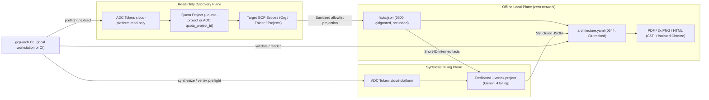

# Security, IAM & Preflight

**GCP Arch** is engineered for high-trust consulting, platform engineering, and enterprise governance environments where read-only discovery against production GCP estates must remain strictly isolated from AI billing, secret payloads, and outbound network access during rendering.

This guide details the OAuth trust boundaries, quota project resolution, GCP error classification, minimum IAM role matrix, the 7-stage `preflight` diagnostic command, credential scrubbing guarantees, atomic file permissions, and offline render hardening.

---

## Trust-Boundary Architecture & OAuth Scope Separation

`gcp-arch` enforces strict separation between **target infrastructure discovery** and **Vertex AI synthesis billing** using two independent OAuth scopes and separate client initializers:

* **Read-Only Discovery Plane (`internal/extract/client.go`):** `NewClients` requests Application Default Credentials strictly scoped to `https://www.googleapis.com/auth/cloud-platform.read-only` (`cloudPlatformReadOnlyScope`). Every gRPC and REST discovery call (`Cloud Asset Inventory`, `Cloud Monitoring`, `BigQuery`, `Dataflow`) carries only read-only tokens and bills API quota to the caller's quota project (`--quota-project` or ADC `quota_project_id`).
* **Vertex AI Synthesis Plane (`internal/synth/client.go` & Vertex preflight):** `newGenAIClient` and `newCloudPlatformHTTPClient` request `https://www.googleapis.com/auth/cloud-platform` (`cloudPlatformScope`) exclusively against the caller-designated `--vertex-project`. Target customer projects are **never** billed for Gemini inference or sent `cloud-platform` write tokens.
* **Air-Gapped Local Plane (`validate` & `render`):** Operates completely offline on Git-tracked `architecture.yaml` (and optional local `facts.json`) with zero GCP credentials and zero external network calls.



---

## Quota Project Resolution & GCP Error Classification

### Caller Quota Project Resolution (`ResolveQuotaProject`)

Google Cloud APIs such as Cloud Asset Inventory and Cloud Monitoring require a billing/quota project header (`X-Goog-User-Project`) when authenticated with user ADC. `ResolveQuotaProject` (`internal/extract/client.go:426-436`) resolves this strictly in two steps:

1. **Explicit override:** `--quota-project` CLI flag (or `quota_project` in `config.yaml`).
2. **ADC embedded quota project:** `quota_project_id` field inside the local ADC JSON (`~/.config/gcloud/application_default_credentials.json`).
3. **Otherwise empty (`""`):** No `X-Goog-User-Project` override is attached.

!!! warning "Never Falls Back to Target Workload Projects"
    `ResolveQuotaProject` deliberately **never** falls back to a scanned `--projects` target. This guarantees that scanning a customer's production workload project never silently bills quota to it or fails unexpectedly if `cloudasset.googleapis.com` is disabled in the customer project.

### Structured GCP Error Classification (`ClassifyGCPError`)

Both gRPC (`*errdetails.ErrorInfo` + gRPC status codes) and REST (`*googleapi.Error` `Details`, JSON `error.details`, `Errors[0].Reason`, and HTTP status codes) responses are classified by `ClassifyGCPError` (`internal/extract/client.go:125-297`) into seven `ErrorKind` categories to cleanly distinguish **fatal caller problems** from **non-fatal target degradations**:

| Error Condition / `ErrorInfo.Reason` | `ErrorKind` | Handling in `preflight` & `extract` | Exit Code |
| :--- | :--- | :--- | :---: |
| `USER_PROJECT_DENIED` | `QUOTA_FATAL` | **Fatal** (`*extract.QuotaProjectError`). Caller lacks `roles/serviceusage.serviceUsageConsumer` on the quota project; aborts immediately. | `1` |
| `SERVICE_DISABLED` or `BILLING_DISABLED` where `metadata.consumer` is the caller's quota project, does not match the target project, or no target project context exists (Org/Folder CAI) | `QUOTA_FATAL` | **Fatal** (`*extract.QuotaProjectError`). Caller's quota project has the required API or billing disabled; aborts immediately. | `1` |
| `SERVICE_DISABLED` or `BILLING_DISABLED` where `metadata.consumer` matches a distinct target child project (different from the caller's quota project) | `TARGET_SERVICE_DISABLED` | **Degraded** (non-fatal). Recorded as `SERVICE_DISABLED` in `PreflightReport` or `coverage_ledger`; scan continues across remaining scopes. | `0` |
| `VPC_SERVICE_CONTROLS`, `SECURITY_POLICY_VIOLATED`, or non-empty `metadata.vpcServiceControlsUniqueIdentifier` | `VPC_SC_BLOCKED` | **Degraded** (non-fatal). Captures `VPCSCUUID` for perimeter audit logs and records `VPC_SC_BLOCKED`; scan continues. | `0` |
| `IAM_PERMISSION_DENIED`, gRPC `PermissionDenied`, or HTTP `403` | `IAM_DENIED` | **Degraded** (non-fatal). Recorded as `DENIED` (`preflight`) or `IAM_DENIED` (`extract` `coverage_ledger`); scan continues with partial visibility. | `0` |
| gRPC `Unauthenticated` or HTTP `401` | `UNAUTHENTICATED` | **Fatal**. Expired or missing ADC credentials; aborts with `gcloud auth application-default login` remediation. | `1` |
| Other transport / API / internal errors | `OTHER` | **Fatal** in `preflight` and CAI streaming; propagated as runtime error. | `1` |

!!! note "Exact Disambiguation of `SERVICE_DISABLED`"
    In `classifyDisabledServiceKind` (`internal/extract/client.go:246-262`), `SERVICE_DISABLED` is treated as a harmless target degradation **only** when all three conditions hold:
    1. A target project ID or number is known for the call (e.g., per-project BigQuery, Dataflow, or Monitoring enrichment),
    2. `metadata["consumer"]` matches that target project ID or number, **and**
    3. The caller's quota project is **not** that same project.

    In every other case, `gcp-arch` classifies the failure as `QUOTA_FATAL` so caller-side setup mistakes are never silently swallowed.

---

## Minimum IAM Role Matrix

The table below lists every IAM role required or recommended across all three surfaces: **Target Scopes**, **Caller Quota Project**, and **Vertex AI Project**.

| Surface | IAM Role | Necessity | Exact API Calls Exercised | Impact If Missing |
| :--- | :--- | :--- | :--- | :--- |
| **Target Org / Folder / Project(s)** | `roles/cloudasset.viewer` | **Required** | `AssetService.ListAssets` (`ContentType=RESOURCE` and 20-type `IAM_POLICY`) | Scope records `IAM_DENIED` in `coverage_ledger`; zero assets discovered for that scope. |
| **Target Org / Folder** | `roles/resourcemanager.folderViewer` | **Recommended** *(Org/Folder scopes)* | `ListAssets(AssetTypes=["cloudresourcemanager.googleapis.com/Folder"])` `displayName` resolution | Folder nodes appear in `hierarchy.folders` with empty `display_name`; `preflight` flags `cai.folders` as `DENIED`. |
| **Target Project(s)** | `roles/monitoring.viewer` | **Recommended** | `MetricService.ListTimeSeries` (`serviceruntime.googleapis.com/api/request_count`, `aiplatform.googleapis.com/publisher/online_serving/model_invocation_count`, `consumed_token_throughput`) | Skips 7-day `MONITORING_TRAFFIC` edges and Vertex AI `PublisherModel` synthesis (`IAM_DENIED`). |
| **Target Project(s)** | `roles/bigquery.resourceViewer` | **Recommended** | `bigquery.jobs.list` (`AllUsers=true`, `Projection=full`, partial `Fields`) — USD 0 SQL slot cost | Skips 7-day `BQ_LINEAGE` (`sql_elt` and `bq_job`) edges (`IAM_DENIED`). |
| **Target Project(s)** | `roles/dataflow.viewer` | **Recommended** | `dataflow.projects.locations.jobs.list` (`Filter=ACTIVE`) and `.get` (`View=JOB_VIEW_DESCRIPTION`) | Skips active `dataflow.googleapis.com/Job` synthesis and pipeline `DisplayData` `CONFIG_REF` edges (`IAM_DENIED`). |
| **Caller Quota Project** | `roles/serviceusage.serviceUsageConsumer` | **Required** *(when using quota project)* | `X-Goog-User-Project` billing & quota checks across CAI, Monitoring, BigQuery, Dataflow *(also requires `cloudasset.googleapis.com` and `monitoring.googleapis.com` enabled on the quota project)* | **Fatal** `QuotaProjectError` (`USER_PROJECT_DENIED` / `SERVICE_DISABLED`), exit `1`. |
| **Vertex AI Project (`--vertex-project`)** | `roles/aiplatform.user` | **Required** *(Stage 2 synthesis & Vertex preflight)* | `projects:testIamPermissions` (`aiplatform.endpoints.predict`), `Models.Get` (zero-token preflight), `Models.GenerateContent` (Gemini 4 structured JSON) | Stage 2 `synthesize` fails with permission error; `preflight` flags `vertex.iam` / `vertex.model` as `DENIED`. |

### Copy-Pasteable `gcloud` Grant Commands

=== "Target Project Scope"
    ```bash
    PRINCIPAL="user:architect@example.com" # or serviceAccount:sa@proj.iam.gserviceaccount.com
    TARGET_PROJECT="acme-cicd"

    for ROLE in \
      roles/cloudasset.viewer \
      roles/monitoring.viewer \
      roles/bigquery.resourceViewer \
      roles/dataflow.viewer; do
      gcloud projects add-iam-policy-binding "${TARGET_PROJECT}" \
        --member="${PRINCIPAL}" \
        --role="${ROLE}"
    done
    ```

=== "Target Folder Scope"
    ```bash
    PRINCIPAL="user:architect@example.com"
    TARGET_FOLDER="555000111"

    for ROLE in \
      roles/cloudasset.viewer \
      roles/resourcemanager.folderViewer \
      roles/monitoring.viewer \
      roles/bigquery.resourceViewer \
      roles/dataflow.viewer; do
      gcloud resource-manager folders add-iam-policy-binding "${TARGET_FOLDER}" \
        --member="${PRINCIPAL}" \
        --role="${ROLE}"
    done
    ```

=== "Target Organization Scope"
    ```bash
    PRINCIPAL="user:architect@example.com"
    TARGET_ORG="123456789012"

    for ROLE in \
      roles/cloudasset.viewer \
      roles/resourcemanager.folderViewer \
      roles/monitoring.viewer \
      roles/bigquery.resourceViewer \
      roles/dataflow.viewer; do
      gcloud organizations add-iam-policy-binding "${TARGET_ORG}" \
        --member="${PRINCIPAL}" \
        --role="${ROLE}"
    done
    ```

=== "Quota Project & Vertex AI Project"
    ```bash
    PRINCIPAL="user:architect@example.com"
    QUOTA_PROJECT="consultant-ops"
    VERTEX_PROJECT="consultant-ai-sandbox"

    # Enable discovery APIs and grant Service Usage Consumer on the caller's quota project
    gcloud services enable cloudasset.googleapis.com monitoring.googleapis.com \
      --project="${QUOTA_PROJECT}"
    gcloud projects add-iam-policy-binding "${QUOTA_PROJECT}" \
      --member="${PRINCIPAL}" \
      --role=roles/serviceusage.serviceUsageConsumer

    # Enable Vertex AI API and grant AI Platform User on the dedicated --vertex-project
    gcloud services enable aiplatform.googleapis.com --project="${VERTEX_PROJECT}"
    gcloud projects add-iam-policy-binding "${VERTEX_PROJECT}" \
      --member="${PRINCIPAL}" \
      --role=roles/aiplatform.user
    ```

---

## `gcp-arch preflight` Deep Dive

`gcp-arch preflight` validates every required permission and zero-token Vertex AI readiness before you invest time in a multi-project extraction or synthesis run (`internal/extract/client.go:857-883`).

### The 7 Probe Stages in Execution Order

| Order | Probe `source` | Executed Against | Exact Lightweight Probe Call | Required Role |
| :---: | :--- | :--- | :--- | :--- |
| **1** | `cloudasset.googleapis.com` | Every sorted target scope (`--org`, `--folder`, `--projects`) | `Asset.ListAssets(Parent=scope, ContentType=RESOURCE, PageSize=1)` *(also extracts a sample child project from `Ancestors` when only Org/Folder scopes were supplied)* | `roles/cloudasset.viewer` |
| **2** | `cai.folders` | Every `organizations/...` and `folders/...` scope | `Asset.ListAssets(Parent=scope, AssetTypes=["cloudresourcemanager.googleapis.com/Folder"], ContentType=RESOURCE, PageSize=1)` — **explicitly checks whether a returned Folder has an empty `displayName`**; if empty, marks `DENIED` with `Folder displayName is empty; grant roles/resourcemanager.folderViewer to resolve folder names`. | `roles/resourcemanager.folderViewer` |
| **3** | `monitoring.googleapis.com` | Each explicit project *(or sample project discovered in Stage 1)* | `Monitoring.ListTimeSeries(Name=projects/<proj>, Filter='metric.type = "serviceruntime.googleapis.com/api/request_count"', Interval=[now-1h, now], View=HEADERS, PageSize=1)` | `roles/monitoring.viewer` |
| **4** | `bigquery.googleapis.com` | Each explicit / sample project | `BigQuery.Jobs.List(proj).AllUsers(true).MaxResults(1)` | `roles/bigquery.resourceViewer` |
| **5** | `dataflow.googleapis.com` | Each explicit / sample project | `Dataflow.Projects.Locations.Jobs.List(proj, "-").Filter("ACTIVE").PageSize(1)` | `roles/dataflow.viewer` |
| **6** | `vertex.iam` | `--vertex-project` *(only when set, using `cloud-platform` scope)* | `POST https://cloudresourcemanager.googleapis.com/v1/projects/<proj>:testIamPermissions` with `{"permissions":["aiplatform.endpoints.predict"]}` | `roles/aiplatform.user` |
| **7** | `vertex.model` | `--vertex-project` *(only when set, zero-token check)* | `synth.ProbeVertexModel` -> `google.golang.org/genai` `Models.Get(ctx, model, nil)` *(or fallback REST `GET /v1/projects/<proj>/locations/<loc>/publishers/google/models/<model>`)* — verifies model visibility & endpoint reachability at **0 token cost**. | `roles/aiplatform.user` |

After all stages complete, `RunPreflight` deterministically sorts `report.Probes` by `(Scope, Source)` before printing the table or `--json` output.

### All 6 `ProbeStatus` Values

| `ProbeStatus` | Meaning | Triggers Exit `1`? | Automated Remediation Generated |
| :--- | :--- | :---: | :--- |
| `GRANTED` | Probe succeeded with expected visibility (and non-empty folder `displayName` for `cai.folders`). | No (`0`) | None. |
| `DENIED` | Target IAM permission missing (`IAM_PERMISSION_DENIED`, HTTP `403`, missing `aiplatform.endpoints.predict`, or empty folder `displayName`). | No (`0`) | Scope-aware `gcloud projects|resource-manager folders|organizations add-iam-policy-binding ... --role=<REQUIRED_ROLE>`. |
| `VPC_SC_BLOCKED` | Blocked by a VPC Service Controls perimeter (`VPC_SERVICE_CONTROLS`, `SECURITY_POLICY_VIOLATED`, or `vpcServiceControlsUniqueIdentifier`). | No (`0`) | `Allow caller egress/ingress in VPC-SC perimeter (audit UUID: <UUID>)` *(also appended as `[vpc_sc_uuid=<UUID>]` in table detail)*. |
| `SERVICE_DISABLED` | API is disabled on a distinct target child project (caller quota project is healthy). | No (`0`) | None (normal when a target project does not use BigQuery or Dataflow). |
| `QUOTA_PROJECT_ERROR` | Caller quota project error (`USER_PROJECT_DENIED`, caller `SERVICE_DISABLED`, or caller `BILLING_DISABLED`). | **Yes (`1`)** | Reason-specific `gcloud services enable ...`, `roles/serviceusage.serviceUsageConsumer` binding, or billing link guidance. |
| `ERROR` | Unauthenticated ADC (`401`/`Unauthenticated`) or unexpected transport/API failure. | **Yes (`1`)** | For `Unauthenticated`: `Run 'gcloud auth application-default login' to refresh Application Default Credentials`. |

!!! tip "Exit Code Semantics for CI Automation"
    `preflight` evaluates errors using `firstError()` precedence (`QuotaProjectError` -> `Unauthenticated` -> unexpected `probeErr`). Target-scope degradations (`DENIED`, `VPC_SC_BLOCKED`, `SERVICE_DISABLED`) intentionally exit **`0`** because `extract` can still run with degraded coverage—check `missing_count` in `gcp-arch preflight --json` if your CI pipeline requires 100% probe coverage.

---

## Data Privacy, Credential Scrubbing & Offline Hardening

`gcp-arch` follows a **default-deny metadata architecture**: raw cloud payloads never leave memory, sensitive keys are unconditionally dropped, URLs are stripped of credentials, `facts.json` is stored `0600` atomically and gitignored, and offline rendering operates under a strict Content Security Policy.

### 1. Per-Asset Allowlist Projection (`ProjectAttributes`)

During Stage 1 extraction, `ProjectAttributes` (`internal/extract/sanitize.go:529-555`) constructs `FactResource.Attributes` strictly from an explicit allowlist of **75 asset type projectors** (`assetAttrProjectors`, lines `449-523`):

* Every projector extracts only typed structural fields needed for architecture synthesis (such as `cidr`, `vpc`, `subnet`, `machine_type`, `tier`, `database_version`, `ingress`, `service_account`, `kms_key_uri`, `mode`, `workload_pool`, `storage_class`, `schedule`, `repo_url`, `trigger_filter`, `dns_name`).
* Asset types not in the 75-entry allowlist return `nil` attributes.
* **Raw CAI `resource.data` structs are never serialized into `facts.json` and never sent to Vertex AI.**

### 2. Unconditionally Dropped Sensitive Keys (`sensitiveDroppedKeys`)

All **22** sensitive payload keys in `sensitiveDroppedKeys` (`internal/extract/sanitize.go:42-65`) are unconditionally excluded from emitted metadata. Where structural links live inside them (for example, container `env`/`args`/`command`, Cloud Build `script`, or ConfigMap `data`), `gcp-arch` scans them in memory with `ExtractSanitizedRefs` and discards the raw strings immediately:

| Category | Dropped Keys (`sensitiveDroppedKeys`) |
| :--- | :--- |
| **VM / Instance Bootstrap** | `startup-script`, `startup-script-url`, `shutdown-script`, `user-data` |
| **Environment & Secret Maps** | `env`, `envvariables`, `secretenv`, `environmentvariables`, `buildenvironmentvariables` |
| **Commands, Args & Scripts** | `args`, `command`, `script`, `substitutions` |
| **Kubernetes Payloads & History** | `data`, `binarydata`, `stringdata`, `kubectl.kubernetes.io/last-applied-configuration`, `last-applied-configuration` |
| **Queries, Schemas & Webhooks** | `query`, `rawquery`, `schema`, `webhookconfig` |

### 3. URL & Reference Sanitization (`SanitizeURL` & `ExtractSanitizedRefs`)

* **`SanitizeURL` (`internal/extract/sanitize.go:231-250`):**
  * Strips leading `jdbc:` prefixes (case-insensitive).
  * Parses URLs and removes `u.User` (embedded `user:password@` credentials), `u.RawQuery` (API keys / signed tokens), `u.Fragment`, and trailing `/`.
  * For malformed strings without a scheme/host, truncates at the first `?` or `#`.
* **`ExtractSanitizedRefs` (`internal/extract/sanitize.go:292-306`):**
  * Scans raw env vars, CLI args, Cloud Build steps, ConfigMap entries, and Dataflow `DisplayData` in memory and retains **only** recognized structural patterns:
    1. Secret Manager names (`projects/<p>/secrets/<s>`, stripped of version suffix on edges)
    2. Cloud SQL Unix socket paths (`/cloudsql/proj:region:inst`) and bare `proj:region:inst` connection names
    3. Artifact Registry repositories (`<loc>-{docker,python,maven,npm,apt,yum,go,generic,kfp}.pkg.dev/<proj>/<repo>`) and GCR project references
    4. CLI deploy targets (`--project=<id>`, `--cluster=<name>`, `gcloud run deploy <svc>`)
    5. AIP-122 `//<svc>.googleapis.com/...` URIs, sanitized `googleapis.com` URLs, `gs://<bucket>`, `*.run.app`, `*.cloudfunctions.net`, and relative `projects/...` resource paths
    6. Private IPv4 addresses (RFC 1918 `10/8`, `172.16/12`, `192.168/16`, and CGNAT `100.64/10`) extracted from sanitized connection URLs or IP literals
    7. `<project>.<dataset>` BigQuery pairs (filtering out 23 common domain/file extensions like `.com`, `.io`, `.internal`, `.yaml`, `.json`, `.sql`)
  * All raw passwords, bearer tokens, private keys, inline SQL queries, and shell scripts fail to match and are discarded.

### 4. File Permissions, `.gitignore` & Crash-Safe Atomic I/O

Every output file written by `gcp-arch` goes through `ioutil.WriteFileAtomic` (`internal/ioutil/atomic.go:19-67`), executing an explicit crash-safe sequence:

```text
MkdirAll(dirPerm) -> CreateTemp(dir, ".gcp-arch-*.tmp") -> Write -> Sync (fsync) -> Chmod(filePerm) -> Close -> os.Rename
```

If any step fails before `os.Rename`, a deferred cleanup closes and removes the temporary `.gcp-arch-*.tmp` file so partial or wrong-permission artifacts are never left behind.

| Artifact | Producer | File Mode | Directory Mode | Git Policy |
| :--- | :--- | :---: | :---: | :--- |
| `facts.json` (`v3`) | `extract` (`extract.WriteFacts`) | **`0600`** *(owner read/write only)* | **`0700`** | **Gitignored** (`facts.json`, `*.facts.json`, `.gcp-arch-*.tmp` in `.gitignore`) |
| `architecture.yaml` (`v1`) | `synthesize` (`manifest.Write`) | `0644` | `0755` | **Git-tracked** (no raw env vars, IPs optional/curated, no secrets) |
| `architecture.pdf`, `architecture.html`, `views/*.png` | `render` (`render.Render`) | `0644` | `0755` | Output directory `out/` is gitignored by default |
| Temp Chrome input HTML & profile | `render` (`ChromeDPRunner`) | `0600` (`input.html`) | `0700` (`profile`) | Ephemeral OS temp dir (`gcp-arch-chrome-*`), removed via `defer os.RemoveAll` |

### 5. Offline Render Hardening Summary

Stage 3 (`gcp-arch render`) is hardened against XSS, data exfiltration, and unintended browser telemetry (see [Stage 3 — Offline Rendering & Routing](rendering.md) for full rendering details):

* **Strict Content Security Policy (`internal/render/html.go:22`):** Every generated HTML document embeds:
  ```html
  <meta http-equiv="Content-Security-Policy" content="default-src 'none'; style-src 'unsafe-inline'; font-src data:; img-src data:; script-src 'unsafe-inline'">
  ```
  All external HTTP/HTTPS requests, WebSockets, beacons, and third-party font/image loads are blocked at the browser engine level. Fonts (`Inter` 400–700, `JetBrains Mono` 400–500) are base64-embedded as `data:font/woff2` URIs.
* **Strict Inline SVG Validation (`internal/icons/validate.go`):** `ValidateSVG` parses every embedded SVG icon with `encoding/xml` and rejects XML directives, processing instructions, forbidden elements (`<script>`, `<foreignObject>`, `<iframe>`, `<embed>`, `<object>`), `on*` event handlers, non-SVG `xmlns` attributes, `javascript:`/`vbscript:`/`data:` URI schemes, `http://`/`https://` and protocol-relative `//` URLs, CSS backslash escapes, `@import`, `expression()`, and non-local `url(...)` references (only `#id` fragment references are permitted).
* **Script-Breakout Escaping:** Routing metadata is serialized with Go's `encoding/json`, which escapes `<`, `>`, and `&` as `\u003c`, `\u003e`, and `\u0026`, preventing `</script>` injection.
* **Isolated Ephemeral Headless Chrome (`internal/render/cdp.go:327-360`):** Launches Chrome/Chromium against a temporary `0600` `file://` HTML input inside a dedicated `0700` `--user-data-dir` with `--headless=new`, `--disable-gpu`, `--no-first-run`, `--no-default-browser-check`, `--disable-background-networking`, `--disable-sync`, `--disable-extensions`, `--metrics-recording-only`, and `--mute-audio`. `--no-sandbox` is enabled **only** inside Linux containers (`/.dockerenv`, `/run/.containerenv`, or container cgroup) where unprivileged user namespaces are disabled (`unprivileged_userns_clone == 0`) or running as UID `0`.

---

## Related Documentation

* [CLI & Configuration](cli_configuration.md) — Exact flags for `preflight`, `extract`, `synthesize`, `validate`, and `render`, plus `config.yaml` and exit codes.
* [Stage 1 — Read-Only Extraction](extraction.md) — How sanitized facts, coverage entries, and allowlisted attributes are produced.
* [Stage 2 — Gemini 4 Synthesis & Day-2](synthesis.md) — Short-ID interning and closed-world Vertex AI synthesis on `--vertex-project`.
* [Stage 3 — Offline Rendering & Routing](rendering.md) — Complete offline HTML/PDF/PNG pipeline and Chrome DevTools Protocol runner.
