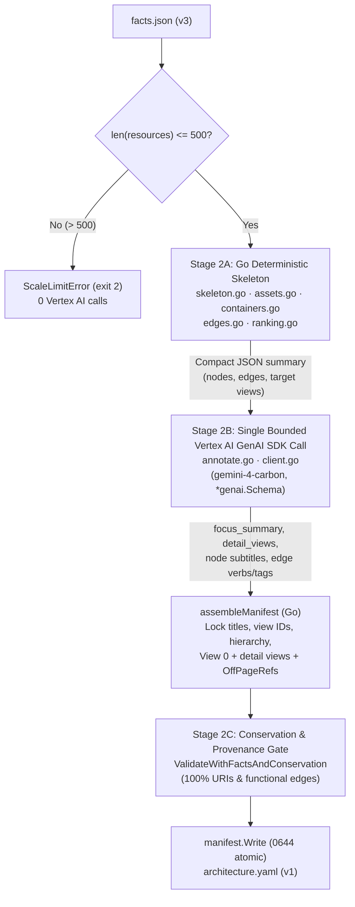
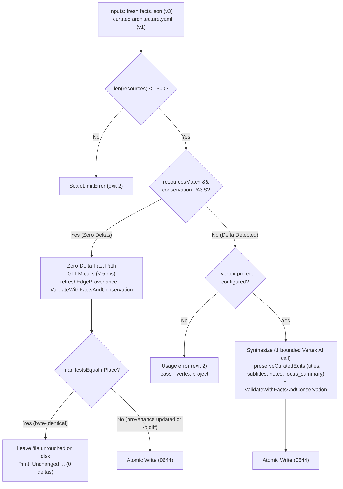

# Stage 2 — Gemini 4 Synthesis & Day-2 Reconciliation

Stage 2 (`gcp-arch synthesize <facts.json>`) transforms a sanitized, read-only `v3` `facts.json` snapshot produced by [Stage 1 — Read-Only Extraction](extraction.md) into a Git-tracked, deterministic `v1` `architecture.yaml` manifest ([`internal/manifest/types.go`](https://github.com/arrase/gcp-arch/blob/main/internal/manifest/types.go)). Rather than prompting an LLM to invent graph topology or raw URIs, Stage 2 executes a **single unified synthesis pipeline**: Go deterministically builds the complete GCP containment skeleton, enriches it with **one bounded Vertex AI Gemini 4 call** (`google.golang.org/genai` with `cloud.google.com/go/auth`), assembles `View 0` plus stage-partitioned detail views, and enforces 100% resource/edge conservation and directed-walk provenance.

On Day 2, `gcp-arch synthesize --reconcile` synchronizes fresh cloud facts into your curated `architecture.yaml` in place—finishing in **`< 5 ms` with `0` Vertex AI calls** when unchanged, and preserving human-curated titles, subtitles, and `notes` when infrastructure deltas trigger re-synthesis.

---

## Quick Usage

=== "Day-1 Synthesis"

    Generate a brand-new multi-view `architecture.yaml` from an extracted `v3` `facts.json`:
    ```bash
    gcp-arch synthesize facts.json \
      --vertex-project my-vertex-project \
      -o architecture.yaml
    ```

=== "Day-2 Reconciliation"

    Reconcile fresh `facts.json` into an existing Git-tracked manifest in place (omitting `-o/--out` updates `--reconcile` atomically in place):
    ```bash
    gcp-arch synthesize facts.json \
      --reconcile architecture.yaml \
      --vertex-project my-vertex-project
    ```

=== "Model & Reasoning Tuning"

    Override the default Gemini 4 model, Vertex location, or reasoning effort:
    ```bash
    gcp-arch synthesize facts.json \
      --vertex-project my-vertex-project \
      --vertex-location global \
      --model gemini-4-carbon \
      --thinking-level high \
      -o architecture.yaml
    ```

### CLI Flags & Config Precedence

Settings resolve in standard precedence order: **CLI flags > `~/.config/gcp-arch/config.yaml` > built-in defaults** ([`cmd/gcp-arch/synthesize.go`](https://github.com/arrase/gcp-arch/blob/main/cmd/gcp-arch/synthesize.go), [`cmd/gcp-arch/config.go`](https://github.com/arrase/gcp-arch/blob/main/cmd/gcp-arch/config.go); see [CLI & Configuration](cli_configuration.md)).

| Flag | Config Key (`config.yaml`) | Default | Description |
| :--- | :--- | :--- | :--- |
| `--vertex-project <ID>` | `vertex_project` | `""` | GCP billing project ID for Vertex AI Gemini calls. Required for Day-1 synthesis; optional on the 0-LLM Day-2 `--reconcile` fast path. |
| `--vertex-location <LOC>` | `vertex_location` | `global` | Vertex AI endpoint location (`synth.DefaultVertexLocation`). |
| `--model <ID>` | `model` | `gemini-4-carbon` | Vertex AI model identifier (`synth.DefaultVertexModel`). |
| `--thinking-level <LVL>` | `thinking_level` | `""` *(model default)* | Gemini thinking/effort level: `minimal`, `low`, `medium`, `high`, or `xhigh`. Omit to let Vertex AI apply the model default. |
| `--reconcile <FILE>` | — | `""` | Existing `architecture.yaml` file for Day-2 delta reconciliation. |
| `-o`, `--out <FILE>` | — | `architecture.yaml` *(or `--reconcile` path)* | Output manifest path. When `--reconcile` is set and `-o/--out` is omitted, updates write atomically in place. |
| `-q`, `--quiet` | — | `false` | Suppress informational stdout summary lines. |

---

## Pre-Synthesis Guardrail (`MaxActiveResources = 500`)

Both `synth.Synthesize` (Day 1, [`internal/synth/synth.go#L36-L66`](https://github.com/arrase/gcp-arch/blob/main/internal/synth/synth.go#L36-L66)) and `synth.Reconcile` (Day 2, [`internal/synth/reconcile.go#L22-L57`](https://github.com/arrase/gcp-arch/blob/main/internal/synth/reconcile.go#L22-L57)) enforce a hard ceiling of **`500` active resources** ([`MaxActiveResources = 500`](https://github.com/arrase/gcp-arch/blob/main/internal/synth/synth.go#L14)):

* If `len(facts.Resources) > 500`, Stage 2 returns `*synth.ScaleLimitError`, which maps directly to **CLI exit code `2`**.
* **Zero wasted Vertex ADC calls:** [`cmd/gcp-arch/synthesize.go#L22-L55`](https://github.com/arrase/gcp-arch/blob/main/cmd/gcp-arch/synthesize.go#L22-L55) wraps the Vertex AI client in a `lazyModelClient` (`sync.Once`) that defers `NewVertexClient` initialization until `GenerateJSON` / `GenerateJSONWithUsage` is actually called. Scale-limit checks run *before* any Vertex AI credentials are loaded or billed.

!!! warning "Exceeding the 500-Resource Ceiling"
    `gcp-arch` is engineered for focused, readable application-domain architecture dossiers rather than organization-wide inventory dumps. If extraction produces more than `500` active resources after Stage 1 plumbing folding, narrow your Stage 1 scope with `--projects` or `--folder` to a single application domain or platform boundary and re-run `gcp-arch extract`.

---

## Unified Synthesis Pipeline Architecture



### Stage 2A — Deterministic Containment Skeleton

Without making any LLM call, [`buildSkeleton`](https://github.com/arrase/gcp-arch/blob/main/internal/synth/skeleton.go#L67-L114) constructs the complete topological and visual skeleton directly from `facts.json`:

| Module | Source File | Deterministic Responsibilities |
| :--- | :--- | :--- |
| **Asset Classification** | [`internal/synth/assets.go`](https://github.com/arrase/gcp-arch/blob/main/internal/synth/assets.go) | Maps GCP/Kubernetes/external asset types to `ComponentKind`, `icon_key`, exposure defaults, structural container types, transversal governance categories (`IAM_SA`, `KMS`, `SECRET`, `OBSERVABILITY`, `NAT_ROUTER`, `FIREWALL_ARMOR`, `VPC_ACCESS`), and retry/DLQ role overrides. |
| **1:1 Plumbing Folds & Cohorts** | [`internal/synth/skeleton.go`](https://github.com/arrase/gcp-arch/blob/main/internal/synth/skeleton.go) | Folds 1:1 plumbing (`k8s.io/Service -> Deployment`, `Ingress -> Workload/LB`, `BackendService -> ForwardingRule`, `VpnGateway -> Tunnel`, `PubSub Subscription -> Topic`), groups homogeneous cohorts (such as Cloud Build triggers and identically wired sibling resources with 100% `members` retention), attaches badges and `inline_meta`, and separates transversal governance items. |
| **Containment Tree** | [`internal/synth/containers.go`](https://github.com/arrase/gcp-arch/blob/main/internal/synth/containers.go) | Builds unlimited-depth containment (`ORG > FOLDER > PROJECT > VPC > REGION > SUBNET > EXPOSURE_ZONE / GKE_CLUSTER / PSA_ZONE / HYBRID_ZONE / EXTERNAL_ZONE`), keeps Shared VPC hosts consolidated as a single `VPC` box with service-project badges, and scopes container IDs by region to prevent collisions. |
| **Edge Wiring & Orphan Bridging** | [`internal/synth/edges.go`](https://github.com/arrase/gcp-arch/blob/main/internal/synth/edges.go) | Maps `FactEdge`s to component-to-component flows, attaches transversal badges/references, records strict `structural_edges` (VPC peering, Shared VPC, PSA, PSC), and bridges structural orphans (Private DNS, NCC Hub spokes, Hybrid VPN/Interconnect, CI staging) with explicit `INFERRED` rationale. |
| **Topological Ranking & Ordering** | [`internal/synth/ranking.go`](https://github.com/arrase/gcp-arch/blob/main/internal/synth/ranking.go) | Runs Tarjan SCC detection (`tarjanCyclicSCCs`) to break cycles cleanly, applies longest-path `TopoRank` propagation (`propagateLongestTopoRank`) for left-to-right data/traffic flow, and runs 3-pass barycenter sub-ranking (`refineSubRanks`) to minimize wire crossings. |

---

## Vertex AI Gemini 4 SDK Client ([`internal/synth/client.go`](https://github.com/arrase/gcp-arch/blob/main/internal/synth/client.go))

Stage 2 uses the official Google GenAI Go SDK (`google.golang.org/genai`, configured with `genai.BackendVertexAI`) authenticated with `cloud.google.com/go/auth`:

| Property | Value / Behavior | Source |
| :--- | :--- | :--- |
| **SDK & Backend** | `google.golang.org/genai` (`genai.NewClient` with `Backend: genai.BackendVertexAI`, `Project`, `Location`, and optional `HTTPOptions.BaseURL`) | [`internal/synth/client.go#L131-L145`](https://github.com/arrase/gcp-arch/blob/main/internal/synth/client.go#L131-L145) |
| **OAuth Scope & ADC Detection** | `credentials.DetectDefault` scoped to `https://www.googleapis.com/auth/cloud-platform` via `cloud.google.com/go/auth/credentials` | [`internal/synth/client.go#L120-L129`](https://github.com/arrase/gcp-arch/blob/main/internal/synth/client.go#L120-L129); strictly separated from Stage 1's `cloud-platform.read-only` target discovery credentials |
| **Default Model & Location** | `gemini-4-carbon` (`DefaultVertexModel`) in `global` (`DefaultVertexLocation`) | [`internal/synth/client.go#L22-L23`](https://github.com/arrase/gcp-arch/blob/main/internal/synth/client.go#L22-L23) |
| **Sampling & Schema** | `Temperature: 0.1`, `ResponseMIMEType: "application/json"`, `ResponseSchema: annotationSchema()` (`*genai.Schema`) | [`internal/synth/client.go#L188-L193`](https://github.com/arrase/gcp-arch/blob/main/internal/synth/client.go#L188-L193) |
| **Timeouts & Transient Retries** | `240s` per-attempt timeout (`defaultVertexAttemptTimeout`), up to **`3` attempts** (`maxVertexAttempts = 3`) with exponential backoff (`2s`, `4s`) on `genai.APIError` `429`/`503`/`504`, `io.EOF`/`io.ErrUnexpectedEOF`, or timeout | [`internal/synth/client.go#L24-L27`](https://github.com/arrase/gcp-arch/blob/main/internal/synth/client.go#L24-L27), [`#L210-L228`](https://github.com/arrase/gcp-arch/blob/main/internal/synth/client.go#L210-L228), [`#L258-L270`](https://github.com/arrase/gcp-arch/blob/main/internal/synth/client.go#L258-L270) |
| **Thought Filtering & Telemetry** | `resp.Text()` excludes thought parts before JSON decoding; `UsageStats` captures prompt, candidate, thoughts, and total token counts from `resp.UsageMetadata` | [`internal/synth/client.go#L231-L248`](https://github.com/arrase/gcp-arch/blob/main/internal/synth/client.go#L231-L248) |
| **Zero-Token Model Probe** | [`ProbeVertexModel`](https://github.com/arrase/gcp-arch/blob/main/internal/synth/client.go#L274-L295) calls `google.golang.org/genai` `Models.Get(probeCtx, model, nil)` (`30s` timeout) | Plugged into `gcp-arch preflight` via `extract.VertexPreflightOptions.ModelProbe` at **0 token cost** |

### Thinking Level Options

[`ParseThinkingLevel`](https://github.com/arrase/gcp-arch/blob/main/internal/synth/client.go#L33-L50) normalizes case-insensitively and accepts five explicit levels plus the empty default:

| `--thinking-level` Value | SDK Enum (`genai.ThinkingLevel`) | Behavior |
| :--- | :--- | :--- |
| *(omitted / empty)* | `""` | Omits `ThinkingConfig` so Vertex AI applies the model's built-in default reasoning budget. |
| `minimal` | `genai.ThinkingLevelMinimal` | Minimal reasoning tokens for fastest latency. |
| `low` | `genai.ThinkingLevelLow` | Light reasoning for small, straightforward topologies. |
| `medium` | `genai.ThinkingLevelMedium` | Balanced reasoning depth and latency. |
| `high` | `genai.ThinkingLevelHigh` | Deep architectural reasoning for complex multi-project or Shared VPC graphs. |
| `xhigh` | `genai.ThinkingLevelXhigh` | Maximum reasoning depth. |

Passing any unrecognized value fails immediately with CLI exit code `2` before loading `facts.json` or initializing Vertex AI.

---

## Stage 2B — Bounded Annotation & Manifest Assembly ([`internal/synth/annotate.go`](https://github.com/arrase/gcp-arch/blob/main/internal/synth/annotate.go))

[`annotateSkeleton`](https://github.com/arrase/gcp-arch/blob/main/internal/synth/annotate.go#L171-L246) sends a compact summary of the deterministic skeleton (`scopes`, `target_detail_view_count`, `transversal_count`, `nodes`, `edges`) to Gemini 4 using [`annotationSchema`](https://github.com/arrase/gcp-arch/blob/main/internal/synth/annotate.go#L87-L130). The model is strictly bounded to returning:

1. `focus_summary` — concise architectural overview sentence for `View 0`.
2. `detail_views` — cohesive subsystem groupings (`view_slot` in `view_1..view_3`, `title`, `subtitle`, `focus_summary`, `node_ids`).
3. `node_enrichments` — concise subtitles per `node_id`.
4. `edge_enrichments` — action `verb` (`<= 14` chars, clamped to `<= 16` runes by `clampVerb`), `flow_kind` (`RUNTIME`, `CICD`, `ADMIN`), and `semantic_tag` (`ingress`, `traffic`, `data`, `async`, `retry`, `dlq`, `cicd`, `peering`, `hybrid`).

### Deterministic Locking & Multi-View Assembly

[`assembleManifest`](https://github.com/arrase/gcp-arch/blob/main/internal/synth/annotate.go#L248-L315) enforces structural stability in Go so repeated Vertex AI runs preserve identical containment, titles, view IDs, and connectivity:

* **Locked Structural Identity:** Node IDs, canonical titles, `backed_by` URIs, container tree, `TopoRank`, `SubRank`, `members`, `badges`, `transversal_items`, and `structural_edges` are owned by Go and cannot be altered or dropped by the model.
* **Annotation Sanitization (`cleanAnnotation`):** Rejects/strips `"..."`, Unicode ellipsis `…` (`U+2026`), and stray trailing punctuation/quotes before writing labels into YAML ([`internal/synth/annotate.go#L722-L769`](https://github.com/arrase/gcp-arch/blob/main/internal/synth/annotate.go#L722-L769)).
* **Deterministic `View 0` (`view_0_system_index`):** Always placed at `views[0]` with `archetype: layered_flow`, placing **100%** of primary components sorted by `(TopoRank, SubRank, ID)` together with all functional edges and `include_transversal_panel: true`.
* **Stage-Partitioned Detail Views (`targetDetailViewCount`):** Emits `0` detail views when `<= 14` primary nodes exist, `2` detail views (`view_1`, `view_2`) for `15..28` nodes, and `3` detail views (`view_1..view_3`) for `> 28` nodes ([`internal/synth/annotate.go#L156-L165`](https://github.com/arrase/gcp-arch/blob/main/internal/synth/annotate.go#L156-L165)). Any node omitted by the model is deterministically assigned via `stageDetailViewBucket` so every component appears in a detail view.
* **Symmetric Cross-View `off_page_refs` (`populateOffPageRefs`):** Automatically derives matching `OUT` and `IN` badges on placements whenever an edge crosses between detail views ([`internal/synth/annotate.go#L593-L691`](https://github.com/arrase/gcp-arch/blob/main/internal/synth/annotate.go#L593-L691)).

---

## Stage 2C — Deterministic Conservation & Provenance Gate

Before `Synthesize` returns, [`manifest.ValidateWithFactsAndConservation`](https://github.com/arrase/gcp-arch/blob/main/internal/manifest/validate.go#L128-L140) and [`manifest.VerifyConservation`](https://github.com/arrase/gcp-arch/blob/main/internal/manifest/conservation.go#L188-L240) mathematically verify the output manifest:

1. **100% Primary Resource Conservation:** Zero missing and zero hallucinated active `FactResource` URIs across `components[].backed_by`, `containers[].backed_by`, `transversal_items[].backed_by`, and `excluded_resources`.
2. **100% Functional & Transversal Edge Accounting:** Every functional `FactEdge` in `facts.json` must be represented in `View 0` edges, component/container folded edges, `structural_edges`, or transversal item attachments—never silently dropped.
3. **100% `View 0` Coverage (`view0=1.00`):** Every primary component in `manifest.components` is placed in `view_0_system_index`.
4. **Strict Directed-Walk Provenance ([`EvidenceIndex.WalkIssue`](https://github.com/arrase/gcp-arch/blob/main/internal/manifest/evidence.go#L81-L120)):** Every `VERIFIED` edge's `evidence_edge_ids` must form a connected, non-heuristic directed walk in `facts.Edges` from `from.backed_by` to `to.backed_by` without traversing container-backed or third-component URIs (and requiring `flow_kind: ADMIN` when backed solely by IAM/Workload Identity edges).

---

## Day-2 Reconciliation (`--reconcile`)

Implemented in [`internal/synth/reconcile.go`](https://github.com/arrase/gcp-arch/blob/main/internal/synth/reconcile.go): infrastructure evolves continuously while `architecture.yaml` accumulates human curation in Git (curated component/view titles, subtitles, `focus_summary`, and `notes`). `synth.Reconcile` implements two clean paths:



### 1. Zero-Delta Fast Path (`< 5 ms`, `0` LLM Calls)

Implemented in [`tryZeroDeltaFastPath`](https://github.com/arrase/gcp-arch/blob/main/internal/synth/reconcile.go#L75-L106):

* Verifies that the set of accounted URIs across `components`, `containers`, `transversal_items`, and `excluded_resources` matches `facts.Resources` 1:1 (`resourcesMatch`).
* Runs [`refreshEdgeProvenance`](https://github.com/arrase/gcp-arch/blob/main/internal/synth/reconcile.go#L180-L215) in place:
  * Valid `VERIFIED` edges remain untouched.
  * If a `VERIFIED` edge's `FactEdge.ID` shifted or broke, Go searches `idx.ShortestWalk(e.From, e.To)`; if a valid walk exists, `evidence_edge_ids` updates silently; otherwise the edge is downgraded to `INFERRED` with `"Not verifiable from facts.json: " + msg` rather than deleted.
  * Previously downgraded edges whose walk recovers are automatically restored to `VERIFIED`. Human-curated `INFERRED` edges are untouched.
* Validates conservation (`ValidateWithFactsAndConservation` for `layered_flow` manifests, or `hasUnsettledProjectedPair` + `ValidateWithFacts` for legacy `v1` manifests).
* Because `cmd/gcp-arch/synthesize.go` uses `lazyModelClient`, Vertex AI credentials are never loaded and `--vertex-project` is not required. When canonical marshaled YAML is unchanged in place (`manifestsEqualInPlace`), the file on disk is left untouched and stdout prints `Unchanged <file> (0 deltas)`.

### 2. Delta Re-Synthesis with Curated Edit Preservation

When added/removed resources or new structural/functional edges are detected:

* Runs `Synthesize` (deterministic skeleton + single bounded Vertex AI Gemini 4 call) to guarantee 100% resource and edge conservation against the updated `facts.json`.
* Calls [`preserveCuratedEdits`](https://github.com/arrase/gcp-arch/blob/main/internal/synth/reconcile.go#L217-L264) to carry forward human-curated `Title`, `Subtitle`, and `Notes` on every matching component ID, plus `Title`, `FocusSummary`, and non-auto-generated `Subtitle` on every matching view ID.
* Validates with `ValidateWithFactsAndConservation` and writes atomically via `manifest.Write` (`0644`).

---

## Related Documentation

* [Manifest Schema & Validation](manifest_schema.md) — Complete `architecture.yaml` (`v1`) specification and validation error codes.
* [Stage 3 — Offline Rendering & Routing](rendering.md) — Nested Flexbox rendering, Hanan-grid A* router, streaming PNG verification, and 1:1 vector PDF export.
* [CLI & Configuration](cli_configuration.md) — Exact `synthesize` flags, `config.yaml` defaults, and exit codes.
* [Security, IAM & Preflight](security_iam.md) — OAuth scope isolation between read-only discovery and `--vertex-project`.
