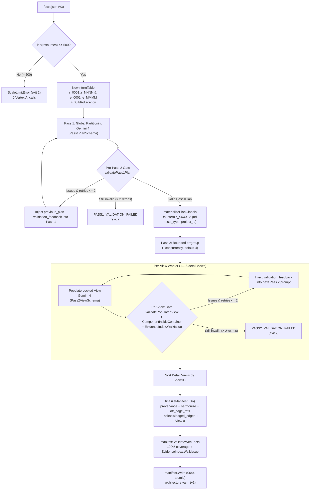
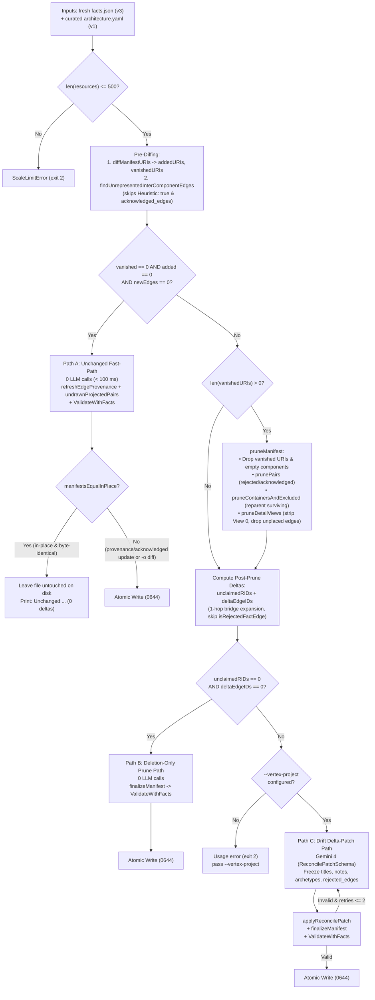

# Stage 2 — Gemini 4 Synthesis & Day-2 Reconciliation

Stage 2 (`gcp-arch synthesize <facts.json>`) converts a sanitized, read-only `v3` `facts.json` snapshot produced by [Stage 1 — Read-Only Extraction](extraction.md) into a Git-tracked, deterministic `v1` `architecture.yaml` manifest ([`internal/manifest/types.go`](https://github.com/arrase/gcp-arch/blob/main/internal/manifest/types.go)). Rather than prompting an LLM to draw unconstrained diagrams directly from raw cloud dumps, Stage 2 enforces a **closed-world two-pass synthesis pipeline** backed by short-ID interning, structured Vertex AI response schemas, deterministic Go finalization (`finalizeManifest`, including `off_page_refs`, `acknowledged_edges`, and `View 0` projection), and full post-synthesis provenance verification.

On Day 2, `gcp-arch synthesize --reconcile` diffs fresh cloud facts against your curated `architecture.yaml` in place—preserving human-edited titles, `notes`, `rejected_edges`, and view archetypes—and completes in **`< 100 ms` with `0` Vertex AI calls** when no resources or unacknowledged non-heuristic inter-component edges changed (as well as on deletion-only deltas).

---

## Quick Usage

=== "Day-1 Synthesis"

    Generate a brand-new multi-view `architecture.yaml` from an extracted `v3` `facts.json`:
    ```bash
    gcp-arch synthesize facts.json \
      --vertex-project consultant-ai-sandbox \
      -o architecture.yaml
    ```

=== "Day-2 Reconciliation"

    Reconcile fresh `facts.json` into an existing Git-tracked manifest in place (omitting `-o/--out` updates `--reconcile` atomically in place):
    ```bash
    gcp-arch synthesize facts.json \
      --reconcile architecture.yaml \
      --vertex-project consultant-ai-sandbox
    ```

=== "Model, Thinking & Concurrency Tuning"

    Override the default Gemini 4 model, Vertex location, reasoning effort, or Pass-2 worker pool:
    ```bash
    gcp-arch synthesize facts.json \
      --vertex-project consultant-ai-sandbox \
      --vertex-location global \
      --model gemini-4-carbon \
      --thinking-level high \
      --concurrency 4 \
      -o architecture.yaml
    ```

### CLI Flags & Config Precedence

Settings resolve in standard precedence order: **CLI flags > `~/.config/gcp-arch/config.yaml` > built-in defaults** ([`cmd/gcp-arch/synthesize.go`](https://github.com/arrase/gcp-arch/blob/main/cmd/gcp-arch/synthesize.go), [`cmd/gcp-arch/config.go`](https://github.com/arrase/gcp-arch/blob/main/cmd/gcp-arch/config.go); see [CLI & Configuration](cli_configuration.md)).

| Flag | Config Key (`config.yaml`) | Default | Description |
| :--- | :--- | :--- | :--- |
| `--vertex-project <ID>` | `vertex_project` | `""` | GCP billing project ID for Vertex AI Gemini calls. Required for Day-1 synthesis; optional on 0-LLM Day-2 `--reconcile` paths. |
| `--vertex-location <LOC>` | `vertex_location` | `global` | Vertex AI endpoint location (`synth.DefaultVertexLocation`). |
| `--model <ID>` | `model` | `gemini-4-carbon` | Vertex AI model identifier (`synth.DefaultVertexModel`). |
| `--thinking-level <LVL>` | `thinking_level` | `""` *(model default)* | Gemini thinking/effort level: `minimal`, `low`, `medium`, `high`, or `xhigh`. Omit to let Vertex AI apply the model default. |
| `--reconcile <FILE>` | — | `""` | Existing `architecture.yaml` file for Day-2 delta reconciliation. |
| `-o`, `--out <FILE>` | — | `architecture.yaml` *(or `--reconcile` path)* | Output manifest path. When `--reconcile` is set and `-o/--out` is omitted, updates write atomically in place. |
| `--concurrency <N>` | `concurrency` | `4` | Max concurrent Pass-2 per-view synthesis calls (`>= 1`, `synth.DefaultConcurrency`). |
| `-q`, `--quiet` | — | `false` | Suppress informational stdout summary lines. |

---

## Pre-Synthesis Guardrails & Token Efficiency

Before a single Vertex AI RPC is dispatched, Stage 2 enforces a strict resource scale guardrail and compacts the entire fact graph into deterministic short handles.

### 1. Hard Active-Resource Ceiling (`MaxActiveResources = 500`)

Both `synth.Synthesize` (Day 1) and `synth.Reconcile` (Day 2) enforce a hard ceiling of **`500` active resources** ([`MaxActiveResources = 500`](https://github.com/arrase/gcp-arch/blob/main/internal/synth/pipeline.go#L22-L27) in [`internal/synth/pipeline.go`](https://github.com/arrase/gcp-arch/blob/main/internal/synth/pipeline.go)).

* If `len(facts.Resources) > 500`, Stage 2 returns `*synth.ScaleLimitError`, which maps directly to **CLI exit code `2`**.
* **Zero wasted Vertex ADC calls:** [`cmd/gcp-arch/synthesize.go:22-40`](https://github.com/arrase/gcp-arch/blob/main/cmd/gcp-arch/synthesize.go#L22-L40) wraps the Vertex AI client in a `lazyModelClient` (`sync.Once`) that defers `NewVertexClient` initialization until `GenerateJSON` is actually called. Scale-limit checks run *before* any Vertex AI credentials are loaded or billed.

!!! warning "Exceeding the 500-Resource Ceiling"
    `gcp-arch` is engineered for focused, readable application-domain architecture dossiers rather than organization-wide inventory dumps. If extraction produces more than `500` active resources after Stage 1 plumbing folding, narrow your Stage 1 scope with `--projects` or `--folder` to a single application domain or platform boundary and re-run `gcp-arch extract`.

### 2. Deterministic Short-ID Interning ([`internal/synth/intern.go`](https://github.com/arrase/gcp-arch/blob/main/internal/synth/intern.go))

Raw GCP Cloud Asset Inventory URIs (such as `//container.googleapis.com/projects/acme-cicd/locations/europe-southwest1-b/clusters/cicd/k8s/namespaces/atlantis/apps/deployments/atlantis`) and 16-hex-character SHA-256 edge IDs inflate prompt/completion tokens and invite character-level transcription errors.

[`NewInternTable`](https://github.com/arrase/gcp-arch/blob/main/internal/synth/intern.go#L30-L78) builds an immutable, bidirectional mapping without mutating the source `FactsFile`:

1. **Resources (`r_0001`..`r_NNNN`):** Clones `facts.Resources`, sorts deterministically by `(URI, AssetType, ProjectID)`, and assigns sequential zero-padded handles `r_0001`, `r_0002`, ..., `r_NNNN`.
2. **Edges (`e_0001`..`e_MMMM`):** Clones `facts.Edges`, backfills any missing `ID` via `extract.EdgeID(Kind, FromURI, ToURI, Detail)` (first 16 hex characters of `SHA-256(kind + ":" + fromURI + ":" + toURI + ":" + detail)`), sorts deterministically by `(FromURI, ToURI, Kind, Detail, ID)`, and assigns `e_0001`, `e_0002`, ..., `e_MMMM`.
3. **Pass-1 Adjacency Projection (`BuildAdjacency`):** Emits a deduplicated, sorted adjacency map `r_XXXX -> [{to, kind}]` covering every `FactEdge` whose endpoints exist in the intern table. Pass 1 uses this compact structural graph instead of raw edge details to partition components and views cleanly.
4. **Canonical Un-Interning:** When materializing the manifest (`materializeComponent`, `materializeContainer`, `materializePlanGlobals`, `materializeEdge`), Go translates every `r_XXXX` back to its canonical `{uri, asset_type, project_id}` tuple and every `e_XXXX` back to its canonical 16-hex-character `FactEdge.ID` hash. Any handle not present in `InternTable` is immediately flagged as a validation error and never silently dropped or hallucinated into YAML.

---

## Vertex AI Gemini 4 Client & Structured Output

Stage 2 communicates with Vertex AI through the official Google GenAI Go SDK (`google.golang.org/genai`) in [`internal/synth/client.go`](https://github.com/arrase/gcp-arch/blob/main/internal/synth/client.go).

### Client Configuration, Credential Isolation & Model Probing

| Property | Value / Behavior | Source |
| :--- | :--- | :--- |
| **SDK Backend** | `genai.BackendVertexAI` | [`internal/synth/client.go:92-98`](https://github.com/arrase/gcp-arch/blob/main/internal/synth/client.go#L92-L98) |
| **OAuth Scope & ADC Detection** | `credentials.DetectDefault` scoped to `https://www.googleapis.com/auth/cloud-platform` (only invoked when both `opts.Credentials` and `opts.HTTPClient` are nil) | [`internal/synth/client.go:81-90`](https://github.com/arrase/gcp-arch/blob/main/internal/synth/client.go#L81-L90); strictly separated from Stage 1's `cloud-platform.read-only` target discovery credentials (see [Security, IAM & Preflight](security_iam.md)) |
| **Default Model** | `gemini-4-carbon` (`DefaultVertexModel`) | [`internal/extract/client.go:46`](https://github.com/arrase/gcp-arch/blob/main/internal/extract/client.go#L46) / [`internal/synth/client.go:19`](https://github.com/arrase/gcp-arch/blob/main/internal/synth/client.go#L19) |
| **Default Location** | `global` (`DefaultVertexLocation`) | [`internal/extract/client.go:44`](https://github.com/arrase/gcp-arch/blob/main/internal/extract/client.go#L44) / [`internal/synth/client.go:18`](https://github.com/arrase/gcp-arch/blob/main/internal/synth/client.go#L18) |
| **Sampling Temperature** | `0.1` (`float32(0.1)`) | Low-variance analytical decoding hardcoded in [`VertexClient.GenerateJSON`](https://github.com/arrase/gcp-arch/blob/main/internal/synth/client.go#L124-L147) (with `SystemInstruction` attached via `genai.NewContentFromText(systemPrompt, genai.RoleUser)` at [`line 127`](https://github.com/arrase/gcp-arch/blob/main/internal/synth/client.go#L127)) |
| **Response MIME Type** | `application/json` | Paired with an explicit non-recursive `genai.Schema` (`ResponseSchema`) |
| **Thinking Config** | Optional `genai.ThinkingConfig{ThinkingLevel}` | Only attached when `--thinking-level` (or `config.yaml` `thinking_level`) is non-empty |
| **Zero-Token Model Probe** | [`ProbeVertexModel`](https://github.com/arrase/gcp-arch/blob/main/internal/synth/client.go#L149-L168) calls `client.Models.Get(ctx, model, nil)` | Used by `gcp-arch preflight` via `extract.VertexPreflightOptions.ModelProbe` to verify model availability without generating tokens |

### Thinking Level Options

[`ParseThinkingLevel`](https://github.com/arrase/gcp-arch/blob/main/internal/synth/client.go#L41-L58) normalizes case-insensitively and accepts five explicit levels plus the empty default:

| `--thinking-level` Value | SDK Constant | Behavior |
| :--- | :--- | :--- |
| *(omitted / empty)* | `""` | Omits `ThinkingConfig` so Vertex AI applies the model's built-in default reasoning budget. |
| `minimal` | `genai.ThinkingLevelMinimal` | Minimal reasoning tokens for fastest latency. |
| `low` | `genai.ThinkingLevelLow` | Light reasoning for small, straightforward topologies. |
| `medium` | `genai.ThinkingLevelMedium` | Balanced reasoning depth and latency. |
| `high` | `genai.ThinkingLevelHigh` | Deep architectural reasoning for complex multi-project or Shared VPC graphs. |
| `xhigh` | `genai.ThinkingLevelXhigh` | Maximum reasoning depth. |

Passing any unrecognized value fails immediately with CLI exit code `2` before loading `facts.json` or initializing Vertex AI.

### Non-Recursive Structured `ResponseSchema` Design

[`internal/synth/schemas.go`](https://github.com/arrase/gcp-arch/blob/main/internal/synth/schemas.go) defines three flat, non-recursive `genai.Schema` contracts so Vertex AI constrained decoding guarantees syntactically valid JSON matching Go's unmarshal structs:

| Schema Function | Stage / Mode | Top-Level JSON Fields |
| :--- | :--- | :--- |
| **`Pass1PlanSchema()`** | Day 1 — Pass 1 | `components`, `container_defs`, `excluded_resources`, `detail_views` (all required) |
| **`Pass2ViewSchema()`** | Day 1 — Pass 2 *(per view)* | `container_ids`, `placements`, `edges` (all required; `Pass2Placement` has no `off_page_refs`—those are derived deterministically in Go by [`deriveOffPageRefs`](https://github.com/arrase/gcp-arch/blob/main/internal/synth/finalize.go#L132-L191)) |
| **`ReconcilePatchSchema()`** | Day 2 — `--reconcile` Path C | `append_backed_by`, `append_container_backed_by`, `new_components`, `new_containers`, `new_excluded_resources`, `new_placements`, `new_edges`, `new_views` (all optional) |

Strict schema-level enums (`Format: "enum"`) are enforced directly inside constrained decoding for all **6** fixed vocabularies ([`internal/synth/schemas.go:136-174`](https://github.com/arrase/gcp-arch/blob/main/internal/synth/schemas.go#L136-L174)):

* `component_kind` (8 values): `EXTERNAL_CALLER`, `INGRESS`, `WORKLOAD`, `PIPELINE`, `MESSAGING`, `DATASTORE`, `COHORT`, `EXTERNAL_TARGET`
* `kind` (6 container kinds): `PROJECT`, `VPC`, `GKE_CLUSTER`, `PSA_ZONE`, `EXTERNAL_ZONE`, `SHARED_HUB`
* `archetype` (3 values): `landscape_matrix`, `stage_pipeline`, `hub_spoke`
* `accent_mode` (3 values): `RUNTIME`, `CICD`, `MIXED`
* `flow_kind` (3 values): `RUNTIME`, `CICD`, `ADMIN`
* `provenance` (2 values): `VERIFIED`, `INFERRED`

!!! info "Why `icon_key` Is Typed as `STRING` Instead of an 85-Value Schema Enum"
    The embedded icon registry ([`internal/icons/assets/icons.yaml`](https://github.com/arrase/gcp-arch/blob/main/internal/icons/assets/icons.yaml)) contains **85** registered SVG icon slugs. Embedding an 85-branch enum inside a repeated object field in a Vertex AI `ResponseSchema` causes constrained-decoding grammar state explosion and slower schema compilation. Instead, `componentSchema()` keeps `icon_key` as `genai.TypeString`, `Pass1SystemPrompt` and `ReconcileSystemPrompt` inject the sorted list of all 85 valid slugs from `reg.ValidKeys()`, and Go validates every returned `icon_key` via `reg.Has(c.IconKey)`—feeding exact offending slugs back into the retry loop if the model ever drifts.

---

## Day-1 Two-Pass Synthesis Pipeline

Splitting Day-1 synthesis into **Pass 1 (Global Partitioning)** and **Pass 2 (Bounded Parallel Per-View Synthesis)** keeps every LLM call focused on a compact, bounded context window while preventing cross-view inconsistencies.



### Pass 1 — Global Partitioning & Pre-Pass-2 Gate

Pass 1 receives the global resource list built by [`BuildPass1UserPrompt`](https://github.com/arrase/gcp-arch/blob/main/internal/synth/prompts.go#L109-L141) (`scopes`, `hierarchy`, `resources`, deduplicated `adjacency`, plus `previous_plan` (`json.RawMessage`) and `validation_feedback` on retries) and produces a `Pass1Plan` declaring all logical `components`, `container_defs`, `excluded_resources`, and `detail_views` (each with a locked list of `component_ids`).

**Closed-world rules enforced in [`Pass1SystemPrompt`](https://github.com/arrase/gcp-arch/blob/main/internal/synth/prompts.go#L16-L32):**

1. **100% Resource Accounting (`1:1`):** Every `r_XXXX` in `input.resources` MUST appear in **exactly one** of `components[].backed_by_ids`, `container_defs[].backed_by_ids`, or `excluded_resources[].resource_id`—never in two places ([`prompts.go:24`](https://github.com/arrase/gcp-arch/blob/main/internal/synth/prompts.go#L24)).
2. **1:1 Folding:** Dedicated 1:1 `ServiceAccount`, `Secret`, `CryptoKey`, `Ingress`, `k8s.io/Service`, and `ForwardingRule` resources are folded into their owning workload or ingress component's `backed_by_ids`, surfacing concise attributes in `inline_meta` (maximum **4** rows per card).
3. **Stateful Datastore Homogeneity & Non-Exclusion:** Distinct stateful datastore asset types from the 15-type datastore set (see [Stateful Datastore Homogeneity](manifest_schema.md#stateful-datastore-homogeneity)) may never be mixed inside a single component's `backed_by_ids`, and **no stateful datastore may be placed in `excluded_resources`** (diagram it in a component or `COHORT` instead).
4. **Focused Detail Views (`1..16`):** Partition into `1..16` cohesive detail views ([`maxDetailViews = 16`](https://github.com/arrase/gcp-arch/blob/main/internal/synth/pipeline.go#L26), [`schemas.go:307`](https://github.com/arrase/gcp-arch/blob/main/internal/synth/schemas.go#L307)) targeting `6–12` components each (hard cap `1..12` blocks per view). Pass 1 must **never** emit `view_0_system_index` (Go projects `View 0` deterministically), every view ID must be distinct from every component ID, and every component must appear in at least one detail view.
5. **Flat Containers (`depth <= 2`):** Define visual grouping frames (`PROJECT`, `VPC`, `GKE_CLUSTER`, `PSA_ZONE`, `EXTERNAL_ZONE`, `SHARED_HUB`) with parent nesting depth `<= 2`. VPC and GKE Cluster `r_XXXX` handles are accounted for via `container_defs[].backed_by_ids` or dedicated hub components.
6. **Archetype Selection:** Assign `stage_pipeline` for CI/CD and ETL pipelines, `hub_spoke` for VPC/PSA/PSC networking topologies, or `landscape_matrix` for application and ingress landscapes.
7. **Valid Icon Slugs:** Choose `icon_key` strictly from the 85 sorted keys injected from `icons.Registry.ValidKeys()`.

**Pre-Pass-2 Validation Gate ([`validatePass1Plan`](https://github.com/arrase/gcp-arch/blob/main/internal/synth/pipeline.go#L182-L385)):**

Before launching any Pass-2 view workers, Go verifies:

* Non-empty, unique component IDs; non-empty component titles; valid `icon_key` in `icons.Registry`; non-empty `backed_by_ids`; `<= 4` `inline_meta` rows; all `r_XXXX` handles exist in `InternTable`; stateful datastore homogeneity across the 15 datastore asset types.
* Non-empty, unique container IDs; all `backed_by_ids` exist in `InternTable`; valid `parent_container_id`; zero parent cycles; global nesting depth `<= 2`.
* All `excluded_resources` reference valid `r_XXXX` handles, carry a non-empty audit `reason`, and **contain zero stateful datastore asset types** ([`validatePass1Excluded`](https://github.com/arrase/gcp-arch/blob/main/internal/synth/pipeline.go#L310-L327)).
* **Exact `1:1` resource coverage:** [`resourceClaims.claim`](https://github.com/arrase/gcp-arch/blob/main/internal/synth/pipeline.go#L192-L202) rejects any `r_XXXX` claimed in more than one place, and `validatePass1ResourceCoverage` lists any unaccounted `r_XXXX` handles verbatim in the retry feedback.
* **`1..16` detail views** ([`pipeline.go:344-346`](https://github.com/arrase/gcp-arch/blob/main/internal/synth/pipeline.go#L344-L346)); unique, non-empty view IDs never equal to `view_0_system_index` and **disjoint from all component IDs** ([`pipeline.go:368-370`](https://github.com/arrase/gcp-arch/blob/main/internal/synth/pipeline.go#L368-L370)); `1..12` valid component IDs per view; zero unplaced components across the suite.

If any issue is found (or JSON fails to unmarshal), [`runPass1`](https://github.com/arrase/gcp-arch/blob/main/internal/synth/pipeline.go#L138-L168) retries Pass 1 up to **`maxValidationRetries = 2` times** (**3 total attempts**), sending both the rejected `previous_plan` (`json.RawMessage`, cleared on JSON syntax failure) and the exact offending IDs and messages inside `validation_feedback` so Gemini corrects only what failed. Exhausting retries returns a `*manifest.ValidationError` with code `PASS1_VALIDATION_FAILED` (CLI exit code `2`).

---

### Pass 2 — Bounded Parallel Per-View Synthesis

Once Pass 1 clears its gate, `materializePlanGlobals` un-interns components, containers, and excluded resources into canonical manifest structs, and `pass2Runner.populateViews` dispatches one Pass-2 worker per detail view inside a bounded `errgroup.WithContext` (`g.SetLimit(concurrency)`, default `4`).

Each view receives a tightly scoped, deterministic 7-field JSON payload built by [`BuildPass2UserPrompt`](https://github.com/arrase/gcp-arch/blob/main/internal/synth/prompts.go#L144-L184):

| Payload Field | Contents |
| :--- | :--- |
| `view` | Locked `Pass1DetailView` header (`id`, `title`, `subtitle`, `archetype`, `accent_mode`, `component_ids`). |
| `max_column` | `4` for `landscape_matrix` / `stage_pipeline`; `2` for `hub_spoke`. |
| `components` | Sorted `Pass1Component` definitions assigned to this view. |
| `container_defs` | Global container definitions available to activate in this view. |
| `resources` | `internedResourceDesc` records for resources backing this view's components plus any bridge resources referenced by `incident_edges`. |
| `incident_edges` | Interned `e_XXXX` `internedEdgeDesc` records (`id`, `from_id`, `to_id`, `kind`, `detail`, and optional `heuristic`, [`prompts.go:80-87, 225`](https://github.com/arrase/gcp-arch/blob/main/internal/synth/prompts.go#L80-L87)) where both endpoints belong to this view's components, **or** one endpoint belongs to this view and the other belongs to the bridge set (`excluded_resources` + `container_defs[].backed_by_ids`). Although bridge edges are supplied for architectural context, `VERIFIED` directed walks may traverse only endpoint-owned or unowned/excluded resources and are **strictly forbidden** from traversing container-backed resources (`containerURIs`, such as a GKE cluster or VPC) or any third component's URIs ([`evidence.go:18-21, 60-72, 92-94`](https://github.com/arrase/gcp-arch/blob/main/internal/manifest/evidence.go#L18-L21), [`prompts.go:44`](https://github.com/arrase/gcp-arch/blob/main/internal/synth/prompts.go#L44)). |
| `validation_feedback` | Exact error messages from the previous attempt on retries (`omitempty`). |

**Per-View Validation Gate ([`validatePopulatedView`](https://github.com/arrase/gcp-arch/blob/main/internal/synth/pipeline.go#L614-L788)) & Final Assembly:**

Each worker un-interns `e_XXXX` handles via `materializeEdge` and validates:

* Active `container_ids` exist and have nesting depth `<= 2` within the view.
* `1..12` placements; every locked `component_id` placed exactly once; `container_id` (if set) is listed in `container_ids` and passes [`manifest.ComponentInsideContainer`](https://github.com/arrase/gcp-arch/blob/main/internal/manifest/validate.go#L188-L208) ([`pipeline.go:498, 716-718`](https://github.com/arrase/gcp-arch/blob/main/internal/synth/pipeline.go#L716-L718)), verifying `parent_uri` ancestry when placed inside a resource-backed container; `0 <= column <= max_column`. *(Pass 2 does not emit `off_page_refs`; they are derived deterministically in Go by `deriveOffPageRefs` during finalization.)*
* Every edge's `from` and `to` are placed in the view; `verb` is `1..16` UTF-8 runes; shared `via_bus_id` groups never mix multiple distinct sources AND multiple distinct targets; `VERIFIED` edges pass [`manifest.EvidenceIndex.WalkIssue`](https://github.com/arrase/gcp-arch/blob/main/internal/manifest/evidence.go#L76-L104) ([`pipeline.go:777`](https://github.com/arrase/gcp-arch/blob/main/internal/synth/pipeline.go#L777)); `INFERRED` edges supply a non-empty `inference_rationale`.

Each view retries independently up to **`2` retries** (**3 total attempts**), returning `PASS2_VALIDATION_FAILED` on exhaustion. After all workers finish ([`pipeline.go:88-105`](https://github.com/arrase/gcp-arch/blob/main/internal/synth/pipeline.go#L88-L105)):

1. Detail views are sorted deterministically by `View.ID`.
2. `Metadata.GeneratedAt` is set from `opts.GeneratedAt` if specified, else `facts.ReadTime`, else current UTC RFC 3339 timestamp.
3. [`finalizeManifest`](https://github.com/arrase/gcp-arch/blob/main/internal/synth/finalize.go#L18-L25) runs all 5 deterministic post-synthesis steps (provenance refresh, cross-view harmonization, `off_page_refs` derivation, `acknowledged_edges` bookkeeping, and `View 0` projection).
4. The complete manifest must pass `manifest.ValidateWithFacts(m, facts, reg)` before `manifest.Write` atomically writes `architecture.yaml` (`0644`).

---

## Closed-World Guarantees & Directed-Walk Provenance

Stage 2 enforces three non-negotiable closed-world invariants across both Day-1 synthesis and Day-2 reconciliation:

1. **Zero Invented Resources:** Every resource handle (`r_XXXX`) and edge handle (`e_XXXX`) returned by Gemini 4 is checked against `InternTable`. Unknown handles immediately fail validation and trigger retry feedback.
2. **100% Resource Accounting:** Every active resource in `facts.Resources` MUST be accounted for exactly once across `components[].backed_by`, `containers[].backed_by`, or `excluded_resources` (with an explicit audit `reason`, never excluding a stateful datastore). Nothing can silently vanish from the architecture.
3. **Strict Directed-Walk Provenance (`EvidenceIndex.WalkIssue`):** Every edge in a detail view carries an explicit `provenance`:
   * **`VERIFIED`:** Must cite one or more `FactEdge.ID`s in `evidence_edge_ids`. Go verifies every `VERIFIED` edge through [`manifest.EvidenceIndex.WalkIssue`](https://github.com/arrase/gcp-arch/blob/main/internal/manifest/evidence.go#L76-L113), enforcing four rules:
     1. **No Heuristic Evidence:** Every cited `FactEdge` must exist in `facts.json` and have `Heuristic == false` ([`evidence.go:89-91`](https://github.com/arrase/gcp-arch/blob/main/internal/manifest/evidence.go#L89-L91)). Heuristic edges (single-target 22-service project IAM bindings, shared-SA BigQuery jobs, and all `MONITORING_TRAFFIC` edges) may back `INFERRED` edges only.
     2. **Blocked Container & Third-Component URIs:** Every cited edge's endpoints must pass `EvidenceIndex.usable` / `blocked` ([`evidence.go:60-72, 92-94`](https://github.com/arrase/gcp-arch/blob/main/internal/manifest/evidence.go#L60-L72)). Walks may traverse unowned/excluded resources, but are **strictly forbidden** from traversing container-backed resources (`containerURIs`, such as a GKE cluster or VPC) or any third component's `backed_by` URIs.
     3. **Dual-BFS Reachability ([`isValidDirectedWalk`](https://github.com/arrase/gcp-arch/blob/main/internal/manifest/validate.go#L831-L851)):** Builds forward adjacency (`FromURI -> ToURI`) and reverse adjacency (`ToURI -> FromURI`) strictly over the cited `evidence_edge_ids`, runs forward BFS from `from.backed_by` (`fwdReach`) and reverse BFS from `to.backed_by` (`bwdReach`), and verifies every cited edge satisfies `fwdReach[fe.FromURI] && bwdReach[fe.ToURI]`—guaranteeing connectivity with zero padded extraneous edges.
     4. **Permissions Are Not Traffic ([`permissionEdgeKinds`](https://github.com/arrase/gcp-arch/blob/main/internal/manifest/evidence.go#L12-L16) / [`permissionOnly`](https://github.com/arrase/gcp-arch/blob/main/internal/manifest/evidence.go#L106-L113)):** Whenever every cited `FactEdge` is `IAM_RESOURCE_BINDING` or `WORKLOAD_IDENTITY`, the walk proves access or identity only, so **`flow_kind` MUST be `ADMIN`** ([`evidence.go:100-113`](https://github.com/arrase/gcp-arch/blob/main/internal/manifest/evidence.go#L100-L113)).
   * **`INFERRED`:** Permitted when a real architectural relationship cannot be proven by non-heuristic structural facts (for example, application-level logic or heuristic Monitoring/IAM correlations). Must supply a non-empty `inference_rationale`, and renders as a dashed connector with a numbered footnote in [Stage 3 — Offline Rendering & Routing](rendering.md).

---

## Deterministic Post-Synthesis Finalization (`finalizeManifest`)

Before final validation, both Day-1 `Synthesize` ([`pipeline.go:100`](https://github.com/arrase/gcp-arch/blob/main/internal/synth/pipeline.go#L100)) and Day-2 `Reconcile` Paths B & C ([`pipeline.go:825, 957`](https://github.com/arrase/gcp-arch/blob/main/internal/synth/pipeline.go#L825)) invoke [`finalizeManifest`](https://github.com/arrase/gcp-arch/blob/main/internal/synth/finalize.go#L18-L25) to apply five deterministic Go passes over `manifest.NewEvidenceIndex(m.Components, m.Containers, facts.Edges)`:

1. **`refreshEdgeProvenance` ([`finalize.go:30-64`](https://github.com/arrase/gcp-arch/blob/main/internal/synth/finalize.go#L30-L64)):** Re-evaluates every detail-view edge against current `facts.Edges` using `idx.WalkIssue` and [`idx.ShortestWalk`](https://github.com/arrase/gcp-arch/blob/main/internal/manifest/evidence.go#L117-L148):
   * If a `VERIFIED` edge's walk still passes `WalkIssue`, it stays untouched.
   * If a `VERIFIED` edge's hash shifted or its old walk broke, Go attempts `ShortestWalk(e.From, e.To)`; if a valid walk passes `WalkIssue`, `evidence_edge_ids` is silently updated; otherwise the edge is **downgraded to `INFERRED`** with `inference_rationale: "Not verifiable from facts.json: " + msg` (and `evidence_edge_ids` cleared)—it is **never deleted**.
   * If a previously downgraded `INFERRED` edge (carrying prefix `"Not verifiable from facts.json: "`) now has a valid `ShortestWalk`, it is automatically upgraded back to `VERIFIED`. Human-curated `INFERRED` edges (without that prefix) are left untouched.
2. **`harmonizeCrossViewEdges` ([`finalize.go:73-91`](https://github.com/arrase/gcp-arch/blob/main/internal/synth/finalize.go#L73-L91)):** Walks detail views in sorted `View.ID` order and copies `verb`, `provenance`, `evidence_edge_ids`, and `inference_rationale` from the first occurrence of each `(from, to, flow_kind)` tuple so edges drawn in multiple detail views read identically everywhere.
3. **`deriveOffPageRefs` ([`finalize.go:132-191`](https://github.com/arrase/gcp-arch/blob/main/internal/synth/finalize.go#L132-L191)):** Deterministically rebuilds every detail placement's `off_page_refs` from non-rejected drawn edges and `idx.ProjectedPairs()` (`relatedPairs`). Component `c` in view `V` receives an `OUT` (`IN`) ref to every other detail view `W` placing component `d` (not shown in `V`) for pair `(c, d)` (`(d, c)`), ensuring cross-view links are symmetric by construction. Existing non-empty human-curated labels for `(target_view_id, direction)` are preserved; otherwise `truncateVerb` truncates the drawn verb (or target component title) to `<= 16` runes.
4. **`undrawnProjectedPairs` -> `AcknowledgedEdges` ([`finalize.go:195-207`](https://github.com/arrase/gcp-arch/blob/main/internal/synth/finalize.go#L195-L207), [`types.go:99, 164-167`](https://github.com/arrase/gcp-arch/blob/main/internal/manifest/types.go#L99)):** Records every sorted `(from, to)` pair in `idx.ProjectedPairs()` (non-heuristic `FactEdge`s connecting distinct components) that was neither drawn in a detail view nor tombstoned in `rejected_edges`. Storing these pairs in root-level `acknowledged_edges` prevents Day-2 `--reconcile` from re-prompting Gemini about intentionally undrawn pairs.
5. **`rebuildSystemIndex` ([`pipeline.go:1325-1336`](https://github.com/arrase/gcp-arch/blob/main/internal/synth/pipeline.go#L1325-L1336)):** Strips any existing `view_0_system_index` and prepends a fresh deterministic `View 0` from [`BuildSystemIndexView`](https://github.com/arrase/gcp-arch/blob/main/internal/synth/view0.go#L18-L60) whenever `>= 2` detail views exist.

---

## Deterministic `View 0` (`view_0_system_index`) Projection

`View 0` is **never generated by the LLM**. [`BuildSystemIndexView`](https://github.com/arrase/gcp-arch/blob/main/internal/synth/view0.go#L18-L60) projects it deterministically in Go during `finalizeManifest`.

### Trigger & Fixed Header

* **Trigger:** Created and pinned at `views[0]` if and only if **`>= 2` detail views** exist. For single-view manifests (`1` detail view), `BuildSystemIndexView` returns `nil` and `view_0_system_index` is omitted (matching `ValidateStructure`'s `UNEXPECTED_SYSTEM_INDEX_VIEW` rule).
* **Fixed Header:**
  * `id`: `view_0_system_index`
  * `title`: `System Index Map`
  * `subtitle`: `"<D> logical views across <C> architecture components"`
  * `archetype`: `landscape_matrix`
  * `accent_mode`: `MIXED`
  * `container_ids`: omitted (View 0 has no container boxes)

### 16-Slot Budget, Caller/Target Balancing & Archetype Column Assignment

View 0 supports up to **`16` placements** (`maxSystemIndexPlacements = 16`, [`view0.go:13, 105-153`](https://github.com/arrase/gcp-arch/blob/main/internal/synth/view0.go#L105-L153)):

1. **Detail Views** are selected first (sorted by `View.ID`, capped at `16`), leaving `remaining = max(0, 16 - len(detailViews))` slots for external actors.
2. **Balanced External Selection ([`collectView0Externals`](https://github.com/arrase/gcp-arch/blob/main/internal/synth/view0.go#L78-L119)):** Deduplicated, ID-sorted `EXTERNAL_CALLER` and `EXTERNAL_TARGET` components placed in detail views share the `remaining` slots. When `len(extCallers) + len(extTargets) > remaining` and `len(extTargets) > 0`, callers are capped at **`(remaining + 1) / 2`** so callers cannot starve targets, and targets fill up to `remaining - len(extCallers)`.
3. **Deterministic Placement Ordering ([`buildView0Placements`](https://github.com/arrase/gcp-arch/blob/main/internal/synth/view0.go#L121-L153)):** Placements are emitted in `[extCallers..., detailViews..., extTargets...]` order.

Each placed item is assigned to a deterministic column based on its role or detail-view archetype:

| Placed Entity | Column Index | Notes |
| :--- | :---: | :--- |
| `EXTERNAL_CALLER` component | `0` | Left-most entry actors (e.g., GitHub, Public Internet). |
| Detail view (`stage_pipeline`) | `1` | CI/CD, ETL, or streaming pipelines. |
| Detail view (`landscape_matrix`) | `2` | Application, GKE, or ingress landscapes (default fallback). |
| Detail view (`hub_spoke`) | `3` | Shared VPC, PSA, or PSC networking topologies. |
| `EXTERNAL_TARGET` component | `4` *(or `3`)* | Column `4` if **any** detail view uses `hub_spoke`; otherwise column `3`. |

### 3-Phase Summary Edge Projection

View 0 summary edges are deduplicated per directed `(from, to)` pair (first phase wins), ignore self-loops and unplaced endpoints, honor `rejected_edges`, receive `provenance: VERIFIED` without `evidence_edge_ids`, truncate verbs to `<= 16` UTF-8 runes (`truncateVerb`, falling back to `"cross-view flow"` if blank), and sort deterministically by `(From, To, FlowKind, Verb)`:

| Phase | Source Signal | Direction | `flow_kind` Resolution | Edge Verb |
| :--- | :--- | :--- | :--- | :--- |
| **1. External Flows** ([`addExternalEdges`](https://github.com/arrase/gcp-arch/blob/main/internal/synth/view0.go#L206-L219)) | Detail-view edges where `e.From == callerID` or `e.To == targetID` | `caller -> detailView` or `detailView -> target` | Highest priority across matching edges in the view: **`RUNTIME` > `CICD` > `ADMIN`** | Caller: `calls ingress` (`RUNTIME`), `triggers CI/CD` (`CICD`), `administers` (`ADMIN`). Target: `sends traffic` (`RUNTIME`), `deploys to` (`CICD`), `configures` (`ADMIN`). |
| **2. Off-Page `OUT` & `IN` Refs** ([`addOffPageEdges`](https://github.com/arrase/gcp-arch/blob/main/internal/synth/view0.go#L221-L257)) | First projects `direction == "OUT"` refs; then runs [`addIncomingOffPageEdges`](https://github.com/arrase/gcp-arch/blob/main/internal/synth/view0.go#L239-L257) in two passes—forward-first (`colOf[from] <= colOf[viewID]`), then remaining—to project `direction == "IN"` refs when no edge exists in either direction between the views | `OUT`: `sourceView -> ref.TargetViewID`; `IN`: `ref.TargetViewID -> dv.ID` | `flowFromAccent` of the source view (`CICD` if `AccentCICD`, else `RUNTIME`) | `truncateVerb(ref.Label)` |
| **3. Shared Components** ([`addSharedComponentEdges`](https://github.com/arrase/gcp-arch/blob/main/internal/synth/view0.go#L259-L283)) | Pair of detail views sharing at least one placed non-external component (neither `EXTERNAL_CALLER` nor `EXTERNAL_TARGET`) with no edge in either direction from Phases 1–2 | Lower-column view `->` higher-column view (ties broken by sorted `View.ID`) | `CICD` only if **both** views have `AccentMode == CICD`, else `RUNTIME` | `shared resources` |

---

## Day-2 Reconciliation (`--reconcile`)

Infrastructure evolves continuously, while architecture manifests accumulate valuable human curation in Git (custom titles, `notes`, `inline_meta`, placement ordering, `acknowledged_edges`, and `rejected_edges` tombstones). Running `gcp-arch synthesize facts.json --reconcile architecture.yaml` keeps the manifest synchronized without regenerating from scratch or wiping manual edits.

### Reconciliation Decision Flow



### Pre-Diffing & Heuristic/Acknowledged Churn Suppression

Before deciding whether an LLM call is needed, [`Reconcile`](https://github.com/arrase/gcp-arch/blob/main/internal/synth/pipeline.go#L796-L848) runs two deterministic checks:

1. **URI Diff ([`diffManifestURIs`](https://github.com/arrase/gcp-arch/blob/main/internal/synth/pipeline.go#L866-L888)):** Compares `facts.Resources` against all URIs accounted for in `components[].backed_by`, `containers[].backed_by`, and `excluded_resources` to produce `addedURIs` and `vanishedURIs`.
2. **Unrepresented Structural Inter-Component Edges ([`findUnrepresentedInterComponentEdges`](https://github.com/arrase/gcp-arch/blob/main/internal/synth/pipeline.go#L1453-L1474)):** Scans `table.EdgeIDs()` for edges connecting two distinct existing components `(fc, tc)` whose pair is neither drawn in a detail view, tombstoned in `rejected_edges`, nor recorded in `m.AcknowledgedEdges`. **All `Heuristic: true` `FactEdge`s are skipped** so transient Cloud Monitoring or heuristic IAM fluctuations never trigger LLM drift.

### The Three Execution Paths

#### Path A — Unchanged Fast-Path (`0` LLM Calls, `< 100 ms`)

* **Condition ([`pipeline.go:805-816`](https://github.com/arrase/gcp-arch/blob/main/internal/synth/pipeline.go#L805-L816)):** `len(vanishedURIs) == 0 && len(addedURIs) == 0 && len(findUnrepresentedInterComponentEdges(cur, table)) == 0`.
* **Behavior:** Builds `idx := manifest.NewEvidenceIndex(cur.Components, cur.Containers, facts.Edges)`, runs [`refreshEdgeProvenance`](https://github.com/arrase/gcp-arch/blob/main/internal/synth/finalize.go#L30-L64) (re-pointing shifted `FactEdge.ID` hashes via [`idx.ShortestWalk`](https://github.com/arrase/gcp-arch/blob/main/internal/manifest/evidence.go#L117-L148), downgrading lost `VERIFIED` walks to `INFERRED` with `"Not verifiable from facts.json: " + msg` without deleting them, upgrading recovered downgraded edges back to `VERIFIED`, and leaving human-curated `INFERRED` edges untouched), updates `cur.AcknowledgedEdges = undrawnProjectedPairs(cur, idx)`, and validates via `manifest.ValidateWithFacts` without invoking Vertex AI (`--vertex-project` is optional).
* **Disk Write Optimization ([`manifestsEqualInPlace`](https://github.com/arrase/gcp-arch/blob/main/cmd/gcp-arch/synthesize.go#L224-L237)):** When writing in place (`filepath.Clean(targetPath) == filepath.Clean(reconcilePath)`), the CLI compares canonical `manifest.Marshal` bytes before and after reconciliation. If byte-identical, the file on disk is **left completely untouched** (preserving mtime and producing zero Git diff) and stdout prints `Unchanged <file> (0 deltas)`. If `refreshEdgeProvenance` updated hashes/provenance, `acknowledged_edges` changed, or `-o` points to a different file, the reconciled manifest is written atomically—still with `0` LLM calls.

#### Path B — Deletion-Only Prune Path (`0` LLM Calls)

* **Condition ([`pipeline.go:818-833`](https://github.com/arrase/gcp-arch/blob/main/internal/synth/pipeline.go#L818-L833)):** Resources vanished (`len(vanishedURIs) > 0`), and after pruning, **`0` `unclaimedRIDs`** and **`0` `deltaEdgeIDs`** remain.
* **Pruning Cascade ([`pruneManifest`](https://github.com/arrase/gcp-arch/blob/main/internal/synth/pipeline.go#L972-L1120), executed only when `len(vanishedURIs) > 0`):**
  1. **`pruneComponents` (`979-993`):** Strips vanished URIs from `components[].backed_by` and removes any component whose `backed_by` becomes empty (`removedComps`).
  2. **`prunePairs` (`995-1005`):** Removes entries in `rejected_edges` and `acknowledged_edges` referencing any `removedComps`.
  3. **`pruneContainersAndExcluded` (`1010-1048`):** Drops vanished URIs from `containers[].backed_by` and `excluded_resources`. Any resource-backed container whose `backed_by` becomes empty is removed, and surviving child containers and placements are reparented to its nearest surviving ancestor container (or `""`).
  4. **`pruneDetailViews` (`1060-1120`):** Strips `view_0_system_index`, updates `view.container_ids` and placements for removed components/reparented containers, drops detail views whose `placements` become empty, and deletes **only edges with unplaced endpoints**. It never deletes `VERIFIED` edges with broken walks and does not touch `off_page_refs`—both are handled deterministically in the next step.
* **Completion:** Runs [`finalizeManifest(cur, facts)`](https://github.com/arrase/gcp-arch/blob/main/internal/synth/finalize.go#L18-L25) (refreshing provenance, harmonizing cross-view edges, re-deriving `off_page_refs`, refreshing `acknowledged_edges`, and rebuilding `View 0`), updates `cur.Metadata.GeneratedAt` if `opts.GeneratedAt != ""`, runs `ValidateWithFacts`, and atomically writes the pruned manifest with `0` Vertex AI calls (`--vertex-project` is optional).

#### Path C — Drift Delta-Patch Path (Vertex AI Gemini 4)

* **Condition ([`pipeline.go:835-847`](https://github.com/arrase/gcp-arch/blob/main/internal/synth/pipeline.go#L835-L847)):** One or more `unclaimed_resources` or `delta_edges` remain after any pruning.
* **Delta Edge Assembly & Frozen Curation Contract:** `findReconcileDeltaEdgeIDs` combines `findUnrepresentedInterComponentEdges` with [`addUnclaimedIncidentEdges`](https://github.com/arrase/gcp-arch/blob/main/internal/synth/pipeline.go#L1367-L1428) (including 1-hop bridge expansion through `excluded_resources` and `containers[].backed_by`, while filtering out rejected component pairs via [`isRejectedFactEdge`](https://github.com/arrase/gcp-arch/blob/main/internal/synth/pipeline.go#L1376-L1428)). [`BuildReconcileUserPrompt`](https://github.com/arrase/gcp-arch/blob/main/internal/synth/prompts.go#L285-L310) sends read-only summaries (`frozen_components`, `frozen_containers`, `existing_views` as [`reconcileViewCapacity`](https://github.com/arrase/gcp-arch/blob/main/internal/synth/prompts.go#L275-L283) carrying `id`, `title`, `archetype`, `max_column`, `remaining_capacity`, `container_ids`, and `placed_components`, plus `rejected_edges`) alongside `unclaimed_resources` and `delta_edges` (including `heuristic`). Existing view IDs, archetypes, curated component titles/subtitles/`icon_key`/`inline_meta`, `notes`, and `rejected_edges` are **strictly frozen** and cannot be overwritten by the patch.
* **Supported `ReconcilePatch` Operations ([`applyReconcilePatch`](https://github.com/arrase/gcp-arch/blob/main/internal/synth/pipeline.go#L1122-L1323)):**

| Patch Field | Effect on Existing Manifest |
| :--- | :--- |
| `append_backed_by` | Appends unique unclaimed resources to an existing component's `backed_by` without altering its title, subtitle, `inline_meta`, or `notes`. |
| `append_container_backed_by` | Appends unique unclaimed resources to an existing container's `backed_by`. |
| `new_components` | Registers brand-new components (rejects ID collisions with existing components). |
| `new_containers` | Registers brand-new containers (rejects ID collisions with existing containers). |
| `new_excluded_resources` | Appends unclaimed resources to `excluded_resources` with an audit `reason` (stateful datastores rejected during validation). |
| `new_placements` | Inserts placements into existing detail views that have `remaining_capacity > 0` (automatically adding `placement.container_id` to `view.container_ids` if needed). |
| `new_edges` | Appends new edges to existing detail views (strictly rejecting any `(from, to)` pair present in `rejected_edges`). |
| `new_views` | Creates overflow detail views (`1..12` placements, never `view_0_system_index`, no ID collisions, **`<= 16` total detail views**, and also strictly rejecting any edge whose `(from, to)` pair is in `rejected_edges`, [`pipeline.go:1301-1305`](https://github.com/arrase/gcp-arch/blob/main/internal/synth/pipeline.go#L1301-L1305)). |

* **Validation & Retries ([`tryApplyAndValidate`](https://github.com/arrase/gcp-arch/blob/main/internal/synth/pipeline.go#L951-L970)):** On each attempt (up to `2` retries / `3` total attempts), Go clones `cur`, applies the patch, runs **`finalizeManifest(candidate, r.facts)`** (plus optional `opts.GeneratedAt`), checks merge errors (`RECONCILE_INVALID_JSON` / `RECONCILE_MERGE_FAILED`), and validates the entire manifest via `manifest.ValidateWithFacts` (retaining exact `*manifest.ValidationError` issues or `RECONCILE_VALIDATION_FAILED`).

### `--vertex-project` & `-o/--out` Behavior Matrix

| Scenario | `--vertex-project` Required? | `-o / --out` Omitted Behavior | Stdout Summary *(unless `-q`)* | Failure Exit Code |
| :--- | :---: | :--- | :--- | :---: |
| **Day-1 synthesis** | **Yes** (checked before loading facts) | Writes `architecture.yaml` | `Wrote <out> (<V> views, <C> components)` | `2` if missing flag, `> 500` resources, or validation retry exhaustion; `1` on Vertex RPC/ADC error |
| **Day-2 Path A** *(0 deltas, identical)* | **Optional** | Leaves `--reconcile` file untouched on disk | `Unchanged <file> (0 deltas)` | `2` if existing manifest fails `ValidateWithFacts` |
| **Day-2 Path A** *(provenance or `acknowledged_edges` update)* | **Optional** | Updates `--reconcile` atomically in place | `Reconciled <file> (<V> views, <C> components)` | `2` on validation failure; `1` on write I/O failure |
| **Day-2 Path B** *(deletions only)* | **Optional** | Updates `--reconcile` atomically in place | `Reconciled <file> (<V> views, <C> components)` | `2` if pruned manifest fails `ValidateWithFacts` |
| **Day-2 Path C** *(new resources/edges)* | **Yes** (`client == nil` returns exit `2` with `pass --vertex-project`) | Updates `--reconcile` atomically in place | `Reconciled <file> (<V> views, <C> components)` | `2` if missing `--vertex-project`, `> 500` resources, or validation retry exhaustion; `1` on Vertex RPC/ADC error |

!!! tip "Safe CI Drift Detection Without Vertex AI Credentials"
    Because Paths A and B require **zero** Vertex AI credentials, you can run `gcp-arch synthesize fresh.facts.json --reconcile architecture.yaml` without `--vertex-project` in read-only drift-check jobs: exit code `0` confirms no new resources or unacknowledged structural edges appeared (or only clean deletions occurred), whereas exit code `2` with `vertex AI model client is required (pass --vertex-project)` pinpoints the exact count of unclaimed resources and new inter-component edges that need synthesis.

---

## Next Steps

* **Schema & Validation Rules:** Explore every field, enum, offline error code, and Day-2 manual curation rule in [Manifest Schema & Validation](manifest_schema.md).
* **Stage 3 Rendering:** Learn how `architecture.yaml` compiles offline into vector PDFs, `3x` PNGs, and HTML dossiers in [Stage 3 — Offline Rendering & Routing](rendering.md).
* **Stage 1 Inputs:** Review how `facts.json` (`v3`) resources, edges, and plumbing folding are constructed in [Stage 1 — Read-Only Extraction](extraction.md).
* **IAM & Preflight:** Check required Vertex AI permissions and zero-token model probes in [Security, IAM & Preflight](security_iam.md).
